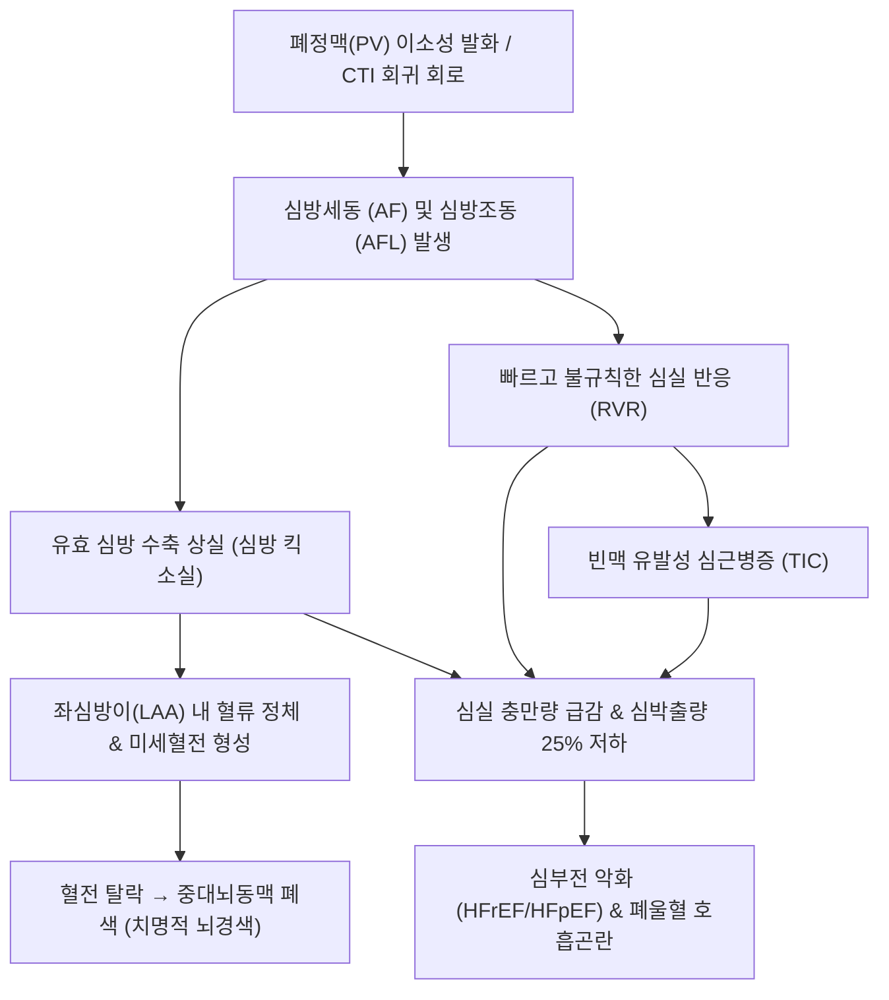

# 🩺 심방 세동 및 심방 조동 (Atrial Fibrillation & Atrial Flutter)

> **핵심 3줄 요약 (Key Summary)**:
> - 📍 병소 부위 & 해부·병태생리: 폐정맥(PV) 개구부의 이소성 전기 흥분 및 심방 다발성 미세 회귀(심방세동 AF), 또는 삼첨판 협부(CTI) 의존성 거대 회귀 회로(심방조동 AFL). 심방의 비효율적 떨림으로 인한 심박출량 20~30% 감소(심방 기여분 소실) 및 좌심방이(LAA) 혈류 정체에 의한 혈전 형성.
> - 🚩 전형적 임상 양상: 불규칙하고 빠른 심계항진("맥이 제멋대로 뜀"), 호흡곤란, 어지럼증, 피로감, 흉부 불쾌감, 맥박 결손(Pulse deficit). 심방조동은 $2:1$ 전도 시 약 150 bpm의 규칙적 빈맥.
> - 🛠️ 핵심 검사 & 치료 전략: 12유도 심전도(AF: P파 소실 + 미세 f파 + 불규칙한 R-R 간격; AFL: 톱니바퀴 모양 F파), 경흉부/경식도 심초음파(LAA 혈전 평가). 치료는 **ABC 경로(Anticoagulation, Better symptom control, Cardiovascular risk factors)**: $\text{CHA}_2\text{DS}_2\text{-VASc}$ 기반 NOAC 항응고, 맥박수 조절(베타차단제, CCB), 율동 조절(항부정맥제, 전기도자 절제술 RFCA).
> - ⚠️ 응급 의뢰 레드플래그: 심인성 뇌색전증(급성 뇌경색 증상: 편마비, 안면마비, 구음장애), 혈역학적 불안정(혈압 저하 $<90\text{ mmHg}$, 급성 폐부종, 협심통 $\rightarrow$ 즉각 응급 동기화 직류 심율동전환 DC Cardioversion), 조기흥분 증후군(WPW) 동반 광범위 빈맥.

---

## 📌 목차
1. [질환 개요 & 해부학적 병태생리](#1-질환-개요--해부학적-병태생리)
2. [병태생리 메커니즘 & 생체역학적 악순환 네트워크](#2-병태생리-메커니즘--생체역학적-악순환-네트워크)
3. [임상 증상 & 이학적 검사(Physical Exam) 알고리즘](#3-임상-증상--이학적-검사physical-exam-알고리즘)
4. [감별 진단 매트릭스 (Differential Diagnosis)](#4-감별-진단-매트릭스-differential-diagnosis)
5. [한의 통합 치료 프로토콜 (침·약침·추나·한약)](#5-한의-통합-치료-프로토콜-침약침추나한약)
6. [양방 치료 & 병용·의뢰 기준 (Conventional Treatment & Referral)](#6-양방-치료--병용의뢰-기준-conventional-treatment--referral)
7. [재활 운동 & 생활습관 티칭 가이드](#7-재활-운동--생활습관-티칭-가이드)
8. [💡 사용자 진료실 핵심 필기 & 임상 노하우 (Melt-In 잔여 심화 집약)](#8--사용자-진료실-핵심-필기--임상-노하우--melt-in-잔여-심화-집약)
9. [출처 및 학술 참고 문헌 (References)](#9-출처-및-학술-참고-문헌-references)

---

## 1. 질환 개요 & 해부학적 병태생리

심방세동(Atrial Fibrillation, AF)은 임상에서 가장 흔히 접하는 지속성 부정맥으로, 심방이 분당 400~600회의 극도로 빠르고 무질서한 전기 자극에 의해 조화로운 수축 없이 미세하게 떨리는 질환이다. 심방조동(Atrial Flutter, AFL)은 심방이 분당 240~340회의 규칙적인 거대 회귀 회로를 도는 질환이다.

### 해부학적 기전 및 혈전 형성 호발 부위
1. **심방세동의 발생 기전**:
   - **폐정맥(Pulmonary Veins, PV)**: 좌심방으로 들어오는 폐정맥 소매 부위의 심근 슬리브(Myocardial sleeve)에서 발생하는 빠른 이소성 흥분 발화(Ectopic triggers)가 전체 심방세동의 90% 이상을 촉발함.
   - **심방 구조적 리모델링**: 고혈압, 판막 질환, 노화 등으로 심방이 확장되고 간질 섬유화가 진행되어 다발성 미세 회귀파(Multiple wavelets)가 유지됨.
2. **심방조동의 발생 기전**:
   - 전형적 조동(Typical AFL): 우심방의 하대정맥-삼첨판 협부(Cavotricuspid isthmus, CTI)를 경계로 삼첨판륜을 반시계 방향(Counterclockwise)으로 회전하는 거대 회귀(Macro-reentry).
3. **좌심방이(Left Atrial Appendage, LAA)와 뇌색전증**:
   - 심방이 효과적으로 수축하지 못하면 좌심방 내강의 귀 모양 주머니인 **좌심방이(LAA)** 내부에서 혈류가 정체되어 와류와 울혈이 발생함.
   - 비판막성 심방세동 환자에서 발생하는 **혈전의 90% 이상이 좌심방이 내부에서 형성**되며, 떨어져 나가 뇌동맥을 막아 치명적인 대뇌경색(Cardioembolic stroke)을 유발함.

---

![[심방세동_01_도해_심장과심전도비교.jpg|450]]
> [그림 1: 심방세동 도해 — 좌심방(심방이) 부위를 강조한 심장 그림과 정상 심전도·심방세동 심전도를 나란히 비교한 그림. — 출처: File:Atrial Fibrillation.jpg (Wikimedia Commons)]

## 2. 병태생리 메커니즘 & 생체역학적 악순환 네트워크

### 1) 혈역학적 손상 및 혈전-색전증의 악순환
- **심방 기여분(Atrial Kick) 소실**:
  - 정상 심실 충만량의 20~30%는 심방 수축(심방 킥)에 의존함.
  - 심방세동 발생 시 심방 수축이 사라져 이완기 심실 충만량이 급감하고 심박출량이 20% 이상 떨어짐.
- **빈맥 유발성 심근병증 (Tachycardia-induced Cardiomyopathy)**:
  - 방실결절이 불규칙한 심방 자극을 걸러내지만, 치료받지 않은 급성기에는 심실 박동수가 분당 120~160회 이상으로 폭증함.
  - 지속적인 빈맥은 심실 이완기 시간을 단축시키고 심근 피로를 유발하여 가역적 박출률 저하 심부전을 초래함.
- **비르쇼 삼징후(Virchow's Triad)와 뇌졸중 위험 5배 증가**:
  - 심방 내 혈류 정체(Stasis) + 혈관내피 손상 + 전신 응고계 활성화로 혈전 형성.

---

![[심방세동_02_병태_심인성색전뇌졸중.jpg|450]]
> [그림 2: 심인성 색전 뇌졸중 도해 — 심장에서 생긴 혈전이 뇌혈관을 막아 뇌경색을 일으키는 경로를 그린 그림. — 출처: File:Atrial fib stroke.jpg (Wikimedia Commons)]

## 3. 임상 증상 & 이학적 검사(Physical Exam) 알고리즘

### 1) 주요 임상 증상
- **심계항진 (Palpitation)**: 가슴이 쿵쾅거리고 불규칙하게 덜컹거림.
- **피로감 및 호흡곤란**: 계단 보행 시 쉽게 지치고 숨이 참 (심박출량 저하).
- **무증상 (Silent AF)**: 환자의 30%는 증상을 느끼지 못하다가 건강검진 또는 급성 뇌경색 발생 후 처음 진단됨.

### 2) 이학적 검사 및 진단 검사 알고리즘
1. **맥박 촉지 및 청진 (Pulse Deficit)**:
   - 요골동맥 맥박이 **"완전히 불규칙하고 무질서함(Irregularly irregular)"**.
   - **맥박 결손(Pulse Deficit)**: 심장 청진으로 들리는 심박수보다 손목 요골동맥에서 촉지되는 맥박수가 적음 (불완전한 심실 충만으로 약하게 박출된 혈액이 말초까지 도달하지 못함).
2. **12유도 심전도 (Gold Standard)**:
   - **심방세동 (AF)**: 뚜렷한 P파 소실, 기저선의 불규칙한 미세 잔물결(Fibrillatory f waves, 분당 400~600회), **완전히 불규칙한 R-R 간격**.
   - **심방조동 (AFL)**: P파 대신 하벽 유도(II, III, aVF)에서 톱니바퀴 모양의 조동파(Sawtooth Flutter F waves, 분당 약 300회), 통상 2:1 또는 4:1의 규칙적 방실 전도.
3. **심초음파**: 좌심방 크기(LA enlargement), 판막 질환, 박출률(LVEF) 평가.
4. **뇌졸중 위험도 평가 ($\text{CHA}_2\text{DS}_2\text{-VASc}$ Score)**:
   - 울혈성 심부전(1), 고혈압(1), 75세 이상(2), 당뇨병(1), 뇌졸중/TIA(2), 혈관질환(1), 65~74세(1), 여성(1).
   - **남성 $\ge 2$점, 여성 $\ge 3$점**: 경구 항응고제(NOAC) 투여 강력 권고.

---

![[심방세동_03_심전도_12유도심방세동.png|450]]
> [그림 3: 12유도 심전도 — P파가 보이지 않고 RR 간격이 불규칙한 심방세동 소견을 보여주는 판독용 그림. — 출처: File:Atrial Fibrillation.png (Wikimedia Commons)]

![[심방세동_04_심전도_심방조동.jpg|450]]
> [그림 4: 12유도 심전도 — 톱니 모양의 규칙적인 심방파(F파)가 보이는 심방조동 소견. — 출처: File:Aflut.jpg (Wikimedia Commons)]

## 4. 감별 진단 매트릭스 (Differential Diagnosis)

| 감별 질환 | 심전도 리듬 규칙성 | P파 소견 | 심박수 특성 | 감별 핵심 포인트 |
| :--- | :--- | :--- | :--- | :--- |
| **심방세동 (AF)** | **완전히 불규칙 (Irregularly irregular)** | **P파 없음, 미세 f파** | 심실수 $100\sim 160$ 가변적 | 불규칙한 R-R, 맥박 결손, 뇌졸중 위험 |
| **심방조동 (AFL)** | 대개 규칙적 ($2:1, 4:1$) | **톱니바퀴 F파 (분당 300)** | $2:1$ 전도 시 약 150 bpm | 하벽 유도 톱니바퀴 음영, CTI 전극도자 절제 완치 |
| **[[심방 조기 박동]] (PAC)** | 기본 동율동에 간헐적 불규칙 | 조기 P파 존재 (변형된 형태) | 정상 기저 맥박 사이 조기 박동 | 간헐적 발생, 기저 율동은 정상 P-QRS |
| **발작성 상심실성 빈맥 ([[PSVT]])** | **완벽히 규칙적 (Regular)** | P파가 QRS 속에 묻히거나 역위 | $150\sim 220\text{ bpm}$ | 발작적 시작과 정지, 발살바법/아데노신 종결 |
| **동성 빈맥 (Sinus Tachycardia)** | 완벽히 규칙적 | 정상 형태의 P파 선행 | $100\sim 150\text{ bpm}$ | 생리적 반응 (운동, 발열, 통증, 빈혈 등) |

---

![[심방세동_05_심전도_리듬스트립.png|450]]
> [그림 5: 심방세동 리듬 기록 — 종이 심전도 스트립에 불규칙한 RR 간격을 표시한 그림. — 출처: A Classification and Prediction Hybrid Model Construction with the IQPSO-SVM Algorithm for Atrial Fibrillation Arrhythmia. PMID 34372459 (CC BY)]

## 5. 한의 통합 치료 프로토콜 (침·약침·추나·한약)

> ⚠️ **심방세동 관리의 안전 원칙**:
> 심방세동의 가장 치명적인 합병증은 뇌색전증(중풍)이다. **$\text{CHA}_2\text{DS}_2\text{-VASc}$ 점수에 따라 처방된 양방 항응고제(NOAC/와파린) 복용을 절대 임의 중단시켜서는 안 된다.**
> 한의 치료는 **항응고 요법을 철저히 유지하는 바탕 위에서, 맥박수 안정, 심계항진 완화, 피로 및 흉민 개선, 자율신경계 조절을 위한 보조 요법**으로 안전하게 적용한다.

### 1) 침구 치료 프로토콜
- **진심안신(鎭心安神) 및 평간청열(平肝淸熱)**:
  - [[내관]](PC6), [[신문]](HT7): 심포경 및 심경을 안정시켜 심계항진 진정 및 미주신경 톤 회복.
  - [[단중]](CV17), [[심수]](BL15): 기회(氣會) 및 배수혈로 흉민, 심장 박동감 완화.
  - [[족삼리]](ST36), [[삼음교]](SP6): 기혈 순환 개선, 하지 정맥 울혈 예방.
  - [[태충]](LR3), [[풍지]](GB20): 교감신경 긴장 완화, 스트레스성 발작 억제.

### 2) 항응고제 복용 환자 침 시술 주의사항
- NOAC(엘리퀴스, 자렐토 등) 또는 와파린 복용 환자는 출혈 경향이 있으므로, **발침 후 압박 지혈(최소 2~3분 이상)을 철저히 시행**하며 깊은 근육층 자침이나 강한 습식 부항(사혈)은 금기.

### 3) 한약 처방 (변증별 가감)
- **심음부족·허화상염(心陰不足·虛火上炎)형 (심계, 가슴 답답함, 불면, 식은땀, 번열)**:
  - **천왕보심단(天王補心丹)** 또는 **자감초탕(炙甘草湯) 가감**:
  - 결대맥(結代脈: 맥이 건너뛰고 불규칙함)을 치료하는 대표 처방.
  - 처방 구성: [[자감초]](대량 12~20g), [[생지황]], [[인삼]], [[맥문동]], [[아교]], [[마자인]], [[계지]], [[생강]], [[대추]].
- **기체혈어(氣滯血瘀)형 (흉부 자통, 흉민, 지두 청자색, 설자 암반)**:
  - **혈부축어탕(血府逐瘀湯) 가감**:
  - 미세혈관 순환을 개선하고 심근 섬유화 억제.
  - 구성: [[당귀]], [[생지황]], [[도인]], [[홍화]], [[적작약]], [[천궁]], [[시호]], [[지각]], [[단삼]]. (단, 항응고제 병용 시 출혈 경향 모니터링).
- **담화요심(痰火擾心)형 (체격 건실, 흥분 시 발작, 가슴 두근거림, 황태, 활삭맥)**:
  - **황련온담탕(黃連溫膽湯)** 가감:
  - 구성: [[황련]], [[반하]], [[진피]], [[복령]], [[지실]], [[죽여]], [[산치자]], [[감초]].

---

## 6. 양방 치료 & 병용·의뢰 기준 (Conventional Treatment & Referral)

### 1) 통합 관리: Atrial Fibrillation Better Care (ABC 경로, 2024 ESC 가이드라인)
1. **A: Anticoagulation / Avoid stroke (항응고 요법)**
   - **NOAC (비-비타민 K 길항제 경구 항응고제)**: 아픽사반(Apixaban, 엘리퀴스), 리바록사반(Rivaroxaban, 자렐토), 에독사반(Edoxaban, 릭시아나), 다비가트란(Dabigatran, 프라닥사). 와파린 대비 뇌출혈 위험 절반 감소 및 동등 이상의 뇌경색 예방 효과.
   - 와파린(Warfarin): 중등도 이상의 승모판 협착증 또는 기계판막 환자에서 필수.
2. **B: Better symptom control (증상 조절: 맥박수 vs 율동 조절)**
   - **맥박수 조절 (Rate Control, 1차 목표 휴식 시 HR $<110\text{ bpm}$)**: 베타차단제(비소프롤롤, 카베딜롤), 비디히드로피리딘계 CCB([[딜티아젬]], [[베라파밀]]), 디곡신.
   - **율동 조절 (Rhythm Control, 정상 동율동 동기화)**:
     - 항부정맥제: Class Ic(플레카이니드 Flecainide, 프로파페논), Class III(아미오다론, 드로네다론).
     - **고주파 전극도자 절제술 (RFCA / Cryoballoon)**: 폐정맥 격리술(PVI). 조기 절제술 시 심부전 예방 및 동율동 유지율 우수.
     - 심방조동: 삼첨판 협부(CTI) 고주파 절제술 시 95% 이상 완치.
3. **C: Cardiovascular risk factors and Comorbidities (동반 질환 관리)**
   - 고혈압, 당뇨병, 비만, 폐쇄성 수면무호흡증(OSA), 음주 제한.

### 2) 양방·전문과 응급 의뢰 기준 (Referral Criteria)
- 🚨 **급성 뇌경색 징후 (FAST 법칙)**: 한쪽 팔다리 마비, 안면 마비, 발음 어눌함 (즉시 골든타임 4.5시간 내 혈전용해 치료 이송).
- 🚨 **혈역학적 불안정 심방세동**:
  - 심한 흉통, 수축기 혈압 $<90\text{ mmHg}$, 급성 폐부종 발생 시 **즉각적인 응급 동기화 심율동전환(Synchronized Cardioversion) 의뢰**.
- 🚨 심실 박동수가 분당 180회 이상으로 치솟아 기절하거나 흉통이 지속될 때.

---

![[심방세동_06_치료_좌심방이폐색.jpg|450]]
> [그림 6: 좌심방이 폐색(LAAO) 시술 3D 도해 — 좌심방이 안에 폐색 장치를 삽입해 혈전 형성 부위를 막는 시술 개념도. — 출처: File:3D Medical Animation of Left Atrial Appendage Occlusion.jpg (Wikimedia Commons)]

## 7. 재활 운동 & 생활습관 티칭 가이드

### 1) 심방세동 3대 생활 악화 인자 차단
- **완전 금주 (Alcohol Zero)**:
  - 과음 후 주말에 심방세동이 발작하는 현상을 **"휴일 심장 증후군(Holiday Heart Syndrome)"**이라 함. 알코올은 심방 불응기를 단축시키고 교감신경을 자극하는 가장 강력한 유발 인자임.
- **카페인 및 에너지 음료 자제**: 고카페인 음료 섭취 주의.
- **수면무호흡증 치료**: 수면 중 저산소증과 흉강내압 급변은 심방세동 재발의 주원인이므로 양압기(CPAP) 적극 사용.

### 2) 규칙적인 중강도 운동
- 격렬한 엘리트 지구력 운동은 오히려 심방 확장을 유발하여 심방세동 위험을 높일 수 있음.
- 주 3~5회, 회당 30~45분의 중등도 유산소 운동(빠르게 걷기, 고정식 자전거)이 최적.

---

## 8. 💡 사용자 진료실 핵심 필기 & 임상 노하우 (Melt-In 잔여 심화 집약)

### 1) "맥이 건너뛰는데 소화제만 먹고 있었습니다"
- 심방세동 환자들이 심장의 쿵쾅거림을 명치끝의 답답함이나 체기(食積)로 느껴 한의원에 소화불량으로 내원하는 경우가 매우 흔하다.
- 환자가 소화불량을 호소하더라도 손목을 잡고 맥을 짚었을 때, **맥박이 불규칙하게 건너뛰며 박동의 세기가 들쑥날쑥하다면(Irregularly irregular)** 즉시 심전도를 확인해야 한다.
- "체한 것을 내려주겠다"며 소화제만 주다 며칠 뒤 뇌경색으로 쓰러지는 사고를 반드시 막아야 한다.

### 2) NOAC 복용 환자의 출혈 위험 티칭
- NOAC은 와파린보다 안전하지만 여전히 강력한 항응고제이다.
- 환자가 양치질할 때 잇몸 출혈, 대변이 자장면처럼 검게 나오는 흑색변(Melena), 멍이 이유 없이 전신에 크게 드는 경우 위장관 출혈의 전조이므로 즉시 주치의와 상담하도록 티칭해야 한다.

---

## 9. 출처 및 학술 참고 문헌 (References)

1. 2026 AHA/ACC Clinical Performance and Quality Measures for Patients With Atrial Fibrillation: A Report of the American College of Cardiology/American Heart Association. (2026). *Circ Cardiovasc Qual Outcomes*, 19(5):e000146. PMID: 42608866.

2. The 2024 ESC guidelines on atrial fibrillation: essential updates for everyday clinical practice. (2025). *Pol Arch Intern Med*, 135(6):16988. PMID: 40514614.

3. Anticoagulation Practices Surrounding Emergency Department Cardioversion for Atrial Fibrillation and Flutter. (2026). *Emerg Med Australas*, 38(2):. PMID: 41765775.

---

## 관련 노트

- [[심방 조기 박동]]
- [[PSVT]]
- [[내관]]
- [[신문]]
- [[단중]]
- [[심수]]
- [[족삼리]]
- [[삼음교]]
- [[태충]]
- [[풍지]]
- [[자감초]]
- [[생지황]]
- [[인삼]]
- [[맥문동]]
- [[아교]]
- [[계지]]
- [[당귀]]
- [[도인]]
- [[홍화]]
- [[적작약]]
- [[천궁]]
- [[단삼]]
- [[황련]]
- [[자감초탕]]
- [[천왕보심단]]
- [[혈부축어탕]]
- [[황련온담탕]]
- [[딜티아젬]]
- [[베라파밀]]
