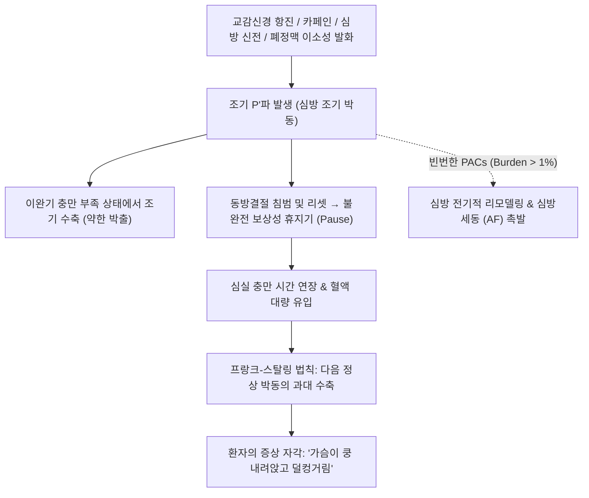

# 🩺 심방 조기 박동 (Premature Atrial Complexes, PAC / PACs)

> **핵심 3줄 요약 (Key Summary)**:
> - 📍 병소 부위 & 해부·병태생리: 동방결절(SA node) 이외의 심방 심근(폐정맥 소매, 분계능, 관상정맥동, 심방 중격 등)에서 정상 박동 주기보다 한 박자 빠르게 자발적 이소성 전기 흥분(Ectopic trigger)이 발생하여 심방과 심실을 조기 탈분극시킴.
> - 🚩 전형적 임상 양상: 대개 무증상. 유증상 시 "심장이 쿵 내려앉는다", "맥이 한 박자 건너뛴다", "목구멍에서 덜컹거린다"는 간헐적 심계항진 호소. 조기 수축 후의 **불완전 보상성 휴지기(Incomplete compensatory pause)**와 그 뒤따르는 강한 박동을 자각함.
> - 🛠️ 핵심 검사 & 치료 전략: 12유도 심전도(정상 P파와 형태가 다른 조기 P'파, 대개 좁은 QRS파, 간혹 변행전도로 넓은 QRS), 24시간 홀터 심전도(PAC 총량/부담도 Burden 산출). 양성 경과 시 안심시키기(Reassurance)와 유발 인자(카페인, 알코올, 스트레스, 수면부족) 교정. 증상 지속 시 저용량 베타차단제.
> - ⚠️ 응급 의뢰 레드플래그: 빈번한 PAC(24시간 홀터상 하루 1,000회 이상 또는 $>1\%$)로 인한 심방세동(AF) 및 심방조동 발작 촉발, 조기흥분 증후군(WPW) 환자에서의 빠른 전도, 동반된 구조적 심질환(심부전, 판막질환), 실신 및 흉통 동반.

---

## 📌 목차
1. [질환 개요 & 해부학적 병태생리](#1-질환-개요--해부학적-병태생리)
2. [병태생리 메커니즘 & 생체역학적 악순환 네트워크](#2-병태생리-메커니즘--생체역학적-악순환-네트워크)
3. [임상 증상 & 이학적 검사(Physical Exam) 알고리즘](#3-임상-증상--이학적-검사physical-exam-알고리즘)
4. [감별 진단 매트릭스 (Differential Diagnosis)](#4-감별-진단-매트릭스-differential-diagnosis)
5. [한의 통합 치료 프로토콜 (침·약침·추나·한약)](#5-한의-통합-치료-프로토콜-침약침추나한약)
6. [양방 치료 & 병용·의뢰 기준 (Conventional Treatment & Referral)](#6-양방-치료--병용의뢰-기준-conventional-treatment--referral)
7. [재활 운동 & 생활습관 티칭 가이드](#7-재활-운동--생활습관-티칭-가이드)
8. [💡 사용자 진료실 핵심 필기 & 임상 노하우 (Melt-In 잔여 심화 집약)](#8--사용자-진료실-핵심-필기--임상-노하우--melt-in-잔여-심화-집약)
9. [출처 및 학술 참고 문헌 (References)](#9-출처-및-학술-참고-문헌-references)

---

## 1. 질환 개요 & 해부학적 병태생리

심방 조기 박동(Premature Atrial Complexes, PAC), 또는 조기 심방 수축(Premature Atrial Contractions)은 동방결절이 정상적인 차기 전기 신호를 내보내기 전에, 심방 내의 이소성 부위에서 조기에 발화하여 심장 전체를 수축시키는 가장 흔한 양성 부정맥이다. 건강한 성인의 90% 이상에서 24시간 홀터 검사상 최소 1회 이상 관찰될 정도로 보편적이다.

### 해부학적 호발 부위와 전기생리학적 전도 형태
1. **이소성 발화의 호발 해부 부위**:
   - **폐정맥 개구부 (Pulmonary Vein Ostia)**: 좌심방 후벽, 심방세동의 주된 촉발 부위와 공유.
   - **분계능 (Crista Terminalis)** 및 상대정맥-우심방 접합부.
   - **관상정맥동 개구부 (Coronary Sinus Ostium)** 및 삼첨판륜/승모판륜 주변.
   - 심방 중격 (Atrial Septum) 부위.
2. **방실결절 전도에 따른 3가지 심전도 양상**:
   - **정상 전도된 PAC (Conducted PAC, 가장 흔함)**: 방실결절을 정상적으로 통과하여 형태가 좁고 정상적인 QRS파($<120\text{ ms}$)를 생성함.
   - **변행 전도된 PAC (PAC with Aberrant Conduction)**: 방실결절은 통과했으나 각(Bundle branch, 특히 불응기가 긴 우각)의 일시적 불응기에 걸려 각차단(대개 우각차단 RBBB) 형태의 넓은 QRS파($\ge 120\text{ ms}$)를 보임 $\rightarrow$ 심실 조기 수축(PVC)으로 오인되기 쉬움.
   - **비전도성 PAC (Non-conducted / Blocked PAC)**: 조기 P'파가 너무 일찍 발생하여 방실결절이 완전 불응기일 때 도달 $\rightarrow$ P'파 뒤에 QRS파가 전혀 나타나지 않고 긴 휴지기가 생김 $\rightarrow$ 동정지(Sinus pause)나 2도 방실 차단으로 오인되기 쉬움.

---

## 2. 병태생리 메커니즘 & 생체역학적 악순환 네트워크

![[심방조기박동_2_정상동리듬vs이소성박동.png|450]]
> [그림 1: 정상 동리듬(위)과 이소성 박동을 나란히 그린 도해 — 가운데는 심실 조기박동(보상성 휴지기), 아래는 심방 조기박동(P파가 조기에 나타나고 비보상성 휴지기) — 출처: Wikimedia Commons — File:NSR and Ectopic beats (PVC and PAC).svg (CC BY-SA 4.0)]

### 1) 세포 수준의 발생 기전
- **자동능 항진 (Enhanced Automaticity)**: 심방 세포의 4기 자발적 탈분극 속도가 빨라져 동방결절보다 먼저 역치 전위에 도달함. (교감신경 항진, 카페인, 저산소증, 신전 자극).
- **유발 활동 (Triggered Activity)**: 세포 내 칼슘 과부하에 의한 지연 후탈분극(DAD, Delayed Afterdepolarization) $\rightarrow$ 디지털리스 중독, 심근 허혈 시 호발.
- **미세 회귀 (Micro-reentry)**: 심방 심근 섬유화 부위 주변의 전도 속도 차이에 의한 국소 회귀.

### 2) 왜 환자는 '조기 박동'이 아니라 '그 다음 박동'을 느끼는가?
- 조기 수축(PAC) 자체는 심실 충만 시간(이완기)이 극히 짧은 상태에서 발생하므로 1회 박출량이 매우 적어 요골동맥 맥박으로 거의 만져지지 않거나 약함.
- PAC 신호가 동방결절을 역행성으로 리셋(Reset)시키면서 **불완전 보상성 휴지기(Pause)**가 발생함.
- 이 휴지기 동안 심실에 피가 평소보다 훨씬 많이 채워짐(이완기 충만 시간 연장).
- 휴지기 직후의 다음 정상 박동 때 프랑크-스탈링 법칙에 의해 심실이 **엄청나게 강한 박출력(High stroke volume)**으로 쿵 하고 수축함.
- 환자가 느끼는 덜컹거림은 바로 이 **휴지기 직후의 과대 박출 박동**이다.

---

## 3. 임상 증상 & 이학적 검사(Physical Exam) 알고리즘

![[심방조기박동_3_흉부유도전극부착.png|450]]
> [그림 2: 12유도 심전도 기록을 위한 흉부 유도(V1–V6) 전극 부착 실사 — PAC 확인은 유도 II·V1의 P파 형태 비교가 핵심이다 — 출처: Wikimedia Commons — File:Bare chest of a old man for ECG with probes (36506).jpg (CC BY-SA 4.0)]

![[심방조기박동_3_시간당PAC_PVC빈도.png|450]]
> [그림 3: 활동·체위 조건별 시간당 PAC·PVC 빈도 그래프(Ambulatory·Chamber·Post Chamber) — 두 이소성 박동이 서로 다른 조건에서 증가함을 보여준다 — 출처: Wikimedia Commons — File:Cardiac Figure 2.jpg (Public domain)]

### 1) 주요 임상 증상
- **자각 증상**:
  - 심장이 한 박자 쉬거나 건너뛰는 느낌(Skipped beats).
  - 목구멍이나 명치 끝이 덜컹거리고 쿵 내려앉는 불쾌감.
  - 조용한 밤이나 휴식 시, 누워 있을 때 더 뚜렷하게 느껴져 불안감 및 불면 유발.
- **신체 진찰**:
  - 요골동맥 촉진 시 규칙적인 맥박 사이에 한 박자 빠르게 살짝 뛰고(약한 조기 맥박) 뒤이어 잠깐 멈췄다가(휴지기) 강하게 뛰는 패턴 확인.

### 2) 이학적 검사 및 진단 검사 알고리즘
1. **12유도 심전도 (12-Lead ECG)**:
   - 기본 동방결절 P파와 형태, 극성, 축이 다른 **조기 P'파** 확인 (예: 하벽 유도에서 역위 P'파).
   - PR' 간격은 대개 정상이나 조기 발생 시 약간 연장될 수 있음.
   - **불완전 보상성 휴지기 (Incomplete Compensatory Pause)**: 조기 박동 전후의 두 P-P 간격의 합이 정상 P-P 간격의 2배보다 짧음 ($< 2 \times \text{PP}$, 동방결절이 리셋되었음을 증명).
2. **24시간 홀터 심전도 (Holter Monitoring)**:
   - 총 심박수 대비 PAC 비율(PAC Burden) 산출.
   - 하루 수십~수백 회는 정상 변이. 하루 **1,000회 이상 또는 전체의 1% 이상**인 경우 향후 심방세동 발생의 독립적 위험 인자.
3. **심초음파**: 좌심방 비대(LA Enlargement), 승모판 탈출증(MVP), 이완기 기능 장애 등 기저 심질환 배제.

---

## 4. 감별 진단 매트릭스 (Differential Diagnosis)

| 감별 질환 | 조기 탈분극 파형 | QRS 형태 및 너비 | 보상성 휴지기 특성 | 감별 핵심 포인트 |
| :--- | :--- | :--- | :--- | :--- |
| **심방 조기 박동 (PAC)** | **이형 P'파 선행** | 대개 좁음 ($<120\text{ ms}$, 변행전도 시 넓음) | **불완전 보상성 ($<2\times \text{PP}$)** | P'파 확인, 동방결절 리셋으로 짧은 휴지기 |
| [[심실 조기 박동]] (PVC) | P파 선행 없음 | **기태적이고 넓음 ($\ge 120\text{ ms}$)** | **완전 보상성 ($=2\times \text{PP}$)** | T파 반대 방향, 동방결절 리셋 안 됨 |
| **비전도성 PAC (Blocked)** | T파 속에 묻힌 조기 P'파 | **QRS파 없음 (탈락)** | P'파 후 휴지기 발생 | 2도 방실 차단이나 동정지와 혼동 주의 |
| **동부정맥 (Sinus Arrhythmia)** | 모든 P파 형태 정상 일치 | 정상 좁은 QRS | 호흡 주기에 따라 점진적 변동 | 흡기 시 빨라지고 호기 시 느려지는 생리적 변동 |
| [[심방 세동]] (AF) | 독립된 P파 전혀 없음 | 불규칙한 간격의 좁은 QRS | 규칙적 패턴 없음 | 간헐적 박동이 아닌 지속적 불규칙 리듬 |

---

## 5. 한의 통합 치료 프로토콜 (침·약침·추나·한약)

> 💡 **한의학적 병인론 및 변증**:
> 심방 조기 박동은 한의학에서 **심계(心悸)**, **정충(怔忡)**, **경계(驚悸)**의 범주에 속하며, 맥진상 **촉맥(促脈: 빠르면서 불규칙하게 건너뜀)** 또는 **결맥(結脈: 느리면서 불규칙하게 건너뜀)**에 해당한다.
> 주요 병기는 심담허겁(心膽虛怯)으로 사소한 일에도 심장이 뛰는 경우, 심혈부족(心血不足)으로 심장이 자양을 받지 못하는 경우, 담음(痰飮)이나 어혈(瘀血)이 심맥을 가로막아 발생한다.

### 1) 침구 치료 프로토콜
- **안신정계(安神定悸) 및 자율신경 조절**:
  - [[내관]](PC6): 심포경 락혈, 심박동 안정, 불안 해소, 교감신경 흥분 억제의 명혈.
  - [[신문]](HT7): 심경 원혈, 청심안신, 수면 장애 및 가슴 두근거림 진정.
  - [[단중]](CV17), [[거궐]](CV14): 기회 및 심모혈, 흉격 압박감 및 쿵 내려앉는 증상 해소.
  - [[족삼리]](ST36), [[삼음교]](SP6): 비위 건운 및 음혈 자양.
  - [[간수]](BL18), [[심수]](BL15): 스트레스성 자율신경 불균형 조절.

### 2) 한약 처방 (변증별 가감)
- **심담허겁·기혈양허(心膽虛怯·氣血兩虛)형 (가장 흔함: 사소한 소리에 놀람, 가슴 덜컹거림, 불면, 건망, 피로)**:
  - **귀비탕(歸脾湯)** 또는 **안신정지환(安神定志丸) 가감**:
  - 심비(心脾)를 보하고 정신을 안정시킴.
  - 처방 구성: [[당귀]], [[용안육]], [[산조인]], [[원지]], [[인삼]], [[황기]], [[백출]], [[복신]], [[목향]], [[감초]], [[생강]], [[대추]].
- **음허화왕·심신불교(陰虛火旺·心腎不交)형 (야간에 두근거림 심함, 손발 열감, 식은땀, 구강 건조)**:
  - **자감초탕(炙甘草湯)** 또는 **천왕보심단(天王補心丹) 가감**:
  - 맥이 건너뛰는 결대맥을 다스리고 진액과 음혈을 보충.
  - 구성: [[자감초]], [[생지황]], [[맥문동]], [[아교]], [[인삼]], [[계지]], [[마자인]], [[생강]], [[대추]].
- **담음정체·기체(痰飮停滯·氣滯)형 (소화불량, 명치 답답함과 함께 두근거림, 트림 시 완화)**:
  - **온담탕(溫膽湯)** 합 **이진탕(二陳湯) 가감**:
  - 구성: [[반하]], [[진피]], [[복령]], [[지실]], [[죽여]], [[감초]], [[생강]].

---

## 6. 양방 치료 & 병용·의뢰 기준 (Conventional Treatment & Referral)

### 1) 안심시키기(Reassurance)와 유발 인자 교정 (1차 치료)
- 구조적 심질환이 없는 환자에서 PAC는 악성 부정맥으로 진행하지 않는 **완전한 양성 상태**임을 명확히 설명하는 것이 치료의 80%를 차지함.
- **유발 인자 차단**: 카페인(커피, 녹차, 에너지 음료), 알코올, 흡연, 수면 부족, 스트레스, 교감신경 흥분제(비충혈제거제 감기약 슈도에페드린 등) 중단.

### 2) 약물 치료 (증상이 심하여 일상생활이 힘든 경우)
- **베타차단제 (Beta-blockers, 1차 선택제)**:
  - 저용량 비소프롤롤(Bisoprolol 1.25~2.5mg), 아테놀롤, 메토프롤롤: 심근의 교감신경 민감도를 낮추어 조기 박동 억제 및 박출 충격감 완화.
- **비디히드로피리딘계 칼슘길항제**:
  - [[딜티아젬]](Diltiazem) 또는 [[베라파밀]](Verapamil) (베타차단제 불내성 시).
- Class I/III 항부정맥제(플레카이니드, 아미오다론)는 약물 자체의 최기부정맥(Proarrhythmic) 위험 때문에 단순 PAC에는 원칙적으로 사용하지 않음.

### 3) 양방·전문과 의뢰 기준 (Referral Criteria)
- 🚨 24시간 홀터 검사상 **빈번한 PACs (Burden $> 1\%$ 또는 하루 수천 회 이상)**: 향후 심방세동 발생 위험 평가 및 예방적 심장내과 추적 필요.
- 🚨 PAC와 함께 실신, 흉통, 심한 호흡곤란이 동반되거나 심초음파상 좌심방 확장, 판막 질환, 박출률 저하가 확인된 경우.

---

## 7. 재활 운동 & 생활습관 티칭 가이드

### 1) 스트레스 및 자율신경 이완 요법
- **복식 호흡 및 이완 훈련**: 가슴이 쿵 내려앉을 때 당황하지 말고 깊은 복식 호흡(4초간 들이마시고 6초간 내쉬기)을 통해 미주신경 활성화 유도.
- **수면 위생**: 하루 7~8시간의 충분한 수면 확보 (수면 부족은 PAC의 가장 강력한 촉발 요인).

### 2) 식이 조절
- 과식 시 미주신경-교감신경 반사로 PAC가 빈발하므로 소식 권장.
- 탈수와 전해질 불균형(마그네슘, 칼륨 결핍)을 막기 위해 충분한 수분과 녹황색 채소, 견과류 섭취 지도.

---

## 8. 💡 사용자 진료실 핵심 필기 & 임상 노하우 (Melt-In 잔여 심화 집약)

### 1) "선생님, 심장이 멎는 것 같아요! 죽는 병인가요?"
- PAC 환자들은 인터넷에서 '부정맥=돌연사'라는 단어를 보고 극심한 공포와 불안에 질려 내원한다.
- 이때 가장 먼저 해주어야 할 말은:
  - **"심장이 멎는 것이 아니라, 심장이 너무 부지런해서 한 박자 먼저 뛰고 잠깐 쉬었다가 다시 뛰는 것입니다. 건강한 사람 누구에게나 있는 딸꾹질 같은 현상입니다."**
  - 이 비유 하나로 환자의 불안이 가라앉으면 교감신경 흥분이 진정되면서 조기 박동 횟수 자체가 절반 이하로 줄어든다.

### 2) 비전도성 PAC(Blocked PAC)를 서맥이나 방실 차단으로 오진하지 말 것
- 심전도상 긴 휴지기(Pause)가 나타날 때, 앞선 T파의 모양을 자세히 관찰해야 한다.
- 정상 T파에 비해 모양이 뾰족하거나 혹처럼 불룩 튀어나와 있다면 그 속에 **숨어 있는 조기 P'파**이다.
- 이것은 방실 차단이 아니라 너무 일찍 나온 PAC를 방실결절이 정상적으로 걸러낸 것이므로 박동기 삽입 대상이 아니다.

---

## 9. 출처 및 학술 참고 문헌 (References)

1. Atrial Effective Refractory Periods in Patients With Frequent Premature Atrial Complexes: Implications for Atrial Fibrillation. (2025). *Am J Cardiol*, 239:131-137. PMID: 42024563.

2. Pediatric premature atrial contractions: Clinical characteristics, diagnosis, and management-A literature review. (2026). *Health Sci Rep*, 9(3):e70498. PMID: 42519370.

3. Holter-detected arrhythmias and associated risk factors in hospitalized elderly patients with diagnosed heart failure. (2025). *BMC Cardiovasc Disord*, 25(1):649. PMID: 41013240.

---

## 관련 노트

- [[심방 세동 및 심방 조동]]
- [[심실 조기 박동]]
- [[PSVT]]
- [[내관]]
- [[신문]]
- [[단중]]
- [[거궐]]
- [[족삼리]]
- [[삼음교]]
- [[간수]]
- [[심수]]
- [[당귀]]
- [[용안육]]
- [[산조인]]
- [[원지]]
- [[인삼]]
- [[황기]]
- [[백출]]
- [[복신]]
- [[자감초]]
- [[생지황]]
- [[맥문동]]
- [[아교]]
- [[계지]]
- [[반하]]
- [[진피]]
- [[복령]]
- [[귀비탕]]
- [[안신정지환]]
- [[자감초탕]]
- [[천왕보심단]]
- [[온담탕]]
- [[딜티아젬]]
- [[베라파밀]]
