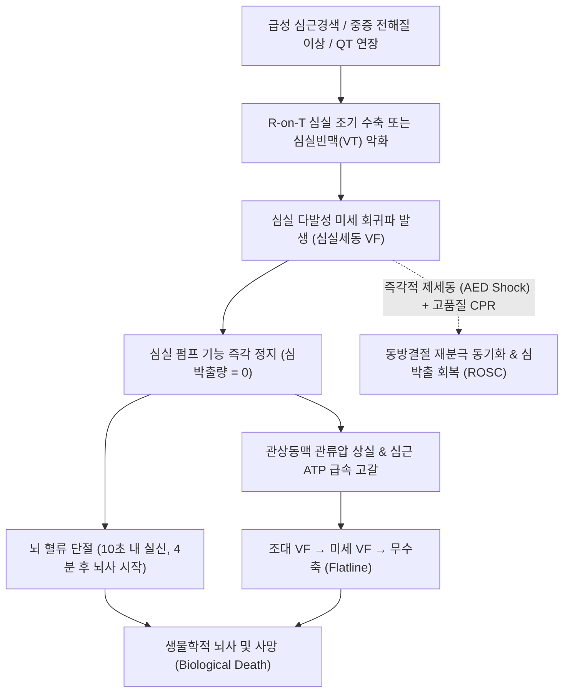

# 🩺 심실 세동 (Ventricular Fibrillation, VF / V-Fib)

> **핵심 3줄 요약 (Key Summary)**:
> - 📍 병소 부위 & 해부·병태생리: 심실 심근 전역의 다발성 미세 회귀파(Multiple wavelet reentry)로 인해 심실 근육이 완전히 비동기적으로 무질서하게 진전(Fibrillating)함. 기계적 심실 박출량이 즉각 0으로 떨어지는 심인성 급사의 가장 흔한 직접 원인.
> - 🚩 전형적 임상 양상: 수 초 내 돌발적인 의식 상실, 경동맥 맥박 완전 소실, 무호흡 또는 임종 호흡(Agonal gasp), 동공 산대.
> - 🛠️ 핵심 검사 & 치료 전략: 심전도상 QRS 복합파 소실 및 불규칙한 미세/조대 파형(Coarse VF $\rightarrow$ Fine VF $\rightarrow$ Asystole). 즉각적인 비동기 제세동(Defibrillation, 120~200J Biphasic) 및 고품질 CPR, 에피네프린, 아미오다론 투여. ROSC 후 관상동맥 중재술(PCI), 목표체온유지치료(TTM), 삽입형 제세동기(ICD) 거치.
> - ⚠️ 응급 의뢰 레드플래그: 매 1분 지연 시마다 생존율 7~10%씩 급감. 즉각적인 119 신고, AED 패드 부착 및 제세동, 가슴 압박을 분초를 다투어 시행해야 하는 절대적 초응급 질환.

---

## 📌 목차
1. [질환 개요 & 해부학적 병태생리](#1-질환-개요--해부학적-병태생리)
2. [병태생리 메커니즘 & 생체역학적 악순환 네트워크](#2-병태생리-메커니즘--생체역학적-악순환-네트워크)
3. [임상 증상 & 이학적 검사(Physical Exam) 알고리즘](#3-임상-증상--이학적-검사physical-exam-알고리즘)
4. [감별 진단 매트릭스 (Differential Diagnosis)](#4-감별-진단-매트릭스-differential-diagnosis)
5. [한의 통합 치료 프로토콜 (침·약침·추나·한약)](#5-한의-통합-치료-프로토콜-침약침추나한약)
6. [양방 치료 & 병용·의뢰 기준 (Conventional Treatment & Referral)](#6-양방-치료--병용의뢰-기준-conventional-treatment--referral)
7. [재활 운동 & 생활습관 티칭 가이드](#7-재활-운동--생활습관-티칭-가이드)
8. [💡 사용자 진료실 핵심 필기 & 임상 노하우 (Melt-In 잔여 심화 집약)](#8--사용자-진료실-핵심-필기--임상-노하우--melt-in-잔여-심화-집약)
9. [출처 및 학술 참고 문헌 (References)](#9-출처-및-학술-참고-문헌-references)

---

## 1. 질환 개요 & 해부학적 병태생리

심실 세동(Ventricular Fibrillation, VF)은 심실 근육 내에서 수백 개의 전기적 흥분 파동이 무질서하게 맴돌며 심실이 수축하지 못하고 단순히 떨리기만 하는 치명적인 부정맥이다. 병원 밖 심정지(OHCA) 발생 초기에 가장 흔히 관찰되는 리듬이자, 즉각적인 전기적 제세동으로 심장을 정상 율동으로 되돌릴 수 있는 '제세동 가능 리듬(Shockable rhythm)'이다.

### 해부학적 기전 및 파형의 시기별 변화
1. **조대 심실세동 (Coarse VF)**:
   - 심정지 발생 직후 수 분 이내에 관찰되며, 진폭이 크고 굵은 진동파($\ge 0.2\text{ mV}$)를 보임.
   - 심근 세포 내 ATP가 아직 어느 정도 보존되어 있는 상태로, 제세동 성공률과 소생 가능성이 가장 높음.
2. **미세 심실세동 (Fine VF)**:
   - 심정지가 지속되어 심근 허혈과 산증이 심화되면서 파형의 진폭이 극도로 작아진 상태($< 0.2\text{ mV}$).
   - 심전도상 무수축(Asystole)과 구별이 어려울 수 있으며, 제세동 성공률이 급격히 저하됨. 충분한 가슴 압박으로 관상동맥 관류를 올려 조대 VF로 전환시킨 후 제세동을 시도해야 함.
3. **무수축 (Asystole)으로의 전변**:
   - 심실 심근의 에너지원이 완전히 고갈되면 모든 전기적 활동이 멈추고 완전한 심정지(Flatline)로 종말을 맞이함.

---

![[심실세동_01_도해_심장과세동파형.png|450]]
> [그림 1: 심실세동 도해 — 좌심실을 강조한 심장 그림과 정상 심전도·심실세동 파형을 나란히 비교한 그림. — 출처: File:Ventricular Fibrillation.png (Wikimedia Commons)]

## 2. 병태생리 메커니즘 & 생체역학적 악순환 네트워크

### 1) 다발성 회귀파 이론 (Multiple Wavelet Hypothesis)
- 심실 조기 박동(R-on-T 현상)이나 급성 관상동맥 허혈로 인해 심근세포의 불응기가 불균일해짐.
- 단일 전기파가 쪼개져 수많은 소용돌이(Rotor) 형태의 미세 회귀 회로를 형성함.
- 심실 벽 전체가 무질서하게 따로 놀기 때문에 심실 내압을 형성하지 못하고 1회 박출량이 즉각 0이 됨.
- 대동맥 판막이 열리지 않아 관상동맥 관류압(Coronary Perfusion Pressure, CPP)이 0으로 추락하고 심근 허혈이 극대화되는 초응급 악순환 형성.

---

## 3. 임상 증상 & 이학적 검사(Physical Exam) 알고리즘

### 1) 주요 임상 증상
- 심실세동 발생 즉시 환자는 3~5초 이내에 뇌 허혈로 어지러움을 느끼고 10초 이내에 바닥으로 쓰러지며 의식을 잃음.
- 경동맥 및 대퇴동맥 맥박이 전혀 촉지되지 않음.
- 호흡 정지 또는 초기 턱을 쳐들며 헐떡이는 비정상적 임종 호흡(Agonal breathing).
- 동공이 풀리고 대광반사가 소실됨.

### 2) 심전도 소견 및 진단 알고리즘
- **12유도 심전도 및 모니터 소견**:
  - P파, QRS 복합파, T파의 구분이 완전히 불가능함.
  - 진폭과 형태, 주기가 제각각인 불규칙하고 빠른 기태적 파형(분당 300~600회 상당의 무질서한 진동).
- **진단 즉시 행동 프로토콜 (AHA ACLS Guidelines)**:
  - 심전도상 VF 확인 즉시 **"충전(Charge)!"** 지시 $\rightarrow$ 충전되는 동안에도 가슴 압박 지속 $\rightarrow$ 안전 확인 후 **즉각 제세동 충격(Shock)** 전달 $\rightarrow$ 리듬 확인 없이 **즉시 가슴 압박 2분간 재개**.

---

![[심실세동_02_심전도_세동파형.png|450]]
> [그림 2: 심실세동 환자의 심전도 — 불규칙하고 파형의 진폭이 제각각인 심실세동 파형 기록. — 출처: Primary Ventricular Fibrillation in a Patient with Mild Hyperthyroidism. PMID 29791575 (CC BY)]

![[심실세동_03_심전도_리듬기록.png|450]]
> [그림 3: 리듬 모니터 기록 — 여러 시점의 심전도 파형을 나열해 리듬 변화를 보여주는 그림. — 출처: Is Takotsubo syndrome induced by patent ductus arteriosus occlusion? PMID 38431545 (CC BY)]

## 4. 감별 진단 매트릭스 (Differential Diagnosis)

| 감별 질환 | 의식 및 맥박 | 심전도 파형 | 치료 핵심 |
| :--- | :--- | :--- | :--- |
| **심실 세동 (VF)** | **의식 소실, 맥박 없음** | **P-QRS-T 소실, 무질서한 잔물결** | **비동기 즉각 제세동 (Defibrillation) + CPR** |
| **무맥성 심실빈맥 (pVT)** | **의식 소실, 맥박 없음** | 넓고 규칙적인 기태적 QRS파 연속 | **비동기 즉각 제세동 (Defibrillation) + CPR** |
| **토르사드 드 포인트 (TdP)** | 가변적 (수 초간 실신 빈발) | QRS 축이 위아래로 꼬이는 다형성 VT | 마그네슘 정주, 불안정 시 제세동 |
| **인공물 잡음 (Artifact)** | **의식 명료, 맥박 정상 촉지** | 환자 움직임이나 전극 탈락으로 인한 잡음 | 전극 재부착, 환자 안심시키기 (제세동 금기) |
| **무수축 (Asystole)** | 의식 소실, 맥박 없음 | 완전한 평평한 선 (Flatline) | 제세동 금기, CPR + 에피네프린 투여 |

---

## 5. 한의 통합 치료 프로토콜 (침·약침·추나·한약)

> 🚨 **급성 심실세동 발생 시 행동 수칙**:
> 심실세동은 환자가 초 단위로 뇌사에 이르는 최고 수준의 심장마비 상태이다. **한의원 내 발생 시 침, 약침, 한약 등 일체의 한방 처치는 절대 금기**이며, **즉시 원내 AED 패드를 부착하여 제세동을 시행하고 119 구급대 인계 시까지 중단 없는 가슴 압박(CPR)을 수행**해야 한다.
> 본 프로토콜은 **소생술 성공 및 중환자실 집중 치료 후 심근 허혈 반흔 복원, 뇌신경 후유증 재활 및 재발 방지 보조 요법**에 한하여 적용한다.

### 1) 심정지 소생 후 뇌기능 재활 침구 치료 (회복기)
- **성뇌개규(醒腦開竅) 및 중추 신경 자극**:
  - [[인중]](GV26), [[백회]](GV20), [[사신총]](EX-HN1): 허혈-재관류 뇌손상 후 인지기능 및 의식 회복 촉진.
  - [[내관]](PC6), [[신문]](HT7): 심장 자율신경 안정 및 심실 조기 수축(재발 트리거) 억제.
  - [[족삼리]](ST36), [[용천]](KI1): 전신 원기 회복 및 하지 운동 기능 재활.

### 2) 심근 반흔 안정 및 재발 예방 한약 처방 (회복기)
- **심기허·어혈조체(心氣虛·瘀血阻滯)형 (관상동맥 재개통술 후 피로, 흉민, 자색 설태)**:
  - **생맥산(生脈散)** 합 **보양환오탕(補陽還五湯) 가감**:
  - 처방 구성: [[인삼]], [[맥문동]], [[오미자]], [[황기]], [[당귀]], [[천궁]], [[적작약]], [[도인]], [[홍화]], [[단삼]].
- **주의 약재**: 심실 이온 통로에 영향을 주는 부자, 오두 계열 약재는 재발 위험을 고려하여 복용을 극도로 신중히 하거나 배제함.

---

## 6. 양방 치료 & 병용·의뢰 기준 (Conventional Treatment & Referral)

### 1) 제세동 및 전문심장소생술 (Defibrillation & ACLS)
- **비동기 직류 제세동 (Defibrillation)**:
  - Biphasic $120\sim 200\text{ J}$ (단상성은 360J). 1회 쇼크 후 맥박 확인 없이 즉시 2분간 CPR.
- **약물 요법**:
  - **에피네프린 (Epinephrine)**: 1mg IV/IO, 2번째 제세동 실패 후 투여 시작하여 3~5분 간격 반복.
  - **아미오다론 (Amiodarone)**: 3번째 제세동 실패 시 1차 300mg 정주, 추가 실패 시 150mg 정주 (대체제: 리도카인 1~1.5 mg/kg).

### 2) 소생 후 통합 치료 (Post-Cardiac Arrest Care)
- **응급 관상동맥 조영술(CAG)**: 급성 관상동맥 폐색(STEMI)에 의한 VF 환자에서 즉각적인 스텐트 삽입술.
- **목표체온유지치료 (TTM)**: 소생 후 혼수 상태 환자에게 $32\sim 36^\circ\text{C}$ 저체온 유지(뇌부종 억제).
- **삽입형 제세동기 (ICD, Secondary Prevention)**:
  - 가역적 원인(급성 심근경색 초기 48시간 이내 등)이 없는 원인 불명 VF 생존자에게 급사 재발 방지를 위해 필수적으로 시술.

### 3) 응급 의뢰 프로토콜
- 🚨 **현장 즉각 119 신고 및 비상 방송, AED 제세동 시행**.

---

![[심실세동_04_치료_AED사용도해.png|450]]
> [그림 4: 자동제세동기(AED) 사용 도해 — 기기를 열어 전극을 가슴에 부착하고 사용하는 순서를 그린 그림. — 출처: File:Automated External Defibrillator.png (Wikimedia Commons)]

![[심실세동_05_치료_제세동전극위치.jpg|450]]
> [그림 5: 제세동 전극 부착 위치 도해 — 인체 앞면에서 두 전극을 놓는 자리를 표시한 그림. — 출처: File:Defibrilator electrode placement.jpg (Wikimedia Commons)]

## 7. 재활 운동 & 생활습관 티칭 가이드

### 1) ICD(삽입형 제세동기) 시술 환자 관리
- 전자기기 안전거리 유지(휴대폰 15cm 이상, 공항 검색대 통과 주의).
- 제세동기 작동(쇼크 발생) 시 즉시 안정 후 심장내과 내원.

### 2) 심장 급사 고위험군 생활 수칙
- 과도한 음주, 수면 부족, 고열 상태는 심실 부정맥을 유발하므로 철저히 회피.
- 가족 전원 심폐소생술(CPR) 실습 교육 이수.

---

## 8. 💡 사용자 진료실 핵심 필기 & 임상 노하우 (Melt-In 잔여 심화 집약)

### 1) "심전도 기계 모니터가 심실세동처럼 요동칠 때 환자 얼굴부터 보라"
- 진료실에서 심전도 모니터상 파형이 마구 헝클어져 심실세동처럼 보일 때, 심장마사지를 시작하기 전에 **반드시 환자의 눈을 보고 말을 걸어야 한다**.
- 환자가 멀쩡히 눈을 뜨고 말을 하고 있다면 그것은 환자의 떨림(치매, 파킨슨), 전극선 접촉 불량, 교류 전류 잡음(Artifact)이다.
- 심실세동 환자는 **심전도가 요동치는 바로 그 순간 10초 이내에 눈이 뒤집히고 의식을 잃는다**.

### 2) 제세동기의 음성 안내에 100% 복종하라
- 자동제세동기(AED)는 최첨단 인공지능 알고리즘으로 심전도를 판독하여 오직 '심실세동'과 '무맥성 심실빈맥'에서만 제세동 버튼을 활성화한다.
- 초보 의료진이라도 당황하지 말고 AED 패드를 붙이고 **"제세동이 필요합니다"**라는 음성이 나오면 전원 물러서게 한 뒤 즉시 버튼을 눌러야 환자를 살릴 수 있다.

---

## 9. 출처 및 학술 참고 문헌 (References)

1. Automated External Defibrillators for In-Hospital Cardiac Arrest: A Systematic Review. (2026). *Resuscitation*, 205:110756. PMID: 42838496.

2. Defibrillation in refractory cardiac arrest: knowledge gaps and future priorities. (2026). *Curr Opin Crit Care*, 32(6):582-588. PMID: 42757492.

3. Life-threatening ventricular arrhythmias in cardiac sarcoidosis with implantable devices: Incidence and predictors in a UK cohort. (2026). *Curr Probl Cardiol*, 51(12):103282. PMID: 42727898.

---

## 관련 노트

- [[심장마비]]
- [[심실 조기 박동]]
- [[심실성 빈맥]]
- [[인중]]
- [[백회]]
- [[사신총]]
- [[내관]]
- [[신문]]
- [[족삼리]]
- [[용천]]
- [[인삼]]
- [[맥문동]]
- [[오미자]]
- [[황기]]
- [[당귀]]
- [[천궁]]
- [[적작약]]
- [[도인]]
- [[홍화]]
- [[단삼]]
- [[생맥산]]
- [[보양환오탕]]
