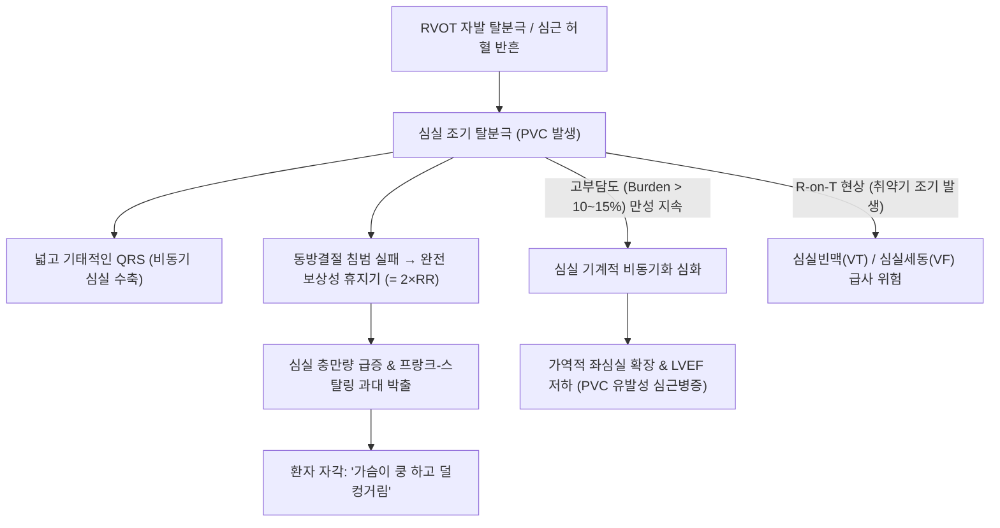

# 🩺 심실 조기 박동 (Premature Ventricular Complexes, PVC / PVCs)

> **핵심 3줄 요약 (Key Summary)**:
> - 📍 병소 부위 & 해부·병태생리: 히스속 분지 하부 심실 심근(우심실 유출로 RVOT, 좌심실 유출로 LVOT, 대동맥동 커스프, 유두근 등)에서 발생하는 자발적 이소성 탈분극. 심실 전도계를 통하지 않고 심근세포 간 전파되어 QRS 폭이 넓고($\ge 120\text{ ms}$) 기태적인 형태를 보임.
> - 🚩 전형적 임상 양상: "심장이 덜컹 내려앉는다", "맥이 건너뛴다", "가슴속에서 쿵 친다"는 심계항진. 조기 박동 뒤의 **완전 보상성 휴지기(Complete compensatory pause)**와 그 뒤따르는 과대 1회 박출량 자각.
> - 🛠️ 핵심 검사 & 치료 전략: 12유도 심전도(선행 P파 없음, 넓고 기태적인 QRS, 반대 방향 T파), 24시간 홀터 심전도(PVC 부담도 Burden 측정), 심초음파(구조적 심질환 배제). 양성 경과 시 안심시키기, 증상성 또는 고부담도($>10\sim 15\%$) 시 베타차단제/CCB 투약 또는 **전극도자 절제술(Catheter ablation)**.
> - ⚠️ 응급 의뢰 레드플래그: 고부담도 PVC($>10\sim 15\%$)에 의한 **PVC 유발성 심근병증(PVC-induced Cardiomyopathy / LVEF 저하)**, R-on-T 현상(T파 정점에 얹히는 PVC $\rightarrow$ 심실빈맥·심실세동 촉발), 다형성 PVC, 런(Run: 3연속 이상 심실빈맥), 동반된 실신 및 허혈성 흉통.

---

## 📌 목차
1. [질환 개요 & 해부학적 병태생리](#1-질환-개요--해부학적-병태생리)
2. [병태생리 메커니즘 & 생체역학적 악순환 네트워크](#2-병태생리-메커니즘--생체역학적-악순환-네트워크)
3. [임상 증상 & 이학적 검사(Physical Exam) 알고리즘](#3-임상-증상--이학적-검사physical-exam-알고리즘)
4. [감별 진단 매트릭스 (Differential Diagnosis)](#4-감별-진단-매트릭스-differential-diagnosis)
5. [한의 통합 치료 프로토콜 (침·약침·추나·한약)](#5-한의-통합-치료-프로토콜-침약침추나한약)
6. [양방 치료 & 병용·의뢰 기준 (Conventional Treatment & Referral)](#6-양방-치료--병용의뢰-기준-conventional-treatment--referral)
7. [재활 운동 & 생활습관 티칭 가이드](#7-재활-운동--생활습관-티칭-가이드)
8. [💡 사용자 진료실 핵심 필기 & 임상 노하우 (Melt-In 잔여 심화 집약)](#8--사용자-진료실-핵심-필기--임상-노하우--melt-in-잔여-심화-집약)
9. [출처 및 학술 참고 문헌 (References)](#9-출처-및-학술-참고-문헌-references)

---

## 1. 질환 개요 & 해부학적 병태생리

심실 조기 박동(Premature Ventricular Complexes, PVC), 혹은 조기 심실 수축(Premature Ventricular Contractions)은 심실 내의 이소성 부위에서 정상적인 동방결절 박동보다 조기에 전기 신호가 발생하여 심실 전체를 탈분극시키는 부정맥이다. 성인의 50% 이상에서 홀터 검사상 관찰될 만큼 흔하며, 구조적 심질환이 없는 경우 대부분 양성이다.

### 해부학적 발생 기원(Origin)에 따른 형태학적 분류
1. **우심실 유출로 기원 (RVOT PVC, 가장 흔함, 약 70%)**:
   - 폐동맥 판막 직하부 우심실 유출로에서 발생.
   - **심전도 특징**: 좌각차단(LBBB) 형태(V1 음성 파형) + 하벽 유도(II, III, aVF) 강한 양성 QRS파 (전기 축이 아래로 향하는 수직축 Inferior axis).
   - 대부분 구조적 심질환이 없는 특발성(Idiopathic) 양성 부정맥.
2. **좌심실 유출로 및 대동맥동 기원 (LVOT / Aortic Cusps)**:
   - 우각차단(RBBB) 또는 LBBB 형태, V1에서 조기 R/S 이행.
3. **유두근 및 섬유속 기원 (Papillary Muscle / Fascicular)**:
   - 이첨판/삼첨판 유두근 또는 좌각 전부지/후부지 기원.

---

## 2. 병태생리 메커니즘 & 생체역학적 악순환 네트워크

### 1) 기전 및 보상성 휴지기
- **발생 기전**: 세포 내 칼슘 과부하에 의한 지연 후탈분극(DAD, 유발 활동)이 주원인이며, 심근경색 후 반흔 부위 주변에서는 미세 회귀(Micro-reentry)가 관여함.
- **완전 보상성 휴지기 (Complete Compensatory Pause)**:
  - 심실에서 발생한 조기 탈분극 신호는 방실결절을 역행성으로 통과하지 못하거나 동방결절을 리셋시키지 못함.
  - 동방결절은 자기 주기에 맞춰 P파를 정상적으로 내보내지만, 심실이 PVC의 불응기에 걸려 있어 그 P파가 전도되지 못하고 소실됨.
  - 다음 정상 동방결절 P파가 도달할 때까지 심실이 대기하므로, **조기 박동 전후 두 정상 박동의 간격이 정확히 정상 RR 간격의 2배($= 2 \times \text{RR}$)**가 됨.

### 2) PVC 유발성 심근병증 (PVC-induced Cardiomyopathy)
- PVC 빈도가 전체 심박수의 **$10\sim 15\%$ 이상(하루 10,000~15,000회 이상)**으로 장기간 지속되는 경우.
- 심실의 비동기적 수축(Ventricular dyssynchrony)으로 인해 좌심실이 확장되고 수축기 박출률(LVEF)이 저하되는 심근병증이 발생할 수 있음 (단, 고주파 절제술이나 약물로 PVC를 없애면 수축력이 가역적으로 완전히 정상 회복됨).

---

## 3. 임상 증상 & 이학적 검사(Physical Exam) 알고리즘

### 1) 주요 임상 증상
- **심계항진**: 덜컹거림, 쿵 내려앉음, 심장이 목구멍까지 치고 올라오는 느낌.
- **연속 발생 시 증상**:
  - 이단맥(Bigeminy: 정상-조기-정상-조기) 또는 삼단맥(Trigeminy): 잦은 약한 박출로 인한 피로감, 어지럼증.
  - 커플릿(Couplet, 2연속) 또는 런(Run, 3연속 이상): 어지럼증, 실신 전단계.
- **신체 진찰**: 요골동맥 맥박 촉지 시 조기 박동 때 맥박이 약하게 만져지거나 건너뛴 후 다음 맥박이 크고 강하게 만져짐.

### 2) 이학적 검사 및 진단 검사 알고리즘
1. **12유도 심전도 (12-Lead ECG)**:
   - **선행 P파가 없음**.
   - **넓고($\ge 120\text{ ms}$) 기태적인 QRS 복합파**.
   - **T파의 불협화(Discordance)**: QRS 주파동과 반대 방향으로 T파가 역전됨.
   - 완전 보상성 휴지기 확인.
2. **24시간 홀터 심전도 (Holter Monitoring, 필수)**:
   - 총 PVC 개수 및 24시간 심박수 대비 비율(PVC Burden) 계산.
   - 단형성(Monomorphic, 모양이 1가지로 양호) vs 다형성(Polymorphic, 여러 부위 기원으로 위험) 감별.
3. **심초음파**: 좌심실 구혈률(LVEF) 및 기저 심질환(허혈, 비대, 판막 질환) 전수 평가.

---

## 4. 감별 진단 매트릭스 (Differential Diagnosis)

| 감별 질환 | 선행 P파 유무 | QRS 복합파 너비 | 보상성 휴지기 특성 | 감별 핵심 포인트 |
| :--- | :--- | :--- | :--- | :--- |
| **심실 조기 박동 (PVC)** | **선행 P파 없음** | **넓음 ($\ge 120\text{ ms}$, 기태적)** | **완전 보상성 ($= 2\times \text{RR}$)** | QRS-T 불협화, 심실 고유 기원 |
| **변행 전도된 [[심방 조기 박동]] (PAC)** | **변형된 P'파 선행** | 넓음 ($\ge 120\text{ ms}$, RBBB형태) | **불완전 보상성 ($< 2\times \text{RR}$)** | 자세히 보면 T파 속에 숨은 조기 P'파 존재 |
| **심실성 빈맥 ([[VT]])** | 독립적 또는 방실 해리 | 넓은 QRS가 **3박동 이상 연속** | 연속적 빈맥 | 분당 100회 이상 지속, 혈역학적 불안정 |
| **간헐적 각차단 (Bundle Branch Block)** | 정상 동방결절 P파 선행 | 넓은 QRS ($\ge 120\text{ ms}$) | 휴지기 없음 (규칙적) | PR 간격 정상, 심실 기원이 아닌 전도 장애 |

---

## 5. 한의 통합 치료 프로토콜 (침·약침·추나·한약)

> 💡 **한의학적 병인론 및 변증**:
> 심실 조기 박동은 한의학에서 **심계(心悸)**, **정충(怔忡)**, **결대맥(結代脈)**에 해당한다. 심양(心陽)이 허하여 흉중의 기가 통하지 않거나, 심혈(心血)이 부족하여 심주(心主)를 영양하지 못하거나, 담음(痰飮)과 어혈(瘀血)이 심맥(心脈)을 차단하여 발생한다.

### 1) 침구 치료 프로토콜
- **통양복맥(通陽復脈) 및 영심안신(寧心安神)**:
  - [[내관]](PC6): 심포경 락혈, 심실 부정맥 억제, 자율신경 조절의 핵심 혈위.
  - [[신문]](HT7): 심경 원혈, 불면 및 가슴 두근거림 완화.
  - [[단중]](CV17), [[심수]](BL15): 기회 및 배수혈, 흉민과 쿵 내려앉는 증상 완화.
  - [[족삼리]](ST36), [[삼음교]](SP6): 비위 건운, 기혈 생성 촉진.
  - [[태충]](LR3): 간양상항 진정, 스트레스성 조기 수축 억제.

### 2) 한약 처방 (변증별 가감)
- **기음양허·허로결대(氣陰兩虛·虛勞結代)형 (심계, 피로, 숨가쁨, 맥이 건너뜀)**:
  - **자감초탕(炙甘草湯, 복맥탕)**:
  - 결대맥을 치료하는 대표 방제로 심근의 전기생리학적 안정성을 회복시킴.
  - 처방 구성: [[자감초]](16~20g), [[생지황]], [[맥문동]], [[아교]], [[인삼]], [[계지]], [[마자인]], [[생강]], [[대추]].
- **심기허·심담허겁(心氣虛·心膽虛怯)형 (사소한 일에 가슴이 철렁 내려앉음, 불안, 건망)**:
  - **귀비탕(歸脾湯)** 가감:
  - 구성: [[당귀]], [[용안육]], [[산조인]], [[원지]], [[인삼]], [[황기]], [[백출]], [[복신]], [[목향]], [[감초]].
- **기체어혈(氣滯瘀血)형 (가슴 자통, 흉민, 고혈압 동반, 암자색 설태)**:
  - **혈부축어탕(血府逐瘀湯)** 합 **단삼음(丹蔘飮) 가감**:
  - 구성: [[단삼]], [[사인]], [[백단향]], [[당귀]], [[도인]], [[홍화]], [[적작약]], [[천궁]].

---

## 6. 양방 치료 & 병용·의뢰 기준 (Conventional Treatment & Referral)

### 1) 치료 방침 결정의 2대 기준 (증상 & Burden)
1. **구조적 심질환이 없고, 무증상이며, Burden $<10\%$인 경우**:
   - 약물 치료 불필요. 안심시키기(Reassurance)와 생활습관 교정.
2. **유증상자 또는 Burden $\ge 10\sim 15\%$인 경우**:
   - **1차 약물 치료**:
     - **베타차단제**: 메토프롤롤, 비소프롤롤, 아테놀롤 (교감신경 매개 RVOT PVC에 매우 효과적).
     - **비디히드로피리딘계 CCB**: [[딜티아젬]], [[베라파밀]] (베타차단제 불내성 시).
   - **2차 약물 치료**: 플레카이니드(Flecainide, 심근경색 없는 환자 한정), 아미오다론.
3. **고주파 전극도자 절제술 (Radiofrequency Catheter Ablation, RFCA)**:
   - 약물 불응성이거나 고부담도($>10\sim 15\%$)로 인해 좌심실 기능 저하(심근병증)가 발생한 경우.
   - RVOT 기원 PVC는 절제술 성공률이 90% 이상으로 완치 가능.

### 2) 양방·전문과 응급 의뢰 기준 (Referral Criteria)
- 🚨 **심초음파상 좌심실 구혈률(LVEF) 저하($<50\%$) 동반 시 즉시 부정맥 전문의 전원**.
- 🚨 PVC가 3연속 이상 이어지는 비지속성 심실빈맥(NSVT) 또는 다형성 PVC 확인 시.
- 🚨 R-on-T 현상(앞선 T파 위에 얹히는 위험한 조기 박동) 관찰 시.
- 🚨 실신, 흉통, 심근경색 병력이 있는 환자에서 발생한 PVC.

---

## 7. 재활 운동 & 생활습관 티칭 가이드

### 1) 카페인 및 유발 인자 관리
- 커피, 에너지 음료, 녹차, 초콜릿 섭취 중단.
- 흡연 및 음주 절대 금지 (니코틴과 알코올은 심실 세포의 칼슘 과부하를 직접 유발).
- 비염 스프레이나 감기약 속 슈도에페드린 성분 복용 주의.

### 2) 수면 및 마그네슘 섭취
- 하루 7시간 이상의 규칙적인 수면.
- 혈중 마그네슘과 칼륨 수치를 정상 상한치로 유지하기 위해 마그네슘 영양제 또는 견과류, 바나나 섭취 권장.

---

## 8. 💡 사용자 진료실 핵심 필기 & 임상 노하우 (Melt-In 잔여 심화 집약)

### 1) "운동할 때 더 심해집니까, 운동하면 없어집니까?"
- 진료실에서 PVC 환자를 문진할 때 가장 결정적인 질문이다:
  - **"가만히 쉴 때나 누워 있을 때 두근거리고, 운동하면 싹 사라집니다"** $\rightarrow$ 동방결절 속도가 빨라지면서 심실 이소성 신호가 자연스럽게 억제(Overdrive suppression)되는 **양성 RVOT PVC**의 전형이다.
  - **"가만히 있을 때는 괜찮은데, 계단을 오르거나 운동할 때 두근거림이 폭발합니다"** $\rightarrow$ 교감신경 긴장 시 악화되는 허혈성 심질환이나 카테콜라민 유발성 다형 심실빈맥(CPVT) 등 위험한 병적 신호이므로 즉시 정밀 검사를 보내야 한다.

### 2) 하루 1만 번 뛰는 조기 박동도 완치될 수 있다
- 환자가 홀터 검사 결과지에서 "하루에 조기 박동이 15,000번이나 뛰었다"며 사형 선고를 받은 것처럼 울며 찾아올 때가 있다.
- 심장 근육에 허혈이나 유전병이 없는 단순 유출로(RVOT) 기원이라면, 1시간짜리 전극도자 절제술(고주파로 1~2개 스팟 지지기)로 90% 이상 영구 완치될 수 있음을 설명하여 과도한 불안으로 인한 공황 발작을 막아주어야 한다.

---

## 9. 출처 및 학술 참고 문헌 (References)

1. Premature ventricular complexes. (2026). *Clin Med (Lond)*, 26(4):100378. PMID: 42342153.

2. Frequent premature ventricular complexes and risk of atrial fibrillation, heart failure, stroke and mortality: a meta-analysis. (2025). *Sci Rep*, 15(1):32688. PMID: 41052919.

3. Diagnostic and prognostic significance of premature ventricular complexes in community and hospital-based participants: A scoping review. (2022). *Heart Rhythm*, 19(4):645-654. PMID: 34941955.

---

## 관련 노트

- [[심실 세동]]
- [[심실성 빈맥]]
- [[심방 조기 박동]]
- [[내관]]
- [[신문]]
- [[단중]]
- [[심수]]
- [[족삼리]]
- [[삼음교]]
- [[태충]]
- [[자감초]]
- [[생지황]]
- [[맥문동]]
- [[아교]]
- [[인삼]]
- [[계지]]
- [[황기]]
- [[당귀]]
- [[단삼]]
- [[자감초탕]]
- [[귀비탕]]
- [[혈부축어탕]]
- [[딜티아젬]]
- [[베라파밀]]
