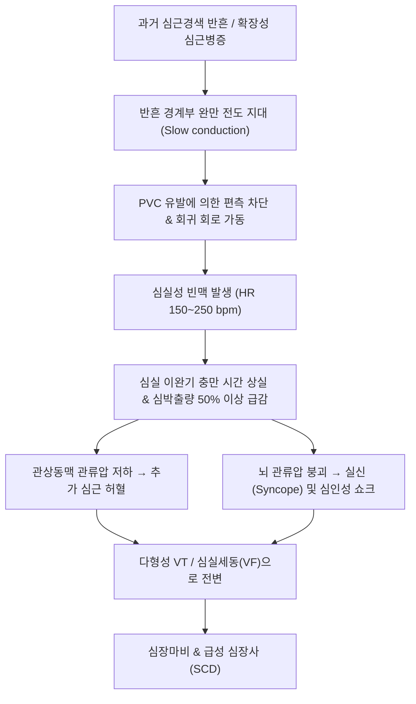

# 🩺 심실성 빈맥 (Ventricular Tachycardia, VT / V-Tach)

> **핵심 3줄 요약 (Key Summary)**:
> - 📍 병소 부위 & 해부·병태생리: 히스속 분지 하부 심실 심근에서 기원하는 연속적인 이소성 탈분극으로, 분당 100회 이상의 넓은 QRS 복합파($\ge 120\text{ ms}$)가 3박동 이상 지속됨. 심근경색 후 반흔(Scar-related reentry), 심근병증, 전해질 이상이 주원인.
> - 🚩 전형적 임상 양상: 지속시간(비지속성 NSVT $<30$초 vs 지속성 SVT $\ge 30$초) 및 형태(단형성 Monomorphic vs 다형성 Polymorphic). 심한 두근거림, 호흡곤란, 흉통, 어지럼증, 실신(Syncope), 혈압 저하 및 심인성 쇼크.
> - 🛠️ 핵심 검사 & 치료 전략: 12유도 심전도(방실 해리 AV dissociation, 융합파 Fusion wave, 포획파 Capture wave로 SVT 감별). 맥박이 없는 무맥성 VT는 즉각 비동기 제세동 + CPR, 혈역학적 불안정 시 즉각 동기화 심율동전환(Synchronized cardioversion), 안정 시 아미오다론 정주. 장기 치료는 전극도자 절제술(RFCA) 및 삽입형 제세동기(ICD).
> - ⚠️ 응급 의뢰 레드플래그: 무맥성 VT(심정지 상태), 혈역학적 불안정(수축기혈압 $<90\text{ mmHg}$, 폐부종, 의식 저하), 다형성 VT(TdP), 전기적 폭풍(Electrical storm: 24시간 내 3회 이상 지속성 VT 발생).

---

## 📌 목차
1. [질환 개요 & 해부학적 병태생리](#1-질환-개요--해부학적-병태생리)
2. [병태생리 메커니즘 & 생체역학적 악순환 네트워크](#2-병태생리-메커니즘--생체역학적-악순환-네트워크)
3. [임상 증상 & 이학적 검사(Physical Exam) 알고리즘](#3-임상-증상--이학적-검사physical-exam-알고리즘)
4. [감별 진단 매트릭스 (Differential Diagnosis)](#4-감별-진단-매트릭스-differential-diagnosis)
5. [한의 통합 치료 프로토콜 (침·약침·추나·한약)](#5-한의-통합-치료-프로토콜-침약침추나한약)
6. [양방 치료 & 병용·의뢰 기준 (Conventional Treatment & Referral)](#6-양방-치료--병용의뢰-기준-conventional-treatment--referral)
7. [재활 운동 & 생활습관 티칭 가이드](#7-재활-운동--생활습관-티칭-가이드)
8. [💡 사용자 진료실 핵심 필기 & 임상 노하우 (Melt-In 잔여 심화 집약)](#8--사용자-진료실-핵심-필기--임상-노하우--melt-in-잔여-심화-집약)
9. [출처 및 학술 참고 문헌 (References)](#9-출처-및-학술-참고-문헌-references)

---

## 1. 질환 개요 & 해부학적 병태생리

심실성 빈맥(Ventricular Tachycardia, VT)은 심실에서 기원하는 심박수 분당 100회 이상의 빈맥으로, 넓은 QRS 복합파($\ge 120\text{ ms}$)가 3박동 이상 연속해서 나타나는 상태를 의미한다. 심실의 부조화된 빠른 수축으로 인해 이완기 충만 시간이 사라져 심박출량이 급감하고, 치명적인 심실세동(VF)으로 악화될 수 있는 중증 부정맥이다.

### 임상-전기생리학적 분류
1. **지속성에 따른 분류**:
   - **비지속성 심실빈맥 (NSVT, Non-sustained VT)**: 3박동 이상 지속되나 **30초 이내에 자발적으로 정지**하며, 혈역학적 붕괴가 없는 상태.
   - **지속성 심실빈맥 (SVT, Sustained VT)**: **30초 이상 지속**되거나, 30초 이전이라도 저혈압, 실신, 폐부종 등 혈역학적 허탈로 응급 심율동전환이 필요한 상태.
2. **형태학적 분류**:
   - **단형성 (Monomorphic VT)**: 모든 QRS파의 모양이 동일함. 심근경색 후 반흔 조직 주변의 해부학적 고정 회귀 회로(Scar-related reentry)가 주원인.
   - **다형성 (Polymorphic VT)**: 박동마다 QRS 모양과 축이 끊임없이 변함. 급성 심근 허혈, 전해질 이상, 긴 QT 증후군(TdP) 등 기능적 불안정성이 주원인.

---

## 2. 병태생리 메커니즘 & 생체역학적 악순환 네트워크

![[심실성빈맥_2_회귀기전도해.png|450]]
> [그림 1: 재진입(Reentrant) 심실빈맥 기전 도해 — 전도속도(Conduction speed)와 불응기(Refractory period) 표 및 정상 전도로 옆에 재진입 회로가 형성된 조직 모식도 — 출처: Wikimedia Commons — File:Ventricular tachycardia.webm — 영상 대표 프레임 (CC BY-SA 4.0)]

![[심실성빈맥_2_심전도파형구간.png|450]]
> [그림 2: P·QRS군·ST분절·T파·U파와 PR·QT 간격을 색 띠로 구분한 심전도 파형 도해 — 광폭 QRS 빈맥에서 QRS 폭과 QT를 재는 기준 — 출처: Wikimedia Commons — File:ECG Complex.svg (CC BY-SA 2.5)]

### 1) 반흔 관련 회귀 회로 (Scar-related Reentry)
- 과거 심근경색 부위는 괴사 후 콜라겐 섬유성 반흔으로 치환됨.
- 반흔 내부 및 경계부에 생존해 있는 심근 다발은 전도 속도가 매우 느림(Slow conduction zone).
- 심실 조기 박동(PVC)이 들어올 때 한쪽 경로는 불응기에 걸려 편측 차단(Unidirectional block)되고, 느린 전도 경로를 통해 되돌아오는 거대 회귀 회로(Reentrant circuit)가 형성되어 심실빈맥이 지속됨.
- 박동수가 분당 150~250회로 치솟으면 심실 충만 시간(이완기)이 소실되고, 심실 중격과 자유벽의 수축 비동기화로 심박출량이 급감하여 관상동맥 허혈이 심화됨.

---

## 3. 임상 증상 & 이학적 검사(Physical Exam) 알고리즘

![[심실성빈맥_3_정상12유도대조.png|450]]
> [그림 3: 정상 12유도 심전도(대조) — 광폭 QRS 빈맥과 비교하기 위한 기준 기록, 좌측에 자동 측정치(PQ·QRS·QT/QTc 등)가 인쇄되어 있다 — 출처: Wikimedia Commons — File:12 lead ECG.jpg (CC BY 4.0)]

### 1) 주요 임상 증상
- **혈역학적 안정성 여부에 따른 양상**:
  - 안정 상태: 심한 가슴 두근거림, 흉부 압박감, 어지럼증, 숨가쁨.
  - 불안정 상태: 식은땀, 안면 창백, 저혈압 쇼크, 급작스러운 의식 상실 및 실신.
  - **무맥성 VT**: 요골 및 경동맥 맥박이 전혀 촉지되지 않는 심정지 상태.

### 2) 심전도 감별 진단 알고리즘 (Brugada Criteria: Wide QRS 감별)
광범위 QRS 빈맥(WCT)의 80%는 VT이며 20%는 변행전도 동반 SVT이다. 다음 4가지 중 하나라도 만족하면 VT로 진단:
1. 모든 흉부 유도(V1-V6)에서 **RS 복합파가 전혀 없음** (Concordance: 전 유도 양성 또는 음성).
2. RS 복합파가 있는 유도에서 **RS 간격(R파 시작부터 S파 최저점까지) $> 100\text{ ms}$**.
3. **방실 해리(AV Dissociation)** 존재: 독립적인 동방결절 P파가 빠른 QRS와 무관하게 튀어나옴.
4. **포획파(Capture wave)** 및 **융합파(Fusion wave)** 관찰 (결정적 증거).
5. V1, V2 및 V6에서 전형적인 VT 형태학적 기준 충족.

---

## 4. 감별 진단 매트릭스 (Differential Diagnosis)

| 감별 질환 | QRS 너비 | 방실 해리 / 융합파 | 임상적 위험도 | 감별 핵심 포인트 |
| :--- | :--- | :--- | :--- | :--- |
| **심실성 빈맥 (VT)** | **넓음 ($\ge 120\text{ ms}$)** | **방실 해리, 융합파 존재** | **매우 높음 (급사 위험)** | 구조적 심질환 병력 흔함, Brugada 기준 양성 |
| **변행 전도 동반 [[PSVT]]** | 넓음 ($\ge 120\text{ ms}$) | **방실 해리 없음 (1:1 P-QRS)** | 중간 | 각차단 기왕력, 아데노신 투약 시 종결 가능 |
| **WPW 증후군 동반 심방세동** | 넓고 불규칙함 | 없음 (불규칙 델타파) | 매우 높음 | 불규칙한 RR, 아데노신/CCB 투약 금기(VF 유발) |
| **심실 세동 ([[심실 세동]])** | 파형 분별 불가 | 없음 (무질서한 잔물결) | **최고 위험 (심정지)** | 즉각 비동기 제세동 필수 |

---

## 5. 한의 통합 치료 프로토콜 (침·약침·추나·한약)

> 🚨 **급성 심실성 빈맥 발생 시 행동 수칙**:
> 지속성 심실성 빈맥은 수 분 내에 심실세동으로 악화되어 급사를 초래할 수 있는 심혈관 응급 질환이다. **원내 발생 시 일체의 한방 치료는 금기이며, 즉시 119 구급대를 호출하고 혈압, 산소포화도, 의식 상태를 감시하며 제세동기를 대기**시켜야 한다. 맥박이 만져지지 않으면 즉시 심폐소생술(CPR)을 시행한다.
> 본 프로토콜은 **ICD 삽입 또는 전극도자 절제술 후의 회복기 재발 억제 및 자율신경 안정 보조 요법**에 한하여 적용한다.

### 1) 회복기 침구 치료 프로토콜
- **익기활혈(益氣活血) 및 청심안신(淸心安神)**:
  - [[내관]](PC6), [[신문]](HT7): 심장 교감신경 긴장 완화, 이소성 조기 탈분극 억제.
  - [[단중]](CV17), [[심수]](BL15): 흉중 기혈 소통, 심근 허혈 완화.
  - [[족삼리]](ST36), [[태충]](LR3): 사관혈 배혈로 전신 자율신경 균형 유지.

### 2) 회복기 한약 처방 (변증별 가감)
- **기허혈어·심맥어저(氣虛血瘀·心脈瘀阻)형 (심근경색 기왕력, 흉민, 피로, 혀의 자반)**:
  - **보양환오탕(補陽還五湯)** 합 **단삼음(丹蔘飮) 가감**:
  - 처방 구성: [[황기]], [[당귀]], [[천궁]], [[적작약]], [[도인]], [[홍화]], [[단삼]], [[백단향]], [[사인]].
- **음허화왕(陰虛火旺)형 (야간 심계, 번열, 구건, 불면)**:
  - **자감초탕(炙甘草湯)** 합 **천왕보심단(天王補心丹) 가감**:
  - 구성: [[자감초]], [[생지황]], [[맥문동]], [[인삼]], [[아교]], [[산조인]], [[원지]].
- ⛔ **부자, 초오, 마황 등 부정맥 유발 가능 약재 절대 금기**.

---

## 6. 양방 치료 & 병용·의뢰 기준 (Conventional Treatment & Referral)

### 1) 급성기 응급 처치 (ACLS Algorithm)
1. **무맥성 VT (Pulseless VT)**:
   - 심정지 상태 $\rightarrow$ **즉각 비동기 직류 제세동 (Defibrillation 120~200J)** + 고품질 CPR + 에피네프린/아미오다론.
2. **혈역학적 불안정 지속성 VT (저혈압, 의식 저하, 흉통, 폐부종)**:
   - **즉각 동기화 심율동전환 (Synchronized Cardioversion 100J)**.
3. **혈역학적 안정 지속성 VT (의식 명료, 혈압 안정)**:
   - **아미오다론 (Amiodarone)**: 150mg을 10분에 걸쳐 정주 후 지속 점적.
   - 대체제: 프로카인아마이드(Procainamide) 또는 리도카인(Lidocaine).

### 2) 장기 재발 방지 및 급사 예방
- **삽입형 제세동기 (ICD, Implantable Cardioverter-Defibrillator)**:
  - 심근경색 후 LVEF $\le 35\%$이거나 지속성 VT 생존자에서 **돌연사 예방의 1차 표준 치료 (Class I)**.
- **고주파 전극도자 절제술 (Catheter Ablation)**:
  - 반흔 관련 회귀 회로의 완만 전도 지대를 지도화(Substrate mapping)하여 고주파로 절제 (약물 불응성 VT 또는 ICD 쇼크 빈발 시 필수).
- **베타차단제 및 항부정맥제 유지 요법**.

### 3) 양방·전문과 응급 의뢰 기준 (Referral Criteria)
- 🚨 **광범위 QRS 빈맥 확인 즉시 119 구급 이송 및 심장내과 응급실 전원**.
- 🚨 ICD 삽입 환자에서 24시간 내 3회 이상 쇼크가 발생하는 **전기적 폭풍(Electrical Storm)** 의심 시.

---

## 7. 재활 운동 & 생활습관 티칭 가이드

### 1) 심장 급사 고위험 환자 생활 관리
- 과도한 운동 금지: 경쟁적 스포츠 및 고강도 무산소 운동 엄격 제한.
- 전해질 관리: 혈중 칼륨($4.0\sim 5.0\text{ mEq/L}$) 및 마그네슘($>2.0\text{ mg/dL}$) 수치를 철저히 유지.
- ICD 작동 시 대처법 교육: 1회 쇼크 시 안정 후 내원, 2회 이상 연속 쇼크 시 즉시 119 호출.

---

## 8. 💡 사용자 진료실 핵심 필기 & 임상 노하우 (Melt-In 잔여 심화 집약)

### 1) "넓은 QRS 빈맥을 보았을 때 절대로 베라파밀을 주지 마라"
- 진료실이나 응급 현장에서 QRS가 넓은 빈맥(WCT)을 발작성 상심실성 빈맥(PSVT)으로 속단하고 칼슘차단제(베라파밀, 딜티아젬)를 투여하는 것은 치명적 실수이다.
- 환자가 심실빈맥(VT)인 상태에서 베라파밀을 주입하면 말초 혈관 확장과 심근 수축력 억제로 혈압이 0으로 떨어지며 **심실세동으로 유도되어 즉사**할 수 있다.
- 감별이 불확실한 Wide QRS 빈맥은 **무조건 VT로 간주하고 대처하는 것이 불문율**이다.

### 2) 포획파(Capture)와 융합파(Fusion)를 찾아라
- 심전도 기록지에서 분당 150회의 넓은 파형이 이어지다가, 갑자기 정상 형태의 좁은 파형 하나가 쏙 끼어들어가 있다면 **포획파(Capture wave)**이다.
- 정상 파형과 넓은 파형이 반반 섞인 모양이 보인다면 **융합파(Fusion wave)**이다.
- 이 두 파형 중 하나만 찾아도 심방과 심실이 따로 놀고 있다는 명백한 증거이므로 1초 만에 **심실빈맥(VT)**으로 확진할 수 있다.

---

## 9. 출처 및 학술 참고 문헌 (References)

1. Tachycardia As Therapy: Control of an Electrical Storm Through Mechanism-Directed Treatment After Refractory Ventricular Arrhythmias. (2026). *Cureus*, 18(8):e89793. PMID: 42719472.

2. Wide QRS Complex Tachycardia. (2025). *StatPearls*, ():. PMID: 32644480.

3. Pulsed Field Ablation for Ventricular Arrhythmias: A Systematic Review and Single-Arm Meta-Analysis. (2026). *Pacing Clin Electrophysiol*, 49(8):. PMID: 41914897.

---

## 관련 노트

- [[심실 세동]]
- [[심실 조기 박동]]
- [[PSVT]]
- [[내관]]
- [[신문]]
- [[단중]]
- [[심수]]
- [[족삼리]]
- [[태충]]
- [[황기]]
- [[당귀]]
- [[천궁]]
- [[적작약]]
- [[도인]]
- [[홍화]]
- [[단삼]]
- [[자감초]]
- [[생지황]]
- [[맥문동]]
- [[인삼]]
- [[아교]]
- [[산조인]]
- [[원지]]
- [[보양환오탕]]
- [[단삼음]]
- [[자감초탕]]
- [[천왕보심단]]
