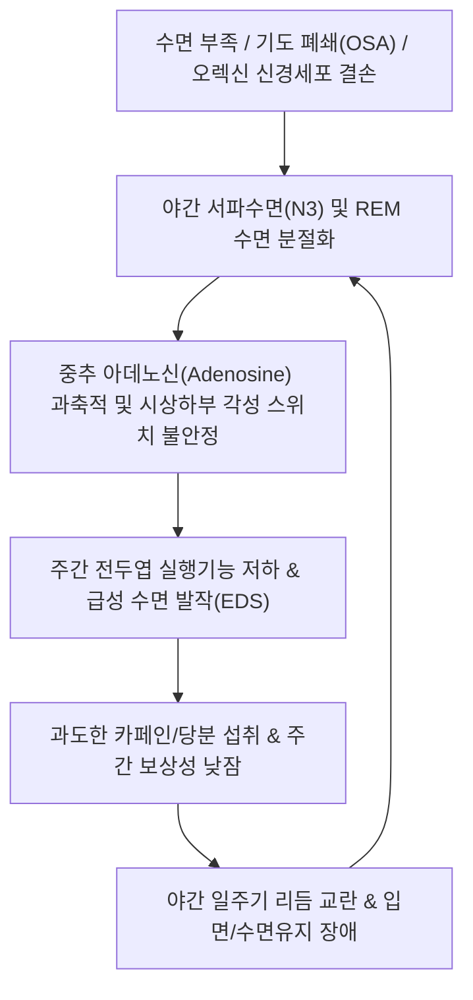

# 🩺 [[불면증 및 주간 과다 졸림증 eds]] (Excessive Daytime Sleepiness / 晝間過多嗜眠症)

> **핵심 3줄 요약 (Key Summary)**:
> - 📍 병소 부위 & 해부·병태생리: 시상하부 외측 오렉신(하이포크레틴, Orexin/Hypocretin) 분비 신경계 결핍 및 상행망상활성계(ARAS)의 도파민·노르에피네프린 각성 신호전달 기능부전, 수면 분절화로 인한 일주기 리듬 항상성 붕괴.
> - 🚩 전형적 임상 양상 & 3대 징후: 야간 수면 시간 확보에도 불구하고 식사 후·운전 중·대화 중 저항할 수 없는 수면 발작(Sleep attacks), 주간 인지 기능 저하 및 뇌무(Brain fog), 탈력발작(Cataplexy) 또는 수면마비 동반.
> - 🛠️ 핵심 감별 검사 & 한·양방 다각적 치료 전략: 앱워스 졸림증 척도(ESS $\ge 10$점) 선별, 야간 수면다원검사(PSG) 및 다중수면잠복기검사(MSLT), 각성 조절제(Modafinil, Solriamfetol) 및 한의 비위습담(脾胃濕痰)·심담허겁(心膽虛怯) 변증 한약(도담탕, 귀비탕, 보중익기탕), 백회·태충·풍지 침구 및 경추 추나 치료.
> - ⚠️ 응급 의뢰 레드플래그: 고속도로 운전 중이나 기계 조작 시의 불수의적 졸음 사고 위험, 야간 중증 산소포화도 저하($\mathrm{SaO_2} < 80\%$)를 동반한 폐쇄성 수면무호흡증, 급격한 체중 감소나 뇌압 상승 소견(뇌종양 감별 필요) 시 즉시 신경과 및 수면전문클리닉 의뢰.

---

## 📌 목차
1. [질환 개요 & 해부학적 병태생리](#1-질환-개요--해부학적-병태생리)
2. [병태생리 메커니즘 & 생체역학적 악순환 네트워크](#2-병태생리-메커니즘--생체역학적-악순환-네트워크)
3. [임상 증상 & 이학적 검사(Physical Exam) 알고리즘](#3-임상-증상--이학적-검사physical-exam-알고리즘)
4. [감별 진단 매트릭스 (Differential Diagnosis)](#4-감별-진단-매트릭스--differential-diagnosis)
5. [한의 통합 치료 프로토콜 (침·약침·추나·한약)](#5-한의-통합-치료-프로토콜--침약침추나한약)
6. [양방 치료 & 병용·의뢰 기준 (Conventional Treatment & Referral)](#6-양방-치료--병용의뢰-기준-conventional-treatment--referral)
7. [재활 운동 & 생활습관 티칭 가이드](#7-재활-운동--생활습관-티칭-가이드)
8. [💡 사용자 진료실 핵심 필기 & 임상 노하우 (Melt-In 잔여 심화 집약)](#8--사용자-진료실-핵심-필기--임상-노하우--melt-in-잔여-심화-집약-)
9. [출처 및 학술 참고 문헌 (References)](#9-출처-및-학술-참고-문헌--references-)

---

## 1. 질환 개요 & 해부학적 병태생리

* **정의 및 핵심 병태**:
  * 주간 과다 졸림증(Excessive Daytime Sleepiness, EDS)은 주간 각성 시간 동안 깨어 있는 상태를 유지하기 어렵고 저항할 수 없는 수면 욕구가 발생하는 임상적 증후군이다.
  * [[불면증]](Insomnia) 환자 중 20~30%가 주간 피로와 함께 심한 주간 졸림증을 호소하지만, 본 질환군은 기면증(Narcolepsy), 특발성 과수면증(Idiopathic Hypersomnia), 폐쇄성 수면무호흡증(OSA), 일주기 리듬 수면-각성 장애 등 기저의 중추성 각성 유지 기전 파탄을 광범위하게 포괄한다.
* **관련 해부학적 및 신경생리학적 구조물**:
  * **외측 시상하부(Lateral Hypothalamus)**: 각성을 유지하는 신경펩타이드인 오렉신 A 및 B(Orexin-A/B, Hypocretin-1/2)를 생성하는 핵심 신경핵이다. 자가면역 기전이나 신경퇴행으로 오렉신 신경원이 소실되면 각성과 수면 사이의 플립플롭 스위치(Flip-flop switch)가 불안정해진다.
  * **상행망상활성계(Ascending Reticular Activating System, ARAS)**: 청반핵(Locus coeruleus, 노르에피네프린), 복측피개영역(Ventral Tegmental Area, 도파민), 결절유두체핵(Tuberomammillary nucleus, 히스타민), 봉선핵(Raphe nuclei, 세로토닌)에서 대뇌피질로 투사되는 신경경로로, 각성 레벨의 항상성을 유지한다.
  * **기저핵 및 시상(Basal Forebrain & Thalamus)**: 콜린성(ACh) 투사를 통해 대뇌피질의 동기화된 각성 뇌파를 유도한다.
* **역학 및 위험 인자**:
  * 일반 인구의 약 10~25%가 유의미한 주간 졸림을 경험하며, 만성 수면 박탈, 교대 근무, 비만, 대사증후군, 우울증 및 진정 작용이 있는 약물(항히스타민제, 벤조디아제핀, 삼환계 항우울제 등) 복용이 주요 유발 인자이다.

---

## 2. 병태생리 메커니즘 & 생체역학적 악순환 네트워크

* **신경생화학적 메커니즘**:
  * **수면 항상성(Process S)과 생체시계(Process C)의 불일치**: 깨어 있는 시간이 길어질수록 뇌내 기저핵과 피질에 대사산물인 아데노신이 축적되어 수면 압력이 상승한다. 야간에 수면의 연속성이 깨지거나 수면의 질이 저하되면 주간 아데노신 소거가 불완전해져 상시적 각성 억제가 유발된다.
  * **도파민 및 노르에피네프린 전달 장애**: 중추성 도파민 수송체(DAT)와 노르에피네프린 수송체(NET)의 신호전달 감소는 주의력 집중 장애와 급격한 각성도 저하를 야기한다.
* **만성적 악순환 네트워크**:
  * 주간 과다 졸림 환자는 집중력을 유지하기 위해 고농도 카페인이나 에너지 음료, 단순당을 과다 섭취하게 된다.
  * 이는 야간의 깊은 서파수면 진입을 방해하고 교감신경계를 흥분시켜 야간 빈번 각성을 초래하며, 다음 날 주간 졸림증을 한층 악화시키는 피드백 루프를 형성한다.

---

## 3. 임상 증상 & 이학적 검사(Physical Exam) 알고리즘

* **주요 임상 증상**:
  * **저항할 수 없는 수면 발작**: 운전 신호 대기, 회의 중, 식사 직후 본인의 의지와 상관없이 잠에 빠져듦.
  * **수면 명정(Sleep drunkenness)**: 기상 시 극심한 방향감각 상실, 혼돈, 비틀거림이 수십 분간 지속됨.
  * **탈력발작(Cataplexy)**: 웃음, 분노 등 강한 감정적 자극 시 무릎에 힘이 풀리거나 턱이 떨어지는 증상(제1형 기면증 특이적).
  * **입면/출면 환각 및 수면마비**: 잠들 때나 깰 때 생생하고 공포스러운 환각이나 몸이 움직이지 않는 가위눌림.
* **이학적 검사 및 평가 도구**:
  * **앱워스 졸림증 척도(Epworth Sleepiness Scale, ESS)**: 8가지 일상 상황에서 졸 위험도를 0~3점으로 평가. 총점 24점 중 10점 이상이면 병적인 주간 과다 졸림증으로 판정.
  * **상기도 구조 평가**:
    * **말람파티 점수(Mallampati Score)**: 개구 시 구개수와 편도의 노출도를 I~IV등급으로 평가하여 상기도 폐쇄 위험도 측정.
    * 목 둘레 측정: 남성 43cm(17인치), 여성 38cm(15인치) 이상 시 폐쇄성 수면무호흡증 위험 급증.
  * **신경학적 검사**: 뇌신경(Cranial Nerves), 건반사, 소뇌 실조 검사를 통해 뇌간 병변이나 중추신경계 종양 배제.

---

## 4. 감별 진단 매트릭스 (Differential Diagnosis)

| 감별 질환 | 호발 연령 및 특징 | 주간 졸림의 양상 | 핵심 감별 지표 및 검사 |
| :--- | :--- | :--- | :--- |
| **제1형 기면증 (Narcolepsy Type 1)** | 10~20대 청소년·청년기 | 10~20분의 짧은 수면 후 일시적 상쾌함, 잦은 수면 발작 | 탈력발작 동반, MSLT 잠복기 $\le 8$분 + SOREMP $\ge 2$회, 뇌척수액 오렉신 $< 110\,\mathrm{pg/mL}$ |
| **제2형 기면증 (Narcolepsy Type 2)** | 10~30대 | 탈력발작이 없는 지속적 졸림 | MSLT 상 SOREMP 2회 이상이나 뇌척수액 오렉신 정상 수치 |
| **특발성 과수면증 (Idiopathic Hypersomnia)** | 10~20대 | 10시간 이상 자도 졸림, 자고 일어나도 개운치 않음, 수면 명정 | MSLT 잠복기 $\le 8$분이나 SOREMP $< 2$회, 24시간 수면다원검사 상 총 수면시간 $\ge 660$분 |
| **[[폐쇄성 수면무호흡증]] (OSA)** | 40~60대 비만 남성 | 수면 중 코골이, 무호흡, 주간 만성 피로 및 졸림 | 수면다원검사(PSG) 상 무호흡-저호흡 지수(AHI) $\ge 5/\mathrm{h}$ |
| **만성 수면 박탈 증후군 (Behaviorally Induced Insufficient Sleep)** | 전 연령대(수험생, 직장인) | 주말에 3시간 이상 보상성 늦잠을 자면 증상 현저히 호전 | 수면일기 작성 시 주중 수면시간 6시간 미만, 주말 수면연장 시 주간 피로 완화 |
| **우울장애 동반 과수면 (Atypical Depression)** | 20~40대 여성 | 피로감, 에너지 저하, 침대에 누워있으려 함 | 기분 저하, 무쾌감증, 체중 증가 및 납양 마비(Leaden paralysis) |

---

## 5. 한의 통합 치료 프로토콜 (침·약침·추나·한약)

* **침구 치료**:
  * **선혈 원칙**: 상행망상활성계 자극 및 청열성뇌(淸熱醒腦), 거습화담(祛濕化痰).
  * **주요 혈위**: [[백회(GV20)]], [[사신총(EX-HN1)]], [[풍지(GB20)]], [[태충(LR3)]], [[합곡(LI4)]], [[족삼리(ST36)]], [[풍륭(ST40)]], [[신문(HT7)]].
  * **자침 기법**: 백회·사신총에 0.25×30mm 호침으로 피하 평자하여 득기 후 2Hz 전침 자극 15분 적용(피질 각성도 정상화). 풍륭·족삼리는 직자 20mm 심자하여 비습(脾濕) 운화 촉진.
* **약침 치료**:
  * **황련해독탕 약침** 또는 **신맥·조해 자하거 약침**:
    * 풍지(GB20), 완골(GB12), 대추(GV14)에 각 0.2~0.3cc씩 총 1.0cc 주입.
    * 뇌혈류 순환 개선 및 교감-부교감 신경계 불균형 조정.
* **추나 요법 (경추 및 후두하근 이완)**:
  * **후두하근막 이완기법(Suboccipital Release)**: 대후두신경 및 척추동맥 압박을 해소하여 뇌저 순환을 증진시킴.
  * **상부 흉추 가동술**: 교감신경절 연접부 긴장을 완화하여 흉곽 호흡 효율성 극대화.
* **변증 한약 처방**:
  * **비위기허·습담조체(脾胃氣虛·濕痰阻滯형 — 식후 극심한 식곤증 및 전신 무력)**:
    * [[보중익기탕]] 합 [[도담탕]]: 인삼, 황기, 백출, 진피, 반하, 복령, 남성, 지실 각 4~8g. 습담을 배출하고 중기(中氣)를 끌어올려 청양출상규(淸陽出上竅) 유도.
  * **심담허겁·기혈양허(心膽虛怯·氣血兩虛형 — 얕은 잠, 기면, 건망)**:
    * [[귀비탕]] 가 석창포, 원지: 산조인(초), 당귀, 원지, 백복신, 용안육, 석창포. 심비(心脾)를 보익하고 뇌규(腦竅)를 열어 각성 유지.
  * **간담습열(肝膽濕熱형 — 안면 홍조, 구고, 만성 피로와 주간 졸림)**:
    * [[용담사간탕]]: 간담의 열을 내리고 맑은 기운을 회복시킴.

---

## 6. 양방 치료 & 병용·의뢰 기준 (Conventional Treatment & Referral)

* **약물 치료 (Medication)**:
  * **중추신경 각성제(Wakefulness-promoting agents)**:
    * **모다피닐(Modafinil, 프로비질)**: 100~200mg 1일 1회 아침 복용. 도파민 수송체 차단으로 세포외 도파민 농도 증가. 내성 및 의존성이 기존 암페타민 계열 대비 낮음.
    * **아모다피닐(Armodafinil, 누비질)**: R-이성질체로 반감기가 길어 오후 각성 유지에 유리.
    * **솔리암페톨(Solriamfetol, 수노시)**: 도파민/노르에피네프린 재흡수 억제제(DNRI). 기면증 및 OSA 환자의 주간 졸림증에 2차 치료제로 처방.
  * **GABA-B 수용체 작용제**:
    * **소듐 옥시베이트(Sodium Oxybate, Xyrem)**: 야간 수면 중 깊은 서파수면을 유도하여 주간 수면 발작 및 탈력발작을 억제. 엄격한 통제 약물.
* **비약물 시술 및 의료기기**:
  * **양압기(CPAP, Continuous Positive Airway Pressure)**: 폐쇄성 수면무호흡증(OSA)으로 인한 주간 졸림증의 1차 표준 치료.
* **한의 병용 판단 및 상호작용**:
  * 모다피닐 복용 중 두통, 불안, 심계항진이 발생하는 환자에게 한의 침구 및 안신(安神) 한약 병용 시 자율신경 부작용을 완화하고 약물 요구량을 안정적으로 감량하는 데 도움을 줌.
  * 한약재 중 마황(Ephedra) 제제 병용 시 각성제와의 교감신경 흥분 상승 작용으로 혈압 상승 및 부정맥 유발 위험이 있으므로 병용 금기.
* **양방 및 전문과 의뢰 기준**:
  * **신경과/수면클리닉 긴급 의뢰**: 운전 중 졸음 사고 기왕력, 탈력발작 동반 의심 환자, 수면다원검사 및 MSLT 확진 검사가 필요한 경우.
  * **이비인후과 의뢰**: 중증 편도 비대, 비중격 만곡증 등 수술적 교정이 요구되는 OSA 환자.

---

## 7. 재활 운동 & 생활습관 티칭 가이드

* **수면 위생 및 일주기 리듬 재조정**:
  * **기상 즉시 30분간 자연광 쬐기**: 망막의 멜라놉신 세포를 자극하여 시교차상핵(SCN)의 생체시계를 초기화하고 야간 멜라토닌 분비 리듬을 동기화.
  * **계획된 짧은 낮잠(Scheduled Power Naps)**: 오후 1~3시 사이 15~20분간의 수면은 아데노신 압력을 감소시키고 오후 집중력을 향상시킴(30분 이상 수면 시 수면 관성으로 인해 악화).
* **식이 및 영양 요법**:
  * 점심 식사 시 고탄수화물·고지방 식이를 제한하고 단백질과 식이섬유 중심의 식단 구성(인슐린 급상승으로 인한 식후 트립토판 유입 및 세로토닌 합성 억제).
  * 오후 2시 이후 카페인 섭취 전면 제한.
* **유산소 운동 및 체중 감량**:
  * 주 4~5회, 30분 이상의 중강도 유산소 운동(빠르게 걷기, 수영, 실내 자전거)을 통해 인슐린 저항성을 개선하고 인두부 연조직 비후를 감소시킴.

---

## 8. 💡 사용자 진료실 핵심 필기 & 임상 노하우 (Melt-In 잔여 심화 집약)

* **식곤증(食困症)과 병적 EDS의 명확한 경계선 설정**:
  * 단순 식곤증은 식후 30분~1시간 내 가벼운 나른함으로 끝나지만, 병적 EDS 환자는 식사 여부와 무관하게 서 있거나 대화 중에도 눈꺼풀이 감기며 수초간 필름이 끊기는 미세수면(Microsleep)을 보임.
* **척추 정렬과 호흡량의 연계성 관찰**:
  * 거북목 자세와 흉추 후만이 심한 환자는 횡격막 호흡이 제한되고 수면 중 상기도 폐쇄가 악화됨.
  * 진료실에서 경추 견인 및 상부 흉추 신전 운동을 병행한 군에서 주간 졸림 개선 만족도가 현저히 높았음.
* **도담탕과 보중익기탕의 감별 투약 포인트**:
  * 설태가 후니(厚膩)하고 비만하며 가래가 끓고 머리가 무거운 환자는 [[도담탕]]을 위주로 사용.
  * 마르고 맥이 침약(沈弱)하며 아침에 일어나기 힘들어하고 오후만 되면 파김치가 되는 환자는 [[보중익기탕]] 가 승마, 시호, 석창포를 투여할 때 각성 반응이 극대화됨.

---

## 9. 출처 및 학술 참고 문헌 (References)

* de Lima MS, et al. (2026 Nov). Modafinil for excessive daytime sleepiness: A systematic review and meta-analysis of randomized controlled trials. *Sleep Med*. PMID: 42468246

* Kanawjia P, et al. (2026 Oct 5). Sodium oxybate for excessive daytime sleepiness in narcolepsy: a systematic review and meta-analysis of randomized placebo-controlled trials. *Daru*. PMID: 42831989

* Chapman JL, et al. (2026 Jun). The Role of Pharmacotherapy for Excessive Daytime Sleepiness in OSA: A Changing Landscape? *CHEST Pulm*. PMID: 42548477

