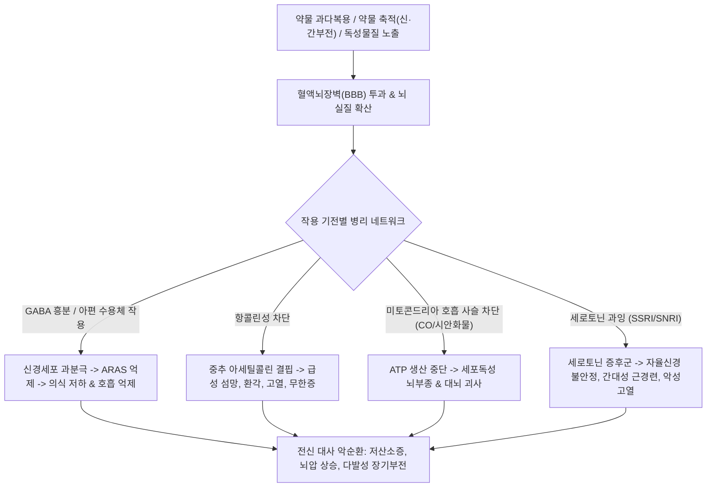
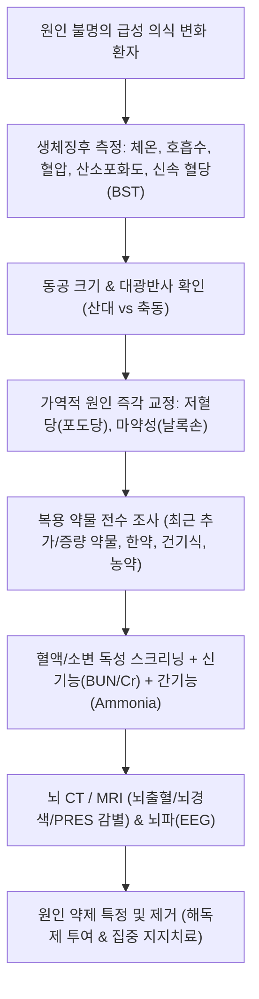

# 🩺 약물·중독성 뇌병증 (Toxic and Drug-Induced Encephalopathy)

> **핵심 3줄 요약 (Key Summary)**:
> - 📍 병소 부위 & 해부·병태생리: 외인성 약물, 중금속, 유기용매 또는 신경독성 물질이 혈액뇌장벽(BBB)을 통과하여 대뇌 피질, 기저핵, 망상활성계(RAS)의 뉴런 대사, 시냅스 신경전달 및 미토콘드리아 기능을 가역적/비가역적으로 손상시키는 미만성 대뇌 기능 장애.
> - 🚩 전형적 임상 양상: 급격한 의식 혼돈, 섬망(Delirium), 기면에서 혼수에 이르는 의식 저하, 주의력 결핍, 진전, 근간대성 경련(Myoclonus), 자세고정불능증(Asterixis), 환각.
> - 🛠️ 핵심 검사 & 치료 전략: 응급 생화학 검사, 동맥혈가스(ABGA), 소변 독성물질 스크리닝(Tox screen), 뇌파(EEG: 미만성 서파 triphasic waves), 뇌 MRI; 원인 약제 즉각 중단, 특이 해독제(날록손, 플루마제닐 등) 투여, 생체징후 안정화 및 보존적 지지 요법.
> - ⚠️ 응급 의뢰 레드플래그: 글래스고 혼수 척도(GCS) $\le 8$점, 호흡 억제(분당 < 10회), 조절되지 않는 전신 경련 발작, 악성 고열, 동공 반사 소실 -> 즉각 119 구급대 호출 및 응급실 후송.

---

## 📌 목차
1. [질환 개요 & 해부학적 병태생리](#1-질환-개요--해부학적-병태생리)
2. [병태생리 메커니즘 & 생체역학적 악순환 네트워크](#2-병태생리-메커니즘--생체역학적-악순환-네트워크)
3. [임상 증상 & 이학적 검사(Physical Exam) 알고리즘](#3-임상-증상--이학적-검사physical-exam-알고리즘)
4. [감별 진단 매트릭스 (Differential Diagnosis)](#4-감별-진단-매트릭스-differential-diagnosis)
5. [한의 통합 치료 프로토콜 (침·약침·추나·한약)](#5-한의-통합-치료-프로토콜--침-약침-추나-한약-)
6. [양방 치료 & 병용·의뢰 기준 (Conventional Treatment & Referral)](#6-양방-치료--병용의뢰-기준-conventional-treatment--referral)
7. [재활 운동 & 생활습관 티칭 가이드](#7-재활-운동--생활습관-티칭-가이드)
8. [💡 사용자 진료실 핵심 필기 & 임상 노하우 (Melt-In 잔여 심화 집약)](#8--사용자-진료실-핵심-필기--임상-노하우--melt-in-잔여-심화-집약-)
9. [출처 및 학술 참고 문헌 (References)](#9-출처-및-학술-참고-문헌--references)

---

## 1. 질환 개요 & 해부학적 병태생리

* **정의**: 약물·중독성 뇌병증(Toxic-Metabolic & Drug-Induced Encephalopathy)은 치료 목적으로 처방된 의약품, 약물 남용, 환경/산업성 독성 물질, 알코올 또는 중금속의 독성 효과로 인해 뇌 실질의 구조적 손상 없이(또는 이차적 부종/괴사를 동반하며) 전반적인 대뇌 피질 및 뇌간 기능 부전이 급성 또는 아급성으로 발생하는 증후군이다.
* **해부학적 취약 부위 및 기전**:
  * **상행망상활성계(ARAS) & 시상(Thalamus)**: 의식의 각성을 유지하는 신경망으로, 중추신경 억제제(진정수면제, 마약성 진통제)에 의해 직접 억제되어 졸음, 기면, 혼수를 유발.
  * **기저핵(Basal Ganglia)**: 높은 대사율과 혈류량으로 인해 일산화탄소(CO, 창백구 괴사), 메탄올(피각 괴사), 망간(담창구 축적), 항정신병제(도파민 수용체 차단에 따른 추체외로 증상)에 극도로 취약.
  * **대뇌 피질 & 해마(Hippocampus)**: 신경독성 흥분독성(Glutamate excitotoxicity), 저산소성 허혈, 항콜린성 섬망의 주된 표적.
* **원인 약제 및 독성 물질 분류**:
  * **의인성/처방 약제**: 항콜린제, 벤조디아제핀, 아편유사제, 삼환계 항우울제(TCA), 리튬, 면역억제제(사이클로스포린, 타크로리무스 - PRES 유발), 항경련제, 화학요법제.
  * **물질 남용**: 알코올(베르니케 뇌병증, 금단 진전섬망), 필로폰/코카인, 합성 마약.
  * **산업/환경 독소**: 일산화탄소(CO), 유기인계 살충제, 메탄올, 납/수은/비소 등 중금속.

---

## 2. 병태생리 메커니즘 & 생체역학적 악순환 네트워크

---

## 3. 임상 증상 & 이학적 검사(Physical Exam) 알고리즘

### 1) 주요 임상 증상
* **의식 및 인지 기능 변화**:
  * 경미한 주의력 결핍, 시간/장소 지남력 상실에서 시작하여 안절부절못함, 야간 악화 섬망(Delirium), 기면, 혼미(Stupor), 혼수(Coma).
* **신경근육계 징후**:
  * 양측성 자세고정불능증(Asterixis, 간성/요독성/약물성 뇌병증의 특징적 징후).
  * 근간대성 경련(Myoclonus), 거친 진전(Tremor), 운동실조(Ataxia).
  * 자율신경계 반응: 발한, 동공 산대(항콜린제/교감흥분제) 또는 축소(핀포인트 동공, 마약류), 고열.
* **약물군별 특이 독성증후군(Toxidrome)**:
  * **항콜린성**: "Mad as a hatter(섬망), Red as a beet(홍조), Dry as a bone(발한소실), Blind as a bat(산대), Hot as a hare(고열)".
  * **마약성(Opioid)**: 호흡수 감소($< 10$/분), 축동(Pinpoint pupils), 의식 저하.
  * **세로토닌 증후군**: 간대성 경련(특히 발목 클로누스), 고열, 자율신경 불안정(혈압/맥박 급변), 장음 항진.

### 2) 이학적 검사 및 진단 알고리즘

---

## 4. 감별 진단 매트릭스 (Differential Diagnosis)

| 감별 질환 | 의식 상태 | 동공 소견 | 체온 / 자율신경 | 뇌파 / 영상 소견 | 감별 핵심 |
| :--- | :--- | :--- | :--- | :--- | :--- |
| **약물·중독성 뇌병증** | 섬망 ~ 혼수 | 약물별 상이 (산대/축동) | 다양함 (항콜린/세로토닌 시 고열) | 미만성 서파, 삼상파(Triphasic) | 약물 노출력, 약제 중단 시 호전 |
| **급성 뇌경색 / 뇌출혈** | 다양함 | 일측성 동공 부동 가능 | 대개 정상 혈압 급상승 | **국소 신경학적 결손, CT 이상** | 편마비, 안면마비 등 국소 징후 |
| **중추신경계 감염 (뇌염/수막염)** | 혼미 ~ 혼수 | 정상 | **뚜렷한 고열, 경부강직** | 뇌척수액(CSF) 백혈구 급증 | 수막자극징후(Kernig, Brudzinski) |
| **저혈당 뇌병증** | 발한, 혼수 | 산대 가능 | 저체온 또는 정상 | 혈당 $< 50 \text{ mg/dL}$ | 50% 포도당 정주 시 즉각 의식 회복 |
| **간성 뇌병증 (Hepatic)** | 기면 ~ 혼수 | 정상 | 황달, 복수, 복벽정맥류 | 혈중 암모니아(NH3) 급상승 | 만성 간경변 병력, 간부전 징후 |

---

## 5. 한의 통합 치료 프로토콜 (침·약침·추나·한약)

> 🚨 **초응급 절대 레드플래그 (Red Flag Alert)**: 급성 약물 중독 및 중독성 뇌병증 환자는 분초를 다투는 기도 확보와 특이 해독제 투여, 혈액투석이 필요한 **응급의학과 집중치료실(ICU) 전원 대상**이다. 외래 진료실에서 침이나 한약으로 해결하려 해서는 절대로 안 되며 즉각 119를 호출해야 한다. 한의 치료는 양방 독소 배출 및 급성기 치료가 완료된 후 남은 **인지 저하, 만성 피로, 자율신경실조증 회복을 위한 후유증 재활 요법으로 엄격히 한정**한다.

### 1) 후유증 회복기 변증 분류
* **담몽심규(痰蒙心竅)**: 정신이 맑지 못하고 멍함, 기억력 감퇴, 언어 완만, 설담태백니, 맥활.
* **기음양허·어혈조락(氣陰兩虛·瘀血阻絡)**: 전신 기력 쇠약, 사지 떨림, 불면, 두통, 설홍소태, 맥세삭.

### 2) 회복기 침구 치료
* **혈위**:
  * 뇌혈류 개선 및 개규(開竅): [[백회]](GV20), [[사신총]](EX-HN1), [[풍지]](GB20), [[인중]](GV26).
  * 신경계 안정 및 진전 완화: [[태충]](LR3), [[합곡]](LI4), [[신문]](HT7), [[내관]](PC6), [[족삼리]](ST36).
* **자침 기법**: 유침 15~20분, 과도한 강자극을 피하고 평보평사(平補平瀉)로 뇌기능 활성화.

### 3) 회복기 한약 처방 (독소 배출 후 뇌세포 보호)
* **원지성향탕(遠志醒香湯) 또는 총명탕(聰明湯) 가감**:
  * 뇌 세포 독성 손상 후 잔여 인지기능 장애 개선. (원지, 석창포, 백복신, 용안육, 당귀, 산조인).
* **생간건비탕(生肝健脾湯) 가감**: 간과 신장의 잔여 해독 대사를 돕고 비위를 안정화.

---

## 6. 양방 치료 & 병용·의뢰 기준 (Conventional Treatment & Referral)

* **초기 응급 소생술 (Emergency Resuscitation)**:
  * 기도(Airway) 확보, 호흡(Breathing) 보조, 순환(Circulation) 유지.
  * **코마 칵테일(Coma Cocktail) 선별 투여**:
    * 50% 포도당수액 50 mL (저혈당 교정).
    * 티아민(Thiamine 100 mg IV, 베르니케 뇌병증 예방 위해 포도당보다 먼저 투여).
    * 날록손(Naloxone 0.4~2 mg IV, 마약성 아편제제 의심 시).
* **특이 해독제(Antidote) 투여**:
  * 아편유사제: 날록손(Naloxone).
  * 벤조디아제핀: 플루마제닐(Flumazenil, 단 만성 복용자의 금단 발작 위험 시 주의).
  * 항콜린제 섬망: 피소스티그민(Physostigmine).
  * 아세트아미노펜(타이레놀): N-아세틸시스테인(NAC).
  * 유기인계 농약: 아트로핀(Atropine) + 프랄리독심(PAM).
  * 일산화탄소: 고압산소치료(HBOT).
* **양방·전문과 의뢰 기준 (Referral Criteria)**:
  * **즉각 119 응급 후송 (Red Flag)**:
    * 원인 불명의 급성 의식 저하, 혼수, 지남력 상실.
    * 호흡수 < 10회/분, 산소포화도 저하, 청색증.
    * 약물 과다복용 자살 시도 의심 환자.

---

## 7. 재활 운동 & 생활습관 티칭 가이드

* **다약제 복용(Polypharmacy) 관리**:
  * 고령 환자는 여러 병원에서 중복 처방된 진정제, 수면제, 감기약(항히스타민/항콜린)을 한곳에 모아 DUR(의약품안전사용서비스) 점검을 받도록 지도.
* **간·신장 기능에 맞춘 약물 용량 조절**:
  * 신기능 저하 환자에서 정상 용량의 약제도 체내 축적되어 뇌병증을 유발하므로 정기 크레아티닌 추적 지도.
* **인지 재활 훈련**:
  * 뇌병증 회복기 환자의 일상 복귀를 위한 가벼운 읽기, 쓰기, 계산 등 인지 자극 훈련 병행.

---

## 8. 💡 사용자 진료실 핵심 필기 & 임상 노하우 (Melt-In 잔여 심화 집약)

* **감기약/수면제 먹고 헛소리하는 어르신의 '항콜린성 섬망' 감별**:
  * 고령 환자가 감기약이나 전립선약, 야간 빈뇨약, 수면유도제를 복용하고 갑자기 밤에 헛것을 보거나 가족을 못 알아본다며 중풍으로 오인하여 내원하는 경우가 흔하다.
  * 이때 환자의 입술이 바짝 말라 있고(Dry mouth), 피부에 땀이 전혀 나지 않으며, 동공이 풀려 있다면 뇌졸중이 아니라 **항콜린성 약물 유발성 뇌병증(Anticholinergic Delirium)**이다. 의심 약물을 중단시키고 수액을 공급하면 24~48시간 내에 극적으로 정상화된다.
* **진료실 보약 상담 시 반드시 '신장/간 수치' 먼저 확인할 것**:
  * 신부전이나 간경변이 있는 환자가 기력이 없다며 내원했을 때, 체내 대사 배설 능력이 떨어진 상태에서 무분별한 건강식품이나 약물을 복합 투여하면 미세 독성 뇌병증을 촉발할 수 있으므로 항상 기저 장기 기능을 먼저 살펴야 한다.

---

## 9. 출처 및 학술 참고 문헌 (References)

* Rauf A, et al. (2026 Nov). Biomarkers of chemical- and drug-induced neurotoxicity: A review of mechanistic insights and neuroprotective strategies. *Food Chem Toxicol*, 193:115124. PMID: 42580617.

* Ding Y, et al. (2026 Oct 1). Neuronal Cell Death Modalities and Protective Mechanisms Induced By Sevoflurane: A Narrative Review. *Anesth Analg*, 143(4):812-823. PMID: 42090240.

* Songur A, et al. (2026 Sep). Neuroprotective Effect of Morin Against Chemical-Induced Neurotoxicities and Neurodegenerative Disease Models. *Eur J Neurosci*, 64(5):412-429. PMID: 42750155.

---

## 관련 노트

- [[_의학/03_이론/질환/호흡기 질환/기타 호흡기/호흡 부전|호흡 부전]]
- [[신부전]]
- [[저혈압]]
- [[고혈압]]
- [[치매]]
- [[알츠하이머병]]
- [[간경변증]]

