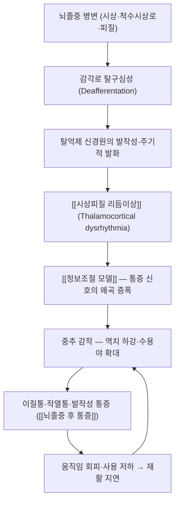

# ⚡ 뇌졸중 후 통증 (Central Post-Stroke Pain, CPSP / 중추성 뇌졸중후 통증)

> **핵심 3줄 요약 (Key Summary)**:
> - 📍 병소 부위 & 병태생리: 뇌졸중 병변 자체가 감각로(척수시상로·시상·시상피질 투사)를 침범해 생기는 중추성 신경병증성 통증으로, 시상 병변이 가장 전형이다. 말초가 아니라 중추에서 통증 신호 처리가 왜곡된 상태다.
> - 🚩 전형적 임상 양상 & 3대 징후: 병변 반대측 반신에 작열통·찌르는 통증·이질통이 나타나고, [[시상피질 리듬이상]] 가설로 설명되는 지속성·발작성 양상이 특징이다. 통증은 뇌졸중 발병 직후 또는 수개월 뒤 시작될 수 있다.
> - 🛠️ 핵심 감별 검사 & 한·양방 다중 치료 전략: [[DN-4]]·[[NPRS]]·[[EQ-5D-5L]]로 평가하고, 약물(삼환계 항우울제·가바펜티노이드·SNRI) 위에 침·[[전침]]·[[스크램블러 치료]] 같은 신경조절 중재를 병용한다.
> - ⚠️ 응급 의뢰 레드플래그 & 악화 요인: 새로 나타난 국소 신경학적 결손·의식 변화·심한 두통은 재발성 뇌졸중이므로 즉시 응급 의뢰한다. 통증 악화만으로 진통제를 무한 증량하지 말고 재발 평가를 먼저 한다.

---

## 📌 목차
1. [질환 개요 & 해부학적 병태생리](#1-질환-개요--해부학적-병태생리)
2. [병태생리 메커니즘 & 중추 감작 악순환 네트워크](#2-병태생리-메커니즘--중추-감작-악순환-네트워크)
3. [임상 증상 & 이학적 검사 알고리즘](#3-임상-증상--이학적-검사-알고리즘)
4. [감별 진단 매트릭스](#4-감별-진단-매트릭스)
5. [한의 통합 치료 프로토콜 (침·전침·약침)](#5-한의-통합-치료-프로토콜-침전침약침)
6. [양방 치료 & 병용·의뢰 기준](#6-양방-치료--병용의뢰-기준)
7. [재활 운동 & 생활습관 티칭 가이드](#7-재활-운동--생활습관-티칭-가이드)
8. [💡 진료실 핵심 필기 & 임상 노하우](#8--진료실-핵심-필기--임상-노하우)
9. [출처 및 학술 참고 문헌](#9-출처-및-학술-참고-문헌)

---

## 1. 질환 개요 & 해부학적 병태생리

![[뇌졸중 후 통증_01_뇌졸중유형_개요도해.jpg|480]]
> [그림 1: ① 개요 도해 — 허혈성 뇌졸중(혈관 폐색)과 출혈성 뇌졸중(혈관 파열)을 뇌 단면과 함께 비교한 한국어 도해. 중추성 통증은 병변 위치가 감각로를 침범할 때 발생한다 — 질병관리청 국가건강정보포털「뇌졸중」]

* **질환 정의 및 분류**
  * 뇌졸중 후 통증(중추성 뇌졸중후 통증)은 **뇌졸중 병변으로 인한 중추 감각로 손상 자체가 원인**이 되어 병변 반대측에 나타나는 신경병증성 통증이다. 말초 침해수용기 자극이나 말초신경 손상이 원인이 아니라는 점에서 [[당뇨병성 말초신경병증]]·[[대상포진후신경통]]과 발생 층위가 다르다.
  * 통상 뇌졸중 후 수일~수개월 내 발생하며, 뇌졸중 생존자의 상당수에서 여러 부위 통증(어깨 통증·경직성 통증·중추성 통증)이 겹쳐 나타난다 — 만성 통증 유병과 중증도가 뇌졸중 생존자의 기능·삶의 질과 연결된다는 보고가 있다.
  * **해부학적 분류**: 병변 위치에 따라 ① 시상(thalamic)형 ② 뇌간·척수시상로 경로형 ③ 피질·피질하형으로 나누어 이해한다. 시상 병변형이 진통제 반응이 가장 나쁘고 통증 강도가 높은 편으로 기술된다.
* **관련 해부학적 구조물**
  * **시상**: 척수시상로와 삼차신경 감각로가 교체(synapse)되는 중계소이며, 시상 병변은 Dejerine-Roussy(시상) 증후군의 고전적 병소다.
  * **척수시상로·후주계**: 통각·온각은 척수시상로(전외측계)로, 촉각·고유수용감각은 후주-내측섬유띠계로 올라간다. 이 두 경로 중 어느 쪽이 침범됐는지가 통증 양상과 감각 소실 패턴을 결정한다.
  * **피질·시상피질 투사**: 체성감각피질·섬엽·전대상피질로 이어지는 투사 섬유가 함께 손상되면 통증의 정서·인지 차원이 커진다.

![[뇌졸중 후 통증_01_시상중뇌경색_CT영상.png|480]]
> [그림 2: ② 영상 소견 — 시상과 중뇌를 침범한 경색 병변(화살표)을 보여주는 뇌 CT 축상면. 시상 병변은 중추성 뇌졸중후 통증의 대표 병소다 — Almamun M, et al. J Clin Med. 2015;4(3):369-374. PMID 26239245 (CC BY 4.0)]

---

## 2. 병태생리 메커니즘 & 중추 감작 악순환 네트워크

![[뇌졸중 후 통증_02_시상핵_해부도해.png|480]]
> [그림 3: ③ 해부 도해 — 뇌 정중시상단면에서 시상의 위치를 표시한 그림과 시상핵군(전핵·내측핵·외측핵·후핵 등) 라벨 도해. 시상은 감각 중계와 각성·정서 조절을 함께 담당한다 — Wikimedia Commons File:Thalamus3en1b.png (CC0)]

![[뇌졸중 후 통증_02_척수시상로_감각경로_도해.png|480]]
> [그림 4: ③ 해부 도해 — 척수 상행 감각로 도해. 후주계(촉각·고유수용감각)와 척수시상로(통각·온각)가 각각 어떻게 교차해 시상으로 올라가는지 나란히 표시되어 있다 — Wikimedia Commons File:Spinal Cord Sensory Pathways.png (CC BY-SA 4.0)]

### 1) 탈구심성과 탈억제 기전
* 시상·감각로가 손상되면 정상적인 구심성 입력이 줄고(탈구심성), 살아남은 신경원이 자발 발화·발작성 발화를 보인다. 억제성(GABA성) 회로의 상실이 이 과흥분을 억제하지 못하는 구조다 → [[중추 감작]]
* 시상의 내측핵·후핵군이 통증의 정서·각성 차원과 연결되므로, 같은 크기의 병변에서도 통증 강도·불면·우울이 크게 달라진다.

### 2) 시상피질 리듬이상 가설
* 탈구심성 상태에서 시상-피질 회로가 저주파(세타) 진동으로 편향되고, 국소적으로 고주파 진동이 얹히면서 통증이 지속된다는 가설이다. 이 관점은 스크램블러 치료·[[rTMS]]·[[tDCS]] 같은 신경조절 중재의 이론적 배경이 된다 → [[시상피질 리듬이상]]

### 3) 악순환 고리
* 통증 → 움직임 회피 → 근력·관절가동범위 저하 → 경직·구축 → 통증 악화의 고리가 만들어진다. 그래서 중추성 통증 치료에는 반드시 재활 운동이 병행되어야 하며, 통증만 낮추는 처치는 재발 방지에 약하다 → [[운동요법]]

---

## 3. 임상 증상 & 이학적 검사 알고리즘

![[뇌졸중 후 통증_03_피부분절_감각분포_도판.png|480]]
> [그림 5: ④ 감각 분포 판정 도판 — 전신 피부분절(C2~S5)을 정면·배면으로 표시한 고전 해부 도판. 중추성 통증의 분포는 피부분절을 따르지 않고 병변 반대측 반신에 나타나므로, 말초성 통증과 구분하는 첫 단계가 된다 — Grant's Atlas of Anatomy(1962), Wikimedia Commons File:Grant 1962 663.png (Public domain)]

### 1) 주소증 및 신경학적 증상
* **통증 양상**: 작열감(불타는 느낌), 찌르거나 칼로 베는 듯한 통증, 전기 통하는 느낌, 쥐어짜는 느낌이 섞인다. 통증은 지속성 자발통과 발작성 악화가 겹치는 형태가 흔하다.
* **분포**: 병변 반대측 반신 또는 특정 사지에 나타난다. 얼굴·손·발처럼 체성감각피질 표상 면적이 넓은 부위에서 심한 경우가 많다.
* **동반 감각 이상**: 이질통(옷깃·바람 등 무해 자극이 통증으로 인식), 통각과민, 온도 감각 저하, 감각 저하와 통증이 같은 부위에 공존하는 양상(온도 자극에 통증이 유발되는 cold allodynia 포함).
* **이차 증상**: 불면, 우울·불안, 피로, 집중력 저하가 자주 동반된다. 통증 강도만 묻고 수면·기분을 묻지 않으면 치료 반응을 잘못 판단한다.

### 2) 필수 평가도구
* [[DN-4]]: 신경병증성 통증 성분을 선별한다. 10문항 중 4점 이상이면 신경병증성 성분 양성으로 본다.
* [[NPRS]]·[[시각아날로그척도(VAS)]]: 통증 강도 추적. 중추성 통증은 강도 변동이 크므로 24시간 평균과 최악 통증을 함께 기록한다.
* [[EQ-5D-5L]]·[[PGIC]]: 뇌졸중 재활에서는 통증 강도만큼 기능·삶의 질·환자 총평이 중요하다. 통증이 반쯤 줄어도 환자가 '달라졌다'고 말하지 않으면 치료 목표 설정을 다시 본다.
* **이학적 검사 주의**: 근긴장도(경직 여부), 관절가동범위, 감각 검사(핀·온도·진동), 편측 무시나 시야 결손 동반 여부를 함께 기록한다. 이 소견들이 재활 처방을 바꾼다.

---

## 4. 감별 진단 매트릭스

| 감별 질환 | 호발 병소 및 원인 | 주소증 차이점 | 감별 포인트 |
| :--- | :--- | :--- | :--- |
| [[뇌졸중 후 통증]] (본 질환) | 뇌졸중 병변(시상·감각로·피질) | 병변 반대측 반신, 작열통·이질통, 감각 소실 공존 | 온도 자극 유발 통증, 시상 병변 영상 확인 |
| [[복합부위통증증후군]] | 말초 손상 후 중추 재조직 | 원위 사지에 국한, 부종·피부색·체온 변화 뚜렷 | [[부다페스트 기준]] 증상·징후 개수 충족 |
| 뇌졸중 후 어깨 통증 | 어깨 관절낭·회전근개·편마비 | 어깨 국소 압통·가동 제한 | 어깨 수동가동 시 통증 재현, 관절 초음파 |
| 경직성 통증 | 상위 운동신경원 손상 | 수동 신전 저항·근육 단축 부위 | 수정 Ashworth 등급, 근육 촉진 |
| [[대상포진후신경통]] | 척수 후근신경절·후각 | 피부분절 띠 모양, 발진 병력 | 발진 병력, 분포가 분절성 |

> 🚩 레드플래그: 새로 생긴 국소 신경학적 결손, 의식 변화, 심한 두통, 발열, 사지 근력의 급격한 저하 → 재발성 뇌졸중·감염·약물 이상반응을 먼저 배제한다.

---

## 5. 한의 통합 치료 프로토콜 (침·전침·약침)

![[뇌졸중 후 통증_05_경피적전기신경자극_시술실사.png|440]]
> [그림 6: ⑤ 시술 실사(대체) — 초음파 유도 경피적 전기신경자극 시술 장면(해부 표시·초음파 화면·시술 사진). 뇌졸중 후 환자에서 실제로 시행되는 침습적 전기자극의 장면이며, 한의 침·전침 시술 사진은 Commons에서 확보하지 못해 이 슬롯은 대체 실사로 두고 사유를 남긴다 — Sartori F, et al. Neurol Int. 2025;17(3):34. PMID 40137455 (CC BY 4.0)]

* **변증 접근(중풍 후 변증)**: 뇌졸중 후 통증은 氣虛血瘀·肝腎陰虛·風痰阻絡 축으로 나누어 보되, **손상 病所가 중추인 만큼 국소 어혈 처방만으로는 부족하다**는 전제로 접근한다. 재활 운동·약물·신경조절 중재를 한 축으로 묶는 통합 설계가 핵심이다.
* **침구 치료 (Acupuncture)**
  * **원위–근위 병용 배혈**: 편마비 환자의 환측에 사신총·백회(GV20) + 국소 아시혈, 원위에 합곡(LI4)·태충(LR3)·족삼리(ST36)·삼음교(SP6)·양릉천(GB34)을 배혈한다. 자극은 마비·감각 저하 부위에서 과자극으로 다칠 수 있으므로 득기를 환자가 표현할 수 있는 부위와 감각 저하 부위를 구분해 강도를 다르게 잡는다.
  * **전침 파라미터**: 저주파(2 Hz) 또는 2/100 Hz 교대파, 20~30분. 감각이 둔한 부위는 전류를 무리하게 올리지 말고 근수축이 눈으로 보이는 최소 강도를 기준으로 삼는다.
  * **근거**: 중추성 뇌졸중후 통증에 대한 침 관련 중재의 총괄고찰(Umbrella Review)이 2026년에 발표되어, 통증 강도와 삶의 질 개선을 보고하면서도 원 시험의 이질성과 눈가림 한계를 함께 지적했다 → [[전침]] · [[침 자극 강도와 용량]] · [[득기]]
* **약침 치료 (Pharmacopuncture)**: 경직·근긴장이 겹친 환자에서 환측 두경부·견배부·상지 근육의 압통점과 협척혈 부위에 저용량 자하거·봉약침을 배합하는 방식이 임상에서 쓰인다. 중추 병변 자체를 겨냥하는 것이 아니라 **주변 경직·통증 축을 낮춰 재활을 가능하게 만드는 보조 처치**로 자리매김한다 → [[약침]] · [[봉약침]] · [[자하거약침]]
* **한약 치료 (Herbal Medicine)**: 변증에 따라 보양환오탕·황기계지오물탕(기허혈어), 신통축어탕·혈부축어탕(기체혈어), 청호별갑탕(음허내열) 계열을 고려한다. 항혈전제 복용 환자가 많으므로 활혈화어 처방 시작 전 복용약을 반드시 확인한다 → [[보양환오탕]] · [[황기계지오물탕]]
* **신경조절 중재 병용**: 스크램블러 치료·[[rTMS]]·[[tDCS]]는 약물 반응이 나쁜 중추성 통증에서 시도되는 비약물 축이다. 국내 가용성과 비급여 여부를 먼저 확인하고, 기기 없이 같은 원리(감각이 남은 분절에 비통증 전기 자극을 넣는다)를 [[TENS]]·전침 배치에 참고할 수 있다. 단 이는 **이론적 유추이며 TENS가 같은 효과를 낸다는 근거는 아니다** → [[스크램블러 치료]] · [[관문조절설]]

---

## 6. 양방 치료 & 병용·의뢰 기준

| 계열 | 대표 약물 | 용법·특징 | 한의 병용 판단 |
| :--- | :--- | :--- | :--- |
| 삼환계 항우울제 | [[아미트립틸린]] | 저용량(10~25 mg) 취침 전. 중추성 통증에서 1차로 시도되는 축 | 병용 가능. 항콜린성 부작용(구갈·변비·요폐·기립성 저혈압)이 침 치료 후 어지럼과 겹칠 수 있어 기립성 저혈압을 함께 확인 |
| 가바펜티노이드 | [[프레가발린]] · [[가바펜틴]] | 어지럼·졸림으로 증량이 제한된다 | 병용 가능. 감량 시 반동 통증을 환자에게 미리 설명 |
| SNRI | [[둘록세틴]] | 우울·불안 동반 시 이점 | 병용 가능. 오심·불면 확인 |
| 국소 제형 | [[리도카인]] · [[캡사이신]] | 국소 적용으로 전신 부담이 적다 | 병용 가능. 피부 손상·감각 소실 부위 도포 자제 |
| 비약물 | 신경조절(스크램블러·rTMS), 신경차단 | 시술자 의존성·비급여 여부 확인 필요 | 병용 판단은 시설·비용에 좌우된다 |

* **수술·시술 적응증**: 약물·신경조절로 조절되지 않는 극심한 통증에서 시상 자극·운동피질 자극·척수자극 같은 침습적 신경조절이 시도될 수 있다. 국내에서는 적응·보험 조건이 제한적이므로 이뤄지는 경우는 드물다.
* **한의 병용 판단**: 항혈전제·항응고제 복용 중이면 **자침 깊이·자극 강도를 낮추고 자락은 피한다.** 스크램블러 치료는 이식형 전자기기(심장박동기·척수자극기), 6개월 내 심근경색, 조절되지 않는 뇌전증, 증상성 뇌전이에서 금기다.
* **의뢰 기준**: 새 국소 신경학적 결손·의식 변화·심한 두통·발열은 즉시 응급 의뢰. 통증 조절이 안 되거나 약물 부작용으로 일상이 무너지면 재활의학과·신경과·통증의학과로 의뢰한다.

---

## 7. 재활 운동 & 생활습관 티칭 가이드

![[뇌졸중 후 통증_07_재활운동_도해.jpg|400]]
> [그림 7: ⑦ 재활 실사·도해 — 치료사가 함께 시행하는 뇌졸중 재활 동작(앉기·서기·보행·상지 훈련) 그림. 중추성 통증 관리에서 재활은 통증 치료와 분리할 수 없는 축이다 — 질병관리청 국가건강정보포털「뇌졸중 환자의 재활」]

* **통증 악화 없는 범위 설정**: 재활은 '통증 0을 기다린 뒤 시작'이 아니라 **통증이 NRS 3 이하로 유지되는 범위에서 시작해 점진적으로 늘리는** 원칙으로 설계한다 → [[점진적 과부하]]
* **감각 재교육**: 환측에 다양한 촉각·온도 자극을 주고 환자가 그 자극을 '무해함'으로 재학습하도록 지도한다. 거울 치료·반복적 과제 훈련과 결합할 수 있다 → [[거울치료]]
* **보행·이동**: 낙상 위험이 높으므로 [[TUG 검사]]·[[버그균형척도]]로 이동·균형을 정기 추적한다. 감각이 둔한 환자는 발 피부 손상을 못 느끼므로 발 확인을 습관화한다 → [[당뇨발]]
* **생활 티칭**: 옷은 부드러운 소재로 헐렁하게, 냉온 자극(얼음찜질·핫팩)은 감각 소실 부위에 화상 위험이 있어 금지, 야간 통증으로 수면이 무너지면 취침 전 복용약 시간 조정과 [[인지행동치료(CBT-I)]] 병행을 검토한다.

---

## 8. 💡 진료실 핵심 필기 & 임상 노하우

* **환자 스크립트 — 효과 크기를 정직하게**: 스크램블러 파일럿 시험에서 통증은 5일 치료 직후 평균 6.7점에서 3점 가까이 줄었고(56%), 4주 뒤에는 38% 감소가 유지됐지만 절반 이상 호전된 환자는 30%로 줄었다. 진료실에서는 "짧은 집중 코스 뒤에 반드시 유지 치료를 계획한다"고 처음부터 설명하는 편이 순응도가 높다.
* **'중추 통증은 약만으로 안 된다'는 문장을 쓰지 말 것**: 약물로 조절되지 않는 다수 환자가 있고, 재활·신경조절·수면·기분 관리가 함께 움직일 때 결과가 달라진다. 진료 첫 방문에서 ① 통증 ② 수면 ③ 움직임 ④ 기분 네 칸을 함께 기록한다.
* **이질통 환자의 진료실 배려**: 옷깃 자극만으로 통증이 폭발하므로 진료 시 옷 위를 두드리지 않고, 자침 전 환부 접촉을 최소화한다. 기계적 이질통이 심한 부위는 먼저 감각이 남은 주변부에서 시작해 범위를 확장한다.
* **기기 적용이 불가할 때**: 감각이 남아 있는 분절 주변에 전극을 붙이고 자극이 통증으로 번지지 않는 위치를 찾는 '위치 탐색' 능력을 기르면 TENS·전침 배치에도 그대로 쓸 수 있다. 단 이는 같은 기전의 유추이며 근거 승계가 아니다.

---

## 9. 출처 및 학술 참고 문헌

1. Park J, et al. Scrambler therapy for treatment of poststroke pain. *Ann Clin Transl Neurol*. 2024;11(11):2904-2911. [PMID 39308135](https://pubmed.ncbi.nlm.nih.gov/39308135/) · [DOI](https://doi.org/10.1002/acn3.52201)
   - [연구 요약] 존스홉킨스 단일기관 파일럿 무작위 샴대조 시험(20명, 5일 연속 40분). 치료 직후 통증 56% 감소·4주 38% 유지였으나 50% 반응자율은 4주에 30%로 감소했다.
2. Klit H, Finnerup NB, Jensen TS. Central post-stroke pain: clinical characteristics, pathophysiology, and management. *Lancet Neurol*. 2009;8(9):857-868. [PMID 19679277](https://pubmed.ncbi.nlm.nih.gov/19679277/)
   - [연구 요약] 중추성 뇌졸중후 통증의 정의·역학·기전·치료를 정리한 표준 고찰. 시상 병변·탈구심성 기전과 약물 반응의 한계를 함께 기술한다.
3. Wang L, et al. Efficacy and Safety of Acupuncture-Related Therapies for Central Post-Stroke Pain: An Umbrella Review. *J Pain Res*. 2026;19:595809. [PMID 42011296](https://doi.org/10.2147/JPR.S595809)
   - [연구 요약] 중추성 뇌졸중후 통증에 대한 침 관련 중재 총괄고찰로, 통증·삶의 질 개선을 보고하면서 원 시험의 이질성·눈가림 한계를 지적했다.
4. Karri J, et al. The Use of Scrambler Therapy in Treating Chronic Pain Syndromes: A Systematic Review. *Neuromodulation*. 2023;26(8):1499-1509. [PMID 35691908](https://pubmed.ncbi.nlm.nih.gov/35691908/)
   - [연구 요약] 만성 통증 증후군에서 스크램블러 치료의 체계적 고찰. 통상 10~12회 코스와 보충 세션 운용을 정리해 프로토콜 설계의 참조가 된다.
5. Marineo G, et al. Inside the Scrambler Therapy, a Noninvasive Treatment of Chronic Neuropathic and Cancer Pain: From the Gate Control Theory to the Active Principle of Information. *Integr Cancer Ther*. 2019. [PMC6482660](https://pmc.ncbi.nlm.nih.gov/articles/PMC6482660/)
   - [연구 요약] 전극 배치·강도 조정·세션 운용과 정보조절 기전을 정리한 리뷰로, 시술 조건과 한계를 이해하는 데 실용적이다.
6. Almamun M, et al. A Case of Midbrain and Thalamic Infarction Involving Artery of Percheron. *J Clin Med*. 2015;4(3):369-374. [PMID 26239245](https://pubmed.ncbi.nlm.nih.gov/26239245/)
   - [연구 요약] 시상·중뇌를 침범한 경색 증례 보고로, 본 노트의 영상 소견 그림 출처다.
7. 질병관리청 국가건강정보포털 — 뇌졸중 / 뇌졸중 환자의 재활. [링크](https://health.kdca.go.kr)
   - [연구 요약] 한국어 환자용 설명 원문과 도해 출처. 공공저작물 출처표시·변경금지 조건에 따라 원본 그대로 인용했다.

---

## 함께 보기
- [[뇌졸중]] · [[허혈성 뇌졸중]] · [[신경병증성 통증]] · [[대상포진후신경통]] · [[복합부위통증증후군]] · [[당뇨병성 말초신경병증]]
- [[시상]] · [[시상피질 리듬이상]] · [[정보조절 모델]] · [[중추 감작]] · [[말초 감작]] · [[하행성 통증억제계]] · [[관문조절설]] · [[체성감각피질]] · [[후근신경절]] · [[Aβ 섬유]] · [[C섬유]]
- [[스크램블러 치료]] · [[전침]] · [[침]] · [[약침]] · [[TENS]] · [[rTMS]] · [[tDCS]] · [[거울치료]] · [[저출력 레이저 치료]]
- [[아미트립틸린]] · [[프레가발린]] · [[가바펜틴]] · [[둘록세틴]] · [[리도카인]] · [[캡사이신]]
- [[DN-4]] · [[NPRS]] · [[시각아날로그척도(VAS)]] · [[EQ-5D-5L]] · [[PGIC]] · [[버그균형척도]] · [[TUG 검사]] · [[기능적 뻗기 검사]]
- [[2026-10-16_신경계통증의학_개념학습]] · [[2026-10-16_신경계통증의학_심층리뷰]]
