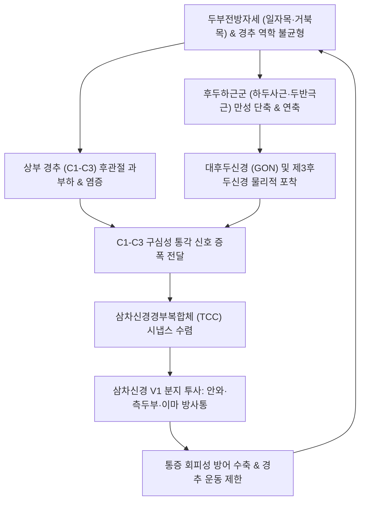

# 🩺 경인성 두통

> **핵심 3줄 요약 (Key Summary)**:
> - 📍 병소 부위 & 해부·병태생리: 상부 경추(C1~C3) 분절 및 후관절, 추간판, 경추 주위 근육·인대의 기능 부전으로 발생하여, [[삼차신경경부복합체]](Trigeminocervical Complex, TCC)에서 삼차신경 제1분지(안신경) 신경원과 수렴(Convergence)되어 후두부·측두부·전두부 및 안와 주위로 방사되는 이차성 두통.
> - 🚩 전형적 임상 양상: 편측성(비박동성)의 둔하고 지속적인 두통, 경추 움직임이나 특정 불량 자세 유지에 의한 두통 유발·악화, 상부 경추 관절 가동범위 제한 및 후두하근군 압통 동반.
> - 🛠️ 핵심 검사 & 치료 전략: 경추 굴곡-회전 검사([[FRT test]], Flexion-Rotation Test), 후두하삼각 압통 촉진. [[경추 추나요법]](상부경추 견인 및 후두하근막 이완), C1-C3 후관절 및 [[풍지]]·[[천주]] 혈위 [[신바로약침]]·[[봉약침]], [[갈근탕]]·[[청상견통탕]] 투여.
> - ⚠️ 응급 의뢰 레드플래그: 벼락두통(Thunderclap headache), 호너 증후군(안검하수·축동), 구음장애·운동실조 등 뇌간/소뇌 징후 동반 시 추골동맥 박리(Vertebral Artery Dissection, VAD) 또는 지주막하출혈(SAH) 의심 즉시 응급실 전원.

---

## 📌 목차
1. [질환 개요 & 해부학적 병태생리](#1-질환-개요--해부학적-병태생리)
2. [병태생리 메커니즘 & 생체역학적 악순환 네트워크](#2-병태생리-메커니즘--생체역학적-악순환-네트워크)
3. [임상 증상 & 이학적 검사(Physical Exam) 알고리즘](#3-임상-증상--이학적-검사physical-exam-알고리즘)
4. [감별 진단 매트릭스 (Differential Diagnosis)](#4-감별-진단-매트릭스-differential-diagnosis)
5. [한의 통합 치료 프로토콜 (침·약침·추나·한약)](#5-한의-통합-치료-프로토콜-침약침추나한약)
6. [양방 치료 & 병용·의뢰 기준 (Conventional Treatment & Referral)](#6-양방-치료--병용의뢰-기준-conventional-treatment--referral)
7. [재활 운동 & 생활습관 티칭 가이드](#7-재활-운동--생활습관-티칭-가이드)
8. [💡 사용자 진료실 핵심 필기 & 임상 노하우 (Melt-In 잔여 심화 집약)](#8--사용자-진료실-핵심-필기--임상-노하우-melt-in-잔여-심화-집약)
9. [출처 및 학술 참고 문헌 (References)](#9-출처-및-학술-참고-문헌-references)

---

## 1. 질환 개요 & 해부학적 병태생리

**경인성 두통(Cervicogenic Headache, CGH)** 은 국제두통학회(ICHD-3) 분류상 경추 및 그 구성 요소(뼈, 추간판, 관절낭, 근육, 신경)의 기질적 병변이나 생체역학적 기능 부전에 의해 발생하는 대표적인 이차성 두통(Secondary headache)이다.

### 1) 상부 경추의 해부학적 구조와 신경 지배
- **환추-후두 관절(C0-C1) 및 환축 관절(C1-C2)**: 경추 전체 회전 운동의 50%가 환축 관절(C1-C2)에서 일어나며, 체중 지탱과 고유수용성 감각 피드백이 집중되어 미세 정렬 이상(Subluxation)과 역학적 과부하에 취약하다.
- **상부 경추 신경근(C1, C2, C3)**:
  - **C1 신경근(후두하신경)**: 후두하삼각 근육들의 운동을 지배하며 환추후두관절 감각을 담당.
  - C2 신경근 & 대후두신경([[Greater occipital nerve]]): C2 척수신경 후지에서 기원하여 하두사근 아래를 돌아 두반극근을 관통한 뒤 후두부 두피 감각을 지배. C1-C2 외측 관절염 또는 후두하근 연축 시 직접 포착 위험이 높음.
  - **C3 신경근 & 제3후두신경(Third occipital nerve)**: C2-C3 후관절(Facet joint)을 가로지르며 하부 후두부 감각을 지배.

### 2) 삼차신경경부복합체(Trigeminocervical Complex, TCC)의 통증 수렴
- 상부 경추 신경근(C1~C3)의 구심성 통각 섬유는 상부 경수 후각의 삼차신경 척수로핵 미부(Spinal trigeminal nucleus caudalis)로 진입한다.
- 이때 뇌신경 5번인 [[삼차신경]](Trigeminal nerve)의 제1분지인 안신경(V1)의 구심성 신경원과 같은 2차 투사 신경원(Second-order nociceptive neuron)에 시냅스를 형성하여 **신경학적 수렴(Convergence)** 이 일어난다.
- 대뇌 피질은 상부 경추(C1~C3)에서 발생한 통증 자극을 안구 주위, 이마, 측두부에서 전달된 통증으로 착각하여 인식하게 되며, 이것이 경인성 두통 특유의 "목 뒤에서 시작하여 눈이나 앞머리로 퍼지는 방사통"의 해부학적 실체이다.

![[경인성_두통_01_후두하근삼각3D해부도해.jpg]]
> [그림 1: ① 해부학적 병태생리 — 후두골과 상부 경추(C1·C2)를 연결하며 경막교(Myodural bridge) 장력을 전달하는 후두하근군 3D 해부 도해 (출처: Wikimedia Commons — File:Suboccipital triangle11.png)]
![[경인성_두통_01_후두하삼각및대후두신경해부.jpg]]
> [그림 2: ① 신경·혈관 해부 — 후두하삼각(대·소후두직근, 상·하두사근)을 주행하는 추골동맥, 후두하신경(C1) 및 대후두신경(C2) 해부 도해 (출처: Wikimedia Commons — File:Suboccipital triangle dissection - Suboccipital triangle.png)]

---

## 2. 병태생리 메커니즘 & 생체역학적 악순환 네트워크

경인성 두통의 발병은 경추 자세 부정렬(거북목·일자목), 후두하근 연축, 후관절 염증 및 TCC 감작의 악순환 고리로 형성된다.

### 1) 생체역학적 불균형과 근육 연축
- 만성적인 두부전방자세(Forward Head Posture, 일자목/거북목)는 상부 경추(C0-C2)의 과신전과 중하부 경추의 과굴곡을 유발한다.
- 이에 따라 후두하근군([[대후두직근]], [[소후두직근]], [[상두사근]], [[하두사근]])과 [[두판상근]], [[상부 승모근]]이 지속적인 등척성 수축과 허혈성 연축에 빠지며, 대후두신경의 포착과 국소 통증유발점(TrP)을 형성한다.

### 2) 삼차신경경부복합체(TCC)의 중추 감작
- 손상된 경추 후관절낭 및 긴장된 근육에서 분비되는 P물질(Substance P), CGRP, 염증성 사이토카인이 상부 경수 후각을 지속적으로 자극한다.
- TCC 내 글루타메이트 수용체(NMDA) 활성화로 신경원의 역치가 낮아지며 시냅스 효율이 증가하는 중추 감작이 초래되어, 가벼운 목 움직임이나 근육 긴장에도 극심한 두통이 격발된다.

![[경인성_두통_02_환축추관절및치돌기횡인대.jpg]]
> [그림 3: ② 상부 경추 관절원성 기전 — 경부 회전 운동의 중심이자 경인성 두통의 핵심 통증원인 환축추관절(C1-C2) 및 환추횡인대 상면 해부 도해 (출처: Wikimedia Commons — File:912 Atlantoaxial Joint.jpg)]
![[경인성_두통_02_후환추후두막및상부경추신경혈관.jpg]]
> [그림 4: ② 해부 구조물 — 후환추후두막(Posterior atlantooccipital membrane)과 환추(C1)·축추(C2) 사이를 관통하는 추골동맥 및 상부 경추 신경근 도해 (출처: Wikimedia Commons — File:Gray305.png)]

---

## 3. 임상 증상 & 이학적 검사(Physical Exam) 알고리즘

### 1) 전형적 임상 증상
- **편측성 고정 통증**: 두통이 한쪽 후두부에서 시작하여 동측 측두부, 전두부, 안와 주위로 퍼짐 (두통 발작 중 좌우 교대 없음).
- **자세 및 움직임 연관성**: 고개를 뒤로 젖히거나 회전할 때, 또는 운전·컴퓨터 작업 등 고정된 자세를 오래 유지할 때 두통이 격발.
- **경부 증상 동반**: 목덜미 뻐근함, 어깨 결림, 경추 능동 및 수동 가동범위(ROM) 감소.
- **동반 자율신경 징후**: 심한 경우 동측 눈의 뻑뻑함, 충혈, 눈물, 경미한 오심이나 현훈(경성 어지럼증)이 동반될 수 있으나 편두통 수준의 심한 박동성이나 전형적 조짐(Aura)은 드묾.

### 2) 이학적 검사 알고리즘
- 경추 굴곡-회전 검사([[FRT test]], Cervical Flexion-Rotation Test):
  - 검사법: 환자를 앙와위로 눕히고 경추를 최대로 굴곡(C3 이하 하부 경추 잠금 효과)시킨 상태에서 두부를 좌우로 부드럽게 회전.
  - 양성 기준: 정상 회전각(각 방향 44° 이상)에 비해 10° 이상 유의한 회전 제한이 있거나 통증이 유발되면 C1-C2 관절 기능 부전에 의한 경인성 두통 진단 (민감도 90%, 특이도 90%).
- **후두하삼각 압진(Suboccipital Palpation)**:
  - C2 극돌기와 후두골 하연 사이, [[풍지]](GB20) 및 [[천주]](BL10) 부위를 깊게 압진 시 환자의 전두부·안와부 두통이 정확히 재현되는지 확인.
- 스펄링 검사([[Spurling test]]):
  - 경추를 신전 및 이환 측으로 측굴 후 축성 압박을 가하여 경추 신경근병증(목디스크)에 의한 신경근 압박 여부를 감별.

![[경인성_두통_03_경추굴곡신전측면엑스레이.jpg]]
> [그림 5: ③ 진단 영상 — 경추 분절 불안정성 및 가동범위 제한을 평가하는 경추 굴곡·신전 역동적 측면 방사선(X-ray) 영상 (출처: Wikimedia Commons — File:Cervical XRayFlexionExtension.jpg)]

---

## 4. 감별 진단 매트릭스 (Differential Diagnosis)

| 질환명 | 주 통증 양상 & 부위 | 유발 요인 & 동반 증상 | 이학적 검사 특징 |
| :--- | :--- | :--- | :--- |
| **경인성 두통** | 편측 비박동성, 후두부→안와·전두부 방사 | 목 움직임, 불량 자세, 목 부위 압박 | FRT 양성, 상부 경추 압통, 경추 ROM 제한 |
| [[편두통]](Migraine) | 편측 또는 양측 박동성(욱신거림), 중등도~중증 | 일상 활동에 악화, 빛·소리 공포증, 구토, 조짐(Aura) | 신경학적 진찰 정상, 경추 ROM 정상 |
| [[긴장형 두통]](TTH) | 양측성 띠를 두른 듯 조이는 둔통 | 스트레스, 피로, 일과 후 악화 | 목 움직임과 무관, 일상 활동으로 악화되지 않음 |
| [[후두신경통]](Occipital Neuralgia) | 대·소후두신경 분포 영역의 찌릿한 발작성 전격통 | 두피를 스치거나 빗질할 때 통증 발작 | Tinel 징후 양성, 안와 방사통 없음 |
| **추골동맥 박리(VAD, 응급)** | 후경부·후두부의 급격한 찢어지는 듯한 벼락통증 | 신경학적 결손, 어지럼증, 복시, 호너 증후군 | 신경학적 응급 징후, MRA/CTA 혈관벽 박리 |

---

## 5. 한의 통합 치료 프로토콜 (침·약침·추나·한약)

### 1) 침구 치료
- **국소 취혈**:
  - 후두하삼각 및 상부 경추부: [[풍지]](GB20), [[천주]](BL10), [[완골]](GB12), [[백회]](GV20), [[아문]](GV15).
  - 경견부 근막 유발점: [[견정]](GB21), [[견외수]](SI14), [[천료]](TE15), 흉쇄유돌근 트리거포인트.
- **원위 취혈**:
  - [[합곡]](LI4), [[태충]](LR3) (사관혈 - 전신 기혈 순환 및 중추 진통), [[후계]](SI3), [[신맥]](BL62) (독맥·양교맥 교회혈 - 항강통 조절).
- **전침 요법**: 양측 [[풍지]]와 [[천주]] 간 2Hz 저주파 전침을 15분간 적용하여 후두하근의 지속적인 강직을 완화하고 TCC의 삼차신경 척수로핵 과흥분을 억제.

### 2) 약침 요법
- [[신바로약침]] / [[봉약침]]:
  - 자입 부위: C1-C2, C2-C3 후관절 관절돌기 부위 심수 및 후두하근 근막 심부.
  - 효과: 멜리틴(Melittin) 및 신바로 복합물이 관절낭 주위 염증성 사이토카인(TNF-alpha, IL-6)을 억제하고 후두신경 주위의 유착을 박리.
- [[중성어혈약침]]: 상경추 인대 부착부 및 유돌돌기 후면의 어혈성 미세혈류 장애 개선.

### 3) 추나요법 (Chuna Manual Therapy)
- **후두하근 이완기법(Suboccipital Release)**:
  - 환자를 앙와위로 눕히고 시술자의 양손 손가락 패드로 후두골 하연을 부드럽게 들어 올리며 지속적인 견인(Longitudinal traction)을 가해 후두골-환추 간격을 넓힘.
- **경추 굴곡-변위 교정 및 관절가동기법**:
  - C1-C2 회전 가동화기법을 통해 환축관절의 회전 가동 범위를 복원. (경추 급격한 과회전 고속저진폭 기법(HVLA)은 추골동맥 손상 위험을 고려하여 부드러운 가동술과 근에너지기법(MET) 위주로 안전하게 적용).

### 4) 한약 치료 (변증별 처방)
- **풍한습비형(風寒濕痺型, 목덜미가 뻣뻣하고 찬바람 맞으면 두통 폭발)**:
  - [[갈근탕]](葛根湯) (갈근, 마황, 계지, 작약, 감초, 생강, 대추) — 경항부 혈류 순환 촉진 및 승모근 경결 해소.
- **기체어혈형(氣滯瘀血型, 찌르는 듯한 고정성 편측 두통, 만성 난치성)**:
  - [[청상견통탕]](淸上莚痛湯) 또는 [[통규활혈탕]](通竅活血湯) (천궁, 당귀, 도인, 홍화, 백지, 강활).
- **담음두통형(痰飮頭痛型, 머리가 무겁고 어지러우며 미식거림 동반)**:
  - [[반하백출천마탕]](半夏白朮天麻湯) (반하, 백출, 천마, 복령, 진피).

![[경인성_두통_05_후두경추연접부시상면해부도해.jpg]]
> [그림 6: ⑤ 추나·약침 시술 해부 — 후두골-환추-축추 연접부의 정중 시상면 인대(항인대·십자인대·익상인대) 및 관절강 해부 도해 (출처: Wikimedia Commons — File:Sobo 1909 243.png)]

---

## 6. 양방 치료 & 병용·의뢰 기준 (Conventional Treatment & Referral)

### 1) 약물 치료 (Medication)
- **단기 소염진통제 및 근이완제**: NSAIDs (Ibuprofen 400mg tid, Naproxen 500mg bid) + Muscle relaxant (Eperisone 50mg tid). 급성 악화기 1~2주간 한시적 사용.
- **삼환계 항우울제(TCA) 및 항경련제**: Amitriptyline (10~25mg qhs), Gabapentin. 만성 중추 감작형 두통에서 신경통 조절 목적으로 투여.

### 2) 비수술적 시술 (Procedures)
- **대후두신경 차단술(GON Block)**: 국소마취제(Lidocaine/Bupivacaine)와 스테로이드를 대후두신경 주위에 주입하여 급성 통증 발작을 차단.
- **C2-C3 내측지 차단술(MBB) 및 고주파 열응고술(RF Neurotomy)**: 경추 후관절성 두통이 확실한 경우 신경 차단술 후 장기 효과를 위해 고주파 절제술 고려.

### 3) 한의 치료와의 병용 전략
- GON 차단술 후에도 남아있는 경추 심부 근육 긴장과 역학적 불균형을 해결하기 위해 한의 추나 및 침치료를 병용할 때 재발률이 유의하게 감소.
- 근이완제 복용 중인 환자에게 침·추나를 병용하면 약물 의존성과 졸림 등의 부작용 없이 조기 단약 가능.

### 4) 전문과 및 응급실 의뢰 기준 (Red Flags)
- 50세 이상에서 새로 발생한 극심한 두통.
- 외상(교통사고 충돌) 후 갑자기 발생한 찢어지는 듯한 후경부 통증 및 호너 증후군.
- 신경학적 결손(시야 결손, 편측 마비, 운동실조), 발열, 경부 강직 동반 시 뇌혈관 질환 감별을 위해 즉시 상급병원 응급실 의뢰.

---

## 7. 재활 운동 & 생활습관 티칭 가이드

### 1) 경추 안정화 운동 (Therapeutic Exercise)
- **턱 당기기 운동(Chin-Tuck Exercise)**:
  - 경추 심부 굴곡근([[두장근]], [[경장근]])을 강화하고 과긴장된 후두하근군을 신장시키는 핵심 운동.
  - 턱을 목젖 쪽으로 수평하게 끌어당긴 상태에서 5~10초간 유지, 10회씩 하루 3회 반복.
- **흉추 신전 운동(Thoracic Extension)**:
  - 폼롤러나 의자 등받이를 이용하여 굽은 흉추를 펴주어 경추가 전방으로 돌출되는 생체역학적 보상 기전을 차단.
- **견갑골 후인 및 하강 운동(Scapular Retraction)**:
  - 능형근과 하부 승모근을 강화하여 상부 승모근과 견갑거근에 실리는 장력을 경감.

### 2) 일상생활 티칭
- 스마트폰을 사용할 때 고개를 숙이지 말고 화면을 눈높이까지 들어 올리기.
- 컴퓨터 모니터의 상단 1/3이 눈높이에 오도록 거치대 조정.
- 수면 시 경추 곡선(C자 커브)을 지지해주는 경추 베개 사용 (너무 높거나 딱딱한 베개 금기).

---

## 8. 💡 사용자 진료실 핵심 필기 & 임상 노하우 (Melt-In 잔여 심화 집약)

- **편두통으로 오진되어 오는 환자의 전형적 패턴**:
  - 안와 통증과 오심 때문에 로컬 신경과나 내과에서 편두통 진단을 받고 트립탄(Triptan) 계열 약물을 복용하지만 효과가 미미한 만성 두통 환자 중 대다수가 경인성 두통이다.
  - 감별 핵심: 환자에게 두통이 올 때 목을 뒤로 젖히거나 돌리면 통증이 심해지는지 묻고, [[FRT test]]와 C2 관절돌기 부위를 꾹 눌렀을 때 "선생님, 바로 거기가 머리로 뻗치는 그 통증이에요!"라고 반응하면 경인성 두통으로 확진할 수 있다.
- **후두하근 자입 시 안전성 주의점**:
  - [[풍지]](GB20)와 [[천주]](BL10) 자침 시 침첨을 상내측(코 반대편 눈 방향)으로 너무 깊이 심자하면 추골동맥(Vertebral artery) 및 연수(Medulla) 손상 위험이 있다.
  - 침첨을 반대편 안구 또는 귓불 방향으로 수평에 가깝게 완만하게 자입하고, 경결된 근막층까지만 침도를 전진시키는 안전한 자입각 유지가 필수적이다.
- **추나 후두하근 이완(Suboccipital release) 시 팁**:
  - 강한 힘으로 주무르는 마사지는 오히려 근방추(Muscle spindle)를 자극하여 반사성 연축을 유발한다. 시술자의 손가락 끝을 후두골 하연에 걸어두고 환자의 머리 무게만을 이용하여 3~5분간 지속적인 등척성 압박을 가할 때 근막의 크리프(Creep) 현상이 발생하며 극적인 두통 소퇴가 일어난다.

---

## 9. 출처 및 학술 참고 문헌 (References)

- Tuina Combined with Acupuncture and Other Therapies for Treating Cervicogenic Headache: A Network Meta-Analysis Based on Randomized Controlled Trials. *J Pain Res*, 2026. PMID: 42183040.

- Neural mobilization in cervicogenic headache: a scoping review of current evidence. *J Man Manip Ther*, 2026. PMID: 42827400.

- Radiofrequency ablation of C2-3 medial branches/third occipital nerve to treat cervicogenic headache. *Ann Palliat Med*, 2026. PMID: 42273812.

---

## 관련 노트

- [[편두통]]
- [[긴장형 두통]]
- [[후두신경통]]
- [[갈근탕]]
- [[청상견통탕]]
- [[경추 추나요법]]
