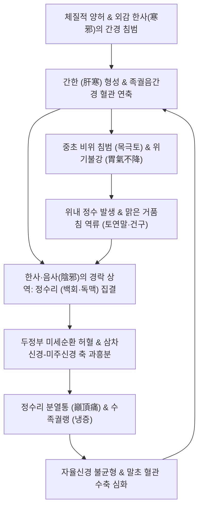

# 🩺 궐음두통

> **핵심 3줄 요약 (Key Summary)**:
> - 📍 병소 부위 & 해부·병태생리: 족궐음간경(足厥陰肝經) 지맥이 전액을 거쳐 두정부(정수리)에서 독맥([[백회]])과 교회하는 유주 특성에 기인하며, 간한(肝寒)과 음사(陰邪)가 위로 치밀어 오르거나(간한음역·탁음상역), 뇌혈관 경련 및 장-뇌 축(Gut-Brain Axis) 세로토닌 불균형으로 인해 발생하는 두정부 중심의 신경혈관성 두통.
> - 🚩 전형적 임상 양상: 정수리가 쪼개지듯 아픈 전형적인 전정통(巓頂痛·頂心痛), 맑은 침이나 거품을 토하는 구토(토연말·건구), 손발과 전신의 차가움(수족궐랭), 오한, 침세(沈細)하거나 현(弦)한 맥상.
> - 🛠️ 핵심 검사 & 치료 전략: 신경학적 검진 및 뇌 영상(SAH·RCVS 배제). 간경 및 독맥 중심 침구 치료([[백회]], [[태충]], [[곡천]], [[내관]]) 및 온경산한(溫經散寒)·강역지구(降逆止嘔) 대표 방제인 [[오수유탕]](吳茱萸湯) 집중 투여.
> - ⚠️ 응급 의뢰 레드플래그: 망치로 맞은 듯한 극심한 벼락두통(Thunderclap headache), 뇌막자극징후(경부강직, Kernig 양성), 신경학적 결손(의식 변화, 복시, 편마비) 발생 시 지주막하출혈(SAH) 또는 가역적 뇌혈관수축증후군(RCVS) 감별을 위해 즉시 응급실 이송.

---

## 📌 목차
1. [질환 개요 & 해부학적 병태생리](#1-질환-개요--해부학적-병태생리)
2. [병태생리 메커니즘 & 생체역학적 악순환 네트워크](#2-병태생리-메커니즘--생체역학적-악순환-네트워크)
3. [임상 증상 & 이학적 검사(Physical Exam) 알고리즘](#3-임상-증상--이학적-검사physical-exam-알고리즘)
4. [감별 진단 매트릭스 (Differential Diagnosis)](#4-감별-진단-매트릭스-differential-diagnosis)
5. [한의 통합 치료 프로토콜 (침·약침·추나·한약)](#5-한의-통합-치료-프로토콜-침약침추나한약)
6. [양방 치료 & 병용·의뢰 기준 (Conventional Treatment & Referral)](#6-양방-치료--병용의뢰-기준-conventional-treatment--referral)
7. [재활 운동 & 생활습관 티칭 가이드](#7-재활-운동--생활습관-티칭-가이드)
8. [💡 사용자 진료실 핵심 필기 & 임상 노하우 (Melt-In 잔여 심화 집약)](#8--사용자-진료실-핵심-필기--임상-노하우-melt-in-잔여-심화-집약)
9. [출처 및 학술 참고 문헌 (References)](#9-출처-및-학술-참고-문헌-references)

---

## 1. 질환 개요 & 해부학적 병태생리

**궐음두통(厥陰頭痛, Jueyin Headache)** 은 한의학의 육경변증(六經辨證) 분류 중 족궐음간경(足厥陰肝經)의 병태생리와 경락 유주 이상에 의해 발생하는 특징적인 두정부(정수리) 통증 증후군이다. 상한론(傷寒論) 궐음병편의 대표 조문인 "건구, 토연말, 두통자, 오수유탕주지(乾嘔, 吐涎沫, 頭痛者, 吳茱萸湯主之)"에 그 병리적 본질이 기술되어 있다.

### 1) 경락 유주와 두정부 해부학
- **족궐음간경의 두부 유주**: 족무지 외측에서 기시한 간경은 생식기(음기)를 돌아 하복부와 협협부를 거쳐 목구멍(후롱)을 지나 안구 뒤쪽(목계 目系)으로 들어간다. 이후 이마(전액 前額)로 나와 정수리의 [[백회]](GV20)에서 척추를 관장하는 [[독맥]](督脈)과 상호 회합한다(連目系, 上出額, 與督脈會於巓).
- **두정부 신경 및 혈관망**: 정수리 부위는 대후두신경, 삼차신경 제1분지(안신경의 활차상·안와상신경), 그리고 천측두동맥 및 후두동맥의 말초 혈관망이 교차하는 지점이다. 경락학적으로는 간(肝)의 소설(疏泄) 기능 실조와 한사(寒邪)의 응체에 가장 취약한 부위이다.

### 2) 현대 의학적 매핑
- 현대 의학적으로 궐음두통은 단순 긴장형 두통이 아니며, **장-뇌 축(Gut-Brain Axis)** 기능 부전을 동반한 전형적인 신경혈관성 편두통(Migraine with prominent autonomic gastrointestinal symptoms) 또는 두정부 작열통/정수리 두통 증후군(Vertex headache syndrome)과 밀접하게 연관된다.
- 위장관의 심한 운동 저하(Gastric stasis), 미주신경 반사성 구토, 두개강 내외 혈관의 국소 연축이 복합되어 나타난다.

---

## 2. 병태생리 메커니즘 & 생체역학적 악순환 네트워크

궐음두통의 핵심 병태는 **"간한음역(肝寒飲逆)"** 과 **"탁음상역(濁陰上逆)"** 으로 요약된다.

### 1) 간한(肝寒)과 혈관 경련
- 간은 풍목(風木)에 속하여 온난함을 좋아하고 한랭을 꺼린다. 한사(寒邪)가 간경으로 직중(直中)하거나 체질적 양기 허약으로 간한(肝寒)이 형성되면, 간맥이 수축 연축(Spasm)되어 혈류 장애가 발생한다.
- 이는 현대 병태생리학적으로 두피 및 두개 내 혈관의 교감신경성 과수축과 삼차신경혈관계(Trigeminovascular system)의 혈관성 염증 자극에 대응된다.

### 2) 탁음상역과 구토(장-뇌 축 조절 장애)
- 간한이 중초의 비위(脾胃)를 침범(목극토 木剋土)하면 위의 강역(降逆) 기능이 무너져 위내 정수(胃內停水)와 담음(痰飲)이 발생한다.
- 차가운 병리적 체액과 위 내용물이 아래로 내려가지 못하고 역류하여 심한 구역감(건구)과 맑은 거품침(토연말)을 분출하게 되며, 이 역상하는 병리적 압력과 화학 자극이 간경을 타고 정수리로 치밀어 올라 격심한 두정통을 촉발한다.

---

## 3. 임상 증상 & 이학적 검사(Physical Exam) 알고리즘

### 1) 전형적 임상 증상
- **두정부 통증(巓頂痛)**: 머리 꼭대기(정수리) 부위가 송곳으로 찌르거나 망치로 두드리는 듯, 혹은 머리가 쪼개질 것 같은(頭痛如破) 심한 통증.
- **소화기 역류 증상**: 지속적인 헛구역질(건구 乾嘔), 위산이나 음식물이 아닌 차갑고 맑은 거품 타액을 왈칵 토해냄(토연말 吐涎沫).
- **전신 한랭 징후**: 손발 끝이 얼음장처럼 차가워짐(수족궐랭 手足厥冷), 이마와 머리 꼭대기에 찬바람이 부는 듯한 시림(두피 한랭감).
- **설상 및 맥상**: 설질 담백(淡白), 설태 백활(白滑)하거나 수습이 넘침. 맥상은 깊고 느리거나(침지 沉遲), 가늘고 팽팽하게 긴장된 현세맥(弦細脈).

### 2) 이학적 검사 알고리즘
- **두피 압진 및 백회 타진**:
  - 두정부 정중선([[백회]], [[전정]], [[후정]])을 압진할 때 통증이 극대화되는지 확인.
  - 가벼운 두부 수직 타진 시 두정부 통증이 두개 내부로 울리는지 확인.
- **신경학적 검진 (Red Flag 배제)**:
  - 뇌신경 12쌍 검사, 동공 반사, 바빈스키 반사 등 병적 반사 확인.
  - 경부 강직(Nuchal rigidity) 및 Kernig/Brudzinski 징후 검사로 지주막하출혈 및 뇌수막염 감별.
- **복진(Abdominal Exam)**:
  - 심하부(중완~거궐) 압진 시 심한 저항감이나 진수음(Splash sound, 위내 정수 징후) 확인.

---

## 4. 감별 진단 매트릭스 (Differential Diagnosis)

| 질환명 | 주 통증 부위 & 양상 | 소화기 & 자율신경 징후 | 핵심 감별 포인트 |
| :--- | :--- | :--- | :--- |
| **궐음두통** | 정수리(두정부) 쪼개지는 통증, 냉감 | 헛구역질, 맑은 거품침 구토, 수족냉증 | 설담태백활, 맥침지/현, 오수유탕 적응증 |
| **[[태양두통]]** | 후두부·목덜미 뻣뻣함(항강통) | 발열, 오한, 땀 유무 | 외감 표증, 방광경 유주, 갈근탕·구미강활탕 |
| **[[양명두통]]** | 이마(전두부), 눈썹 주위 통증 | 변비, 구갈, 신열, 복통 | 위열(胃熱) 실증, 백호탕·승기탕 |
| **[[소양두통]]** | 귀 위쪽 편측 측두부, 관자놀이 | 구고(입 씀), 인건, 목현(어지럼) | 한열왕래, 담경 유주, 소시호탕 |
| **지주막하출혈(SAH, 응급)** | 두부 전체 또는 정수리의 돌발적 벼락두통 | 의식 저하, 분출성 구토, 경부 강직 | 비조영 뇌 CT에서 지주막하 고음영 출혈 확인 |
| **가역적 뇌혈관수축증후군(RCVS)** | 수초 내 극에 달하는 재발성 벼락두통 | 배변, 성행위, 기침 시 격발 | 뇌혈관 MRA/CTA 상 염주알 모양(String of beads) 혈관 연축 |

---

## 5. 한의 통합 치료 프로토콜 (침·약침·추나·한약)

### 1) 침구 치료
- **주치 혈위 (간경 & 독맥)**:
  - [[백회]](GV20): 두정부의 독맥 경혈이자 궐음간경 교회혈. 사자(斜刺) 후 득기 유도.
  - [[통천]](BL7): 백회 양측 방광경 혈위로 두정부 혈류 순환 개선.
  - [[태충]](LR3): 족궐음간경의 수토원혈(輸土原穴) — 간기 소설 및 역상한 기운을 하강시킴.
  - [[곡천]](LR8): 족궐음간경의 합수혈(合水穴) — 간경의 허한을 보하고 경맥을 유연하게 함.
- **화위지구(和胃止嘔) 배오혈**:
  - [[내관]](PC6): 수궐음심포경 락혈 — 심하부 구역감을 억제하고 흉협부 긴장 해소.
  - [[중완]](CV12), [[족삼리]](ST36): 비위 기운을 안정시키고 위내 정수 흡수를 촉진.
- **온구 요법(Moxibustion)**:
  - [[백회]](GV20) 및 [[신궐]](CV8, 배꼽), [[관원]](CV4)에 간접구(신기구)를 시행하여 하초의 원양(元陽)을 북돋우고 상부의 한사를 몰아냄.

### 2) 약침 요법
- **[[황련해독탕약침]] / [[중성어혈약침]]**: 두정부 국소 어혈 및 정맥 울혈 완화를 위해 [[백회]], [[태양]](EX-HN5), [[풍지]](GB20)에 소량 분할 주입.
- **[[자하거약침]]**: 만성 기혈허 및 간신부족을 동반한 허랭성 두정통 환자의 [[간수]](BL18), [[신수]](BL23) 혈위에 시술.

### 3) 추나요법 (Chuna Manual Therapy)
- **두개천골기법(Craniosacral Therapy, CST)**:
  - 시상봉합(Sagittal suture) 및 관상봉합의 가동성 제한을 해소하는 두개골 감압 기법.
  - 정수리 두판막의 긴장을 완화하는 두개저 이완(CV4 기법)을 적용하여 뇌척수액 순환과 자율신경 안정을 유도.
- **상부 흉추 및 늑골 교정**: 간·담 교감신경 분절(T5-T9)의 흉추 관절가동술을 통해 내장기 자율신경 반사를 안정화.

### 4) 한약 치료 (변증별 처방)

#### ① [[오수유탕]](吳茱萸湯) — 궐음두통의 절대적 특효방 (1st Line)
- **구성**: 오수유 8~12g, 생강 12~16g, 인삼 8g, 대추 4개.
- **방해**:
  - 오수유(군약): 신고열(辛苦熱)하여 족궐음간경으로 직달, 간한(肝寒)을 따뜻하게 산산(散散)하고 역상한 탁음을 강력히 하강시킴.
  - 생강(신약): 온위산한(溫胃散寒), 강역지구(降逆止嘔)하여 헛구역질과 토연말을 즉각 멈추게 함.
  - 인삼·대추(좌사약): 보기건비(補氣健脾)하여 한약재의 독성을 완충하고 손상된 중초 비위 기운을 회복.
- **현대 약리**: 오수유의 에보디아민(Evodiamine) 및 루타에카르핀(Rutaecarpine) 성분이 5-HT1A/3A 세로토닌 수용체를 조절하고, TRPV1 칼슘 통로를 탈감작하며 위장관 배출능을 촉진.

#### ② [[당귀사역가오수유생강탕]](當歸四逆加吳茱萸生薑湯)
- 수족냉증이 팔꿈치와 무릎까지 올라오는 혈허한궐(血虛寒厥) 증상과 함께 하복부 냉통이 동반된 경우.

#### ③ [[천궁차조산]](川芎茶調散) 가감
- 외감 풍한이 겸하여 오한, 발열, 전두통이 겹친 경우 온경산한 약재(세신, 백지, 고본)를 가미하여 투여.

---

## 6. 양방 치료 & 병용·의뢰 기준 (Conventional Treatment & Referral)

### 1) 약물 치료 (Medication)
- **트립탄계 약물**: Sumatriptan 50mg, Zolmitriptan 2.5mg. 5-HT1B/1D 수용체 효능제로 뇌혈관 수축 유도 (단, 궐음두통의 한랭성 혈관 연축 상태에서는 환자에 따라 흉부 압박감 등 주의 필요).
- **진토제(Antiemetics)**: Metoclopramide 10mg, Domperidone 10mg. 도파민 D2 수용체를 차단하여 위장관 연동운동을 촉진하고 오심·구토 완화.
- **칼슘채널차단제(CCB)**: Flunarizine 5~10mg. 뇌혈관 연축 예방 및 편두통 예방 요법.

### 2) 양방 치료와의 상호작용 및 한의 병용 가이드
- NSAIDs(진통소염제) 단독 투여는 위점막을 자극하여 궐음두통 환자의 구역·구토와 위장관 냉증을 급격히 악화시키는 경우가 빈번함.
- 한약 [[오수유탕]]을 양방 진토제 복용 환자에게 병용할 경우 장-뇌 축 정상화 시너지로 구토가 신속히 멎고 두통 관해 시간이 단축됨.

### 3) 응급실 및 상급병원 의뢰 기준 (Red Flags)
- **돌발성 벼락두통(Thunderclap headache)**: 1분 이내에 최고조(VAS 10)에 달하는 두정부 두통.
- 신경학적 이상 징후: 시야 결손, 복시, 편측 마비, 감각 이상, 구음장애.
- 수막자극징후 양성 또는 고열 동반 시 지주막하출혈(SAH), 뇌정맥동혈전증(CVST), 뇌수막염 감별을 위해 즉각적인 뇌 CT/MRI/MRA 및 요추천자 필요.

---

## 7. 재활 운동 & 생활습관 티칭 가이드

### 1) 보온 및 한랭 회피 (Thermal Management)
- 두부 및 경항부 보온: 외출 시 모자나 목도리를 착용하여 찬바람이 정수리와 풍지혈에 직접 닿지 않도록 차단.
- 복부 및 족부 온열 요법: 핫팩을 이용해 배꼽 아래(단전)와 발바닥을 따뜻하게 유지하여 하초 양기를 보존.

### 2) 식이 티칭
- 찬 음료(아이스 아메리카노, 빙수, 맥주), 날음식(생선회, 생채소)의 섭취를 엄격히 금지.
- 따뜻한 생강차나 계피차를 수시로 복용하여 위장관 한기를 몰아내고 위 연동운동을 보조.
- 식사는 소량씩 따뜻한 유동식 위주로 섭취하여 위의 역류 부하를 경감.

### 3) 이완 요법
- 복식 호흡과 명상을 통해 과항진된 교감신경을 안정시키고 미주신경 톤(Vagal tone)을 회복.

---

## 8. 💡 사용자 진료실 핵심 필기 & 임상 노하우 (Melt-In 잔여 심화 집약)

- **소염진통제 먹고 체해서 토하며 머리 깨진다는 환자의 정체**:
  - 로컬 진료실에 내원하는 환자 중 "머리 꼭대기가 쪼개질 듯 아파서 타이레놀이나 탁센을 먹었는데, 속이 쓰리고 미식거리더니 맑은 물과 거품을 계속 토하면서 머리가 더 아파 죽겠다"고 호소하는 경우가 전형적인 궐음두통(오수유탕증)이다.
  - 이 환자들에게 양방 진통제를 추가하거나 위장약을 대증 투여하면 백약이 무효하다. 체내 한음(寒飲)이 위를 막고 있는 상태이므로, 즉시 따뜻하게 달인 [[오수유탕]] 1포를 복용시키고 [[백회]]와 [[중완]]에 뜸(간접구)을 올려놓으면 30분 이내에 구역질이 멈추고 정수리 통증이 씻은 듯이 가라앉는다.
- **오수유(吳茱萸)의 탕전 비결**:
  - 오수유는 특유의 맵고 쓴 맛(辛苦)과 특유의 정유 성분이 있어 비위가 약한 환자가 복용하기 힘들어할 수 있다. 탕전 시 생강과 대추를 넉넉히 넣고, 뜨겁지 않은 따뜻한 온도로 천천히 씹듯이 복용하도록 복약 지도를 해야 구토 반사를 자극하지 않고 위장에 순조롭게 안착된다.
- **두정부(백회) 자침 시 방향성**:
  - 궐음두통의 치솟는 기운(상역)을 꺾기 위해 [[백회]](GV20)에 자침할 때는 침첨을 후방(후두부 쪽)으로 향하게 하여 사자(斜刺, 15~30도)하고 강자극을 주는 것이 하강(降逆) 효과를 배가시킨다.

---

## 9. 출처 및 학술 참고 문헌 (References)

- Wuzhuyu Decoction Relieves Chronic Migraine by Regulating 5-HT1A and 3A Receptors-Mediated CREB Signaling Pathway in Brain and Intestine. *Pharmaceuticals (Basel)*, 2025. PMID: 40143202.

- Amelioration of nitroglycerin-induced migraine in mice via Wuzhuyu decoction: Inhibition of the MZF1/PGK1 pathway and activation of NRF2 antioxidant response. *J Ethnopharmacol*, 2024. PMID: 38373662.

- Burning vertex syndrome: a novel unclassified headache - its preliminary observations, and possible mechanisms. *Curr Opin Neurol*, 2025. PMID: 40208092.

---

## 관련 노트

- [[편두통]]
- [[오수유탕]]
- [[백회]]
- [[태충]]
- [[당귀사역가오수유생강탕]]
