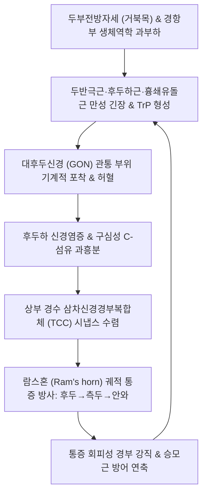

# 🩺 람스혼 두통

> **핵심 3줄 요약 (Key Summary)**:
> - 📍 병소 부위 & 해부·병태생리: 후두골 기저부 및 상부 경추(C1~C3) 주변 근막(두반극근·후두하근군·흉쇄유돌근)의 과긴장 및 대·소후두신경([[Greater occipital nerve]], LON) 포착으로 인해, 통증이 후두부에서 시작하여 측두부를 감아 돌아 안와 주위로 숫양의 뿔(Ram's Horn) 모양으로 주행하는 특징적인 근신경성 연관통 증후군.
> - 🚩 전형적 임상 양상: 편측 후두하부의 둔통 및 조임감으로 시작하여 정수리 외측을 돌아 관자놀이, 이마, 안와(눈 뒤)로 곡선을 그리며 뻗치는 방사통, 후두골 하연 압진 시 안와 통증 재현, 장시간 두부전방자세 시 악화.
> - 🛠️ 핵심 검사 & 치료 전략: 후두신경 출구부 압진 및 Tinel 징후 검사, 경추 굴곡-회전 검사([[FRT test]]). 후두하근막 이완 중심의 [[경추 추나요법]], 후두신경 주행로([[풍지]]·[[천주]]·[[완골]]) [[신바로약침]]·[[봉약침]] 자입 및 [[청상견통탕]]·[[갈근탕]] 투여.
> - ⚠️ 응급 의뢰 레드플래그: 50세 이상에서 측두부 압통·시력 저하 동반 시 측두동맥염(Giant cell arteritis), 돌발적 격심한 벼락두통 및 신경학적 결손 동반 시 추골동맥 박리(VAD)·지주막하출혈(SAH) 의심 즉시 응급실 전원.

---

## 📌 목차
1. [질환 개요 & 해부학적 병태생리](#1-질환-개요--해부학적-병태생리)
2. [병태생리 메커니즘 & 생체역학적 악순환 네트워크](#2-병태생리-메커니즘--생체역학적-악순환-네트워크)
3. [임상 증상 & 이학적 검사(Physical Exam) 알고리즘](#3-임상-증상--이학적-검사physical-exam-알고리즘)
4. [감별 진단 매트릭스 (Differential Diagnosis)](#4-감별-진단-매트릭스-differential-diagnosis)
5. [한의 통합 치료 프로토콜 (침·약침·추나·한약)](#5-한의-통합-치료-프로토콜-침약침추나한약)
6. [양방 치료 & 병용·의뢰 기준 (Conventional Treatment & Referral)](#6-양방-치료--병용의뢰-기준-conventional-treatment--referral)
7. [재활 운동 & 생활습관 티칭 가이드](#7-재활-운동--생활습관-티칭-가이드)
8. [💡 사용자 진료실 핵심 필기 & 임상 노하우 (Melt-In 잔여 심화 집약)](#8--사용자-진료실-핵심-필기--임상-노하우-melt-in-잔여-심화-집약)
9. [출처 및 학술 참고 문헌 (References)](#9-출처-및-학술-참고-문헌-references)

---

## 1. 질환 개요 & 해부학적 병태생리

**람스혼 두통(Ram's Horn Headache)** 은 임상적으로 후두부에서 기원한 통증이 두정부와 측두부를 우회하여 안와부로 진행하는 궤적이 숫양의 뿔(Ram's horn) 형태를 띤다고 하여 명명된 근막통증증후군(MPS) 및 경추신경 포착성 두통 패턴이다.

### 1) 해부학적 구조와 람스혼 궤적
- **대후두신경([[Greater occipital nerve]], GON)**: C2 척수신경 후지에서 나와 [[하두사근]] 아래를 주행한 뒤, [[두반극근]](Semispinalis capitis)의 건막과 [[승모근]](Trapezius) 부착부를 관통하여 두피로 올라간다. 이 관통부(Piercing point)가 근막 긴장에 의해 조여지면 신경 허혈과 포착이 발생한다.
- **소후두신경([[Lesser occipital nerve]], LON)**: C2-C3 경신경총에서 기원하여 [[흉쇄유돌근]](SCM) 후연을 따라 주행하며 유돌돌기 뒤쪽 및 이개 후면의 감각을 지배한다.
- **두반극근과 흉쇄유돌근의 연관통(Referred Pain)**:
  - Travell & Simons의 근막통증 이론에 따르면, 두반극근 상부의 통증유발점(TrP)은 후두부에서 정수리를 넘어 안와 상부로 뻗치는 람스혼 곡선 궤적의 통증을 방사한다.
  - 흉쇄유돌근(SCM) 쇄골지의 TrP 역시 귀 뒤쪽을 돌아 이마와 안와부로 통증을 투사하여 람스혼 패턴의 전형적인 임상상을 완성한다.

### 2) 삼차신경경부복합체(TCC)와의 연계
- 대·소후두신경을 통해 유입된 통각 신호는 상부 경수 후각의 삼차신경 척수로핵(TCC)에서 삼차신경 제1분지(안신경 V1) 신경원과 시냅스 수렴을 일으킨다.
- 이로 인해 환자는 후두하부의 압박성 자극을 안구 뒤쪽이 빠질 듯한 통증(Retro-orbital pain)으로 인지하게 된다.

---

## 2. 병태생리 메커니즘 & 생체역학적 악순환 네트워크

람스혼 두통의 기전은 경추 전방전위(거북목), 후두하 근육군의 만성 등척성 과부하, 국소 신경 포착 및 통증유발점 형성이 맞물려 진행된다.

### 1) 자세성 근막 과부하와 신경 압박
- VDT 작업이나 스마트폰 과사용으로 머리가 전방으로 돌출(Forward head posture)되면, 5~7kg에 달하는 두부 중량을 지탱하기 위해 [[두반극근]], [[두판상근]], 후두하근군이 지속적인 원심성 수축 상태에 놓인다.
- 근육 내 압력이 상승하면서 모세혈관이 압박되어 에너지 위기(Energy crisis)와 국소 허혈이 발생하고, 대후두신경이 근건 결합부에서 기계적으로 포착되어 이소성 신경 방전이 유발된다.

### 2) 근신경성 악순환 고리
- 신경 포착과 근막 통증유발점에서 방출되는 신경펩타이드(CGRP, Substance P)가 무균성 신경염증을 촉발하고, 이는 다시 주변 근육의 반사성 경련을 유도하여 람스혼 궤적을 따라 통증 강도를 증폭시킨다.

---

## 3. 임상 증상 & 이학적 검사(Physical Exam) 알고리즘

### 1) 전형적 임상 증상
- **람스혼 통증 분포**: 편측(간혹 양측) 후두부에서 시작하여 귓바퀴 위쪽 측두부를 돌아 눈썹 위 및 안와 내부로 만곡 주행하는 조이는 듯한 둔통 및 욱신거림.
- **두피 이상감각**: 대후두신경 지배 두피의 감각과민, 머리를 빗거나 만질 때 발생하는 화끈거림 또는 저림.
- **동반 근육 증상**: 목덜미 회전 제한, 견배부(승모근 상부) 결림, 흉쇄유돌근 부위 뻐근함.
- **안구 자극 증상**: 이환 측 눈의 피로감, 침침함, 눈물 분비 이상. (단, 편두통과 같은 명확한 시각 조짐이나 심한 박동성은 없음).

### 2) 이학적 검사 알고리즘
- **후두신경 출구부 압진 & 티넬 징후(Tinel's Sign)**:
  - 후두골 외후두융기 외측 2~3cm 지점([[천주]]·[[풍지]] 사이) 대후두신경 관통 부위를 압박하거나 가볍게 타진.
  - 양성: 정수리를 돌아 안와부로 뻗치는 람스혼 궤적의 통증 및 찌릿한 방사통이 즉각 재현됨.
- **통증유발점(TrP) 압진**:
  - 두반극근 상부 부착부 및 SCM 쇄골지 상단 촉진 시 연관통 유발 확인.
- **경추 굴곡-회전 검사([[FRT test]])**:
  - 상부 경추(C1-C2) 관절 가동성 제한 동반 여부 확인 (35° 미만 회전 시 양성).
- **스펄링 검사([[Spurling test]])**: 경추 추간판성 신경근병증 감별을 위해 시행.

---

## 4. 감별 진단 매트릭스 (Differential Diagnosis)

| 질환명 | 주 통증 양상 & 주행 궤적 | 유발 요인 & 촉진 소견 | 특징적 감별점 |
| :--- | :--- | :--- | :--- |
| **람스혼 두통** | 후두부→측두부→안와로 만곡 주행하는 뿔 모양 연관통 | 두반극근·후두하근 압박 시 통증 재현 | MPS 통증유발점과 신경 포착의 복합 양상 |
| **[[경인성 두통]]** | 편측 고정성, 목 움직임에 의해 두통 격발 | FRT 양성, 상부 경추 후관절 압통 | 상경추 관절 가동성 장애가 핵심 |
| **진성 [[후두신경통]]** | 대·소후두신경 주행로를 따르는 발작성 전격통(찌릿함) | 두피 스침, 빗질 등 가벼운 접촉 | 찌르는 듯한 순간적 전기 통증, 안와 방사 드묾 |
| **[[편두통]]** | 편측 박동성(욱신거림), 중등도~중증 | 신체 활동에 악화, 빛·소리 공포증, 오심·구토 | 혈관성 두통, 트립탄 반응, 전형적 조짐 |
| **측두동맥염(응급)** | 50세 이상, 측두부 박동통, 턱관절 파행, 시력 저하 | 측두동맥 비후, 압통, 결절성 팽륜 | ESR/CRP 급상승, 실명 위험 즉시 스테로이드 |

---

## 5. 한의 통합 치료 프로토콜 (침·약침·추나·한약)

### 1) 침구 치료
- **근위 취혈 (후두신경 주행로 & 근막 부착부)**:
  - [[풍지]](GB20): 승모근과 흉쇄유돌근 사이 함요처, 대후두신경 출구부 심부 근막 이완.
  - [[천주]](BL10): 승모근 외연 두반극근 부착부, 대후두신경 직접 자극.
  - [[완골]](GB12): 유돌돌기 후하방 함요처, 소후두신경 및 흉쇄유돌근 부착부.
  - [[솔곡]](GB8), [[태양]](EX-HN5): 람스혼 궤적의 측두부 주행로 완화.
- **원위 취혈**:
  - [[합곡]](LI4), [[태충]](LR3) (사관혈 - 전신 기혈 순환 및 중추성 진통).
  - [[후계]](SI3), [[신맥]](BL62) (독맥 및 방광경 긴장 완화, 항배통 조절).
- **침전기자극술(전침)**: [[천주]]와 [[풍지]]에 2Hz 저주파 전침을 15분간 적용하여 엔돌핀 분비를 촉진하고 국소 허혈성 근수축을 해소.

### 2) 약침 요법
- **[[신바로약침]] / [[봉약침]]**:
  - 자입 부위: 대후두신경 관통부(C2 레벨 협척혈 외측 2cm) 및 [[풍지]], [[천주]] 심부.
  - 효과: 멜리틴(Melittin) 성분이 신경 주위의 무균성 결합조직 염증을 억제하고 국소 유착을 완화.
- **[[중성어혈약침]]**: SCM 유돌돌기 부착부 및 후두하삼각의 미세 순환 부전(어혈) 개선.

### 3) 추나요법 (Chuna Manual Therapy)
- **후두하근막 이완기법(Suboccipital Release)**:
  - 앙와위에서 후두골 하연에 양손 손가락 패드를 걸고 두개골을 가볍게 상방 견인하며 3~5분간 지속 압박.
- **흉쇄유돌근 및 두반극근 근막경근이완술(Myofascial Release)**:
  - 핀치 앤 홀드(Pinch & hold) 기법으로 SCM의 발통점을 부드럽게 압박 신장.
- **경추 가동기법**: 환추-축추(C1-C2) 관절의 회전 변위를 완만하게 교정.

### 4) 한약 치료 (변증별 처방)
- **풍한습비형(風寒濕痺型, 한랭 자극으로 목과 어깨가 굳으며 람스혼 두통 격발)**:
  - [[갈근탕]](葛根湯) (갈근, 마황, 계지, 작약, 감초, 생강, 대추) — 경항부 근긴장 완화 및 혈류 개선.
- **기체어혈형(氣滯瘀血型, 야간 악화, 찌르는 듯한 편측 통증, 만성 난치성)**:
  - [[청상견통탕]](淸上莚痛湯) (황금, 강활, 방풍, 창출, 당귀, 천궁, 백지, 맥문동) — 두면부 풍열 및 어혈성 두통 다스림.
- **간울기체형(肝鬱氣滯型, 스트레스와 피로에 의해 측두부로 치솟는 두통)**:
  - [[시호소간탕]](柴胡疎肝湯) 또는 [[소요산]](逍遙散).

---

## 6. 양방 치료 & 병용·의뢰 기준 (Conventional Treatment & Referral)

### 1) 약물 치료 (Medication)
- **NSAIDs & 근이완제**: Meloxicam 7.5~15mg qd, Eperisone 50mg tid (급성기 근막통 조절).
- **신경병증성 통증 약물**: Gabapentin 300~900mg/day 또는 Pregabalin 75~150mg/day (신경 포착에 의한 전격통 조절).

### 2) 비수술적 시술 (Procedures)
- **초음파 유도하 대후두신경 차단술(US-guided GON Block)**:
  - C2 척추궁판 레벨에서 대후두신경을 초음파로 실시간 확인 후 국소마취제(Ropivacaine)와 스테로이드를 주입하여 신경 포착을 차단.
- **통증유발점 주사(TPI)**: 두반극근 및 승모근 발통점에 국소마취제 주입.

### 3) 한의 치료와의 병용 및 시너지
- 양방 GON 차단술 후 통증이 일시적으로 경감되었으나 2~3주 후 재발하는 환자에게 한의 추나(후두하근 이완)와 침구 치료를 결합하면 근본적인 생체역학적 포착 원인이 제거되어 장기 관해율이 향상됨.

### 4) 전문과 및 응급실 의뢰 기준 (Red Flags)
- 50세 이상 환자에서 측두동맥 팽륜 및 시야 장애 동반 시 (측두동맥염 의심 → 류마티스내과).
- 외상 후 갑자기 발생한 목 뒤 통증과 함께 Horner 증후군이나 소뇌성 운동실조 동반 시 (추골동맥 박리 의심 → 신경과 응급실).

---

## 7. 재활 운동 & 생활습관 티칭 가이드

### 1) 자가 스트레칭 및 운동
- **후두하근 턱 당기기 스트레칭(Chin-Tuck)**:
  - 벽에 등을 대고 서서 턱을 수평 후방으로 지그시 당겨 후두하근을 신장 (10초 유지, 10회 반복).
- **흉쇄유돌근(SCM) 자가 마사지**:
  - 고개를 반대편으로 돌린 상태에서 흉골과 쇄골 부착부부터 유돌돌기까지 집게손가락으로 부드럽게 롤링.
- **테니스공 후두골 하연 지압**:
  - 앙와위에서 후두골 하연 바로 아래에 테니스공 두 개를 놓고 체중으로 부드럽게 지압.

### 2) 일상생활 티칭
- 컴퓨터 작업 시 50분마다 5분씩 경추 신전 스트레칭 실시.
- 고개를 숙인 채 장시간 스마트폰을 보는 자세(Text neck) 금지.
- 너무 높거나 머리가 앞으로 꺾이는 베개 교체.

---

## 8. 💡 사용자 진료실 핵심 필기 & 임상 노하우 (Melt-In 잔여 심화 집약)

- **"눈 뒤가 빠질 것처럼 아프다"는 주소증의 함정**:
  - 환자가 "원장님, 관자놀이와 눈 뒤쪽이 터질 것처럼 아파요"라고 호소하면 시선을 눈이나 앞머리에만 두기 쉽다.
  - 하지만 환자의 고개를 숙이게 하고 후두골 하연의 [[풍지]](GB20)와 [[천주]](BL10) 사이(대후두신경 관통부)를 엄지손가락으로 깊게 압박하면 환자가 "앗, 바로 그 통증이 눈으로 찌릿하게 타고 들어와요!"라고 소리친다. 이것이 람스혼 두통의 핵심 진찰 스킬이다.
- **자침 깊이와 방향 조절**:
  - 대후두신경 포착을 풀기 위해 [[천주]]를 자침할 때는 직자하지 말고, 침첨을 약간 외상방(이환 측 눈썹 바깥쪽 방향)으로 향하게 하여 두반극근 건막층에 저항감이 느껴지는 곳까지 부드럽게 진침해야 신경 포착 압박이 풀린다.
- **한약 투여 시 포인트**:
  - 환자가 만성 피로와 스트레스를 동반한 경우 [[청상견통탕]]에 조구등, 백질려, 백작약을 가미하면 두경부 혈관 경련과 근막 긴장이 현저하게 빠르게 안정된다.

---

## 9. 출처 및 학술 참고 문헌 (References)

- A Pain in the Neck: Occipital Neuralgia vs. Cervicogenic Headache vs. Migrainous Cervicalgia. *Curr Pain Headache Rep*, 2025. PMID: 40691746.

- Ultrasound-guided greater occipital nerve block for chronic migraine: a systematic review and meta-analysis. *Head Face Med*, 2025. PMID: 41287059.

- Exploring Proximal and Distal Ultrasound-Guided Greater Occipital Nerve Block Approaches in Migraine: A Systematic Review and Meta-Analysis. *Pain Pract*, 2026. PMID: 42743099.

---

## 관련 노트

- [[경인성 두통]]
- [[후두신경통]]
- [[편두통]]
- [[갈근탕]]
- [[청상견통탕]]
- [[경추 추나요법]]
