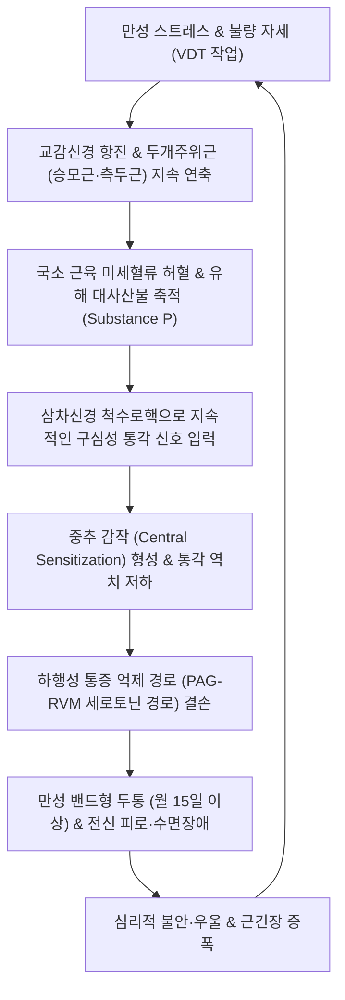

# 🩺 만성 긴장성 두통

> **핵심 3줄 요약 (Key Summary)**:
> - 📍 병소 부위 & 해부·병태생리: 두개주위 근육(승모근·후두하근·측두근·전두근)의 지속적인 만성 수축 및 허혈성 통증유발점(TrP) 형성과 함께, 척수 및 삼차신경 척수로핵 수준의 만성적인 **중추 감작(Central Sensitization)** 및 하행성 통증 억제계 결손으로 발생하는 만성 원발성 두통.
> - 🚩 전형적 임상 양상: 3개월 이상 월 15일 이상(연 180일 이상) 지속되는 머리 전체 또는 띠를 두른 듯한(Band-like) 양측성 압박감·조임통, 일상 활동으로 악화되지 않음, 심한 오심·구토 없음, 경도~중등도의 만성 피로성 둔통.
> - 🛠️ 핵심 검사 & 치료 전략: 두개주위 근육 총압통점수([[TTS score]], Total Tenderness Score) 평가, 신경학적 정상 확인 및 약물과용두통([[MOH]]) 배제. 두개주위근 침구([[백회]]·[[풍지]]·[[태양]]·[[합곡]]·[[태충]]) 및 전침, 두개천골요법([[CST]]), [[청상견통탕]]·[[반하백출천마탕]]·[[소요산]] 투여.
> - ⚠️ 응급 의뢰 레드플래그: 체위 변화(누웠다 일어날 때)에 따른 극심한 두통 변화(뇌압 이상), 신경학적 결손(시야 장애·편마비), 암 병력 환자에서의 새로운 지속 두통 발생 시 뇌 MRI 즉시 의뢰.

---

## 📌 목차
1. [질환 개요 & 해부학적 병태생리](#1-질환-개요--해부학적-병태생리)
2. [병태생리 메커니즘 & 생체역학적 악순환 네트워크](#2-병태생리-메커니즘--생체역학적-악순환-네트워크)
3. [임상 증상 & 이학적 검사(Physical Exam) 알고리즘](#3-임상-증상--이학적-검사physical-exam-알고리즘)
4. [감별 진단 매트릭스 (Differential Diagnosis)](#4-감별-진단-매트릭스-differential-diagnosis)
5. [한의 통합 치료 프로토콜 (침·약침·추나·한약)](#5-한의-통합-치료-프로토콜-침약침추나한약)
6. [양방 치료 & 병용·의뢰 기준 (Conventional Treatment & Referral)](#6-양방-치료--병용의뢰-기준-conventional-treatment--referral)
7. [재활 운동 & 생활습관 티칭 가이드](#7-재활-운동--생활습관-티칭-가이드)
8. [💡 사용자 진료실 핵심 필기 & 임상 노하우 (Melt-In 잔여 심화 집약)](#8--사용자-진료실-핵심-필기--임상-노하우-melt-in-잔여-심화-집약)
9. [출처 및 학술 참고 문헌 (References)](#9-출처-및-학술-참고-문헌-references)

---

## 1. 질환 개요 & 해부학적 병태생리

**만성 긴장성 두통(Chronic Tension-Type Headache, CTTH)** 은 국제두통질환분류(ICHD-3)에 정의된 대표적인 만성 원발성 두통으로, 3개월 이상 월 15일 이상(연간 180일 이상) 지속되는 양측성의 비박동성 압박 두통이다.

### 1) 해부학적 구조와 두개주위 근막망
- **두개주위 근육군(Pericranial Muscles)**:
  - [[전두근]](Frontalis), [[측두근]](Temporalis), [[후두근]](Occipitalis)으로 이루어진 모상건막(Galea aponeurotica) 연계 시스템.
  - 후경부 및 저작근계: [[승모근]](Trapezius) 상부, [[판상근]](Splenius), [[후두하근]](Suboccipitalis), [[교근]](Masseter), [[익돌근]](Pterygoid).
- 이들 근육은 머리 둘레 전체를 원형으로 감싸고 있어 지속적인 등척성 수축 시 머리 전체를 헬멧이나 끈으로 조이는 듯한 특유의 밴드형(Band-like) 통증을 생성한다.

### 2) 말초성 근긴장에서 중추 감작으로의 전환
- 삽화성 긴장형 두통이 주로 말초 근막 통증유발점(TrP)과 국소 허혈에 의해 유발되는 반면, **만성 긴장성 두통(CTTH)** 은 **중추 신경계의 통증 처리 이상(Central Sensitization)** 이 핵심 병태이다.
- 말초 근육의 지속적인 유해 자극 입력이 척수 후각 및 삼차신경 척수로핵 미부(Spinal trigeminal nucleus caudalis)의 통각 신경원을 만성적으로 감작시켜, 정상적인 감각 입력조차 통증으로 오인하는 이질통(Allodynia)과 통각과민(Hyperalgesia)이 고착화된다.

![[만성_긴장성_두통_01_긴장두통임상특징도해.jpg]]
> [그림 1: ① 질환 개요 — 머리 전체를 조이거나 짓누르는 듯한 양측성 비박동성 통증 양상을 보여주는 긴장성 두통 임상 특징 도해 (출처: 국가건강정보포털 두통)]
![[만성_긴장성_두통_01_일차두통통증분포비교도해.jpg]]
> [그림 2: ① 통증 분포 비교 — 긴장성 두통(양측 띠 모양 압박통), 편두통(편측 박동통), 군발두통(안와주위 격통)의 부위별 통증 분포 비교 도해 (출처: Wikimedia Commons — File:Pain distribution primary headache types.png)]

---

## 2. 병태생리 메커니즘 & 생체역학적 악순환 네트워크

CTTH의 병태는 심리적 스트레스, 자세성 근막 과긴장, 하행성 통증 억제계 결손이 얽힌 신경생물학적 네트워크로 설명된다.

### 1) 말초 근막 허혈과 염증 매개체
- 스트레스와 불량한 작업 자세는 교감신경을 과활성화하여 두개주위 미세혈관을 수축시킨다. 이로 인해 근육 내 젖산, Substance P, 브래디키닌, 세로토닌(5-HT)이 축적되고 통증 수용체가 지속적으로 탈분극된다.

### 2) 하행성 통증 조절 경로의 결손
- 중뇌 수도관주위 회백질(PAG)과 문측 연수 복내측부(RVM)에서 척수로 내려오는 **세로토닌 및 노르에피네프린 매개 하행성 통증 억제계(Descending Pain Inhibitory System)** 의 활성이 유의하게 저하된다.
- 억제 기능이 상실되면서 통증 신호가 뇌로 무제한 유입되어 환자는 매일 머리가 무겁고 맑지 않은 지속적 둔통을 경험한다.

![[만성_긴장성_두통_02_측두근해부도해.jpg]]
> [그림 3: ② 말초 근막 인자 — 만성 긴장성 두통 환자에서 두개주위 근육 압통(Pericranial tenderness)이 가장 흔하게 관찰되는 측두근(Temporalis muscle) 해부 도해 (출처: Wikimedia Commons — File:Gray382 muscle temporal.png)]
![[만성_긴장성_두통_02_전두근3D해부도해.jpg]]
> [그림 4: ② 해부 구조물 — 전두부 압박감 및 두피 근막 긴장에 관여하는 양측 전두근(Frontalis muscle) 3D 해부 도해 (출처: Wikimedia Commons — File:Frontalis muscle fronal.png)]

---

## 3. 임상 증상 & 이학적 검사(Physical Exam) 알고리즘

### 1) 전형적 임상 증상 (ICHD-3 기준)
- **통증 양상**: 머리 전체를 꽉 쥐어짜거나 띠를 두른 듯한 둔한 압박감(Pressing/tightening).
- **통증 부위**: 대개 양측성(Bilateral)이며, 후두부, 정수리, 전두부, 측두부 전반에 걸쳐 분포.
- **통증 강도**: 경도에서 중등도(VAS 3~6). 일상생활을 방해할 정도는 아니지만 하루 종일 지속되어 삶의 질을 저하시킴.
- **활동과의 연관성**: 걷기나 계단 오르기 등 일상적인 신체 활동에 의해 악화되지 않음.
- **수반 증상**: 중등도 이상의 오심이나 구토는 없으며, 빛 공포증(Photophobia)이나 소리 공포증(Phonophobia) 중 하나 이하만 존재 가능.

### 2) 이학적 검사 알고리즘
- 두개주위 근육 총압통점수([[TTS score]], Total Tenderness Score):
  - 검사자가 제2, 제3 수지로 8개 두개주위 근육군(전두근, 측두근, 교근, 익돌근, 흉쇄유돌근, 판상근, 승모근, 후두근)을 약 1~2kg의 일정한 압력으로 촉진.
  - 각 부위별 압통을 0~3점(0: 무통, 1: 경미한 통증, 2: 찌푸림 동반 통증, 3: 움찔거리며 피하는 통증)으로 채점하여 합산(만성 긴장성 두통 환자는 유의하게 상승).
- **신경학적 검진**: 뇌신경 검사, 심부건반사, 감각/운동 신경 검사, 병적 반사(Babinski) 모두 정상이어야 함.
- **약물 복용력 조사**: 매일 단순 진통제나 복합제를 복용하는지 확인하여 [[약물과용두통]](MOH) 동반 여부를 반드시 평가.

![[만성_긴장성_두통_03_두통감별진단알고리즘.jpg]]
> [그림 5: ③ 진단 알고리즘 — 위험 신호 유무, 발생 시기, 두통 빈도 및 동반 증상에 따른 긴장성 두통·편두통·이차성 두통 감별 흐름도 (출처: 국가건강정보포털 두통)]

---

## 4. 감별 진단 매트릭스 (Differential Diagnosis)

| 질환명 | 발생 빈도 & 지속 시간 | 통증 성상 & 위치 | 수반 증상 & 특징 |
| :--- | :--- | :--- | :--- |
| **만성 긴장성 두통** | 월 15일 이상, 수시간~매일 지속 | 양측성 비박동성 압박감, 밴드형 | 일상 활동 무관, 구토 없음, 중추 감작 |
| [[만성 편두통]] | 월 15일 이상 (이 중 8일 이상 편두통성) | 편측 또는 양측 박동성(욱신거림) | 일상 활동 시 악화, 심한 구토, 빛/소리 공포증 |
| [[약물과용두통]](MOH) | 월 15일 이상 매일 아침 지속 | 기상 직후 심한 둔통, 약 먹으면 일시 호전 | 진통제(NSAIDs, Triptan 등) 만성 과다 복용 |
| [[경인성 두통]] | 편측성 고정, 목 움직임에 의해 악화 | 후두부에서 안와로 방사 | 상경추(C1-C2) 관절 가동 장애, FRT 양성 |
| **뇌종양 / 두개내압 상승** | 점진적 악화, 기침·배변 시 악화 | 아침 기상 시 가장 심함, 분출성 구토 | 시신경유두부종(Papilledema), 국소 마비 |

---

## 5. 한의 통합 치료 프로토콜 (침·약침·추나·한약)

### 1) 침구 치료
- **두개주위 국소 취혈**:
  - [[백회]](GV20), [[태양]](EX-HN5), [[솔곡]](GB8), [[두유]](ST8), [[풍지]](GB20), [[천주]](BL10), [[완골]](GB12).
  - 통증유발점(TrP)이 밀집된 측두근막 및 후두부 모상건막 부위 사자(斜刺) 자침.
- **원위 및 전신 조절 취혈**:
  - [[합곡]](LI4), [[태충]](LR3) (사관혈 - 기혈 소통 및 중추 신경계 진통 촉진).
  - [[족삼리]](ST36), [[삼음교]](SP6), [[내관]](PC6) (자율신경 조절 및 스트레스 완화).
- **전침 요법(Electroacupuncture)**: 양측 [[태양]]과 [[풍지]], [[합곡]]과 [[태충]]에 2Hz 저주파 전침을 20분간 적용하여 중추 엔돌핀 분비와 척수 레벨의 하행성 통증 억제를 강화.

### 2) 약침 요법
- [[신바로약침]] / [[황련해독탕약침]]:
  - 자입 부위: 승모근 상부 통증유발점, 후두하근군, 측두근 건막.
  - 효과: 근막 내 염증성 통증 매개체를 신속히 배출하고 허혈성 근섬유의 이완을 촉진.
- [[자하거약침]]: 만성 피로와 허약, 수면장애를 동반한 환자의 [[간수]](BL18), [[비수]](BL20), [[신수]](BL23) 혈위에 시술.

### 3) 추나요법 (Chuna Manual Therapy)
- **두개천골기법(Craniosacral Therapy, CST)**:
  - 제4뇌실 압박기법(CV4)과 후두골 감압술(Occipital cranial base release)을 적용하여 뇌척수액의 미세 파동을 정상화하고 과항진된 교감신경계를 진정.
- **상부 경추 및 경흉추 이행부 가동술**:
  - C7-T1 및 상부 흉추의 회전 제한을 부드럽게 가동하여 경추로 집중되는 생체역학적 부하를 분산.

### 4) 한약 치료 (변증별 처방)
- **풍열습담형(風熱濕痰型, 머리가 무겁고 조이며 어지럽고 찌뿌둥함)**:
  - [[청상견통탕]](淸上莚痛湯) (황금, 강활, 방풍, 창출, 당귀, 천궁, 백지, 맥문동) — 두면부 풍열과 근막 울체 해소의 1순위 다빈도 처방.
- **간울기체형(肝鬱氣滯型, 스트레스·불안·가슴 답답함 동반)**:
  - [[소요산]](逍遙散) 또는 [[시호소간탕]](柴胡疎肝湯).
- **비허담탁형(脾虛痰濁型, 소화 불량, 기운 없음, 머리가 안개 낀 듯 무거움)**:
  - [[반하백출천마탕]](半夏白朮天麻湯) (반하, 백출, 천마, 복령, 진피).
- **기혈양허형(氣血兩虛型, 만성 피로, 수면 부족 시 악화, 은은한 둔통 지속)**:
  - [[보중익기탕]](補中益氣湯) 또는 [[귀비탕]](歸脾湯).

![[만성_긴장성_두통_05_응급의뢰필요두통위험신호.jpg]]
> [그림 6: ⑤ 적색신호 및 응급 의뢰 — 벼락두통, 신경학적 이상, 발열 등 즉각적인 정밀 검사와 상급병원 의뢰가 필요한 이차성 두통 위험 신호 도해 (출처: 국가건강정보포털 두통)]

---

## 6. 양방 치료 & 병용·의뢰 기준 (Conventional Treatment & Referral)

### 1) 약물 치료 (Medication)
- **예방 약물 요법 (1st Line)**:
  - 삼환계 항우울제(TCA): Amitriptyline (10~75mg qhs 취침 전 복용). 세로토닌과 노르에피네프린 재흡수를 차단하여 하행성 억제계를 복원.
  - 2선 약물: Mirtazapine (15~30mg qhs), Venlafaxine (75~150mg qd).
- **급성기 진통제 사용 제한**:
  - 단순 진통제(Acetaminophen, NSAIDs)는 주 2~3일 이내로 제한해야 하며, 만성 긴장성 두통에서는 급성기 약물의 효과가 떨어지고 [[약물과용두통]](MOH)으로 이행될 위험이 극도로 높음.

### 2) 한의 병용 판단 및 상호작용
- Amitriptyline 복용 환자에게 침구 및 한약([[소요산]], [[청상견통탕]])을 병용하면 항우울제의 구갈, 변비, 졸림 등 항콜린성 부작용을 완충하면서 감량(Tapering)을 안전하게 유도할 수 있음.
- 진통제 과용 환자의 약물 중단기(Detoxification phase)에 나타나는 반동성 두통을 한의 침·약침 치료로 성공적으로 제어 가능.

### 3) 전문과 및 응급실 의뢰 기준 (Red Flags)
- 50세 이상에서 새로 시작된 두통.
- 기침, 재채기, 힘주기 시 심해지는 두통 (Valsalva 악화 두통).
- 발열, 체중 감소, 암 병력 환자에서의 새로운 두통.
- 유두부종, 시야 결손, 편마비 등 신경학적 이상 동반 시 즉시 뇌 MRI/CT 시행 의뢰.

---

## 7. 재활 운동 & 생활습관 티칭 가이드

### 1) 이완 요법 및 자가 운동
- **점진적 근육이완법(Progressive Muscle Relaxation, PMR)**:
  - 어깨와 안면 근육을 5초간 강하게 긴장시켰다가 10초간 완전히 이완하는 호흡 훈련을 매일 취침 전 15분간 시행.
- **두개주위근 자가 스트레칭**:
  - 측두근 마사지: 주먹 쥔 손의 손가락 마디로 관자놀이 부위를 부드럽게 원을 그리며 롤링.
  - 전두근 및 모상건막 지압: 양손 손가락으로 두피를 전후좌우로 흔들어 건막의 유착을 풀어줌.

### 2) 생활습관 티칭
- **수면 위생 철저**: 규칙적인 수면-각성 주기 유지 (수면 부족과 과다 수면 모두 두개주위근 긴장을 유발).
- **카페인 섭취 조절**: 커피 등 카페인 음료를 하루 1잔 이하로 제한하고 오후 2시 이후 섭취 금지.
- **VDT 작업 환경 개선**: 50분 연속 작업 후 5분간 휴식하며 먼 곳을 바라보고 목 어깨 스트레칭.

---

## 8. 💡 사용자 진료실 핵심 필기 & 임상 노하우 (Melt-In 잔여 심화 집약)

- **진통제 과용의 악순환을 반드시 끊어내야 한다**:
  - 만성 긴장성 두통으로 내원하는 환자의 70% 이상은 타이레놀, 이부프로펜, 게보린, 사리돈 등을 거의 매일 복용하고 있다.
  - 환자에게 "지금 드시는 진통제가 두통을 낫게 하는 것이 아니라, 뇌의 통증 역치를 떨어뜨려 매일 두통을 만들고 있습니다"라고 명확히 티칭하고, 한의 치료를 시작하면서 진통제를 과감히 끊게 해야 완치로 갈 수 있다.
- **침 치료의 다빈도 핵심 조합 (백회·태양·풍지 + 사관)**:
  - 머리의 모상건막 텐션을 즉각적으로 떨어뜨리는 데는 [[백회]](GV20) 전후좌우의 사신총 자침과 양측 [[태양]](EX-HN5) 사자, 그리고 [[풍지]](GB20) 심자 자극이 최고이다.
  - 여기에 사관혈([[합곡]], [[태충]]) 전침을 결합하면 20분 유침 동안 뇌파가 안정되며 환자가 깊은 수면에 빠지는 경우가 많고, 기상 후 머리가 시원해지는 것을 즉각 체감한다.
- **처방 선택의 팁**:
  - 소화 기능이 양호하고 열감이 있는 직장인 스트레스형은 [[청상견통탕]]을, 소화가 잘 안 되고 차가운 것을 싫어하며 기운이 없는 여성 환자는 [[반하백출천마탕]]이나 [[보중익기탕]]을 선방하는 것이 진료실 실전 성공률을 극대화한다.

---

## 9. 출처 및 학술 참고 문헌 (References)

- Hallmarks of primary headache: part 2- Tension-type headache. *Neurol Sci*, 2025. PMID: 40676501.

- Tension-Type Headache: Toward an Integrative Multidimensional Framework for Clinical Stratification and Personalized Management. *J Clin Med*, 2026. PMID: 42074786.

- Utility of Acupuncture Therapy for Adult Chronic Daily Headache Prophylaxis: A Systematic Review and Meta-Analysis. *J Pain Res*, 2026. PMID: 42177613.

---

## 관련 노트

- [[긴장형 두통]]
- [[편두통]]
- [[청상견통탕]]
- [[반하백출천마탕]]
- [[소요산]]
- [[약물과용두통]]
