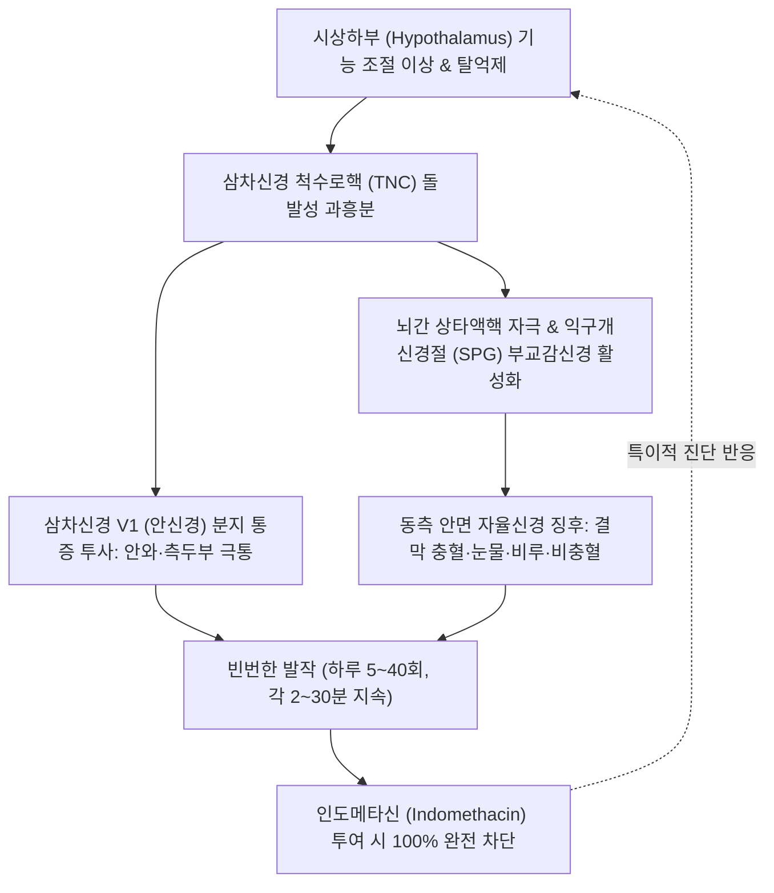

# 🩺 발작성 반두통

> **핵심 3줄 요약 (Key Summary)**:
> - 📍 병소 부위 & 해부·병태생리: 시상하부(Hypothalamus)의 중추 조절 이상 및 삼차신경-자율신경 반사(Trigeminal-Autonomic Reflex) 과흥분으로 인해, 삼차신경 제1분지(V1 안신경)와 익구개신경절([[SPG]])을 경유하는 편측 신경혈관성 급성 통증 질환.
> - 🚩 전형적 임상 양상: 편측 안와·안와상·측두부의 극심한 발작성 통증(지속 시간 2~30분, 하루 5~40회 빈발), 동측 결막 충혈, 눈물(Lacrimation), 비충혈, 비루, 안검하수 동반, **인도메타신(Indomethacin) 투여 시 100% 완전 소실**.
> - 🛠️ 핵심 검사 & 치료 전략: 인도메타신 반응 검사([[Indotest]]), 뇌 MRI(안장 부위·뇌하수체 종양 등 이차성 배제). 한의 간담화열(肝膽火旺) 청열사화 침구([[찬죽]]·[[사죽공]]·[[태양]]·[[행간]]·[[협계]]) 및 [[용담사간탕]]·[[시호청간탕]], 양방 인도메타신 장기 복용 위장 장애 보호 한약 병용.
> - ⚠️ 응급 의뢰 레드플래그: 인도메타신에 전혀 반응하지 않거나, 시야 결손·안구운동마비 동반 시 뇌하수체 졸중(Pituitary apoplexy), 해면정맥동 혈전증 또는 내경동맥 박리 의심 즉시 신경과·신경외과 정밀 영상 검사 의뢰.

---

## 📌 목차
1. [질환 개요 & 해부학적 병태생리](#1-질환-개요--해부학적-병태생리)
2. [병태생리 메커니즘 & 생체역학적 악순환 네트워크](#2-병태생리-메커니즘--생체역학적-악순환-네트워크)
3. [임상 증상 & 이학적 검사(Physical Exam) 알고리즘](#3-임상-증상--이학적-검사physical-exam-알고리즘)
4. [감별 진단 매트릭스 (Differential Diagnosis)](#4-감별-진단-매트릭스-differential-diagnosis)
5. [한의 통합 치료 프로토콜 (침·약침·추나·한약)](#5-한의-통합-치료-프로토콜-침약침추나한약)
6. [양방 치료 & 병용·의뢰 기준 (Conventional Treatment & Referral)](#6-양방-치료--병용의뢰-기준-conventional-treatment--referral)
7. [재활 운동 & 생활습관 티칭 가이드](#7-재활-운동--생활습관-티칭-가이드)
8. [💡 사용자 진료실 핵심 필기 & 임상 노하우 (Melt-In 잔여 심화 집약)](#8--사용자-진료실-핵심-필기--임상-노하우-melt-in-잔여-심화-집약)
9. [출처 및 학술 참고 문헌 (References)](#9-출처-및-학술-참고-문헌-references)

---

## 1. 질환 개요 & 해부학적 병태생리

**발작성 반두통(Paroxysmal Hemicrania, PH)** 은 국제두통질환분류(ICHD-3)상 **삼차자율신경두통(Trigeminal Autonomic Cephalalgias, TACs)** 군에 속하는 비교적 드물지만 극심한 통증을 유발하는 원발성 두통 질환이다.

### 1) 해부학적 구조와 신경 경로
- **삼차신경 제1분지(안신경, V1)**: 두개강 내 경막, 천측두동맥, 안와 주위 조직의 통각을 담당하며 뇌간 삼차신경 척수로핵으로 통증 신호를 전달한다.
- **삼차신경-자율신경 반사궁(Trigeminal-Autonomic Reflex Arc)**:
  - 삼차신경 척수로핵으로 유입된 통각 자극이 뇌간의 상타액핵(Superior salivatory nucleus)을 흥분시킨다.
  - 부교감신경 절전섬유가 대추체신경을 거쳐 **익구개신경절([[Sphenopalatine ganglion]], SPG)** 로 주행하고, 절후섬유가 누선(눈물샘) 및 비점막 혈관을 지배하여 동측 눈물과 비루, 비충혈을 유발한다.
- **교감신경 마비 징후**: 두통 발작 중 안와 주변 정맥 울혈과 경동맥 신경총 부종으로 인해 동측 안검하수(Ptosis) 및 축동(Miosis) 등 일시적 부분 호너 증후군(Horner-like syndrome)이 나타난다.

### 2) 역학 및 핵심 특징
- 여성에서 남성에 비해 약 2~3배 호발하며, 20대~40대에 주로 발병한다.
- 발작성 반두통의 가장 결정적인 특징은 **NSAIDs 계열인 인도메타신(Indomethacin) 치료에 100% 완전한 반응(Absolute therapeutic response)** 을 보인다는 점이다.

---

## 2. 병태생리 메커니즘 & 생체역학적 악순환 네트워크

발작성 반두통의 발생은 시상하부의 생체 리듬 조절 이상과 삼차자율신경 반사의 폭발적 활성화로 설명된다.

### 1) 시상하부(Hypothalamus) 활성화
- 기능적 신경영상(fMRI/PET) 연구에 따르면, 두통 발작 시 동측 시상하부 후하부(Posterior inferior hypothalamus)의 국소 뇌혈류가 유의하게 증가한다. 시상하부는 삼차신경 통각 전달계와 부교감신경 반사를 억제하는 상위 조절 센터인데, 이 기능이 일시적으로 탈억제되면서 빈번한 발작이 촉발된다.

### 2) 인도메타신의 특이적 작용 기전
- 단순한 COX 억제 항염 작용뿐만 아니라, 인도메타신 특유의 **두개내압(ICP) 감소 효과** 및 **일산화질소(NO) 합성 억제**, **시상하부 뇌혈류 조절** 작용이 삼차자율신경 반사의 폭발을 즉각 진정시키는 것으로 규명되어 있다.

---

## 3. 임상 증상 & 이학적 검사(Physical Exam) 알고리즘

### 1) 전형적 임상 증상 (ICHD-3 진단 기준)
- **통증 부위**: 엄격한 편측성(Unilateral)으로 안와(Orbital), 안와상부(Supraorbital), 측두부(Temporal)에 국한.
- **통증 성상**: 찌르거나 타는 듯한 극심한 작열통 또는 송곳으로 후비는 듯한 고통(VAS 8~10).
- **발작 지속 시간**: **2분 ~ 30분** (대개 10~15분 내외로 짧음).
- **발작 빈도**: **하루 5회 이상** (평균 하루 5~40회 수시로 발작).
- **동측 자율신경계 징후 (최소 1개 이상 동반)**:
  - 결막 충혈 및 눈물 흘림(Lacrimation).
  - 비충혈(코막힘) 및 비루(맑은 콧물).
  - 안검 부종 및 안검하수.
  - 이마와 안면의 발한 또는 홍조.
  - 이충만감(귀가 먹먹함).
- **인도메타신 절대 반응**: 적정 용량의 인도메타신 투여 시 두통이 완전히 소실됨.

### 2) 이학적 검사 알고리즘
- **인도메타신 검사([[Indotest]])**:
  - 발작성 반두통이 의심되는 환자에게 Indomethacin 50mg 근육주사 또는 경구 150~225mg/day(3일 투여)를 시행.
  - 24~48시간 이내에 발작이 완전히 100% 멈추면 확진 (진단적 치료).
- **신경학적 검진**: 뇌신경 3, 4, 6번(외안근 운동) 및 5번(안면 감각) 검사. 정상 소견 확인.
- **두경부 및 안와 압진**: 발작 중 안와상절제부([[찬죽]]), 활차상신경, [[태양]] 혈위 압통 여부 평가.

---

## 4. 감별 진단 매트릭스 (Differential Diagnosis)

| 질환명 | 호발 성별 | 발작 지속 시간 | 발작 빈도 | 치료 반응성 핵심 |
| :--- | :--- | :--- | :--- | :--- |
| **발작성 반두통(PH)** | **여성 우세 (2:1)** | **2 ~ 30분** | **하루 5 ~ 40회** | **인도메타신에 100% 완전 반응** |
| **[[군발두통]](Cluster Headache)** | 남성 우세 (3:1) | 15 ~ 180분 | 2일에 1회 ~ 하루 8회 | 100% 고유량 산소 흡입, 수마트립탄 반응 |
| **SUNCT / SUNA** | 남녀 비슷 | 1 ~ 600초 (초 단위) | 하루 수십 ~ 수백 회 | 라모트리진(Lamotrigine) 반응, 인도메타신 불응 |
| **[[지속반두통]](Hemicrania Continua)** | 여성 우세 | 연속적 지속 (배경통) | 24시간 내내 지속 | 인도메타신 반응 (단, 지속형 통증) |
| **삼차신경통(Trigeminal Neuralgia)** | 여성 우세 | 수초 ~ 2분 | 씹기·세안 시 격발 | 카르바마제핀 반응, 자율신경 징후 없음 |

---

## 5. 한의 통합 치료 프로토콜 (침·약침·추나·한약)

### 1) 침구 치료
- **안와 및 두면부 국소 취혈 (삼차신경 V1 및 자율신경 반사 차단)**:
  - [[찬죽]](BL2), [[어요]](EX-HN4), [[사죽공]](TE23): 안와상신경 주행로 직접 진정.
  - [[태양]](EX-HN5), [[동자료]](GB1), [[승읍]](ST1): 안와 측면 및 익구개신경절 반사 완화.
  - [[풍지]](GB20), [[솔곡]](GB8): 두개혈관 긴장 완화.
- **원위 청열사화 취혈**:
  - [[행간]](LR2), [[태충]](LR3) (간경 형화혈·원혈 - 치솟는 간담의 풍열 사화).
  - [[협계]](GB43), [[족임읍]](GB41) (담경 형수혈 - 편측 두통 및 안충혈 해소).
  - [[합곡]](LI4), [[내정]](ST44) (양명경 사열).
- **치침 수기법**: 발작기에는 영수보사 중 사법(瀉法, 강자극 염전)을 적용하여 급성 화열(火熱)을 꺾음.

### 2) 약침 요법
- **[[황련해독탕약침]]**:
  - 자입 부위: [[찬죽]], [[사죽공]], [[태양]], [[풍지]] 피내 및 근막 심부.
  - 효과: 황련·황금·황백·치자의 강력한 청열해독 및 항신경염증 작용으로 삼차자율신경 반사의 국소 충혈과 신경 부종을 신속히 억제.
- **[[신바로약침]]**: 상경추 후관절 및 경부 연부조직 긴장 완화.

### 3) 추나요법 (Chuna Manual Therapy)
- **익구개신경절(SPG) 간접 감압술 & 안면 두개골 가동화**:
  - 접형골(Sphenoid) 및 상악골의 미세 변위를 교정하는 두개천골요법(CST)을 통해 익구개와(Pterygopalatine fossa) 부위의 신경혈관 압박을 완화.
- **경추 가동기법**: 상부 경추(C1-C2) 관절가동술을 적용하여 삼차신경경부복합체(TCC)로의 과도한 자극 유입을 차단.

### 4) 한약 치료 (변증별 처방)

#### ① [[용담사간탕]](龍膽瀉肝湯) — 간담실화형(肝膽實火型)의 대표 방제
- **적응증**: 안구 충혈, 눈물, 콧물과 함께 안와가 터질 듯 아프고 입이 쓰고(구고) 화를 잘 내며 맥현삭(弦數)한 경우.
- **구성**: 용담초 8g, 황금 6g, 치자 6g, 택사 8g, 목통 4g, 차전자 6g, 당귀 4g, 생지황 8g, 시호 6g, 감초 4g.
- **기전**: 용담초·치자가 간담의 치솟는 화열을 직접 끄고, 차전자·택사가 하초로 습열을 배출하여 삼차신경혈관계 과흥분을 차단.

#### ② [[시호청간탕]](柴胡淸肝湯) 또는 [[황련해독탕]](黃連解毒湯)
- 급성기 안면 홍조 및 심한 안와 박동통, 불면이 동반된 풍열화독(風熱火毒) 상태.

#### ③ 인도메타신 위장 보호 병용 방제: [[반하사심탕]](半夏瀉心湯) / [[평위산]](平胃散)
- 인도메타신을 장기 복용해야 하는 발작성 반두통 환자의 소화성 궤양, 위통, 속쓰림을 방어하는 최적의 위점막 보호 처방.

---

## 6. 양방 치료 & 병용·의뢰 기준 (Conventional Treatment & Referral)

### 1) 약물 치료 (Medication)
- **인도메타신(Indomethacin, 절대적 1차 치료제)**:
  - 투여법: 25mg tid (하루 75mg)로 시작하여 반응이 불충분하면 50mg tid (150mg/day)로 증량, 필요 시 최대 225mg/day까지 증량.
  - 반응: 투여 후 1~2일 이내에 두통 발작이 100% 완전히 멈추며, 복용을 중단하면 1~2일 내에 재발함.
  - 유지 요법: 최소 유효 용량(보통 25~75mg/day)으로 감량 유지.
- **2차 대체 약물 (인도메타신 불내성 또는 금기 시)**:
  - Verapamil (120~240mg/day), Topiramate (50~100mg/day), Melatonin (9~15mg qhs).
  - 단, 인도메타신만큼 완전한 관해율을 보이지는 못함.

### 2) 비약물적 시술 (Procedures)
- **익구개신경절(SPG) 차단술 또는 고주파 열응고술(RF Thermocoagulation)**:
  - 약물 난치성 만성 발작성 반두통에서 SPG를 차단하여 부교감신경 반사 루프를 차단.
- **비침습적 미주신경 자극술(nVNS, non-invasive Vagus Nerve Stimulation)**:
  - 경부 미주신경을 경피적으로 자극하여 뇌간 자율신경 반사를 억제하는 신치료법.

### 3) 한의 병용 판단 및 임상적 의의
- **위장관 보호 시너지**: 인도메타신은 강력한 NSAID로서 장기 복용 시 30~50%에서 위장관 출혈이나 소화성 궤양을 유발함. PPI와 함께 한약([[반하사심탕]], [[생강백출]])을 병용하면 위점막 손상을 효과적으로 예방하고 인도메타신 복용 지속성을 확보할 수 있음.
- **용량 감량 효과**: 침구 및 [[용담사간탕]] 투여를 통해 신경 흥분성을 낮추면 인도메타신 유지 용량을 절반 이하로 감량 가능.

### 4) 전문과 및 응급실 의뢰 기준 (Red Flags)
- 인도메타신 최고 용량(225mg/day) 투여에도 발작 빈도나 강도에 전혀 변화가 없는 경우 (이차성 TACs, 군발두통, 뇌하수체 종양 감별).
- 안구운동장애(외전신경 마비에 의한 복시), 시력 감퇴, 결막 부종이 지속되는 경우 (해면정맥동 질환, 뇌동맥류 의심 → 뇌 MRI/MRA 즉시 시행).

---

## 7. 재활 운동 & 생활습관 티칭 가이드

### 1) 유발 요인 회피 (Trigger Management)
- **알코올 완전 금기**: 알코올은 혈관 확장과 삼차신경 자율신경 반사를 격발시키는 가장 강력한 방아쇠이므로 두통 활성기에는 한 모금의 음주도 금지.
- **급격한 온도 변화 회피**: 찬바람을 갑자기 맞거나 뜨거운 사우나에 들어가는 등 급격한 혈관 수축·이완 자극 피하기.
- **목의 과신전 또는 압박 회피**: 고개를 과도하게 뒤로 젖히거나 경부 혈관을 누르는 자세 지양.

### 2) 일상생활 티칭
- 발작 일기(Headache Diary) 작성: 하루 발작 횟수, 지속 시간, 약물 복용량 및 자율신경 징후를 상세히 기록하여 치료 반응 평가.
- 규칙적인 수면과 식사: 수면 부족이나 저혈당 상태는 시상하부 불안정성을 가중시킴.

---

## 8. 💡 사용자 진료실 핵심 필기 & 임상 노하우 (Melt-In 잔여 심화 집약)

- **군발두통으로 잘못 알고 오는 환자의 감별 포인트**:
  - 눈 주위가 찌르는 듯 아프고 눈물 콧물이 나서 로컬 병원에서 군발두통으로 진단받았으나, 수마트립탄이나 산소치료에 별 효과를 보지 못한 환자가 내원할 수 있다.
  - "하루에 몇 번이나 아프신가요? 한 번 아프면 몇 분 정도 지속되나요?"라고 물었을 때, "하루에 10번도 넘게 오는데, 한 번 오면 10분~15분 바짝 아프고 싹 가라앉아요"라고 대답하면 즉시 발작성 반두통을 의심해야 한다. (군발두통은 하루 1~2회, 1시간 이상 길게 지속됨).
- **진단적 치료로서의 인도메타신 테스트**:
  - 발작성 반두통이 의심되면 인도메타신을 50mg 하루 3회 처방하여 복용시킨다. 만약 진짜 발작성 반두통이라면 다음 날 내원하여 "원장님, 하루에 수십 번씩 오던 지옥 같은 통증이 약 먹고 하루 만에 마법처럼 사라졌어요!"라고 말한다. 이 드라마틱한 반응 자체가 질환의 확진 도구이다.
- **인도메타신의 딜레마와 한의 치료의 역할**:
  - 인도메타신은 약을 끊으면 바로 재발하며, 장기 복용 시 위장이 망가지는 것이 최대 난제이다. 이때 한방에서 [[용담사간탕]]으로 간담의 화열을 끄고 [[반하사심탕]]으로 위장을 보완하면서 침 치료([[찬죽]], [[사죽공]], [[태양]])를 병행하면 인도메타신을 점진적으로 줄이거나 끊고도 안정적인 관해를 유지할 수 있다.

---

## 9. 출처 및 학술 참고 문헌 (References)

- Indomethacin testing in suspected paroxysmal hemicrania and hemicrania continua: Clinical phenotypes and response patterns in a tertiary headache centre. *Neurol Sci*, 2026. PMID: 42834248.

- Radiofrequency thermocoagulation of the sphenopalatine ganglion in the treatment of chronic paroxysmal hemicrania. *Agri*, 2026. PMID: 42550977.

- Beyond indomethacin: a case report of chronic paroxysmal hemicrania with remarkable response to non-invasive vagus nerve stimulation. *Neurologia (Engl Ed)*, 2026. PMID: 41765128.

---

## 관련 노트

- [[군발두통]]
- [[지속반두통]]
- [[삼차신경통]]
- [[용담사간탕]]
- [[황련해독탕]]
- [[찬죽]]
