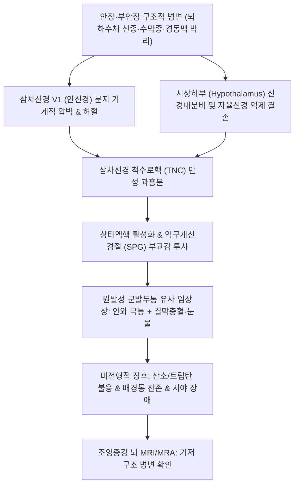

# 🩺 속발성 군발두통양 두통

> **핵심 3줄 요약 (Key Summary)**:
> - 📍 병소 부위 & 해부·병태생리: 뇌하수체 종양·해면정맥동 병변·내경동맥 박리·수막종 등 안장 및 두개저 기질적 병변이 삼차신경 제1분지(V1) 또는 시상하부-삼차자율신경 반사궁을 물리적·혈관성으로 자극하여 원발성 군발두통의 임상상을 모방(Mimicry)하는 이차성 두통.
> - 🚩 전형적 임상 양상: 편측 안와·측두부의 극심한 발작성 통증 및 동측 자율신경 징후(결막충혈·눈물·비루)를 보이나, 50세 이상 늦은 발병, 전형적 군발 주기의 결손, 배경 통증의 지속, 표준 산소·트립탄 치료 불응이 특징.
> - 🛠️ 핵심 검사 & 치료 전략: 뇌신경 2~6번 정밀 신경학적 검진, 조영증강 뇌 MRI 및 뇌혈관 MRA/CTA 필수 시행. 기저 원인 병변의 신경외과적 처치가 근본 치료이며, 수술 후 잔여 신경통에 대해 [[청상견통탕]]·[[통규활혈탕]] 및 침구 치료 보조.
> - ⚠️ 응급 의뢰 레드플래그: 시야 결손(양이측 반맹), 안구운동마비(복시), 시력 감퇴, 지속적인 호너 증후군 동반 시 뇌하수체 졸중·내경동맥 박리·해면정맥동 혈전증 의심 즉시 상급병원 응급 신경외과 전원.

---

## 📌 목차
1. [질환 개요 & 해부학적 병태생리](#1-질환-개요--해부학적-병태생리)
2. [병태생리 메커니즘 & 생체역학적 악순환 네트워크](#2-병태생리-메커니즘--생체역학적-악순환-네트워크)
3. [임상 증상 & 이학적 검사(Physical Exam) 알고리즘](#3-임상-증상--이학적-검사physical-exam-알고리즘)
4. [감별 진단 매트릭스 (Differential Diagnosis)](#4-감별-진단-매트릭스-differential-diagnosis)
5. [한의 통합 치료 프로토콜 (침·약침·추나·한약)](#5-한의-통합-치료-프로토콜-침약침추나한약)
6. [양방 치료 & 병용·의뢰 기준 (Conventional Treatment & Referral)](#6-양방-치료--병용의뢰-기준-conventional-treatment--referral)
7. [재활 운동 & 생활습관 티칭 가이드](#7-재활-운동--생활습관-티칭-가이드)
8. [💡 사용자 진료실 핵심 필기 & 임상 노하우 (Melt-In 잔여 심화 집약)](#8--사용자-진료실-핵심-필기--임상-노하우-melt-in-잔여-심화-집약)
9. [출처 및 학술 참고 문헌 (References)](#9-출처-및-학술-참고-문헌-references)

---

## 1. 질환 개요 & 해부학적 병태생리

**속발성 군발두통양 두통(Secondary Cluster-like Headache, Symptomatic Cluster Headache)** 은 임상적으로 극심한 편측 안와 통증과 자율신경 징후를 동반하여 원발성 [[군발두통]](Cluster headache)의 진단 기준을 충족하거나 유사하지만, 실제로는 두개강 내의 기질적이고 구조적인 병변(Structural lesions)에 의해 이차적으로 발생하는 두통 증후군이다.

### 1) 기저 원인 병변 및 해부학적 호발 부위
![[속발성군발두통_01_삼차신경_분포영역.png|450]]
> [그림 1: 두부 측면에서 삼차신경 세 분지의 말초 분포(누선신경·안와상신경·안와하신경·이개측두신경·이하신경·이개대신경·후두신경)를 구역별로 표시한 Gray 해부 도해. 이차성 군발두통양 두통은 이 구심로가 구조물에 눌리거나 침윤될 때 생긴다 — 출처: Wikimedia Commons — File:Gray784.png (Public domain)]

- **안장 및 부안장 부위(Sellar & Parasellar Lesions)**:
  - **뇌하수체 선종(Pituitary adenoma)**: 특히 프로락틴 분비 선종(Prolactinoma) 및 성장호르몬 선종, 비기능성 거대선종. 시상하부 저부를 직접 압박하거나 안장 측벽을 침범하여 해면정맥동을 자극함.
  - 두개인두종(Craniopharyngioma), 라트케 낭종(Rathke's cleft cyst).
- **해면정맥동 및 안와 질환(Cavernous Sinus Pathology)**:
  - 해면정맥동 혈전증, 톨로사-헌트 증후군([[Tolosa-Hunt syndrome]]), 경동맥-해면정맥동 누공(CCF).
  - 해면정맥동 내부를 통과하는 삼차신경 제1분지(안신경, V1) 및 내경동맥 주위 교감신경총의 직접적인 침습과 압박.
- **혈관성 병변(Vascular Lesions)**:
  - **내경동맥 박리(Internal Carotid Artery Dissection, ICAD)**: 혈관벽 가성동맥류 형성과 신경총 자극.
  - 두개내 뇌동맥류(후교통동맥류, 안동맥류), 뇌동정맥기형(AVM).
- **두개저 종양 및 염증성 질환**:
  - 접형골능 수막종(Sphenoid ridge meningioma), 전정신경초종.
  - 다발성 경화증(MS)의 뇌간 삼차신경근 진입부 탈수초 병변.
  - 중증 부비동염(접형동염 Sphenoid sinusitis).

---

## 2. 병태생리 메커니즘 & 생체역학적 악순환 네트워크

속발성 군발두통양 두통은 기질적 병변이 삼차신경-자율신경 반사 회로를 직접 물리적으로 침해함으로써 격발된다.

### 1) 삼차신경 구심로의 물리적 포착
- 해면정맥동이나 두개저의 종양 또는 박리된 혈관벽이 삼차신경 V1 분지를 직접 압박하거나 염증성 침윤을 유발한다.
- 이소성 기계적 자극이 삼차신경 척수로핵으로 지속 유입되어 원발성 군발두통과 동일한 안와부 작열통을 투사한다.

### 2) 뇌간 자율신경핵 및 시상하부 간섭
![[속발성군발두통_02_시상하부_해부.png|450]]
> [그림 2: 시상하부를 적색으로 강조한 뇌 시상면·관상면 도해. 발작의 ‘생체시계’ 역할을 하는 시상하부 후하부가 이차성 병변(종양·염증)의 침범 부위이기도 하다 — 출처: Wikimedia Commons — File:Hypothalamus image.png (CC BY-SA 2.1 JP)]

- 뇌하수체 종양이 시상하부(Hypothalamus)를 위로 밀어올리거나 정상 억제 피드백을 차단할 경우, 삼차신경-자율신경 반사가 통제 불능 상태로 과항진되어 익구개신경절([[SPG]])을 통해 결막 충혈, 콧물, 눈물이 유도된다.
- 종양의 팽창 속도와 혈관성 박동에 따라 통증이 주기성을 잃고 지속적인 양상으로 고착화된다.

---

## 3. 임상 증상 & 이학적 검사(Physical Exam) 알고리즘

### 1) 원발성 군발두통과 구별되는 비전형적 "레드플래그 임상상"
- **발병 연령의 비전형성**: 군발두통의 전형적 호발 연령(20~40대)을 벗어나 **50세 이상 고령**에서 첫 발작이 시작됨.
- **주기성 결손(Lack of Periodicity)**:
  - 원발성 군발두통 특유의 군발기(수주~수개월 지속 후 수개월~수년 관해) 리듬이 없음.
  - 발작과 발작 사이에 통증이 완전히 사라지지 않고 은은한 둔통(Background persistent headache)이 지속됨.
- **치료 반응성 결여**: 100% 고유량 산소 흡입(12~15 L/min)이나 피하 수마트립탄 주사, 예방약인 베라파밀에 부분적이거나 전혀 반응이 없음.
- **신경학적 결손 동반**: 시야 결손, 안구운동장애, 지속성 안검하수 등.

### 2) 이학적 및 신경학적 검사 알고리즘
![[속발성군발두통_03_군발두통_임상양상.jpg|450]]
> [그림 3: ‘군발두통’ — 편측 눈·관자놀이 통증과 동측 결막 충혈·눈물·비루, 통증 시간대 집중을 그림으로 설명한 국가건강정보포털 도해. 원발성과 구별되는 이차성 레드플래그를 볼 때의 기준 그림 — 출처: 질병관리청 국가건강정보포털 — 두통 (cntntsSn 5830) (공공누리 제4유형)]

- **시신경(CN 2) 검진**:
  - 대면시야검사(Confrontation test): 뇌하수체 거대선종에 의한 시교차 압박 여부(양이측 반맹, Bitemporal hemianopsia) 평가.
  - 안저 검사: 유두부종(Papilledema) 또는 시신경 위축 유무 확인.
- **외안근 신경(CN 3, 4, 6) 검진**:
  - 안구 운동(H-pattern test) 시 복시(Diplopia) 발생 여부 및 외전신경(CN 6) 마비 확인 (해면정맥동 병변의 조기 지표).
- **삼차신경(CN 5) 감각 검진**: V1(이마), V2(뺨) 영역의 감각 저하(Hypesthesia) 유무 확인.
- **필수 영상 검사**: 원발성 군발두통으로 의심되더라도 **조영증강 뇌 MRI 및 뇌혈관 MRA(안장 및 해면정맥동 프로토콜 포함)** 를 1회 이상 반드시 시행하여 기질적 원인을 배제해야 함.

---

## 4. 감별 진단 매트릭스 (Differential Diagnosis)
![[속발성군발두통_04_안면홍조.jpg|450]]
> [그림 4: 군발두통 발작 중 동측 뺨의 홍조(blushing)를 촬영한 임상 사진 — 삼차자율신경 반사로 안면 혈관이 확장된 소견 — 출처: Wikimedia Commons — File:Blushing cheeks is a common symptom during attacks of cluster headache.jpg (CC BY-SA 4.0)]

| 질환명 | 주 병인 및 기전 | 임상 양상 및 주기성 | 영상 및 확진 검사 |
| :--- | :--- | :--- | :--- |
| **속발성 군발두통양 두통** | 뇌하수체종양, 수막종, 내경동맥박리 | 비전형적 발작, 배경통 잔존, 고령 발병 | 뇌 MRI/MRA 상 구조적 병변 확인 |
| **원발성 [[군발두통]]** | 시상하부 활성화, 삼차자율신경 반사 | 엄격한 주기성(밤 특정 시간 발작), 15~180분 | 뇌 영상 검사 정상, 산소 흡입 반응 |
| **톨로사-헌트 증후군** | 해면정맥동의 특발성 육아종성 염증 | 안구 후부 극심한 통증 + 통증성 외안근마비 | 뇌 MRI 해면정맥동 조영증강, 스테로이드 반응 |
| [[발작성 반두통]] | 삼차자율신경두통 (TACs) | 2~30분 짧은 발작, 하루 5~40회 | 인도메타신에 100% 완전 소실 |
| **내경동맥 박리(ICAD)** | 외상 또는 혈관벽 미세 파열 | 돌발성 편측 두통, 경부통, 호너 증후군 | 경동맥 초음파, MRA/CTA 혈관벽 내 혈종 |

---

## 5. 한의 통합 치료 프로토콜 (침·약침·추나·한약)
![[속발성군발두통_05_두통유형별_통증분포.png|450]]
> [그림 5: 긴장두통·편두통·군발두통의 통증 분포를 머리 그림으로 비교한 도해. 군발두통은 안와 주위에 집중되고 긴장두통은 후두·목덜미를 띠로 감싼다 — 출처: Wikimedia Commons — File:Pain distribution primary headache types.png (CC BY 4.0)]

> ⚠️ **원칙**: 속발성 군발두통양 두통은 뇌종양, 혈관 박리 등 생명을 위협하거나 영구적 신경 결손을 초래하는 기질 질환이 원인이므로, **원인 질환에 대한 신경외과/신경과적 치료(수술·혈관 시술·약물)가 절대적 제1선**이다. 한의 치료는 신경외과적 처치 완료 후 잔여 통증이나 수술 불가 환자의 대증 완화에 보조적으로 적용한다.

### 1) 침구 치료
- **두면부 신경 통로 감압 및 순환 촉진 취혈**:
  - [[찬죽]](BL2), [[사죽공]](TE23), [[태양]](EX-HN5), [[승읍]](ST1): 안와 주변 삼차신경 말초 분지 자극 진통.
  - [[풍지]](GB20), [[천주]](BL10), [[완골]](GB12): 두개저 및 후두하 혈류 울체 완화.
- **원위 사열·청열 취혈**:
  - [[합곡]](LI4), [[태충]](LR3) (사관혈 - 전신 기혈 순환 촉진).
  - [[행간]](LR2), [[협계]](GB43) (풍열과 화열을 사함).

### 2) 약침 요법
- [[황련해독탕약침]]: 안와 주변 및 측두부 연부조직 염증 완화.
- [[중성어혈약침]]: 두개저 부위의 미세 순환 부전 및 어혈 제거.

### 3) 한약 치료 (변증별 보조 처방)
- **담어조락형(痰瘀阻絡型, 두통이 심하고 고정적이며 야간 악화, 수술 후 잔여 통증)**:
  - [[통규활혈탕]](通竅活血탕) (도인, 홍화, 당귀, 천궁, 적작약, 사향/석창포) — 두면부 미세순환 개선 및 혈종·울혈 흡수 촉진.
- **풍열화독형(風熱火毒型, 극심한 안와 작열통, 결막 충혈, 구갈)**:
  - [[청상견통탕]](淸上莚痛湯) 또는 [[용담사간탕]](龍膽瀉肝湯).
- **기허어혈형(氣虛瘀血型, 종양 절제 수술 후 체력 저하 및 만성 두통)**:
  - [[보양환오탕]](補陽還五湯) 가감.

---

## 6. 양방 치료 & 병용·의뢰 기준 (Conventional Treatment & Referral)

### 1) 원인 기질 질환의 치료 (Etiologic Management)
- **뇌하수체 종양**:
  - 프로락틴종: 도파민 효능제인 Cabergoline (0.25~1.0mg 주 1~2회) 투여로 종양 축소 및 두통 소실.
  - 거대선종 또는 비기능성 선종: 경접형동 접근법(Transsphenoidal Approach, TSA)을 통한 미세수술적 절제.
- **내경동맥 박리(ICAD)**: 항혈소판제(Aspirin, Clopidogrel) 또는 항응고 요법, 필요 시 혈관 내 스텐트 삽입술.
- **톨로사-헌트 증후군**: 고용량 정맥 스테로이드(Methylprednisolone 1g/day 3일 후 경구 Prednisolone 테이퍼링).

### 2) 증상 완화 대증 치료 (Symptomatic Treatment)
- 급성기: 100% 산소 흡입(12L/min 안면마스크) 및 피하 Sumatriptan 6mg 주사. (단, 뇌혈관 박리나 허혈성 뇌졸중 위험 환자에서는 트립탄 투여 금기).
- 예방 요법: Verapamil (240~480mg/day), 단기 경구 스테로이드 요법.

### 3) 전문과 및 응급실 의뢰 기준 (Absolute Red Flags)
- **새로 발생한 시야 장애(시야 결손)** 또는 급격한 시력 저하.
- **안검하수 및 복시(안구운동 제한)** 가 뚜렷하게 관찰되는 경우.
- 50세 이상에서 처음 발생한 군발두통양 발작.
- 표준 산소 및 트립탄 치료에 전혀 반응하지 않고 통증 강도가 지속적으로 악화되는 경우.
- **의뢰 조치**: 즉시 상급병원 신경과 및 신경외과로 응급 전원하여 조영증강 뇌 MRI/MRA 시행.

---

## 7. 재활 운동 & 생활습관 티칭 가이드

### 1) 위험 인자 관리
- 혈압의 급격한 상승을 피하기 위해 과도한 발살바(Valsalva) 동작(무거운 역기 들기, 변비로 힘주기) 엄격 금지.
- 금연 및 금주: 흡연과 음주는 두개혈관 확장 및 삼차신경 자극을 급격히 촉발함.

### 2) 생활습관 티칭
- 두통 발작 양상, 시각 증상, 약물 반응을 기록하는 정밀 두통 일기 작성.
- 수면 부족 및 수면 무호흡증 교정 (수면 중 저산소증은 두개내압 상승 및 두통 악화 유발).

---

## 8. 💡 사용자 진료실 핵심 필기 & 임상 노하우 (Melt-In 잔여 심화 집약)

- **"군발두통 환자는 처음 진료 시 반드시 뇌 MRI를 찍었는지 확인하라"**:
  - 1차 한의원이나 클리닉에 "한쪽 눈이 뽑힐 듯 아프고 눈물 콧물이 난다"고 내원하는 환자를 군발두통으로 속단하고 침이나 한약만 투여해서는 절대 안 된다.
  - 진료실 첫 문진에서 "뇌 MRI를 찍어보셨습니까?"를 확인하고, 만약 한 번도 뇌 영상을 찍지 않았거나 50세 이후에 발병했다면 뇌하수체 종양이나 뇌동맥류 가능성을 반드시 설명하고 상급병원 영상 검사를 의뢰해야 의료사고를 방지할 수 있다.
- **시야 대면 검사(Confrontation test)의 실전 활용**:
  - 안장 부위 종양(뇌하수체선종)은 시신경교차를 아래에서 압박하여 양이측 반맹(양쪽 바깥쪽 시야가 안 보임)을 유발한다.
  - 진료실에서 환자와 마주 앉아 손가락을 양측 귀 쪽에서 중심으로 움직이며 시야 범위를 간단히 확인하는 것만으로도 거대 뇌하수체 종양을 조기에 스크리닝할 수 있다.
- **혈관 박리 환자에게 추나 금기**:
  - 편측 후두부 통증과 함께 안와 통증이 있는 환자에게 추골동맥 또는 내경동맥 박리가 의심되는 상황에서 경추 과회전 고속저진폭(HVLA) 추나를 시행하면 뇌경색을 유발할 수 있으므로, 의심 시 즉각 중단하고 혈관 조영 검사로 넘겨야 한다.

---

## 9. 출처 및 학술 참고 문헌 (References)

- Cluster headache due to structural lesions: A systematic review of published cases. *World J Clin Cases*, 2021. PMID: 34002138.

- Cluster-Like Headache Secondary to Anamnesis of Sphenoid Ridge Meningioma: A Case Report and Literature Review. *Front Neurol*, 2019. PMID: 30740086.

- Secondary (Symptomatic) Trigeminal Autonomic Cephalalgia. *Ann Indian Acad Neurol*, 2018. PMID: 29720820.

---

## 관련 노트

- [[군발두통]]
- [[발작성 반두통]]
- [[통규활혈탕]]
- [[청상견통탕]]
- [[용담사간탕]]
