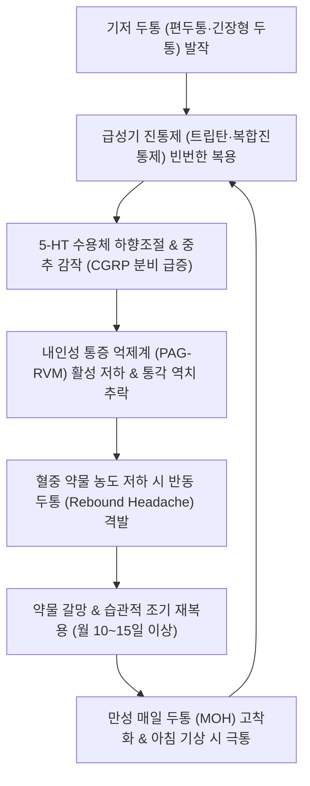

# 🩺 약물과용두통

> **핵심 3줄 요약 (Key Summary)**:
> - 📍 병소 부위 & 해부·병태생리: 기존 편두통 또는 긴장형 두통 환자가 급성기 진통제(트립탄·복합진통제·NSAIDs·오피오이드)를 과다 복용함으로써, 5-HT 세로토닌 수용체 하향조절 및 뇌간 삼차신경 척수로핵의 중추 감작(Central Sensitization)과 하행성 통증 억제계 붕괴로 매일 발생하는 반동성 만성 두통.
> - 🚩 전형적 임상 양상: 3개월 이상 월 15일 이상 지속되는 두통, "매일 아침 눈뜨자마자 머리가 깨질 듯 아파 약부터 찾음", 약 복용 시 일시 완화되나 약효 소진 시 더 심한 반동 두통(Rebound headache) 폭발, 오심·피로·불안 동반.
> - 🛠️ 핵심 검사 & 치료 전략: 약물 복용력 상세 조사(트립탄/복합제 월 10일 이상, 단순진통제 월 15일 이상). **원인 약물의 즉각 중단(Detoxification)** 및 환자 교육, 금단기 반동 두통 제어를 위한 침구([[백회]]·[[풍지]]·[[태양]]·[[합곡]]·[[태충]]) 및 [[청상견통탕]]·[[소요산]], CGRP 단클론항체 등 조기 예방 치료.
> - ⚠️ 응급 의뢰 레드플래그: 오피오이드(마약성 진통제) 또는 복합 진정제(바르비투르산염) 중증 중독 환자의 심각한 금단 섬망·경련 위험 시 또는 약물 중단 후에도 새로운 신경학적 결손 동반 시 즉시 신경과 입원 해독 의뢰.

---

## 📌 목차
1. [질환 개요 & 해부학적 병태생리](#1-질환-개요--해부학적-병태생리)
2. [병태생리 메커니즘 & 생체역학적 악순환 네트워크](#2-병태생리-메커니즘--생체역학적-악순환-네트워크)
3. [임상 증상 & 이학적 검사(Physical Exam) 알고리즘](#3-임상-증상--이학적-검사physical-exam-알고리즘)
4. [감별 진단 매트릭스 (Differential Diagnosis)](#4-감별-진단-매트릭스-differential-diagnosis)
5. [한의 통합 치료 프로토콜 (침·약침·추나·한약)](#5-한의-통합-치료-프로토콜-침약침추나한약)
6. [양방 치료 & 병용·의뢰 기준 (Conventional Treatment & Referral)](#6-양방-치료--병용의뢰-기준-conventional-treatment--referral)
7. [재활 운동 & 생활습관 티칭 가이드](#7-재활-운동--생활습관-티칭-가이드)
8. [💡 사용자 진료실 핵심 필기 & 임상 노하우 (Melt-In 잔여 심화 집약)](#8--사용자-진료실-핵심-필기--임상-노하우-melt-in-잔여-심화-집약)
9. [출처 및 학술 참고 문헌 (References)](#9-출처-및-학술-참고-문헌-references)

---

## 1. 질환 개요 & 해부학적 병태생리

**약물과용두통(Medication-Overuse Headache, MOH)** 은 국제두통질환분류(ICHD-3)에 규정된 대표적인 이차성 만성 두통으로, 기존에 일차 두통(편두통, 긴장형 두통)을 앓던 환자가 두통 치료 목적의 급성기 약물을 만성적·습관적으로 과다 복용하면서 두통이 오히려 매일 지속되는 형태로 악화된 상태를 의미한다.

### 1) 약물 계열별 과용 진단 기준 (3개월 이상 정기적 복용)
- **월 10일 이상 복용 시**:
  - **트립탄계 약물(Triptans)**: Sumatriptan, Zolmitriptan, Naratriptan 등.
  - **에르고트 제제(Ergotamines)**.
  - **복합 진통제(Combination analgesics)**: 카페인, 아세트아미노펜, 진통제 성분이 결합된 일반의약품(게보린, 사리돈, 펜잘 등).
  - **마약성 진통제(Opioids)**: 트라마돌 복합제, 코데인 함유 진통제.
- **월 15일 이상 복용 시**:
  - **단순 진통제(Simple analgesics)**: Acetaminophen(타이레놀), NSAIDs(Ibuprofen, Dexibuprofen, Naproxen 등).
- **혼합 복용**: 여러 성분을 교차 복용하는 경우 총 복용 일수가 **월 10일 이상**.

### 2) 역학적 중요성
- 전 세계 인구의 약 1~2%가 이환되어 있으며, 3차 병원 두통 클리닉을 찾는 만성 매일 두통(Chronic Daily Headache, CDH) 환자의 50~70%가 약물과용두통을 동반하고 있다.
- 40~50대 여성에서 호발하며, 두통의 빈도가 잦아질수록 약 복용량이 늘어나는 악순환에 빠진다.

---

## 2. 병태생리 메커니즘 & 생체역학적 악순환 네트워크

MOH의 병태는 단순한 약물 독성이 아니라, 중추신경계의 통각 전달 회로와 보상계가 신경생물학적으로 변형된 상태이다.

### 1) 통각 수용체 하향조절 및 중추 감작
- 트립탄 및 진통제의 반복적인 노출은 뇌혈관 및 신경 접합부의 세로토닌 5-HT1B/1D 수용체의 내재화(Internalization)와 하향조절(Down-regulation)을 초래한다.
- 이에 따라 뇌간 삼차신경 척수로핵에서 칼시토닌 유전자 관련 펩타이드([[CGRP]]) 및 Substance P의 기저 분비가 급증하며 통각 전달 역치가 극도로 낮아지는 **중추 감작(Central sensitization)** 이 발생한다.

### 2) 하행성 억제계 붕괴 및 반동성 두통
![[약물과용두통_01_세로토닌_시냅스.png|450]]
> [그림 1: 세로토닌(5-HT) 합성(Tph→5-HTP→5-HT)·재흡수(SERT)·이화(MAO)·수용체 결합을 표시한 시냅스 모식도. 진통제 과용 시 이 세로토닌계의 항통각 조절이 탈감작되는 것이 반동성 두통의 기전으로 제시된다 — 출처: Wikimedia Commons — File:5-HT Neuron.svg (CC BY-SA 3.0)]

- 중뇌 수도관주위 회백질(PAG)의 내인성 진통 억제 경로가 무력화된다. 혈중 약물 농도가 떨어질 때마다 억제되지 않은 통증 신호가 대뇌 피질로 폭발적으로 쏟아져 나와 극심한 **반동 두통(Rebound headache)** 을 유발하고, 환자는 다시 약물을 복용하게 된다.

---

## 3. 임상 증상 & 이학적 검사(Physical Exam) 알고리즘

### 1) 전형적 임상 증상
![[약물과용두통_02_5HT3_수용체.png|450]]
> [그림 2: 5-HT3 수용체가 리간드 결합 시 Na⁺·Ca²⁺ 유입 통로로 작동하는 모식도. 5-HT3 길항제(진토제)와 진통제의 상호작용을 이해하는 기본 그림 — 출처: Wikimedia Commons — File:Synapse 5-HT3 cation.png (CC BY-SA 3.0)]

- **매일 반복되는 두통**: 한 달에 15일 이상, 거의 매일 지속되는 둔하고 멍한 두통.
- **아침 기상 시 두통(Early Morning Headache)**: 수면 중 약물 농도가 떨어져 혈중 농도가 최저점에 달하는 새벽이나 기상 직후 가장 심한 통증으로 눈을 뜸.
- **약물 내성(Tolerance) 및 의존성**: 과거에는 약 1알로 진정되던 두통이 2~3알을 먹어도 가라앉지 않고, 약효 지속 시간이 점점 짧아짐.
- **전신 자율신경 및 정서 증상**: 만성 피로, 소화불량, 속쓰림(소화성 궤양), 기억력 및 집중력 저하, 불면, 우울, 약을 소지하지 않으면 불안해지는 예기불안.

### 2) 이학적 검사 및 진단 알고리즘
![[약물과용두통_03_두통_진료의뢰체계.jpg|450]]
> [그림 3: 두통 환자를 1차 의료기관 → 2차 → 3차로 단계적으로 의뢰하는 진료 체계와 각 단계의 역할을 정리한 국가건강정보포털 도해 — 출처: 질병관리청 국가건강정보포털 — 두통 (cntntsSn 5830) (공공누리 제4유형)]

- **정밀 약물 복용 일기 분석**:
  - 어떤 성분의 약(일반약, 처방약, 편의점 상비약 포함)을 한 달에 며칠이나 복용하는지 달력에 전수 기록.
- **신경학적 검진**: 뇌신경, 소뇌 기능, 심부건반사 정상 확인.
- **두개주위근 압통 검진**: 만성 근긴장 및 통증유발점 평가.
- **이차성 두통 배제**: 약물 중단 후에도 두통이 호전되지 않거나 신경학적 이상 징후가 있을 경우 뇌 MRI 검사 고려.

---

## 4. 감별 진단 매트릭스 (Differential Diagnosis)

| 질환명 | 발생 패턴 및 약물 연관성 | 주 증상 및 특징 | 치료 접근 핵심 |
| :--- | :--- | :--- | :--- |
| **약물과용두통(MOH)** | 월 15일 이상, 진통제 만성 과용 | 아침 기상 시 극통, 약물 투여 시 일시 완화 | **과용 약물 즉시 중단(Detox)** |
| [[만성 편두통]] | 월 15일 이상 (8일 이상 편두통성) | 편측 박동성, 오심, 구토, 광공포증 | CGRP 항체, 보톡스, 항경련제 예방 |
| [[만성 긴장성 두통]] | 월 15일 이상, 약물 과용 없음 | 양측성 비박동성 밴드형 압박통 | 삼환계 항우울제(Amitriptyline), 이완요법 |
| [[속발성 군발두통양 두통]] | 발작성 안와 극통, 자율신경 징후 | 기질적 병변(뇌종양, 경동맥박리) 동반 | 뇌 MRI 정밀 검사, 신경외과적 처치 |
| **저뇌압 두통 (SIH)** | 기립 시 악화, 누우면 즉시 호전 | 뇌척수액 누출, 체위성 두통 | 침상 안정, 경막외 혈액봉합술(EBP) |

---

## 5. 한의 통합 치료 프로토콜 (침·약침·추나·한약)

> 💡 **한의 치료의 핵심 역할**: 약물과용두통의 치료 성패는 **"약물을 끊었을 때 발생하는 1~2주간의 극심한 금단 반동 두통과 불안을 환자가 버텨낼 수 있는가"** 에 달려 있다. 침구, 약침, 한약 치료는 이 금단기를 안전하게 완충(Buffer)해 주는 최적의 비약물 솔루션이다.

### 1) 침구 치료
- **두면부 기혈 순환 촉진 및 중추 안정 취혈**:
  - [[백회]](GV20), [[태양]](EX-HN5), [[풍지]](GB20), [[천주]](BL10), [[솔곡]](GB8), [[인당]](EX-HN3).
  - 모상건막과 측두근막을 자극하여 두피 미세순환을 개선하고 중추성 이질통 완화.
- **사관혈 및 자율신경 조절 원위 취혈**:
  - [[합곡]](LI4), [[태충]](LR3): 사관혈 — 전신 기혈 순환 촉진 및 뇌간 통각 억제 자극.
  - [[내관]](PC6), [[신문]](HT7): 심포경·심경 혈위 — 금단기 구역감, 오심, 가슴 답답함, 불안 완화.
  - [[족삼리]](ST36), [[삼음교]](SP6): 비위 기능 회복 및 자율신경 밸런스.
- **전침 요법(Electroacupuncture)**: 양측 [[합곡]]-[[태충]], [[백회]]-[[풍지]] 간 2Hz 저주파 전침을 20분간 적용하여 내인성 오피오이드(엔돌핀, 다이노르핀) 분비를 촉진하고 세로토닌 시스템을 회복.

### 2) 약침 요법
- [[황련해독탕약침]]:
  - 자입 부위: [[풍지]], [[태양]], 후두하근군 및 상부 승모근.
  - 효과: 약물 중단 후 발생하는 두면부의 울혈, 화열(火熱), 흥분 상태를 청열해독하여 반동 두통을 진정.
- [[신바로약침]]: 경항부 근막 이완 및 척추 주위 신경염증 완화.

### 3) 추나요법 (Chuna Manual Therapy)
- **두개천골기법(CST)**:
  - CV4(제4뇌실 압박) 기법과 접형후두저 감압(Sphenobasilar decompression)을 통해 두개내 압력 불균형을 해소하고 자율신경을 안정화.
- **경추 가동기법**: 상경추 후관절을 부드럽게 이완하여 경추성 두통 유발 인자를 차단.

### 4) 한약 치료 (변증별 처방)

#### ① 금단 급성기 (약물 중단 직후 1~2주, 반동 두통 극심기)
- **간담화왕·풍열상옹형(肝膽火旺·風熱上壅型, 두통 극심, 얼굴 달아오름, 불안, 구역)**:
  - [[청상견통탕]](淸上莚痛湯) 가감 (황금, 황련, 강활, 방풍, 천궁, 백지, 조구등).
  - [[시호청간탕]](柴胡淸肝湯) 또는 [[용담사간탕]](龍膽瀉肝湯).
- **담음구토형(痰飮嘔吐型, 속이 울렁거리고 맑은 침을 흘리며 어지러움)**:
  - [[반하백출천마탕]](半夏白朮天麻湯) 또는 [[이진탕]](二陳湯) 가미.

#### ② 회복기 및 재발 방지기 (약물 중단 2주 이후)
- **간울비허·기혈양허형(肝鬱脾虛·氣血兩虛型, 만성 피로, 소화 불량, 은은한 잔여 두통)**:
  - [[소요산]](逍遙散) 또는 [[보중익기탕]](補中益氣湯), [[귀비탕]](歸脾湯).
  - 손상된 위장관 점막을 재생하고 전신 기력을 북돋워 진통제에 다시 손대지 않도록 체질 개선.

---

## 6. 양방 치료 & 병용·의뢰 기준 (Conventional Treatment & Referral)

### 1) 약물 중단 프로토콜 (Detoxification Strategy)
- **원인 약물 전면 중단(Abrupt Withdrawal)**:
  - 단순 진통제, NSAIDs, 트립탄계 약물은 원칙적으로 즉시 일괄 중단함.
  - 단, 바르비투르산염이나 고용량 오피오이드 복용 환자는 금단 발작 위험으로 2~4주에 걸쳐 점진적 감량.
- **금단기 가교 요법(Bridge Therapy)**:
  - 약물 중단 후 5~7일간 경구 스테로이드(Prednisolone 60mg/day로 시작하여 3~5일마다 감량 테이퍼링)를 투여하여 반동 두통을 제어.
  - 진토제: Metoclopramide 10mg tid (오심 완화).

### 2) 조기 예방 치료 개시 (Early Prophylaxis)
- 약물 중단과 동시에 새로운 예방 약제를 즉시 시작:
  - CGRP 표적 치료제: Galcanezumab(엠겔러티), Erenumab, Fremanezumab (MOH 환자에서 약물 중단 성공률을 극적으로 높임).
  - 경구 예방약: Topiramate (50~100mg/day), Amitriptyline (10~50mg qhs), OnabotulinumtoxinA (보톡스 주사).

### 3) 한의 병용 판단 및 상호작용
- 가교 치료(Bridging) 단계에서 스테로이드를 복용하기 어려운 환자(당뇨, 소화성 궤양, 골다공증)에게 한약([[청상견통탕]], [[반하백출천마탕]])과 침 치료를 단독 가교 요법으로 적용할 때 매우 안전하고 우수한 금단 제어 효과를 보임.
- 양방 CGRP 항체 주사 치료와 한의 침구 치료를 병용할 때 만성 두통의 관해율이 가장 높음.

### 4) 전문과 및 입원 의뢰 기준 (Inpatient Criteria)
- 고용량 마약성 진통제(오피오이드) 또는 진정제 의존 환자 (약물 중단 시 금단 섬망, 경련 위험).
- 심각한 우울증, 불안장애, 자살 사고를 동반한 환자.
- 외래에서 약물 중단 시도가 2회 이상 연속 실패한 난치성 환자 → 신경과 입원 해독 치료 의뢰.

---

## 7. 재활 운동 & 생활습관 티칭 가이드

### 1) 환자 교육의 절대적 중요성
- **"진통제가 두통을 치료하는 것이 아니라, 두통을 만들고 있습니다"** 라는 사실을 환자가 명확히 이해해야 치료 성공률이 80% 이상으로 올라감.
- 진통제를 완전히 끊더라도 처음 3~7일 동안은 두통이 일시적으로 더 심해질 수 있으나, 1~2주가 지나면 두통 빈도가 현저히 줄어든다는 예후를 사전에 충분히 고지.

### 2) 생활습관 티칭
- **집안의 상비약 정리**: 서랍, 가방, 직장 책상에 있는 모든 일반 진통제를 버리거나 치우기.
- **카페인 디톡스**: 커피, 녹차, 에너지 음료, 콜라 등 카페인 섭취 전면 중단 (카페인은 강력한 반동 두통 유발 인자).
- **수분 섭취 및 규칙적 식사**: 탈수와 저혈당은 두통의 방아쇠가 되므로 하루 1.5L 이상의 미온수 섭취.

---

## 8. 💡 사용자 진료실 핵심 필기 & 임상 노하우 (Melt-In 잔여 심화 집약)

- **"원장님, 약을 안 먹으면 머리가 깨질 것 같아서 출근을 못 해요"라는 환자 대처법**:
  - 환자의 두려움에 깊이 공감해주되 단호해야 한다. "지금 환자분의 뇌는 진통제라는 자물쇠에 걸려 있습니다. 지금 약을 끊지 않으면 평생 매일 아침 두통으로 고통받게 됩니다. 이번 주말을 기점으로 딱 3일만 한의원 침과 한약으로 버텨봅시다"라고 환자와 동맹을 맺어야 한다.
- **금단기 첫 3일 내원 프로토콜**:
  - 약을 끊은 첫 3~5일 동안은 환자를 매일 내원하게 한다. [[백회]], [[태양]], [[풍지]]에 침을 놓고 사관혈 전침을 20분간 시행하며, 따뜻한 [[청상견통탕]]이나 [[반하백출천마탕]]을 원내에서 복용시키면 진통제 없이도 견딜 수 있는 자신감을 얻게 된다.
- **게보린/사리돈 과용 환자의 특이점**:
  - 이소프로필안티피린(IPA) 및 카페인이 복합된 약물을 수년간 매일 복용해 온 환자들은 단순 편두통 환자보다 금단 두통과 신경과민이 훨씬 격렬하다. 이때는 침 치료 시 [[신문]](HT7)과 [[내관]](PC6)을 반드시 배오하여 중추 신경계를 안정시켜야 금단 실패를 막을 수 있다.

---

## 9. 출처 및 학술 참고 문헌 (References)

- Corticosteroids in withdrawal therapy following medication-overuse headache: a systematic review. *Expert Rev Neurother*, 2026. PMID: 42332418.

- Profiling galcanezumab in episodic migraine, cluster headache, and medication overuse headache. *Expert Rev Neurother*, 2026. PMID: 42186187.

- Effect of Educational and Behavioral Interventions on Medication-Overuse Headache: A Systematic Review and Meta-Analysis. *Pain Res Manag*, 2026. PMID: 42460454.

---

## 관련 노트

- [[편두통]]
- [[만성 긴장성 두통]]
- [[청상견통탕]]
- [[반하백출천마탕]]
- [[소요산]]
