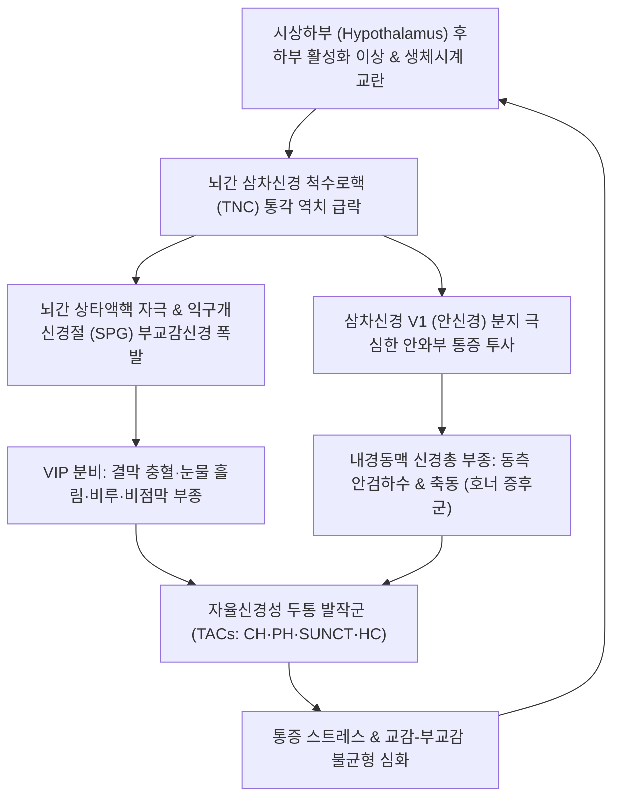

# 🩺 자율신경성 두통

> **핵심 3줄 요약 (Key Summary)**:
> - 📍 병소 부위 & 해부·병태생리: 시상하부(Hypothalamus)의 일주기 생체리듬 조절 이상 및 삼차신경-자율신경 반사궁(Trigeminal-Autonomic Reflex Arc)의 병리적 과항진으로 인해, 삼차신경 안신경(V1) 통각과 익구개신경절([[SPG]]) 매개 부교감신경 흥분이 결합되어 발생하는 삼차자율신경두통([[TACs]]) 군.
> - 🚩 전형적 임상 양상: 극심한 편측 안와·안와상·측두부 통증과 함께 두통 발작 시 동측에 결막 충혈, 눈물(Lacrimation), 비충혈, 비루, 안검하수, 안검부종 등 두부 자율신경계 징후가 필수적으로 동반됨.
> - 🛠️ 핵심 검사 & 치료 전략: TACs 하위 질환(군발두통·발작성 반두통·SUNCT/SUNA·지속반두통) 감별 및 조영증강 뇌 MRI 필수 시행. 한의 간담화왕(肝膽火旺) 청열사화 침구([[찬죽]]·[[사죽공]]·[[태양]]·[[행간]]·[[협계]]) 및 [[황련해독탕약침]], [[용담사간탕]]·[[시호가용골모려탕]] 투여.
> - ⚠️ 응급 의뢰 레드플래그: 인도메타신 및 표준 치료 불응, 양이측 반맹(시야 결손), 외안근 마비(복시), 호너 증후군 고착화 시 뇌하수체 종양, 해면정맥동 병변, 내경동맥 박리 의심 즉시 상급병원 신경외과 정밀 검사 의뢰.

---

## 📌 목차
1. [질환 개요 & 해부학적 병태생리](#1-질환-개요--해부학적-병태생리)
2. [병태생리 메커니즘 & 생체역학적 악순환 네트워크](#2-병태생리-메커니즘--생체역학적-악순환-네트워크)
3. [임상 증상 & 이학적 검사(Physical Exam) 알고리즘](#3-임상-증상--이학적-검사physical-exam-알고리즘)
4. [감별 진단 매트릭스 (Differential Diagnosis)](#4-감별-진단-매트릭스-differential-diagnosis)
5. [한의 통합 치료 프로토콜 (침·약침·추나·한약)](#5-한의-통합-치료-프로토콜-침약침추나한약)
6. [양방 치료 & 병용·의뢰 기준 (Conventional Treatment & Referral)](#6-양방-치료--병용의뢰-기준-conventional-treatment--referral)
7. [재활 운동 & 생활습관 티칭 가이드](#7-재활-운동--생활습관-티칭-가이드)
8. [💡 사용자 진료실 핵심 필기 & 임상 노하우 (Melt-In 잔여 심화 집약)](#8--사용자-진료실-핵심-필기--임상-노하우-melt-in-잔여-심화-집약)
9. [출처 및 학술 참고 문헌 (References)](#9-출처-및-학술-참고-문헌-references)

---

## 1. 질환 개요 & 해부학적 병태생리

**자율신경성 두통(Trigeminal Autonomic Cephalalgias, TACs)** 은 국제두통질환분류(ICHD-3) 제3군에 속하는 원발성 두통의 한 범주로, 엄격한 편측성의 심한 두통과 함께 **동측 두부의 두드러진 부교감신경 활성화 징후 및 교감신경 저하 징후**가 동반되는 특징적인 질환군이다.

### 1) 해부학적 구조와 신경 회로
- **시상하부 후하부(Posterior Inferior Hypothalamus)**:
  - 일주기 리듬(Circadian rhythm)과 수면-각성 주기, 자율신경계 통합을 담당하는 중추.
  - 기능적 신경영상 연구에서 모든 TACs 두통 발작 시 시상하부 후하부의 유의한 활성화가 공통적으로 관찰되어 질환의 핵심 발원지(Generator)로 규명됨.
- **삼차신경-자율신경 반사궁(Trigeminal-Autonomic Reflex Arc)**:
  - **구심로(Afferent)**: 두개혈관 및 경막을 지배하는 삼차신경 제1분지(안신경, V1)가 통각 신호를 뇌간 삼차신경 척수로핵(TNC)으로 전달.
  - **연계핵**: 삼차신경 척수로핵에서 뇌간의 상타액핵(Superior salivatory nucleus)으로 신경 신호가 전달되어 뇌간 자율신경 반사를 격발.
  - **원심로(Efferent)**: 안면신경(CN VII)의 대추체신경을 거쳐 **익구개신경절([[Sphenopalatine ganglion]], SPG)** 로 투사. 절후 부교감신경 섬유가 눈물샘(Lacrimal gland)과 비점막 혈관을 지배하여 폭발적인 눈물 흘림, 결막 충혈, 비루, 비충혈을 유발함.
  - **교감신경 장애**: 내경동맥 주위 교감신경 얼기의 부종 및 압박으로 동측 안검하수(Ptosis)와 축동(Miosis) 등 일시적 부분 호너 증후군(Partial Horner's syndrome)이 형성됨.

### 2) 질환군 분류
- [[군발두통]](Cluster Headache, CH)
- [[발작성 반두통]](Paroxysmal Hemicrania, PH)
- 결막충혈과 눈물을 동반하는 단기 지속 편측 신경통형 두통 발작([[SUNCT]]) / 두부 자율신경 증상을 동반하는 단기 지속 편측 신경통형 두통 발작([[SUNA]])
- [[지속반두통]](Hemicrania Continua, HC)

---

## 2. 병태생리 메커니즘 & 생체역학적 악순환 네트워크

자율신경성 두통의 발병 기전은 시상하부의 탈억제, 뇌간 삼차자율신경 반사 루프의 과흥분, 신경혈관성 염증 물질의 폭발적 분비로 이루어진다.

### 1) 중추 생체시계 교란과 발작 트리거
- 시상하부의 멜라토닌 분비 억제 및 코르티솔 리듬 장애로 인해 주로 야간 수면 중(REM 수면기)에 발작이 촉발된다.
- 시상하부의 통제 결손이 뇌간 삼차신경핵을 탈억제하여 통증 역치를 급격히 붕괴시킨다.

### 2) 신경펩타이드 분비와 혈관성 충혈
- 삼차신경 말단에서 CGRP와 Substance P가 방출되어 안와 주변 혈관을 강력하게 확장시키고, 익구개신경절을 통한 VIP(Vasoactive Intestinal Peptide)의 대량 분비가 안면 부교감신경 반응(충혈, 눈물, 콧물)을 증폭시킨다.

---

## 3. 임상 증상 & 이학적 검사(Physical Exam) 알고리즘

### 1) TACs 공통 자율신경계 징후 (최소 1개 이상 필수 동반)
- **안구 증상**: 동측 결막 충혈(Conjunctival injection), 멈추지 않는 눈물(Lacrimation).
- **비강 증상**: 동측 콧물(Rhinorrhea), 코막힘(Nasal congestion).
- **안면 및 안검 징후**: 안검 부종(Eyelid edema), 안검하수(Ptosis), 축동(Miosis), 이마 및 안면 발한/홍조.
- **귀 증상**: 귀가 먹먹한 이충만감.
- **행동 양상**: 편두통 환자가 어두운 방에 가만히 누워있으려 하는 것과 달리, TACs 환자(특히 군발두통)는 통증이 너무 극심하여 가만히 있지 못하고 안절부절못하며 방안을 서성이거나 머리를 벽에 찧는 초조감(Restlessness/agitation)을 보임.

### 2) TACs 4대 하위 질환 핵심 구별 기준

| 구분 | [[군발두통]](CH) | [[발작성 반두통]](PH) | [[SUNCT]] / SUNA | [[지속반두통]](HC) |
| :--- | :--- | :--- | :--- | :--- |
| **호발 성별** | 남성 우세 (3:1) | **여성 우세 (2:1)** | 남녀 비슷 | 여성 우세 |
| **발작 지속시간** | **15 ~ 180분** | **2 ~ 30분** | **1 ~ 600초 (초 단위)** | **24시간 지속성 (배경통)** |
| **하루 발작빈도** | 2일에 1회 ~ 하루 8회 | 하루 5 ~ 40회 | 하루 수십 ~ 수백 회 | 배경통 바탕 간헐적 악화 |
| **특이 반응 치료** | **100% 고유량 산소, 수마트립탄** | **인도메타신 100% 완전 반응** | **라모트리진(Lamotrigine)** | **인도메타신 100% 완전 반응** |

### 3) 이학적 검사 및 감별 알고리즘
- **인도메타신 검사([[Indotest]])**: 인도메타신에 완전 소실되는지 확인하여 PH 및 HC 확진.
- **신경학적 검진**: 뇌신경 2~6번 정밀 평가(외안근 마비, 시야 결손 등 이상 유무).
- **필수 영상 검사**: 안장 부위 뇌하수체 종양, 해면정맥동 혈전증, 동맥류 등 속발성 원인을 감별하기 위해 **조영증강 뇌 MRI/MRA 필수**.

---

## 4. 감별 진단 매트릭스 (Differential Diagnosis)

| 질환명 | 주 증상 및 자율신경 징후 | 지속 시간 및 양상 | 핵심 감별점 |
| :--- | :--- | :--- | :--- |
| **자율신경성 두통(TACs)** | 편측 안와 극통 + 결막충혈, 눈물, 비루 필수 동반 | 초~분~시간 단위 발작성 또는 지속성 | 시상하부 병태, 삼차자율신경 반사 과흥분 |
| **[[편두통]](Migraine)** | 편측 박동성, 오심, 구토, 광공포증 | 4 ~ 72시간 지속 | 가벼운 눈물 동반될 수 있으나 자율신경 징후 경미, 안정 원함 |
| **삼차신경통(TN)** | 찌릿한 전기 충격통 (V2, V3 분지 호발) | 수초 ~ 2분 | 세안·식사 등 유발점 접촉에 의해 유발, 자율신경 징후 없음 |
| **[[속발성 군발두통양 두통]]** | TACs와 유사한 임상상 | 주기성 결손, 고령 발병, 치료 불응 | 뇌 MRI 상 뇌하수체 종양, 경동맥 박리 발견 |
| **급성 폐쇄각 녹내장** | 안통, 두통, 결막 충혈, 각막 부종 | 지속적 안구 팽만통, 시력 감퇴 | 안압 급상승(>40mmHg), 안과적 응급 |

---

## 5. 한의 통합 치료 프로토콜 (침·약침·추나·한약)

### 1) 침구 치료
- **안와 및 삼차자율신경 투사 혈위**:
  - [[찬죽]](BL2), [[사죽공]](TE23), [[태양]](EX-HN5): 안와상신경 및 삼차신경 V1 말초 분지 직접 진통.
  - [[동자료]](GB1), [[승읍]](ST1): 안와 혈관 울혈 및 결막 충혈 완화.
  - [[풍지]](GB20), [[솔곡]](GB8), [[완골]](GB12): 측두·후두부 혈류 순환 개선.
- **원위 청열사화·평간식풍 취혈**:
  - [[행간]](LR2), [[태충]](LR3) (간경 형화혈·원혈 - 치솟는 간담의 풍열과 화열을 사함).
  - [[협계]](GB43), [[족임읍]](GB41) (담경 형수혈 - 편두통 및 안충혈, 이충만감 해소).
  - [[내정]](ST44), [[합곡]](LI4) (양명경 열독 배출).
- **자침 기법**: 급성 발작기에는 강자극 사법(瀉法)을 적용하여 기혈의 상역(上逆)을 억제.

### 2) 약침 요법
- **[[황련해독탕약침]]**:
  - 자입 부위: [[찬죽]], [[사죽공]], [[태양]], [[풍지]] 피내 및 근막층.
  - 효과: 황련·황금·황백·치자의 성분이 삼차자율신경 반사 루프의 급성 신경혈관성 염증을 강력하게 소퇴.
- **[[신바로약침]]**: 상경추 후관절 및 척추기립근 긴장 완화.

### 3) 추나요법 (Chuna Manual Therapy)
- **익구개신경절(SPG) 간접 이완을 위한 두개천골요법(CST)**:
  - 접형후두저(SBS) 감압술 및 상악골(Maxilla) 가동화를 통해 익구개와 부위의 신경혈관 압박 해소.
- **경추 가동기법**: C1-C2 환축관절의 회전 부정렬을 교정하여 삼차신경경부복합체(TCC) 과민성을 낮춤.

### 4) 한약 치료 (변증별 처방)
- **간담실화형(肝膽實火型, 안구 충혈, 눈물, 콧물, 안와가 터질 듯한 극통, 성격 급함, 맥현삭)**:
  - [[용담사간탕]](龍膽瀉肝湯) (용담초, 황금, 치자, 택사, 목통, 차전자, 당귀, 생지황, 시호, 감초).
- **풍열화독형(風熱火毒型, 안면 홍조, 눈 주변이 벌겋게 붓고 찌르는 통증)**:
  - [[청상견통탕]](淸上莚痛湯) 가미 (조구등, 백질려, 황련 가미) 또는 [[황련해독탕]](黃連解毒湯).
- **자율신경 실조 및 심신불교형(心腎不交型, 가슴 두근거림, 불안, 불면, 번열감 동반)**:
  - [[시호가용골모려탕]](柴胡加龍骨牡蠣湯) 또는 [[영계출감탕]](苓桂朮甘湯).

---

## 6. 양방 치료 & 병용·의뢰 기준 (Conventional Treatment & Referral)

### 1) 질환별 양방 표준 치료 (Conventional Management)
- **군발두통(CH)**:
  - 급성기: **100% 고유량 산소 흡입(12~15 L/min)**, 피하 Sumatriptan 6mg.
  - 예방: Verapamil (240~480mg/day), 단기 경구 스테로이드(Prednisone 테이퍼링), Galcanezumab(엠겔러티).
- **발작성 반두통(PH) 및 지속반두통(HC)**:
  - 절대 치료제: **Indomethacin (75~225mg/day)** + PPI(위보호제) 병용.
- **SUNCT / SUNA**:
  - 예방약: Lamotrigine (100~400mg/day, 1차 선택), Topiramate, Gabapentin.

### 2) 인터벤션 및 신경조절술 (Neuromodulation)
- **익구개신경절(SPG) 차단술 또는 고주파 열응고술**: 부교감신경 원심로 차단.
- **대후두신경 자극술(ONS) 및 비침습적 미주신경 자극술(nVNS)**.

### 3) 한의 치료와의 병용 시너지
- Verapamil이나 Indomethacin 복용 환자에게 한약([[용담사간탕]], [[반하사심탕]])과 침 치료를 병용하면 약물 용량을 절반 이하로 감량하면서도 안정적인 관해 상태를 유지할 수 있음.
- 양방 치료에 부분 반응하는 난치성 TACs 환자에서 침·약침 치료가 유의한 발작 빈도 감소를 유도함.

### 4) 전문과 및 응급실 의뢰 기준 (Red Flags)
- 50세 이상에서 새로 시작된 자율신경성 두통.
- 표준 치료제(산소, 트립탄, 인도메타신)에 전혀 반응하지 않는 경우.
- 시야 결손, 안구운동마비, 영구적 호너 증후군 등 신경학적 이상 소견 동반 시 즉각 상급병원 정밀 뇌 영상 검사 의뢰.

---

## 7. 재활 운동 & 생활습관 티칭 가이드

### 1) 유발 요인 엄격 차단 (Trigger Elimination)
- **알코올 완전 금기**: 활성기(군발기) 중 알코올 섭취는 수십 분 내에 100% 두통 발작을 유발하므로 절대 금주.
- **수면 패턴 규칙성 유지**: 낮잠이나 불규칙한 수면은 시상하부 리듬을 깨뜨려 야간 발작을 촉발하므로 규칙적인 수면-기상 시간 준수.
- **급격한 혈관 확장 요인 회피**: 뜨거운 사우나, 과도한 직사광선 노출, 격렬한 운동 자제.

### 2) 생활습관 티칭
- 발작 일기 작성: 발작 시각, 지속 시간, 동반된 자율신경 증상(눈물/콧물 등), 약물 복용량을 기록하여 아형 분류 및 치료 반응 평가.
- 금연 필수: 흡연은 군발두통 환자의 가장 강력한 악화 요인임.

---

## 8. 💡 사용자 진료실 핵심 필기 & 임상 노하우 (Melt-In 잔여 심화 집약)

- **"눈물 콧물이 쏟아지며 안절부절못한다"는 것이 TACs의 핵심 단서**:
  - 편두통 환자는 빛과 소리를 피해 조용한 방에서 이불을 뒤집어쓰고 꼼짝없이 누워있는 반면, 자율신경성 두통(특히 군발두통) 환자는 눈을 부여잡고 방 안을 뱅뱅 돌거나 머리를 흔들며 극도의 불안과 초조(Restlessness)를 보인다.
  - 이 외형적 행동 차이와 눈물·충혈 여부만으로도 일반 편두통과 즉시 감별할 수 있다.
- **찬죽·사죽공·태양 자침의 테크닉**:
  - 안와 주위 침 시술 시 직자하지 말고, 안와상절제부의 안와상신경을 스치듯이 피하를 따라 수평으로 1~1.5cm 자입(사자)한 후 가볍게 염전하면 눈 주위가 시원해지면서 충혈과 눈물이 멈추는 부교감신경 진정 효과를 얻을 수 있다.
- **인도메타신 반응 여부로 질환을 쪼개라**:
  - 편측 안와 극통 환자가 오면 발작 시간과 횟수를 물어 2~30분 이내로 하루 5회 이상 빈발하면 발작성 반두통으로 보고 인도메타신 반응을 확인한다. 100% 반응하면 PH, 반응이 없고 1~3시간씩 길게 가면 군발두통으로 프로토콜을 분기해야 한다.

---

## 9. 출처 및 학술 참고 문헌 (References)

- Ventral tegmental area deep brain stimulation for trigeminal autonomic cephalalgias: a comprehensive literature review. *Neurosurg Rev*, 2026. PMID: 42522999.

- Comorbidities and Clinical Overlap of Cluster Headache with Other Primary Headache Disorders: A Narrative Review. *Diagnostics (Basel)*, 2026. PMID: 42650901.

- Efficacy of Occipital Nerve Stimulation in Trigeminal Autonomic Cephalalgias: A Systematic Review. *Neurosurgery*, 2023. PMID: 37712710.

---

## 관련 노트

- [[군발두통]]
- [[발작성 반두통]]
- [[속발성 군발두통양 두통]]
- [[용담사간탕]]
- [[황련해독탕]]
- [[찬죽]]
