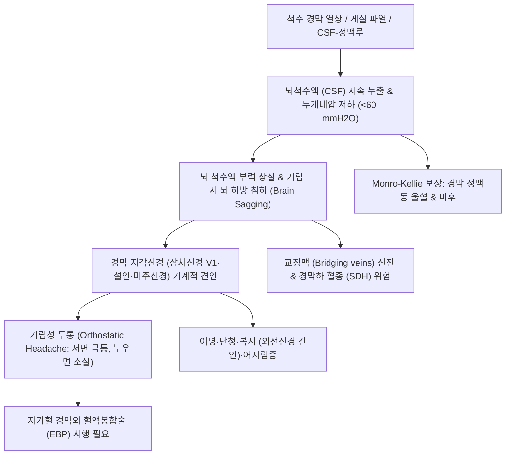

# 🩺 저압성 두통

> **핵심 3줄 요약 (Key Summary)**:
> - 📍 병소 부위 & 해부·병태생리: 척수 지주막 및 경막 파열에 의한 뇌척수액(CSF) 누출로 두개내압 저하(<60 mmH2O) 및 뇌 부력 상실이 발생하여, 뇌가 하방으로 침하(Brain sagging)되면서 통각에 민감한 경막, 뇌신경, 교정맥(Bridging veins)을 기계적으로 견인하여 유발되는 이차성 두통.
> - 🚩 전형적 임상 양상: **전형적인 기립성 두통(Orthostatic headache)** — 앉거나 일어서면 15분 이내에 후두부·전두부 극통이 발생하고, 누우면(앙와위) 수분~30분 이내에 완전히 소실되거나 극적으로 경감됨; 이명, 이충만감, 복시, 어지럼증 동반.
> - 🛠️ 핵심 검사 & 치료 전략: 조영증강 뇌 MRI(미만성 경막 조영증강·뇌 처짐 확인), 척추 MRI/CT 척수조영술(누출 부위 탐색). 초기 절대 침상 안정(Flat bed rest) 및 수액·카페인 공급, 보존 치료 실패 시 자가혈 [[경막외 혈액봉합술]](EBP); 한의 승양익기(升陽益氣) 보조([[보중익기탕]]·[[백회]] 구법).
> - ⚠️ 응급 의뢰 레드플래그: 뇌 처짐에 따른 교정맥 견인 파열로 급성 경막하 혈종(Subdural Hematoma, SDH) 병발, 의식 저하, 동공 부동, 진행성 마비 발생 시 즉시 응급 신경외과 전원 감압술 및 누출부 폐쇄 의뢰.

---

## 📌 목차
1. [질환 개요 & 해부학적 병태생리](#1-질환-개요--해부학적-병태생리)
2. [병태생리 메커니즘 & 생체역학적 악순환 네트워크](#2-병태생리-메커니즘--생체역학적-악순환-네트워크)
3. [임상 증상 & 이학적 검사(Physical Exam) 알고리즘](#3-임상-증상--이학적-검사physical-exam-알고리즘)
4. [감별 진단 매트릭스 (Differential Diagnosis)](#4-감별-진단-매트릭스-differential-diagnosis)
5. [한의 통합 치료 프로토콜 (침·약침·추나·한약)](#5-한의-통합-치료-프로토콜-침약침추나한약)
6. [양방 치료 & 병용·의뢰 기준 (Conventional Treatment & Referral)](#6-양방-치료--병용의뢰-기준-conventional-treatment--referral)
7. [재활 운동 & 생활습관 티칭 가이드](#7-재활-운동--생활습관-티칭-가이드)
8. [💡 사용자 진료실 핵심 필기 & 임상 노하우 (Melt-In 잔여 심화 집약)](#8--사용자-진료실-핵심-필기--임상-노하우-melt-in-잔여-심화-집약)
9. [출처 및 학술 참고 문헌 (References)](#9-출처-및-학술-참고-문헌-references)

---

## 1. 질환 개요 & 해부학적 병태생리

**저압성 두통(Low CSF Pressure Headache, Intracranial Hypotension)** 은 뇌척수액(Cerebrospinal Fluid, CSF)의 체적 감소 및 뇌척수액압 저하(개방압 60 mmH2O 미만)로 인해 발생하는 대표적인 자세성 이차성 두통 질환이다. 요추 천자 후 발생하는 요추천자후두통(PDPH)과 뚜렷한 외상 없이 발생하는 특발성 두개내저압증(Spontaneous Intracranial Hypotension, SIH)으로 분류된다.

### 1) 해부학적 구조와 뇌 부력 기전
- **뇌척수액의 물리적 완충(Buoyancy)**: 약 1,400g에 달하는 사람의 뇌는 뇌척수액 속에 떠 있음으로써 부력에 의해 유효 무게가 약 45~50g으로 감소되어 두개저와 뇌신경을 압박하지 않고 유지된다.
- **뇌척수액 누출(CSF Leakage) 부위**:
  - 대부분 흉요추부(Thoracic & lumbar spine)의 신경근 소포(Meningeal diverticula) 파열, 퇴행성 척추 골극(Spinal osteophyte)에 의한 경막 찢김, 또는 뇌척수액-정맥루(CSF-venous fistula)를 통해 뇌척수액이 경막외강으로 지속 누출된다.

### 2) 몬로-켈리(Monro-Kellie) 가설과 혈관성 대상
- 두개강은 비팽창성 골격 구조로 내부 용적(뇌조직 80% + 혈액 10% + CSF 10%)의 합이 일정해야 한다.
- 뇌척수액이 빠져나가면 감소한 부피를 보상하기 위해 정맥계가 반사적으로 확장(Venous engorgement)되어 경막 정맥동의 비후와 충혈이 발생한다.

---

## 2. 병태생리 메커니즘 & 생체역학적 악순환 네트워크

저압성 두통의 통증 발생은 중력에 의한 기계적 견인(Mechanical traction)과 정맥 울혈의 복합 작용이다.

### 1) 뇌 하강(Brain Sagging)과 신경 혈관 견인
- 환자가 기립하면 뇌척수액의 부력 상실로 인해 대뇌와 소뇌가 중력을 이기지 못하고 두개골 기저부로 가라앉는다(Brain sagging).
- 이 과정에서 감각 신경이 밀집된 천막(Tentorium), 상시상정맥동 주위 경막, 뇌신경(삼차신경 V1, 설인신경 CN IX, 미주신경 CN X, 외전신경 CN VI)이 아래로 강하게 잡아당겨져 심한 두통과 뇌신경 장애가 유발된다.

### 2) 교정맥(Bridging Veins) 신전과 경막하 출혈
- 대뇌 표면에서 상시상정맥동으로 연결되는 교정맥들이 하방 견인력에 의해 팽팽하게 늘어나며 미세 파열을 일으켜 **경막하 체액저류(Hygroma)** 및 **경막하 혈종(Subdural Hematoma, SDH)** 을 유발할 수 있다.

---

## 3. 임상 증상 & 이학적 검사(Physical Exam) 알고리즘

### 1) 전형적 임상 증상
- **기립성 두통(Orthostatic Headache)**:
  - 기립 후 15분 이내(보통 수초~수분)에 후두부, 경항부, 전두부에 심한 조임통 및 둔통 발생.
  - 평평하게 누우면(앙와위) 15~30분 이내에 통증이 급격히 경감되거나 마법처럼 완전히 사라짐.
- **동반 뇌신경 견인 징후**:
  - 청각 및 전정 증상: 이충만감(비행기 탄 듯 귀가 먹먹함), 금속성 이명, 저음역 난청, 어지럼증.
  - 시각 증상: 외전신경(CN VI) 마비에 의한 수평 복시, 시야 흐림, 눈부심.
  - 뇌간 및 경추 증상: 목덜미 뻣뻣함(항강), 오심, 구토, 연하 곤란.

### 2) 이학적 검사 및 영상 진단 알고리즘
- **자세 변화 유발 검사**: 앉은 자세와 누운 자세에서의 통증 강도(VAS) 변화를 측정하여 극적인 자세 의존성 확인.
- **조영증강 뇌 MRI 5대 전형적 징후**:
  1. **광범위한 경막 비후 및 조영증강(Diffuse pachymeningeal enhancement)**: 연수막 침범 없이 경막만 균일하게 조영됨.
  2. **뇌 처짐(Brain sagging)**: 소뇌 편도 하강(Chiari I 기형 유사), 뇌간의 사대(Clivus) 밀착.
  3. **정맥동 팽창(Venous engorgement)**.
  4. **뇌하수체 종대(Pituitary hyperemia)**.
  5. **경막하 체액저류 또는 혈종(Subdural hygroma/hematoma)**.
- **척추 MRI / CT 척수조영술**: 척수 레벨의 뇌척수액 누출 부위 탐색.

---

## 4. 감별 진단 매트릭스 (Differential Diagnosis)

| 질환명 | 주 증상 및 자세 의존성 | 영상의학적 소견 | 치료 핵심 |
| :--- | :--- | :--- | :--- |
| **저압성 두통(SIH/PDPH)** | **서면 악화, 누우면 즉시 소실 (기립성)** | 미만성 경막 조영증강, 뇌 처짐 소견 | 침상 안정, 수액, 경막외 혈액봉합술(EBP) |
| **체위성 기립빈맥증후군([[POTS]])** | 기립 시 두통, 어지럼증, 심계항진 | 뇌 MRI 정상, 기립 시 맥박 30회 이상 급증 | 자율신경 조절, 염분/수분 섭취, 베타차단제 |
| **특발성 두개내고압증([[IIH]])** | 기상 시 및 누우면 악화 (고압성) | 시신경유두부종, 빈 안장(Empty sella) | 아세타졸라마이드, 체중 감량, 요추천자 |
| **[[경인성 두통]]** | 목 움직임 시 악화, 누워도 호전 안 됨 | 상경추 후관절 이상, 뇌 MRI 정상 | 추나요법, 후두하근 이완, 신경차단술 |
| **만성 경막하 혈종(CSDH)** | 점진적 두통, 편마비, 고령 환자 | 뇌 CT/MRI 초승달 모양 혈종 및 뇌 압박 | 신경외과적 천공배액술(Burr-hole) |

---

## 5. 한의 통합 치료 프로토콜 (침·약침·추나·한약)

> ⚠️ **원칙**: 저압성 두통은 물리적인 뇌척수액 누출이 원인이므로, 급성기에는 척추 교정이나 경추 회전 추나요법 같은 물리적 외력을 가하는 치료는 누출을 악화시킬 수 있어 **절대 금기**이다. 보존적 침상 안정기에 양기와 수액을 보충하는 승양익기(升陽益氣) 한의 치료를 보조한다.

### 1) 침구 치료
- **승양익기(升陽益氣) 및 기혈 순환 취혈**:
  - [[백회]](GV20): 독맥의 교회혈 — 가라앉은 뇌기(腦氣)를 위로 끌어올림 (두침 사자).
  - [[풍지]](GB20), [[천주]](BL10): 후두하부 혈류 순환 개선 및 목덜미 경결 완화.
  - [[족삼리]](ST36), [[삼음교]](SP6), [[태충]](LR3): 비위와 간신을 보하여 체액 생성 촉진.
- **온구 요법(간접구)**:
  - [[백회]](GV20), [[기해]](CV6), [[관원]](CV4)에 온구를 시행하여 하초의 원기를 보강하고 뇌수의 생성을 돕는 한의학적 보조 효과 유도.

### 2) 약침 요법
- **[[자하거약침]]**: [[신수]](BL23), [[비수]](BL20) 혈위에 시술하여 척추 지주막 및 결합조직의 재생을 돕고 뇌수 부족(腦髓不足)을 보충.

### 3) 한약 치료 (변증별 처방)
- **중기하함·기혈양허형(中氣下陷·氣血兩虛型, 기립 시 기운이 쑥 빠지며 두통, 무기력, 식욕 부진)**:
  - [[보중익기탕]](補中益氣湯) (황기, 인삼, 백출, 감초, 당귀, 진피, 승마, 시호) — 가라앉은 양기를 끌어올리고 체액 흡수를 촉진하는 대표 방제.
- **신음부족·뇌수고갈형(腎陰不足·腦髓枯竭型, 만성 이명, 어지럼증, 허리 무릎 시림 동반)**:
  - [[좌귀환]](左歸丸) 또는 [[육미지황탕]](六味地黃湯) 가미 (숙지황, 산약, 산수유, 구기자, 녹용).
- **수습불화·청양불승형(水濕不和·淸陽不升型, 머리가 맑지 않고 어지러우며 구역질 동반)**:
  - [[오령산]](五苓散) 또는 [[영계출감탕]](苓桂朮甘湯) — 체내 수분 대사 조절.

---

## 6. 양방 치료 & 병용·의뢰 기준 (Conventional Treatment & Referral)

### 1) 1차 보존 치료 (Conservative Therapy)
- **절대 침상 안정(Strict Bed Rest)**: 베개 없이 평평하게 누운 자세(Flat position)를 1~2주간 유지하여 정수압 차이를 없애고 경막 열상의 자연 치유를 유도.
- **공격적 수액 공급**: 경구 수분 섭취(하루 2.5~3L) 및 등장성 생리식염수 정맥 주사.
- **카페인 요법(Caffeine Therapy)**: 경구 카페인 정제(100~200mg tid) 또는 정맥 주사 (아데노신 수용체 차단을 통한 뇌혈관 수축 및 CSF 분비 촉진).

### 2) 인터벤션 및 수술적 치료 (Procedures)
- **경막외 혈액봉합술([[EBP]], Epidural Blood Patch, 치료의 표준)**:
  - 환자의 자가 정맥혈 15~20ml를 무균적으로 채취하여 척수 경막외강으로 주입.
  - 혈종이 경막 열상 부위를 물리적으로 즉각 압박·밀봉하고, 섬유아세포를 자극하여 반흔 치유를 유도 (성공률 70~90%).
  - 1차 비표적(Lumbar) EBP 실패 시 조영제를 이용한 표적(Targeted) EBP 또는 피브린 글루(Fibrin glue) 주입술 시행.
- **외과적 경막 봉합술 및 색전술**: CSF-정맥루에 대한 혈관내 색전술 또는 수술적 결찰.

### 3) 전문과 및 응급실 의뢰 기준 (Red Flags)
- 두통 양상이 갑자기 기립성과 무관한 극심한 지속통으로 바뀌거나 구토가 동반되는 경우 (경막하 혈종 파열 의심).
- 편마비, 구음장애, 졸림증(Somnolence), 의식 저하 발생 시.
- 보존적 치료 1~2주에도 기립성 두통이 지속되는 모든 환자는 **경막외 혈액봉합술(EBP)을 위해 즉시 상급병원 신경과/마취통증의학과로 전원**.

---

## 7. 재활 운동 & 생활습관 티칭 가이드

### 1) 절대 안정 및 복압 관리
- 배변 시 힘주기 금지: 변비가 생기지 않도록 완하제를 복용하고 흉곽/복압 상승(Valsalva)을 원천 차단.
- 무거운 물건 들기, 허리 숙이기, 과도한 스트레칭 엄격 금지 (치유 중인 경막 열상이 다시 찢어짐).

### 2) 일상생활 티칭
- 물과 전해질 음료를 하루 종일 자주 섭취.
- 두통이 호전된 후에도 최소 2~4주간은 과격한 운동, 비행기 탑승, 무거운 짐 들기를 피해야 EBP 후 재발을 방지할 수 있음.

---

## 8. 💡 사용자 진료실 핵심 필기 & 임상 노하우 (Melt-In 잔여 심화 집약)

- **"누우면 씻은 듯이 낫는다"는 말이 나오면 무조건 저압성 두통이다**:
  - 환자가 "앉아서 일하면 머리가 터질 듯이 아프고 귀가 먹먹한데, 침대에 눕기만 하면 거짓말처럼 5분 만에 머리가 하나도 안 아파요"라고 말하면 1초도 지체 없이 저압성 두통을 진단해야 한다.
  - 여기에 목 디스크나 긴장형 두통으로 오진하여 목을 꺾거나 추나 치료를 하는 순간 척수 경막 누출 부위가 더 찢어지는 치명적인 사고가 발생한다.
- **진료실 즉각 대처법**:
  - 이 환자는 진료실 의자에 앉혀놓고 상담하면 극통으로 쓰러지므로, 즉시 한의원 치료 베드에 베개 없이 편평하게 눕혀야 한다.
  - 누운 상태에서 따뜻한 보리차나 수액을 공급하고, 1주일 이상 지속된 상태라면 침상 안정 티칭과 함께 즉시 척추 MRI 및 경막외 혈액봉합술(EBP)을 시행할 수 있는 3차 병원으로 진료의뢰서를 작성해 보내는 것이 환자를 살리는 길이다.
- **EBP 후 재활 시 보중익기탕의 시너지**:
  - 양방에서 EBP 시술을 받고 경막 누출이 막힌 후에도 기운이 없고 머리가 띵하게 무거운 후유증을 앓는 환자에게 [[보중익기탕]]을 2~4주 투여하면 뇌척수액 생성과 전신 기력이 신속하게 회복된다.

---

## 9. 출처 및 학술 참고 문헌 (References)

- Spontaneous intracranial hypotension: A stepwise diagnostic and therapeutic workflow from a tertiary referral center. *Eur J Neurol*, 2026. PMID: 42669760.

- Acute subdural hematoma in spontaneous intracranial hypotension: illustrative case and review of the literature. *J Neurosurg Case Lessons*, 2026. PMID: 42830963.

- Percutaneous and Endovascular Treatment of Spontaneous Intracranial Hypotension and Related Cerebrospinal Fluid Disorders. *Semin Roentgenol*, 2026. PMID: 42202497.

---

## 관련 노트

- [[보중익기탕]]
- [[경인성 두통]]
- [[만성 긴장성 두통]]
- [[백회]]
