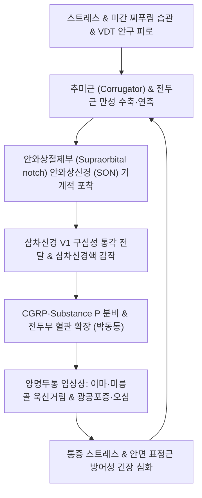

# 🩺 전두부 편두통

> **핵심 3줄 요약 (Key Summary)**:
> - 📍 병소 부위 & 해부·병태생리: 삼차신경 제1분지(안신경 V1)의 말초 분지인 **안와상신경([[Supraorbital nerve]])** 및 활차상신경이 안와상절제(추미근·전두근) 부위에서 압박·포착되거나 삼차신경혈관계 과흥분으로 이마·미간·안와 주변에 국한되어 발생하는 편두통 아형 (한의학의 [[양명두통]]·미릉골통).
> - 🚩 전형적 임상 양상: 이마, 미간, 눈썹 안쪽(미릉골) 및 안와 상부의 욱신거리는 박동성 통증, 눈부심(광공포증), 소화불량 및 오심 동반, 안와상절제부([[찬죽]]·[[양백]]) 압진 시 극심한 압통.
> - 🛠️ 핵심 검사 & 치료 전략: 안와상신경 압진 및 안과/부비동(전두동염) 배제. 양명경 청열소풍 침구([[찬죽]]·[[양백]]·[[두유]]·[[합곡]]·[[내정]]) 및 안와상근막 이완 추나, 양명두통 특효 인경약인 백지·갈근 중심 [[청상견통탕]]·[[승마위풍탕]] 투여.
> - ⚠️ 응급 의뢰 레드플래그: 전두부 발적·부종·고열 동반 시 전두동염 합병 두개내 농양(Pott's puffy tumor), 시력 저하 및 안압 상승 동반 시 급성 녹내장 의심 즉시 안과/이비인후과 응급 의뢰.

---

## 📌 목차
1. [질환 개요 & 해부학적 병태생리](#1-질환-개요--해부학적-병태생리)
2. [병태생리 메커니즘 & 생체역학적 악순환 네트워크](#2-병태생리-메커니즘--생체역학적-악순환-네트워크)
3. [임상 증상 & 이학적 검사(Physical Exam) 알고리즘](#3-임상-증상--이학적-검사physical-exam-알고리즘)
4. [감별 진단 매트릭스 (Differential Diagnosis)](#4-감별-진단-매트릭스-differential-diagnosis)
5. [한의 통합 치료 프로토콜 (침·약침·추나·한약)](#5-한의-통합-치료-프로토콜-침약침추나한약)
6. [양방 치료 & 병용·의뢰 기준 (Conventional Treatment & Referral)](#6-양방-치료--병용의뢰-기준-conventional-treatment--referral)
7. [재활 운동 & 생활습관 티칭 가이드](#7-재활-운동--생활습관-티칭-가이드)
8. [💡 사용자 진료실 핵심 필기 & 임상 노하우 (Melt-In 잔여 심화 집약)](#8--사용자-진료실-핵심-필기--임상-노하우-melt-in-잔여-심화-집약)
9. [출처 및 학술 참고 문헌 (References)](#9-출처-및-학술-참고-문헌-references)

---

## 1. 질환 개요 & 해부학적 병태생리

**전두부 편두통(Frontal Migraine)** 은 편두통의 통증 분포가 측두부나 후두부가 아닌 **이마(Frontal), 미간, 눈썹 주위(Supraorbital region)** 에 집중되는 임상 아형이다. 한의학적으로는 육경변증(六經辨證)의 대표적인 **양명두통(陽明頭痛)** 및 안와 상연의 **미릉골통(眉稜骨痛)** 과 정확히 일치한다.

### 1) 해부학적 구조와 신경 포착 부위
- **안와상신경([[Supraorbital nerve]], SON)**: 삼차신경 제1분지(안신경, V1)의 전두신경(Frontal nerve)에서 분지하여 안와상절제(Supraorbital notch/foramen)를 통해 이마로 주행한다.
- **추미근(Corrugator supercilii) 및 전두근(Frontalis)**:
  - 안와상신경은 안와골을 빠져나온 후 **추미근**의 근육 섬유 사이를 관통하여 두피로 진입한다.
  - 미간을 찌푸리는 습관, 만성 스트레스, 근막 비후 등으로 인해 추미근이 과도하게 수축하면 안와상신경이 집게에 찝히듯 기계적으로 압박되어 신경병증성 자극과 신경인성 염증이 격발된다.
- **활차상신경(Supratrochlear nerve, STN)**: 비근부와 눈썹 내측단을 주행하며, 미간근(Procerus)과 추미근 내측 섬유에 의해 함께 압박을 받는다.

### 2) 한의학적 양명두통(陽明頭痛)의 본질
- 동의보감: "양명두통은 미릉골통과 액각통이 위주가 되고, 눈이 아프고 코가 마르며, 맥상은 부장(浮長)하다(陽明頭痛, 眉稜骨痛, 額角痛, 目痛鼻乾)."
- 족양명위경(足陽明胃經)은 안와하부(승읍)에서 이마 측면 모서리인 [[두유]](ST8)로 상행하므로, 위장의 습열(濕熱)이나 소화기 정체(식적 食積)가 상역할 때 이마와 눈썹 주위에 박동성 두통이 집중된다.

---

## 2. 병태생리 메커니즘 & 생체역학적 악순환 네트워크

전두부 편두통은 중추성 삼차신경혈관계 활성화와 말초성 근신경 포착(Musculonervous entrapment)의 상호작용으로 악순환을 형성한다.

### 1) 말초 신경 포착에 의한 이소성 방전
- 추미근과 모상건막 전두부의 만성 연축은 안와상신경의 미세혈관을 허혈 상태로 몰아넣는다. 허혈된 신경 축삭에서 이소성 자발 방전이 일어나 통각 신호가 뇌간 삼차신경 척수로핵으로 유입된다.

### 2) 삼차신경혈관계 확장과 신경인성 염증
- 중추로 전달된 자극은 삼차신경절을 역방향으로 자극하여 안와상동맥과 전두부 미세혈관에 CGRP, P물질을 방출시킨다.
- 혈관 투과성 증가, 비만세포 탈과립, 무균성 신경인성 염증이 초래되어 심장 박동에 맞춘 욱신거리는 전두부 박동통이 발생한다.

---

## 3. 임상 증상 & 이학적 검사(Physical Exam) 알고리즘

### 1) 전형적 임상 증상
- **통증 부위**: 이마 전반, 미간, 눈썹 안쪽(미릉골), 안와 상부 및 깊은 곳.
- **통증 양상**: 욱신거리는 박동성(Throbbing) 통증, 또는 묵직하게 이마를 짓누르고 칼로 베는 듯한 전격통.
- **수반 증상**: 눈부심(광공포증 Photophobia), 안구 충혈, 잦은 미식거림(오심), 소화불량, 어지럼증.
- **유발 요인**: 밝은 햇빛, 스마트폰/모니터 집중 응시, 스트레스, 수면 부족, 기름진 음식 과식.

### 2) 이학적 검사 알고리즘
- **안와상신경 압진(Supraorbital Nerve Palpation)**:
  - 검사자가 엄지손가락으로 눈썹 안쪽 1/3 지점 안와 상연의 안와상절제([[찬죽]]과 [[어혈]]) 부위를 강하게 압박.
  - 양성: 환자의 이마와 정수리로 뻗치는 전형적인 편두통 통증이 즉각 재현되거나 극심한 압통 유발.
- **부비동 타진 및 검사**:
  - 전두동(이마 중앙) 및 상악동 타진을 통해 급성 전두동염(화농성 콧물, 기침 시 악화) 감별.
- **안과적 검사**: 동공 반사 및 대광 반사, 안압 평가(녹내장 배제).

---

## 4. 감별 진단 매트릭스 (Differential Diagnosis)

| 질환명 | 주 통증 양상 & 위치 | 동반 증상 & 특징 | 핵심 감별점 |
| :--- | :--- | :--- | :--- |
| **전두부 편두통 (양명두통)** | 이마·미릉골 박동통, 편측/양측 | 광공포증, 오심, 안와상신경 압통 | 안와상절제부 압진 양성, 트립탄/백지 반응 |
| **급성 전두동염(부비동염)** | 이마 중앙의 둔중한 압박통 | 고열, 누런 콧물, 고개 숙일 때 악화 | PNS X-ray/CT 상 전두동 공기음영 소실·액체저류 |
| **안와상신경통(SON)** | 안와상신경 분포부 찌릿한 칼통증 | 두피 감각저하 또는 이질통 | 찰나의 전격통, 박동성/오심 없음, 국소마취 반응 |
| **긴장형 두통** | 머리 전체 또는 이마의 조이는 둔통 | 메스꺼움 없음, 일상 활동 무관 | 비박동성 밴드형, 광공포증 없음 |
| **급성 폐쇄각 녹내장** | 안구 극통, 전두통, 시력 감퇴 | 달무리(Halo), 동공 산대, 오심/구토 | 안압 급상승(>40mmHg), 안과적 응급 |

---

## 5. 한의 통합 치료 프로토콜 (침·약침·추나·한약)

### 1) 침구 치료
- **안와상신경 및 양명경 국소 취혈**:
  - [[찬죽]](BL2): 안와상신경 내측지 출구부, 미릉골통의 최고 특효혈 (하방 또는 외측 수평 사자).
  - [[양백]](GB14): 안와상신경 외측지 주행로, 눈썹 중앙 위 1촌.
  - [[두유]](ST8): 족양명위경 액각 부위, 전두부 박동통 완화.
  - [[인당]](EX-HN3), [[태양]](EX-HN5): 미간근 이완 및 안와 압력 분산.
- **양명경 및 사열 원위 취혈**:
  - [[합곡]](LI4): 수양명대장경 원혈 — 안면두부 질환의 총괄 명혈 (면구합곡수).
  - [[내정]](ST44): 족양명위경 형수혈 — 위열(胃熱)을 내리고 전두부 화열을 사함.
  - [[족삼리]](ST36), [[풍륭]](ST40): 소화기 담음(痰飲)과 식적 해소.
- **전침 요법**: [[찬죽]]과 [[양백]] 간 2Hz 저주파 전침을 15분간 적용하여 추미근의 국소 연축을 완화하고 CGRP 방출을 억제.

### 2) 약침 요법
- **[[황련해독탕약침]]**:
  - 자입 부위: [[찬죽]], [[양백]], [[인당]] 피내 및 피하 근막층.
  - 효과: 안와상부 신경염증을 청열해독하고 두면부의 열감을 신속히 진정.
- **[[신바로약침]]**: 안면 표정근 긴장 이완 및 경추 주위 통증유발점 소퇴.

### 3) 추나요법 (Chuna Manual Therapy)
- **추미근 및 전두근 근막이완술(Myofascial Release)**:
  - 검사자의 양손 모지로 미간에서부터 눈썹 외연을 따라 안와상연의 근막을 부드럽게 횡방향으로 신장.
- **두개천골기법(CST - 전두골 리프트 Frontal Lift)**:
  - 전두골 봉합선을 감압하여 안와 전벽의 생체역학적 장력을 해소.

### 4) 한약 치료 (변증별 처방)

#### ① 양명두통의 특효 인경약: 백지(白芷) & 갈근(葛根)
- 백지는 족양명위경으로 들어가 미릉골과 이마의 통증을 멎게 하는 풍한두통·풍열두통의 핵심 약재이다.

#### ② 처방 구성
- **풍열습담형(風熱濕痰型, 이마가 쪼개지듯 아프고 미식거리며 어지러움)**:
  - [[청상견통탕]](淸上莚痛湯) 가미 (백지, 갈근, 황금, 강활, 방풍, 창출, 천궁, 조구등).
- **위열치성형(胃熱熾盛型, 갈증, 변비, 입냄새, 이마의 화끈거리는 극심한 박동통)**:
  - [[백호탕]](白虎湯) 또는 [[승마위풍탕]](升麻胃風湯) (석고, 지모, 승마, 갈근, 백지).
- **식적담탁형(食積痰濁型, 소화불량 및 과식 후 격발되는 전두통)**:
  - [[반하백출천마탕]](半夏白朮天麻湯) 합 [[평위산]](平胃散).

---

## 6. 양방 치료 & 병용·의뢰 기준 (Conventional Treatment & Referral)

### 1) 약물 치료 (Medication)
- **급성기 치료**:
  - 트립탄계: Zolmitriptan 2.5mg, Eletriptan 40mg (5-HT1B/1D 효능제).
  - NSAIDs: Naproxen 500mg, Ketorolac.
- **예방 약물 요법**: Topiramate (50~100mg/day), Propranolol, CGRP 단클론항체(Galcanezumab).

### 2) 외과적 시술 및 신경조절 (Procedures)
- **안와상신경 차단술(Supraorbital Nerve Block)**: 국소마취제(Lidocaine) 주입으로 급성기 통증 차단.
- **안와상신경 감압 수술(Nerve Decompression Surgery)**:
  - 약물 난치성 만성 전두부 편두통 환자에서 내시경을 통해 안와상신경을 조이고 있는 추미근(Corrugator)의 일부를 절제하여 신경을 영구 감압.

### 3) 한의 병용 판단 및 상호작용
- 트립탄 복용 시 가슴 답답함이나 오심 부작용이 심한 환자에게 한약([[청상견통탕]])과 침 치료를 병용하면 트립탄 복용 빈도를 70% 이상 절감 가능.
- 추미근 근막이완 침구 치료는 외과적 감압술을 대체할 수 있는 비수술적 신경 감압 효과를 제공.

### 4) 전문과 및 응급실 의뢰 기준 (Red Flags)
- 전두부 부종, 고열, 오한 동반 시 (전두동염의 골수염 파급 또는 두개내 경막외 농양 의심 → 이비인후과/신경외과).
- 시력 감퇴, 달무리 현상, 심한 안구 충혈 동반 시 (급성 녹내장 의심 → 안과 응급).

---

## 7. 재활 운동 & 생활습관 티칭 가이드

### 1) 안면 표정근 이완 자가 훈련
- 미간 찌푸림 방지 훈련: 거울을 보며 무의식적으로 미간을 찡그리는 습관을 인지하고 이완.
- 눈썹 자가 지압: 양손 엄지손가락으로 눈썹 안쪽 끝([[찬죽]])에서부터 바깥쪽([[사죽공]])까지 뼈를 훑듯이 하루 3회 롤링 지압.

### 2) 생활습관 티칭
- 블루라이트 차단 안경 및 모니터 밝기 조절: 전두부 편두통 환자는 광공포증에 극도로 취약함.
- 야식 및 폭식 금지: 위장 내 음식물 정체는 족양명위경을 타고 전두통을 격발시키는 가장 흔한 원인.

---

## 8. 💡 사용자 진료실 핵심 필기 & 임상 노하우 (Melt-In 잔여 심화 집약)

- **"미릉골통(眉稜骨痛)은 백지(白芷)가 없으면 낫지 않는다"**:
  - 환자가 "눈썹 뼈 속이 쑤시고 눈알이 빠질 것 같다"고 호소하면 한의 고전에서 말하는 전형적인 미릉골통이다.
  - 처방 시 백지(白芷)를 최소 8~12g 이상 충분히 배오하고 갈근을 보조로 넣어야 약효가 정확히 이마 안와상신경 영역으로 도달한다.
- **찬죽혈(BL2) 자침 시 방향의 묘미**:
  - [[찬죽]]에 침을 놓을 때 뼈에 직자하면 통증만 심하고 효과가 떨어진다. 눈썹을 살짝 들어올린 후 침첨을 눈썹 바깥쪽([[어혈]] 방향)으로 눕혀 피하를 따라 1~1.5cm 횡자(수평자입)해야 추미근 속을 지나는 안와상신경을 정확히 감압하여 환자가 "눈이 번쩍 뜨이고 이마가 맑아진다"고 감탄한다.
- **체기와 이마 두통의 상관관계**:
  - 전두부 편두통 환자는 문진 시 10명 중 8명이 만성 소화불량이나 체기를 호소한다. 머리만 치료하지 말고 복진을 통해 중완혈 압통을 확인한 뒤 사관혈([[합곡]], [[태충]])과 [[내정]]을 함께 사해주면 이마 두통이 현저히 빠르게 가라앉는다.

---

## 9. 출처 및 학술 참고 문헌 (References)

- Supraorbital Nerve Decompression for the Treatment of Chronic Refractory Migraine: Case Report and Review of the Literature. *Ann Plast Surg*, 2026. PMID: 42832778.

- Long-Term Experience with Occipital and Supraorbital Nerve Stimulation for the Various Headache Disorders-A Retrospective Institutional Case Series of 96 Patients. *World Neurosurg*, 2021. PMID: 33905904.

- Effects of Acupuncture on Cerebral Blood Flow in Episodic Migraine Patients Investigated by Arterial Spin Labeling MRI. *Acupunct Med*, 2026. PMID: 42836392.

---

## 관련 노트

- [[편두통]]
- [[청상견통탕]]
- [[찬죽]]
- [[합곡]]
- [[백호탕]]
