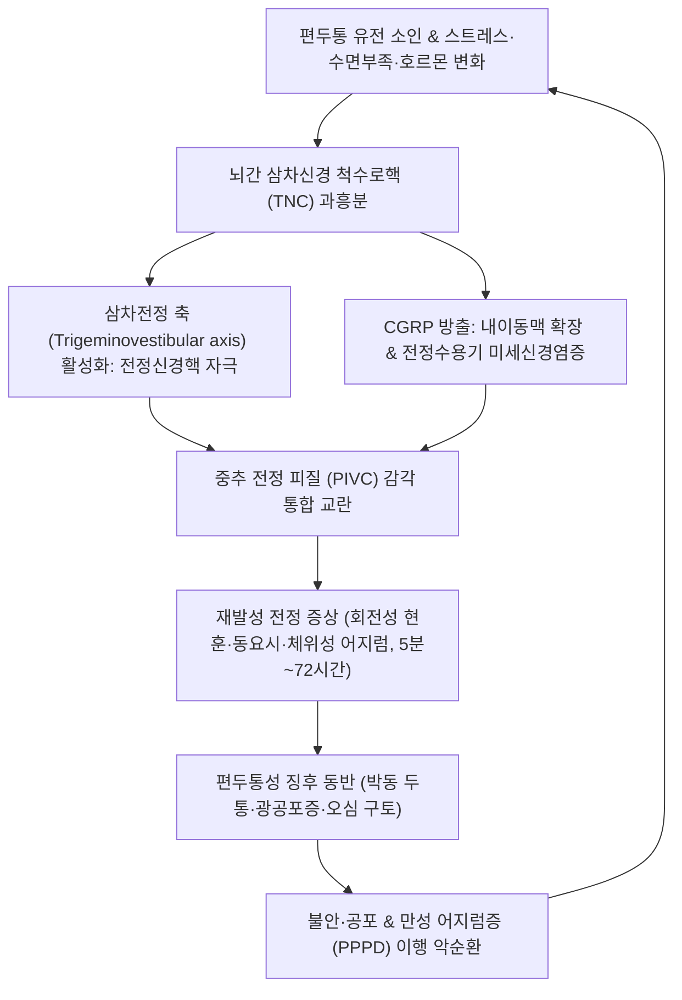

# 🩺 전정편두통

> **핵심 3줄 요약 (Key Summary)**:
> - 📍 병소 부위 & 해부·병태생리: 뇌간 삼차신경 척수로핵과 전정신경핵(Vestibular nuclei) 간의 **삼차전정 상호작용(Trigeminovestibular interaction)** 및 내이 미세혈관의 CGRP 방출·신경성 염증으로 인해 발생하는 재발성 전정 증상 동반 편두통 질환 (한의학의 풍담상요 담훈 痰暈).
> - 🚩 전형적 임상 양상: 편두통 병력이 있는 환자에서 5분~72시간 지속되는 중등도~중증의 재발성 현훈(회전성·체위성·시각 유발성 어지럼증) 삽화가 반복되며, 발작의 50% 이상에서 박동성 두통, 광공포증, 소리공포증 또는 시각 조짐 동반.
> - 🛠️ 핵심 검사 & 치료 전략: Bárány Society 진단 기준 적용, 비디오 두부충동검사([[vHIT]]) 및 청력 검사(메니에르병 감별). 한의 담훈(痰暈) 다스림의 최고 명방 [[반하백출천마탕]]·[[택사탕]], 전정신경 진정 침구([[풍지]]·[[예풍]]·[[백회]]·[[내관]]·[[풍륭]]), 양방 CGRP 제제 및 전정재활치료.
> - ⚠️ 응급 의뢰 레드플래그: HINTS 검사 상 중추성 징후(수직 안진, 방향교대성 안진, 두부충동 정상), 구음장애·복시·실조증 동반 시 소뇌·뇌간 뇌졸중(VBI) 의심 즉시 뇌 MRI(DWI) 응급 의뢰.

---

## 📌 목차
1. [질환 개요 & 해부학적 병태생리](#1-질환-개요--해부학적-병태생리)
2. [병태생리 메커니즘 & 생체역학적 악순환 네트워크](#2-병태생리-메커니즘--생체역학적-악순환-네트워크)
3. [임상 증상 & 이학적 검사(Physical Exam) 알고리즘](#3-임상-증상--이학적-검사physical-exam-알고리즘)
4. [감별 진단 매트릭스 (Differential Diagnosis)](#4-감별-진단-매트릭스-differential-diagnosis)
5. [한의 통합 치료 프로토콜 (침·약침·추나·한약)](#5-한의-통합-치료-프로토콜-침약침추나한약)
6. [양방 치료 & 병용·의뢰 기준 (Conventional Treatment & Referral)](#6-양방-치료--병용의뢰-기준-conventional-treatment--referral)
7. [재활 운동 & 생활습관 티칭 가이드](#7-재활-운동--생활습관-티칭-가이드)
8. [💡 사용자 진료실 핵심 필기 & 임상 노하우 (Melt-In 잔여 심화 집약)](#8--사용자-진료실-핵심-필기--임상-노하우-melt-in-잔여-심화-집약)
9. [출처 및 학술 참고 문헌 (References)](#9-출처-및-학술-참고-문헌-references)

---

## 1. 질환 개요 & 해부학적 병태생리

**전정편두통(Vestibular Migraine, VM)** 은 국제두통질환분류(ICHD-3) 및 국제바라니학회(Bárány Society)의 합의 기준에 등재된 원발성 두통 질환으로, 재발성 현훈을 호소하는 성인 환자에서 이석증(BPPV)에 이어 두 번째로 흔한 원인이자 비이비인후과적 현훈의 가장 흔한 원인이다.

### 1) 해부학적 구조와 신경학적 연결
- **삼차전정 신경계(Trigeminovestibular System)**:
  - 뇌간 교뇌-연수 부위에서 삼차신경 척수로핵(TNC)의 신경원들은 내측, 상측 전정신경핵(Vestibular nuclei)과 긴밀한 양방향 신경 연계를 형성한다.
  - 삼차신경의 통각 자극이 전정신경핵을 직접 탈분극시켜 자세 평형 감각을 왜곡시킬 수 있으며, 반대로 전정 자극이 삼차신경혈관계를 활성화하여 두통을 유발할 수 있다.
- **내이 혈관망과 신경펩타이드**:
  - 삼차신경 제1분지(V1)의 말초 신경섬유는 내이 기저동맥(Basilar artery) 및 내이동맥(Labyrinthine artery) 주위에 신경얼기를 형성한다.
  - 삼차신경 흥분 시 분비되는 [[CGRP]](Calcitonin Gene-Related Peptide)와 P물질이 와우 및 전정 미세혈관의 투과성을 증가시키고 국소 혈관 수축·확장을 유발한다.

### 2) 역학
![[전정편두통_01_내이_MRI.jpg|450]]
> [그림 1: 전정편두통 연구에서 제시된 내이(미로·전정기관) 국소 MRI 소견 모음 — A·B·C 세 패널 모두 화살표로 내이의 국소 신호 이상 부위를 지시하고 있다. 말초 내이의 혈관염증·림프액 변화를 영상으로 확인하는 근거 — 출처: Frontiers in Neurology 2026;17:1882444 — Figure 3 (CC BY)]

- 일반 인구의 유병률은 약 1~2.7%이며, 여성에서 남성보다 약 3배 흔하다.
- 환자의 상당수가 소아기 멀미(Motion sickness) 병력이 있거나, 과거 편두통 두통 병력이 있다가 중년 이후 두통은 약화되고 어지럼증만 전면에 드러나는 형태로 발현되기도 한다.

---

## 2. 병태생리 메커니즘 & 생체역학적 악순환 네트워크

전정편두통은 중추 전정 처리 경로의 감작, 신경인성 염증, 뇌혈관 기능 부전이 복합 작용하여 발병한다.

### 1) 중추 전정 피질의 과흥분성
- 편두통 환자의 뇌는 피질확산성억제(CSD)와 세로토닌 불균형으로 인해 감각 자극에 대해 과민 반응을 보인다.
- 시각-전정 통합을 담당하는 두정-도피질(Parieto-insular vestibular cortex, PIVC)의 감작으로 인해 가벼운 머리 움직임이나 움직이는 물체 응시만으로도 극심한 회전성 현훈이 격발된다.

### 2) 말초 내이 혈관염증과 림프액 변화
- 삼차신경 말단에서 방출된 CGRP는 내이의 전정수용기(이석기관, 반고리관 팽대부릉) 주위의 혈류 장애와 신경염증을 일으켜 일시적인 말초 전정 불균형을 가중시킨다.

---

## 3. 임상 증상 & 이학적 검사(Physical Exam) 알고리즘
![[전정편두통_02_전정동맥_혈관조영.png|450]]
> [그림 2: 뇌혈관 조영에서 상전정동맥(SUPERIOR VESTIBULAR ARTERY)과 전하소뇌동맥(AICA)의 주행을 표시한 패널. 전정기관으로 가는 혈류가 어느 동맥에서 오는지 보여주는 그림 — 출처: Cureus 2026;18(1) — Figure 1 (CC BY)]

### 1) 전형적 임상 증상 (Bárány Society 기준)
- **전정 증상 삽화 (5분 ~ 72시간 지속, 최소 5회 이상)**:
  - **자발 현훈(Spontaneous vertigo)**: 가만히 있어도 세상이 핑핑 도는 회전성 어지럼 또는 몸이 흔들리는 동요감.
  - **체위성 현훈(Positional vertigo)**: 머리 위치를 바꿀 때 유발되는 어지럼증.
  - **시각 유발성 현훈(Visually-induced vertigo)**: 마트의 진열대, 영화 화면 등 복잡한 시각 패턴에 노출 시 악화.
- **편두통성 징후 (삽화의 50% 이상에서 최소 1개 동반)**:
  - 박동성, 편측성 두통 (단, 환자의 30%는 어지럼증 발작 시 두통이 전혀 동반되지 않을 수 있음).
  - 빛 공포증(광공포증) 및 소리 공포증.
  - 시각 조짐(섬광암점, 지그재그 선).

### 2) 이학적 및 전정기능 검사 알고리즘
- **HINTS 검사 (중추성 뇌졸중 배제)**:
  - Head Impulse(두부충동): 대개 정상(Catch-up saccade 없음).
  - Nystagmus(안진): 자발 안진이 관찰될 경우 방향이 바뀌는 주시유발 안진이나 순수 수직 안진(중추성 징후)이 나타날 수 있음.
  - Test of Skew(수직 사위): 대개 음성.
- **딕스-홀파이크 검사([[Dix-Hallpike test]])**: 이석증(BPPV) 동반 여부 감별.
- **비디오 두부충동검사([[vHIT]]) 및 청력 검사(PTA)**:
  - vHIT: 전정편두통 급성기에는 정상 소견을 보임 (전정신경염과의 핵심 감별점).
  - 순음청력검사: 영구적 저음역 청력 저하가 없음을 확인하여 메니에르병과 감별.

---

## 4. 감별 진단 매트릭스 (Differential Diagnosis)

| 질환명 | 현훈 지속 시간 | 청각 증상 (이명·난청) | 핵심 감별점 |
| :--- | :--- | :--- | :--- |
| **전정편두통(VM)** | **5분 ~ 72시간** | 가역적 이충만감/이명 가능, **영구 난청 없음** | 편두통 병력, 광공포증, vHIT 정상, 편두통약 반응 |
| [[메니에르병]] | 20분 ~ 12시간 | **진행성 저음역 감각신경성 난청**, 지속성 이명 | 청력검사 상 비가역적 청력 손실, 이뇨제 반응 |
| [[이석증]] (BPPV) | **수초 ~ 1분 이내** | 청각 증상 전혀 없음 | 특정 머리 자세 시 유발, Dix-Hallpike 잠복기 회선 안진 |
| **전정신경염** | 수일 ~ 수주간 지속 | 청각 증상 없음 | 단발성 급격 발병, vHIT 양성(전정기능 마비) |
| **소뇌/뇌간 경색(VBI)** | 수분 ~ 수시간 | 신경학적 결손 동반 (복시, 마비) | 고령, 뇌졸중 위험인자, HINTS 중추성 이상 |

---

## 5. 한의 통합 치료 프로토콜 (침·약침·추나·한약)

### 1) 한의학적 병태관: 풍담상요(風痰上擾)와 담훈(痰暈)
- 동의보감: **"무담불작현(無痰不作眩, 담이 없으면 어지럼증이 생기지 않는다)"**
- 비위(脾胃)의 운화 기능이 실조되어 생성된 병리적 체액인 담음(痰飲)이 간풍(肝風)을 타고 머리로 치밀어 올라(풍담상요) 뇌규(腦竅)를 가릴 때 극심한 어지럼증과 두통, 구토가 발생한다.

### 2) 침구 치료
- **전정신경 및 두개내 혈류 안정 취혈**:
  - [[백회]](GV20), [[풍지]](GB20), [[예풍]](TE17), [[이문]](TE21), [[청궁]](SI19), [[솔곡]](GB8).
  - 내이 신경 혈류를 개선하고 전정신경핵의 과흥분성을 안정시킴.
- **화담지구(化痰止嘔) 및 평간 취혈**:
  - [[내관]](PC6): 심포경 락혈 — 오심, 구토, 멀미 증상 차단.
  - [[풍륭]](ST40): 위경 락혈 — 거담(祛痰)의 최고 요혈, 담음 배출.
  - [[태충]](LR3), [[합곡]](LI4): 사관혈 — 풍담을 가라앉히고 중추 신경계 진통.
  - [[족삼리]](ST36): 비위 건운 및 중초 안정.
- **전침 요법**: 양측 [[풍지]]와 [[예풍]]에 2Hz 저주파 전침을 20분간 적용하여 뇌간 및 소뇌 전정 신경망의 미세혈류를 복원.

### 3) 약침 요법
- [[황련해독탕약침]]: [[예풍]](TE17), [[풍지]](GB20) 피내 주입 — 내이 신경염증 및 화열(火熱) 청열.
- [[자하거약침]]: 기혈허약형 만성 어지럼 환자의 [[신수]](BL23), [[간수]](BL18) 보신양혈.

### 4) 추나요법 (Chuna Manual Therapy)
- **상부 경추(C1-C2) 관절가동술**:
  - 환축관절의 회전 아탈구는 경추성 고유수용성 감각 오류를 일으켜 전정 감각과 충돌하므로 부드러운 가동술로 정렬 교정.
- **두개천골요법(CST - 측두골 감압술 Temporal Decompression)**:
  - 내이가 위치한 측두골 암양부(Petrous part)의 미세 장력을 해소하여 림프액 순환을 정상화.

### 5) 한약 치료 (변증별 처방)

#### ① [[반하백출천마탕]](半夏白朮天麻탕) — 전정편두통 담훈(痰暈)의 절대적 제1선 처방
- **구성**: 반하 8g, 백출 8g, 천마 6g, 복령 6g, 진피 6g, 황기 4g, 인삼 4g, 창출 4g, 맥아 4g, 신곡 4g, 황백 2g, 건강 2g.
- **방해**:
  - 반하·백출(군약): 조습화담(燥濕化痰), 건비익기(健脾益氣)하여 담음의 생성을 원천 차단.
  - 천마(신약): 식풍지현(熄風止眩)의 명약 — 뇌혈관 경련을 풀고 중추성 현훈을 즉각 안정시킴.
- **현대 약리**: 가스트로딘(Gastrodin) 성분이 GABA 수용체를 조절하고 전정신경핵의 자발 방전을 억제.

#### ② [[택사탕]](澤瀉湯) / [[영계출감탕]](苓桂朮甘湯)
- 수음(水飮)이 심하여 몸이 흔들리고 소변이 시원치 않으며 배에서 물소리가 나는 경우.

#### ③ [[천마구등음]](天麻鉤藤飲)
- 간양상항형: 혈압이 오르며 얼굴이 붉어지고 화가 치밀며 머리가 띵하고 어지러운 경우.

---

## 6. 양방 치료 & 병용·의뢰 기준 (Conventional Treatment & Referral)

### 1) 약물 치료 (Medication)
- **급성기 증상 완화 (발작 중단)**:
  - 전정억제제(Vestibular suppressants): Dimenhydrinate 50mg, Meclizine. (중추 보상 기전을 억제하므로 **급성기 2~3일만 단기 사용** 원칙).
  - 진토제: Metoclopramide 10mg tid (오심·구토 억제).
  - 트립탄계: Zolmitriptan, Rizatriptan (두통 및 어지럼증 삽화 시간 단축).
- **예방 약물 요법 (삽화 빈도 억제)**:
  - Venlafaxine (37.5~75mg qd, 우수한 전정 개선 효과), Topiramate, Propranolol, Flunarizine.
  - CGRP 단클론항체(Fremanezumab, Galcanezumab): 난치성 VM에서 뛰어난 예방 효과 입증.

### 2) 전정재활치료 (Vestibular Rehabilitation Therapy, VRT)
- 시각-전정 반사(VOR) 훈련, 균형 운동을 통해 중추 전정 적응 및 대치 능력을 강화.

### 3) 한의 병용 판단 및 상호작용
- 전정억제제의 장기 복용으로 인해 만성 멍함과 보행 불안을 호소하는 환자에게 [[반하백출천마탕]]과 전정재활 추나를 병용하면 전정억제제를 신속히 단약하고 일상 복귀를 촉진할 수 있음.

### 4) 전문과 및 응급실 의뢰 기준 (Red Flags)
- **HINTS 검사 상 중추성 안진(수직 안진, 방향교대 안진)** 또는 두부충동 정상.
- 복시, 구음장애, 삼킴 곤란, 편측 위약, 소뇌성 운동실조(비틀거림) 동반 시.
- 50세 이상 고혈압/당뇨 환자에서 갑자기 발생한 격심한 어지럼증 → **뇌간/소뇌 뇌경색 배제를 위해 뇌 MRI(DWI) 응급 의뢰**.

---

## 7. 재활 운동 & 생활습관 티칭 가이드

### 1) 식이 및 트리거 관리 (Heads UP Diet)
- **편두통 유발 음식 제한**: 치즈, 초콜릿, 와인(적포도주), 가공육(아질산염), 글루탐산나트륨(MSG), 감미료.
- 카페인 섭취 조절: 커피 섭취를 일정하게 유지하거나 점진적으로 중단.

### 2) 시각-전정 자가 훈련
- **시선 고정 운동(VOR x1 Exercise)**:
  - 명함 크기의 글자를 눈앞 30cm에 두고 시선은 글자에 고정한 채 고개를 좌우로 천천히 흔들기 (하루 3회, 1분씩).
- **수면 및 스트레스 위생**: 수면 부족은 전정편두통의 가장 강력한 유발 인자이므로 일정한 수면 시간 유지.

---

## 8. 💡 사용자 진료실 핵심 필기 & 임상 노하우 (Melt-In 잔여 심화 집약)

- **"이석증 치료를 여러 번 받았는데도 머리가 계속 어지럽고 멍해요" 환자의 정체**:
  - 이비인후과에서 이석증 정복술을 받고 이석은 들어갔는데도, 몇 주째 머리가 맑지 않고 배를 탄 것처럼 울렁거리며 어지럽다고 호소하는 환자의 대다수가 전정편두통이다.
  - 과거 병력에서 생리 전 편두통이나 차멀미 병력을 캐물어 확인한 뒤, 이석증 치료를 중단하고 편두통-담훈(痰暈) 프로토콜로 전환해야 완치된다.
- **반하백출천마탕의 기적 같은 임상력**:
  - 세상이 핑핑 돌고 토하면서 양방 응급실에서 링거를 맞아도 어지럼증이 가라앉지 않는 환자에게 따뜻하게 달인 [[반하백출천마탕]]을 원내에서 복용시키고, [[내관]]과 [[풍륭]]에 강자극 전침을 걸어주면 30분 내로 구역질이 멈추고 땅이 가라앉는 극적인 경험을 하게 된다.
- **두통 없는 전정편두통(Migraine without headache)을 놓치지 말라**:
  - "어지럽긴 한데 머리는 전혀 안 아파요"라는 환자 중에도 어지러울 때 빛이나 소리가 거슬리는지, 과거 젊었을 때 편두통이 있었는지를 확인하여 전정편두통으로 진단하는 안목이 명의의 차이를 만든다.

---

## 9. 출처 및 학술 참고 문헌 (References)

- Cognitive impairment in vestibular migraine: a PubMed-based systematic review and meta-analysis. *Front Neurol*, 2026. PMID: 42755571.

- Can video head impulse testing aid differential assessment of suspected vestibular migraine attacks? *Front Neurol*, 2026. PMID: 42676809.

- Distinguishing Meniere's disease from vestibular migraine: A comprehensive review of symptoms and diagnostic insights. *J Int Med Res*, 2026. PMID: 42816771.

---

## 관련 노트

- [[편두통]]
- [[반하백출천마탕]]
- [[영계출감탕]]
- [[풍지]]
- [[내관]]
