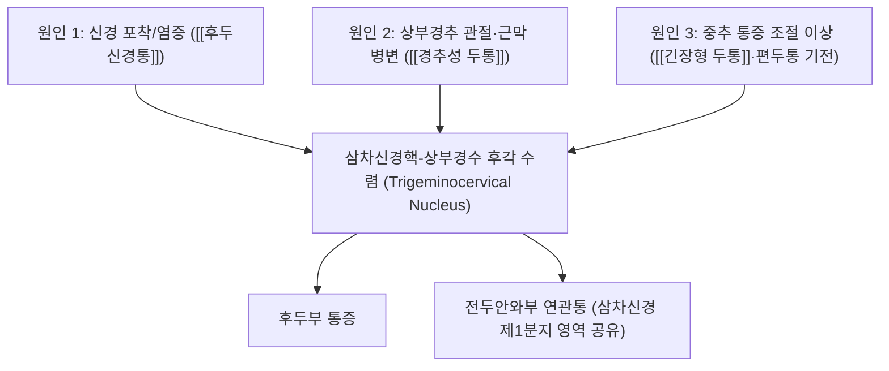

# 🩺 후두통 (Occipital Headache)

> **핵심 3줄 요약 (Key Summary)**:
> - 📍 병소 부위 & 해부·병태생리: 후두부(occiput) 통증은 단일 질환명이 아니라 **C2·C3 분절 지배 영역(대후두신경·소후두신경·제3후두신경)과 상부 경추 구조물의 통증 수렴 지점**으로, [[후두신경통]]·[[경추성 두통]]·[[긴장형 두통]]·[[제3후두신경 두통]] 등 서로 다른 원인 질환이 같은 부위에 통증을 낸다.
> - 🚩 전형적 임상 양상: 발현 양상(발작성 전격통 vs 지속적 압박통)과 유발 요인(목 움직임 vs 자발적 발생)으로 1차 감별이 가능하며, 전두안와부로 뻗치는 연관통이 공통적으로 나타날 수 있다(삼차신경-경수 수렴핵 공유).
> - 🛠️ 핵심 감별 & 한·양방 치료 전략: 신경 압통점·경부 가동범위·유발검사로 1차 감별 후, 진단적 신경차단으로 확진; 한의학적으로는 족태양방광경·족소양담경 풍한습 침습 및 경항부 근막 긴장으로 변증해 [[풍지]]·[[천주]]·[[풍부]] 등 침구·추나 치료를 적용한다.
> - ⚠️ 응급 의뢰 레드플래그: 경부 회전 중 돌발한 극심한 후두통(추골동맥 박리 의심), 발열·경부강직(수막염), 진행성 운동/보행 장애(대후두공·상부 경수 병변), 외상 후 발생한 새로운 후두통(골절·경막외혈종).

---

## 📌 목차
1. [질환 개요 & 해부학적 병태생리](#1-질환-개요--해부학적-병태생리)
2. [통증 발생 네트워크 — 삼차신경-경수 수렴](#2-통증-발생-네트워크--삼차신경-경수-수렴)
3. [임상 증상 & 1차 감별 알고리즘](#3-임상-증상--1차-감별-알고리즘)
4. [감별 진단 매트릭스 (Differential Diagnosis)](#4-감별-진단-매트릭스-differential-diagnosis)
5. [한의 통합 치료 프로토콜](#5-한의-통합-치료-프로토콜)
6. [양방 치료 & 의뢰 기준](#6-양방-치료--의뢰-기준)
7. [생활습관 & 환자 교육](#7-생활습관--환자-교육)
8. [💡 사용자 진료실 핵심 필기 & 임상 노하우](#8--사용자-진료실-핵심-필기--임상-노하우)
9. [출처 및 학술 참고 문헌 (References)](#9-출처-및-학술-참고-문헌-references)

---

## 1. 질환 개요 & 해부학적 병태생리

* **정의**: '후두통'은 후두부(뒤통수)에 국한되거나 그 부위에서 시작되는 두통을 지칭하는 **부위 기반 증상명**이며, ICHD-3 자체의 독립 진단명이 아니다. 임상에서는 반드시 아래 원인 질환 중 하나로 재분류(rule-in/rule-out)해야 한다.
* **관련 해부 구조물**:
  * **신경**: [[대후두신경]](C2 후지), [[소후두신경]](C2-C3 전지), [[제3후두신경]](C3 후지 내측지) — 모두 후두하근군·두반극근·승모근 건막을 관통해 두피로 올라간다.
  * **관절·근육**: 상부 경추(C0-C1, C1-C2) 후관절, 후두하근군(대후두직근·소후두직근·상두사근·하두사근), 승모근 상부.
  * **혈관**: [[추골동맥]] — 경부 회전 시 상부 경추 부위를 통과하므로 박리 시 급성 후두통의 원인이 될 수 있다(레드플래그).

## 2. 통증 발생 네트워크 — 삼차신경-경수 수렴

* 대후두신경·소후두신경의 1차 들신경세포와 삼차신경(특히 안신경 분지)의 2차 신경세포가 **상부 경수(C1-C3) 후각에서 수렴(trigeminocervical convergence)**하기 때문에, 서로 다른 원인이라도 후두부+전두안와부에 걸친 유사한 통증 분포를 만들 수 있다. 이 수렴 구조가 후두신경통·경추성 두통·편두통이 서로 오인되기 쉬운 핵심 기전이다.

## 3. 임상 증상 & 1차 감별 알고리즘

### 1) 통증의 시간적 양상으로 1차 분류
* **발작성·전격통(초~분 단위, 번개 치듯)** → [[후두신경통]] 가능성 우선 고려. 신경 분포를 따라 두피 이질통·감각이상 동반.
* **지속적·압박성(시간~일 단위)**, 목 움직임·자세로 악화 → [[경추성 두통]] 가능성. 경부 가동범위 감소 동반.
* **양측성·조이는 듯한 경도~중등도 통증**, 스트레스·장시간 자세 불량과 연관 → [[긴장형 두통]].
* **박동성·편측, 빛·소리 공포 동반** → 후두부에서 시작하는 편두통 변이(occipital-onset migraine) 고려.

### 2) 이학적 검사
* **신경 압통점**: 외후두융기와 유양돌기 중간점(대후두신경 출구부) 압통 — [[후두신경통]] 시사.
* **티넬 징후(Tinel's sign)**: 해당 지점 타진 시 저림·방사감.
* **경부 가동범위 & 유발검사**: 목 움직임으로 통증이 재현/악화되면 경추성 원인 비중이 높아진다.
* **진단적 신경차단**: 국소마취제 차단 후 통증이 소실되면 해당 신경 기원을 확인할 수 있으나, 위양성이 최대 40%에 달해 단독 확진 수단으로는 한계가 있다.

## 4. 감별 진단 매트릭스 (Differential Diagnosis)

| 감별 질환 | 특징적 양상 | 감별 포인트 |
| :--- | :--- | :--- |
| [[후두신경통]] | 발작성 전격통, 신경분포 이질통 | 신경 압통점·Tinel 양성, 신경차단 반응 |
| [[경추성 두통]] | 지속적 둔통, 목 움직임으로 악화 | 경부 가동범위 감소, 상부경추 관절 유발검사 양성 |
| [[긴장형 두통]] | 양측성 조이는 통증, 경도~중등도 | 두피·경부 근육 압통 다발, 박동성 없음 |
| [[제3후두신경 두통]] | 편측 후두통, 경부 신전/회전 시 유발 | C2-C3 후관절 유발, 제3후두신경 차단 반응 |
| 편두통(후두부 발현) | 박동성, 빛·소리 공포, 오심 동반 | 발작성 두통 병력, 트립탄 반응 |
| 군발두통·속발성 두통군 | 편측 안와주위 극심한 통증 주기성 발작 | 자율신경 증상(눈물·비루) 동반 |

> 🚩 **레드플래그 감별 (최상단 우선 배제)**: 추골동맥 박리(경부 회전 중 돌발 극심 통증), 수막염(발열+경부강직), 대후두공·상부경수 병변(진행성 운동/보행 장애), 외상 후 급성 후두통(골절·경막외혈종), 측두동맥염(고령+턱파행·시력저하 동반 시).

## 5. 한의 통합 치료 프로토콜

* **변증 분류**: 풍한습 침습(足太陽膀胱經·足少陽膽經 經絡 불통), 어혈(외상 후), 간양상항(肝陽上亢, 긴장·스트레스성), 기혈허(氣血虛, 만성 과로형).
* **침구 치료**: [[풍지]]·[[천주]]·[[풍부]]·[[완골]] 등 후두하부 경혈 위주 배혈, 압통이 심한 신경 주행 경로를 따라 아시혈(阿是穴) 자침.
* **약침 치료**: 후두하근군 압통점에 신바로 약침 또는 중성어혈약침 적용(만성 근막통 동반 시).
* **추나 요법**: 후두하근군 긴장 완화 및 상부 경추(C0-C1-C2) 가동술 — 단, 추골동맥 박리 의심 시 경부 고속저진폭 수기는 절대 금기.
* **한약 치료**: 풍한습형에는 [[강활]]·[[방풍]] 계열 거풍산한 처방, 어혈형에는 [[천궁]]·[[당귀]] 계열 활혈 처방을 변증에 맞춰 선택.

## 6. 양방 치료 & 의뢰 기준

* **약물 치료**: 급성기 NSAIDs, 만성 신경병성 양상에는 가바펜틴·카르바마제핀 등 항경련제, 삼환계 항우울제가 사용될 수 있다.
* **시술적 치료**: 대후두신경/제3후두신경 차단술, 보툴리눔톡신 주사, 박동성 고주파술(pulsed RF) — 모두 대증적 치료로 근본 치료는 아니다.
* **의뢰 기준**: 레드플래그 소견 동반 시 즉시 영상 검사(MRI/MRA) 및 응급·신경과 의뢰. 반복적인 진단적 차단에도 반응이 불명확하거나 진행성 신경학적 결손이 있으면 신경외과·통증클리닉 협진을 고려한다.

## 7. 생활습관 & 환자 교육

* **자세 교육**: 거북목·장시간 전방머리자세(forward head posture) 교정, 모니터 높이·베개 높이 조절.
* **자가 관리**: 후두하근군 스트레칭, 온열 요법, 과도한 경부 회전·신전 자세 회피.
* **경과 관찰**: 통증 양상이 변하거나(갑자기 더 심해짐, 새로운 신경학적 증상 동반) 즉시 재평가가 필요함을 교육.

## 8. 💡 사용자 진료실 핵심 필기 & 임상 노하우

> [!tip] 진료실 실전 노하우
> - 현재 별도로 기록된 원장님 임상 필기가 없습니다. 추후 실전 진료 경험이 누적되면 이 섹션에 추가합니다.
> - 이 노트는 '후두통'이라는 **부위 증상**을 다루는 감별진단 허브로 설계했습니다 — 구체적 병리·치료 디테일은 [[후두신경통]]·[[경추성 두통]]·[[제3후두신경 두통]] 등 개별 진단 노트를 참조하십시오(중복 서술을 피하기 위해 공통 감별 틀만 이 노트에 유지합니다).

## 9. 출처 및 학술 참고 문헌 (References)

1. **Headache Classification Committee of the International Headache Society**. *ICHD-3* — Occipital neuralgia 진단기준.
2. **EyeWiki** — Occipital Neuralgia. [링크](https://eyewiki.org/Occipital_Neuralgia)
   - **[임상 요약]**: C2·C3 신경 기원 통증의 진단기준, Tinel 징후, 신경차단 위양성률(최대 40%), 단계적 치료(보존적→시술적→수술적).
3. **Choi I, Jeon SR**. Occipital Neuralgia and Cervicogenic Headache. *Practical Neurology*. [링크](https://practicalneurology.com/diseases-diagnoses/headache-pain/occipital-neuralgia-cervicogenic-headache/31787/)
   - **[임상 요약]**: 후두신경통과 경추성 두통의 삼차신경-경수 수렴 기전에 따른 중복 증상, 핵심 감별점(발작성·신경압통 vs 목움직임 악화·지속적) 정리.

## 함께 보기
- [[후두신경통]] · [[경추성 두통]] · [[긴장형 두통]] · [[제3후두신경 두통]] · [[편두통]] · [[추골동맥]]
