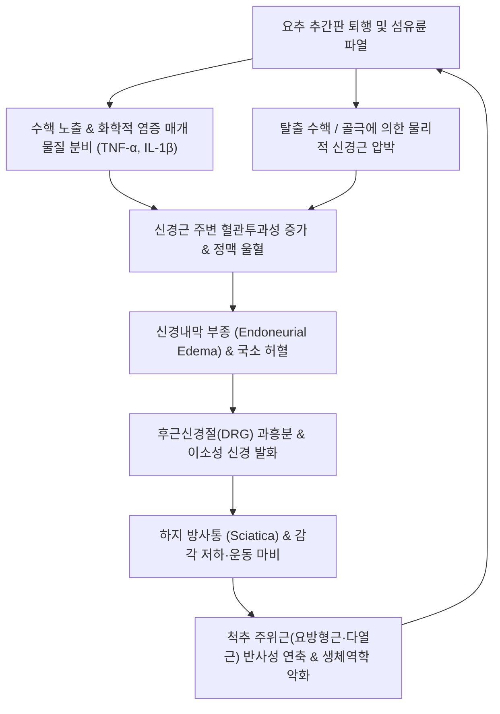

# 🩺 요추 신경근병증

> **핵심 3줄 요약 (Key Summary)**:
> - 📍 병소 부위 & 해부·병태생리: [[요추]] 추간판 탈출(HIVD), 척추관 협착증 또는 추간공 협착으로 인해 L4, L5, S1 [[요수신경근]](Lumbar nerve root)이 기계적 압박 및 수핵 누출에 따른 화학적 염증 자극을 받아 발생하는 신경근병증성 방사통 질환.
> - 🚩 전형적 임상 양상: 요통과 함께 편측 둔부, 대퇴부 후외측, 하퇴부 및 족부로 뻗치는 전격성 방사통(Sciatica), 피부분절 감각 이상(이상감각·저림), 근력 약화(족하수, 족지 신전근 약화), 건반사 저하.
> - 🛠️ 핵심 검사 & 치료 전략: 하지직거상검사([[SLR test]]), [[Bragard test]], 피부분절·근절 신경학적 검사. 급성기 신경근 주위 [[신바로약침]]·[[봉약침]] 항염 소염, [[요추 추나요법]](신연기법·굴곡변위 교정) 및 [[독활기생탕]]·[[오적산]] 투여.
> - ⚠️ 응급 의뢰 레드플래그: 마미증후군([[Cauda equina syndrome]]) 징후(급성 배뇨·배변 장애, 회음부 안장 마비), 진행성 하지 마비(Foot drop 족하수 등 근력 Grade 3 이하 급격 저하) 발생 시 즉시 척추신경외과 응급 감압술 의뢰.

---

## 📌 목차
1. [질환 개요 & 해부학적 병태생리](#1-질환-개요--해부학적-병태생리)
2. [병태생리 메커니즘 & 생체역학적 악순환 네트워크](#2-병태생리-메커니즘--생체역학적-악순환-네트워크)
3. [임상 증상 & 이학적 검사(Physical Exam) 알고리즘](#3-임상-증상--이학적-검사physical-exam-알고리즘)
4. [감별 진단 매트릭스 (Differential Diagnosis)](#4-감별-진단-매트릭스-differential-diagnosis)
5. [한의 통합 치료 프로토콜 (침·약침·추나·한약)](#5-한의-통합-치료-프로토콜-침약침추나한약)
6. [양방 치료 & 병용·의뢰 기준 (Conventional Treatment & Referral)](#6-양방-치료--병용의뢰-기준-conventional-treatment--referral)
7. [재활 운동 & 생활습관 티칭 가이드](#7-재활-운동--생활습관-티칭-가이드)
8. [💡 사용자 진료실 핵심 필기 & 임상 노하우 (Melt-In 잔여 심화 집약)](#8--사용자-진료실-핵심-필기--임상-노하우-melt-in-잔여-심화-집약)
9. [출처 및 학술 참고 문헌 (References)](#9-출처-및-학술-참고-문헌-references)

---

## 1. 질환 개요 & 해부학적 병태생리

**요추 신경근병증(Lumbar Radiculopathy)** 은 요천추부 척수 신경근(L1~S1 nerve roots)이 추간판 질환, 후관절 비대, 황색인대 비후 또는 척추전방전위증 등에 의해 물리적으로 압박되거나 생화학적 염증 반응에 노출되어 해당 신경 분절의 지배 영역을 따라 신경병증성 통증, 감각 저하, 운동 마비가 발생하는 임상 증후군이다.

### 1) 해부학적 구조와 신경근 주행
- **외측 함요부(Lateral recess) 및 추간공(Intervertebral foramen)**: 척수 신경근은 경막낭을 빠져나와 외측 함요부를 지나 추간공을 통해 척주관 외부로 주행한다. 요추 4-5번(L4-L5) 추간판 탈출증에서는 대개 후외측으로 탈출하여 하위 신경근인 L5 신경근을 압박(Traversing root)하며, 외측 또는 추간공형 탈출(Foraminal herniation) 시에는 상위 신경근인 L4 신경근(Exiting root)을 직접 포착한다.
- **후근신경절(Dorsal Root Ganglion, DRG)**: 추간공 내외측에 위치하며, 통각 전달의 1차 감각 뉴런 세포체가 밀집되어 있다. DRG는 기계적 변형과 압력에 극도로 민감하여, 미세한 기계적 접촉이나 부종만으로도 자발 발화(Ectopic discharge)를 일으켜 심한 전격통을 유발한다.

### 2) 역학 및 이환 분절
- 가장 흔히 침범되는 분절은 **L5 신경근(약 45~50%)** 과 **S1 신경근(약 40~45%)** 이며, L4 신경근 침범은 약 5~10%를 차지한다.
- 30~50대 활동기 연령에서는 급성 [[요추 추간판 탈출증]]이 주원인이며, 60대 이상 고령층에서는 퇴행성 [[척추관 협착증]] 및 후관절 골극 형성에 의한 추간공 협착이 주된 원인으로 작용한다.

---

## 2. 병태생리 메커니즘 & 생체역학적 악순환 네트워크

요추 신경근병증의 통증은 단순한 물리적 압박만으로 설명되지 않으며, **기계적 압박(Mechanical Compression)** 과 **화학적 신경염증(Biochemical Neuroinflammation)** 의 복합 상호작용으로 발생한다.

### 1) 병태생리 3단계
1. **수핵 노출과 화학적 염증 촉발**: 파열된 섬유륜을 통해 [[수핵]](Nucleus pulposus) 물질이 경막외 공간으로 누출되면, 수핵 내의 포스포리파아제 A2(PLA2), 종양괴사인자(TNF-alpha), 인터루킨-1베타(IL-1beta), 프로스타글란딘 E2(PGE2) 등이 신경근 주위에 급성 면역 염증 반응을 유발한다.
2. **미세혈관 허혈 및 신경 내 부종**: 염증 매개물질과 기계적 압박은 신경근 내 모세혈관의 혈류 장애를 일으켜 정맥 울혈, 모세혈관 투과성 증가, 신경내막 부종(Endoneurial edema)을 초래한다. 이는 신경근의 산소 공급을 차단하여 허혈성 신경 손상을 심화시킨다.
3. **이소성 축삭 발화와 중추 감작**: 허혈과 염증에 노출된 A-delta 섬유 및 무수 C-섬유에서 자발적인 이소성 방전이 발생하여 척수 후각으로 통증 신호가 증폭 전달되며, 장기화될 경우 척수 및 뇌 수준의 중추 감작(Central sensitization)으로 이행한다.

---

## 3. 임상 증상 & 이학적 검사(Physical Exam) 알고리즘

### 1) 신경근 분절별 전형적 증상 및 신경학적 검사

| 신경근 | 주요 방사통 및 감각 저하 부위 | 핵심 근력 검사 (Myotome) | 심부건반사 (DTR) |
| :--- | :--- | :--- | :--- |
| **L4** | 대퇴 전외측 → 슬관절 내측 → 하퇴 내측면 | 전경골근([[Tibialis anterior]]) — 발목 배굴(Dorsiflexion) | 슬개건반사(Patellar reflex) 저하 |
| **L5** | 대퇴 후외측 → 하퇴 전외측 → 족배부 & 제1·2족지 | 장무지신근([[Extensor hallucis longus]]) — 엄지발가락 배굴 | 건반사 대개 정상 (드물게 내측 슬와건 저하) |
| **S1** | 둔부 → 대퇴 후면 → 하퇴 후면(종아리) → 족외연 & 족저부 | 비복근·가자미근([[Gastrocnemius]]) — 족저 굴곡(Plantarflexion) | 아킬레스건반사(Achilles reflex) 저하 |

### 2) 이학적 검사 알고리즘
- **하지직거상검사([[SLR test]], Straight Leg Raise Test)**:
  - 환자를 앙와위로 눕히고 무릎을 편 상태에서 천천히 하지를 거상.
  - 30°~70° 사이에서 환자의 이환 신경근 주행 경로를 따라 전격통이 재현되면 양성 (민감도 80~90%).
- **브라가드 검사([[Bragard test]])**:
  - SLR 검사에서 통증이 발생한 각도보다 5°가량 하지를 내린 후, 발목을 급격히 족배 굴곡(Dorsiflexion)시킴. 통증이 재현되면 진성 신경근 압박으로 판정 (위양성 햄스트링 단축 감별).
- **교차 하지직거상검사(Crossed SLR Test)**:
  - 무증상 하지를 거상했을 때 반대편 이환된 다리에 방사통이 유발되는 현상. 민감도는 낮으나 특이도가 90% 이상으로 높아 중심성 대형 수핵 탈출증을 강력히 시사.
- **대퇴신경 신전검사(Femoral Nerve Stretch Test, Ely Test)**:
  - 복와위에서 무릎을 굽히고 대퇴를 신전시켜 L2~L4 신경근 자극 유무를 평가.

---

## 4. 감별 진단 매트릭스 (Differential Diagnosis)

| 질환명 | 주 증상 및 호발 양상 | 신체 검사 및 감별 포인트 | 방사선 / 확진 검사 |
| :--- | :--- | :--- | :--- |
| **요추 신경근병증** | 허리 통증보다 하지 방사통이 우세, 기침·재채기 시 악화 | SLR/Bragard 양성, 분절형 감각·근력 저하 | 요추 MRI (신경근 압박 일치 확인) |
| **[[이상근 증후군]](Piriformis Syndrome)** | 둔부 통증 및 좌골신경통 유사 양상, 요통 없음 | SLR 음성 또는 고각도 양성, FAIR test 양성, 이상근 압통 | 요추 MRI 정상, 둔부 초음파/MRI 이상근 비대 |
| **퇴행성 고관절염([[고관절 질환]])** | 서혜부·둔부 통증, 보행 시 체중 부하 통증 | Patrick(FABER) test 양성, 고관절 내회전 제한, SLR 음성 | 골반 X-ray (고관절 간격 협착, 골극) |
| **천장관절 증후군** | 천장관절부 후면 통증, 둔부 및 대퇴 후면 막연한 방사통 | Gaenslen test 양성, Fortin finger test 양성, 신경 결손 없음 | 골반 X-ray/MRI (천장관절 염증/퇴행) |
| **말초동맥 질환([[간헐적 파행]])** | 보행 시 종아리 쥐남·통증, 휴식 시 즉시 소실 | 하지 족배동맥 맥박 약화, 피부 냉감·창백, 신경학적 이상 없음 | 발목-상완 혈압비(ABI < 0.9) |

---

## 5. 한의 통합 치료 프로토콜 (침·약침·추나·한약)

### 1) 침구 치료
- **근위 취혈**: [[신수]](BL23), [[대장수]](BL25), [[관원수]](BL26), 협척혈(EX-B2 요추 4-5번, 5번-천추 1번 레벨 심자).
- **원위 및 하지 취혈**:
  - L5 신경근 이환: [[환도]](GB30), [[풍시]](GB31), [[양릉천]](GB34), [[현종]](GB39), [[구허]](GB40), [[태충]](LR3).
  - S1 신경근 이환: [[질변]](BL54), [[은문]](BL37), [[위중]](BL40), [[승산]](BL57), [[곤륜]](BL60).
- **전침 요법(Electroacupuncture)**: 협척혈과 [[환도]]-하퇴 경혈 간 2~4Hz 저주파 전침을 20분간 적용하여 엔돌핀 및 다이노르핀 분비를 촉진하고 신경근 혈류를 개선.

### 2) 약침 요법
- **[[신바로약침]] / [[봉약침]]**:
  - 자입 부위: L4-L5, L5-S1 협척혈 심부(관절돌기간 관절 주변) 및 척추기립근 외측 연부조직.
  - 효과: 봉독(Mellitin) 및 신바로 성분이 COX-2, iNOS 발현을 억제하고 TNF-alpha를 차단하여 신경근막 주변의 급성 화학적 부종과 신경염을 신속히 소퇴.
- **[[중성어혈약침]] / [[황련해독탕약침]]**: 좌골신경 주행 부위(둔부 이상근하공 영역 및 [[위중]])의 울혈 및 염증 완화.

### 3) 추나요법 (Chuna Manual Therapy)
- **요추 신연기법(Traction & Distraction)**:
  - 굴곡-신연 탁자(Cox table)를 활용한 굴곡 신연 수기요법.
  - 추간판 내 음압(Negative pressure)을 유도하여 탈출 수핵의 수축을 도모하고 추간공 면적을 일시적으로 넓혀 신경근 허혈을 해소.
- **골반 및 요추 관절가동기법**: 천장관절 아탈구 및 요추 분절의 비틀림(Rotational malalignment)을 완만히 교정하여 요천추 역학적 부하를 재분배. (급성 탈출증 극초기에는 과도한 회전 고속저진폭 기법(HVLA)을 지양).

### 4) 한약 치료 (변증별 처방)
- **기체어혈형(氣滯瘀血型, 급성 극심한 방사통·야간통)**:
  - [[신통축어탕]](身痛逐瘀湯) 또는 [[당귀수산]](當歸鬚散) 가감 (도인, 홍화, 몰약, 오약, 우슬).
- **풍한습비형(風寒濕痺型, 찬 곳에서 악화·다리가 무겁고 시림)**:
  - [[오적산]](五積散) 또는 [[서경탕]](舒經湯).
- **간신휴허형(肝腎虧虛型, 만성 퇴행·하지 무력감 동반)**:
  - [[독활기생탕]](獨活寄生湯) (독활, 방풍, 상기생, 두충, 우슬, 당귀, 백작약 등) — 신경 재생 촉진 및 척추 지지 인대 강화.

---

## 6. 양방 치료 & 병용·의뢰 기준 (Conventional Treatment & Referral)

### 1) 약물 치료 (Medication)
- **1차 진통소염제**: NSAIDs (Aceclofenac 100mg bid, Celecoxib 200mg qd) — 급성기 통증 조절.
- **신경병증성 통증 약물**: Pregabalin (75~150mg bid) 또는 Gabapentin (300mg tid) — 칼슘 채널 alpha-2-delta 소단위에 결합하여 이소성 방전 억제.
- **단기 경구 스테로이드 펄스 요법**: Methylprednisolone 테이퍼링 요법으로 급성 신경근 부종 감소.

### 2) 비수술적 시술 (Procedures)
- **경막외 스테로이드 주사(Epidural Steroid Injection, ESI)**:
  - 신경근 차단술(Transforaminal ESI) 또는 추간판간 ESI. 스테로이드와 국소마취제를 압박된 신경근 주변에 주입하여 즉각적인 강력한 항염 효과 도모.
  - 연간 3~4회 이하로 제한 (전신 부작용 및 인대 약화 방지).

### 3) 수술적 치료 적응증 (Surgical Indication)
- **절대적 응급 수술 적응증**: 마미증후군([[Cauda equina syndrome]] — 실금, 배뇨 곤란, 안장 감각 소실) 발생 시 48시간 이내 긴급 감압술 시행 필수.
- **상대적 수술 적응증**:
  - Foot drop(족하수) 등 중증 운동 마비(근력 Grade 3 이하).
  - 6~8주 이상의 적극적인 보존적 한의·양방 치료에도 견디기 힘든 극심한 방사통이 지속되는 경우.
  - 수술법: 미세현미경하 추간판 절제술(Microdiscectomy), 양방향 척추 내시경술(Biportal Endoscopic Spine Surgery, BESS).

### 4) 한의 병용 판단 및 상호작용
- Pregabalin/Gabapentin 복용 환자가 한의 침·한약 치료 병용 시 진통 상승 효과로 약물 복용량을 안전하게 테이퍼링(감량) 가능.
- ESI 시술 직후(24~48시간)에는 주사 부위 감염 예방을 위해 침 시술을 회피하고 원위부 경혈 치료 위주로 진행.

---

## 7. 재활 운동 & 생활습관 티칭 가이드

### 1) 통증 단계별 재활 운동
- **급성기 (발병 1~2주, 침상 안정기)**:
  - 윌리엄 굴곡 운동 같은 과도한 전방 굴곡은 금기. 맥켄지 신전 운동(신전 상태 유지)을 환자의 통증이 중심화(Centralization)되는 한도 내에서 가볍게 적용.
  - 무릎 아래에 베개를 받치고 앙와위 휴식 (Psoas resting position).
- **아급성기 및 회복기 (방사통 소퇴 후)**:
  - **맥켄지 신전 신장(McKenzie prone press-up)**: 탈출된 수핵의 전방 이동을 유도하고 신경근 압박 해소.
  - **신경 가동술(Neural Flossing / Gliding Exercise)**: 좌골신경의 척추관 내 유착을 방지하기 위해 앉은 자세에서 고개와 발목을 상호 교차하여 굴곡·신전하는 부드러운 신경 활주 운동.
  - **코어 안정화 운동**: 복횡근(Transverse abdominis) 수축 훈련, 버드독(Bird-Dog), 교각운동(Bridge).

### 2) 생활습관 티칭
- 바닥에 양반다리로 앉는 좌식 생활 전면 금지, 허리 등받이가 있는 의자 사용.
- 기침이나 재채기 시 무릎을 살짝 구부리고 허리를 손으로 지지하여 복압 상승 충격을 완충.
- 무거운 물건을 들 때는 허리를 숙이지 말고 무릎을 굽혀 몸에 바짝 붙인 상태로 기립.

---

## 8. 💡 사용자 진료실 핵심 필기 & 임상 노하우 (Melt-In 잔여 심화 집약)

- **말초화(Peripheralization) vs 중심화(Centralization) 법칙**:
  - 진료실에서 진찰 및 치료(추나·운동) 후 통증의 양상을 확인할 때, 허리 통증이 다소 심해지더라도 종아리나 발가락의 방사통이 허벅지나 엉덩이 쪽으로 올라오면 호전 징후(중심화). 반대로 허리는 덜 아픈데 저림과 통증이 발끝으로 뻗치면 악화 징후(말초화)이므로 치료 강도를 즉시 낮추어야 한다.
- **협착증성 신경근병증 vs 추간판성 신경근병증의 자세 감별**:
  - 허리를 펼 때 방사통이 악화되고 굽힐 때 편안해지면 추간공 협착에 의한 신경근병증(Shopping cart sign 양성).
  - 허리를 굽힐 때 디스크 내압 상승으로 방사통이 격발되면 급성 추간판 탈출증. 협착형 신경근병증 환자에게 맥켄지 과신전을 무리하게 처방하면 추간공이 좁아져 전격통이 폭발하므로 주의.
- **약침 시술의 핵심 포인트**:
  - 단순히 아픈 종아리(비복근)에만 약침을 놓는 것은 대증요법에 불과하다. 병소 분절인 요추 4-5번, 5번-천골 1번 협척혈 심부와 이상근 하공을 관통하는 좌골신경 출구 부위([[환도]])에 충분한 용량의 신바로·봉약침을 집중 주입해야 뿌리 염증이 가라앉는다.

---

## 9. 출처 및 학술 참고 문헌 (References)

- Evidence-Based Conservative Treatment Strategies for Lumbar Radiculopathy: A Systematic Review. *Cureus*, 2026. PMID: 42434659.

- Spine-related leg pain: Definitions, etiology, clinical presentation, and management. *Musculoskelet Sci Pract*, 2026. PMID: 42497502.

- Effectiveness of epidural steroid injections in the treatment of lumbar radiculopathy: a systematic review and meta-analysis. *Front Pain Res (Lausanne)*, 2026. PMID: 42698843.

---

## 관련 노트

- [[요추 추간판 탈출증]]
- [[척추관 협착증]]
- [[이상근 증후군]]
- [[신바로약침]]
- [[독활기생탕]]

---
## 📎 개념 학습 보충 (2026-10-15 논문 연계)
- **말초 표적 약물과의 접점 (2026-10-15)** — [[수제트리진]]은 [[후근신경절]]·말초 침해수용 뉴런의 [[NaV1.8]]을 겨냥하는데, 이는 요추 신경근병증의 통증 발생 위치와 겹치는 층위다. 다만 승인 근거는 급성 수술 후 통증이고 만성 방사통에서의 사용은 근거가 없다(PMID 41785614).
- **진료실 대응** — 급성기 방사통 악화 시 기존 약물 조정 + 침·도수·운동이 기본이고, 신약 정보는 환자 상담용으로만 둔다.
- 관련: [[수제트리진]] · [[후근신경절]] · [[NaV1.8]] · [[2026-10-15_통합의학약리학_심층리뷰]] 3번
