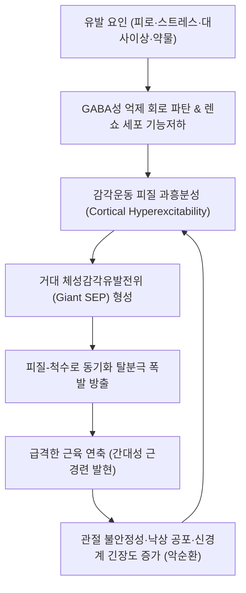

# 🩺 [[간대성 근경련]] (Myoclonus / 肌陣攣, ICD-10 G25.3)

> **핵심 3줄 요약 (Key Summary)**:
> - 📍 병소 부위 & 해부·병태생리: 대뇌 피질([[감각운동피질]]), 피질하 회로(시상·기저핵), 뇌간 망상체 및 [[척수]] 수준의 GABA성 억제 실패로 인한 급격하고 불수의적인 근육 수축(양성) 또는 이완(음성).
> - 🚩 전형적 임상 양상: 벼락치듯 갑작스럽고 짧은 사지·체간의 움찔거림, 의도적 동작이나 감각 자극에 의해 격발되는 불규칙적 연축, 보행 중 무릎 꺾임(Asterixis).
> - 🛠️ 핵심 검사 & 치료 전략: 뇌파-근전도 역방향 평균화(Jerk-locked back averaging) 및 원인 질환 스크리닝, [[레베티라세탐]]·[[클로나제팜]] 양방 표적 약물 요법 + 평간식풍(平肝熄風)·영양구등탕·전침 통합 관리.
> - ⚠️ 응급 의뢰 레드플래그: 급성 의식 혼탁 동반(대사성/중독성 뇌병증), 발열 및 경부 강직(중추신경계 감염), 급격한 인지 저하 및 실조 동반(프리온병/CJD).

---

## 📌 목차
1. [질환 개요 & 해부학적 병태생리](#1-질환-개요--해부학적-병태생리)
2. [병태생리 메커니즘 & 생체역학적 악순환 네트워크](#2-병태생리-메커니즘--생체역학적-악순환-네트워크)
3. [임상 증상 & 이학적 검사(Physical Exam) 알고리즘](#3-임상-증상--이학적-검사physical-exam-알고리즘)
4. [감별 진단 매트릭스 (Differential Diagnosis)](#4-감별-진단-매트릭스-differential-diagnosis)
5. [한의 통합 치료 프로토콜 (침·약침·추나·한약)](#5-한의-통합-치료-프로토콜-침약침추나한약)
6. [양방 치료 & 병용·의뢰 기준 (Conventional Treatment & Referral)](#6-양방-치료--병용의뢰-기준-conventional-treatment--referral)
7. [재활 운동 & 생활습관 티칭 가이드](#7-재활-운동--생활습관-티칭-가이드)
8. [💡 사용자 진료실 핵심 필기 & 임상 노하우 (Melt-In 잔여 심화 집약)](#8--사용자-진료실-핵심-필기--임상-노하우-melt-in-잔여-심화-집약)
9. [출처 및 학술 참고 문헌 (References)](#9-출처-및-학술-참고-문헌-references)

---

## 1. 질환 개요 & 해부학적 병태생리

### 1) 질환 정의 및 분류
- **정의**: 하나 이상의 근육 또는 근육군에서 발생하는 돌발적이고 충격과 같으며 매우 짧은(대개 10~100ms 미만) 비자발적 근육 수축([[양성 근경련]], Positive myoclonus) 또는 활동성 근긴장 상태의 급격한 소실([[음성 근경련]], Negative myoclonus / Asterixis)을 통칭하는 [[이상운동질환]]이다.
- **해부학적 기원별 분류 (Anatomical Classification)**:
  - **피질성 근경련 (Cortical myoclonus)**: 대뇌 피질 감각운동영역([[중심전회]])의 과흥분성에 기인하며, 사지 원위부(손, 손가락)와 안면에 호발한다. 의도적 동작(Action)이나 가벼운 체성감각 자극에 의해 격발되는 경우가 많다.
  - **피질하성 근경련 (Subcortical myoclonus)**: 시상(Thalamus), 기저핵([[선조체]]) 또는 뇌간 망상체에서 발생하며, 체간과 근위부 근육을 포함한 양측 대칭성 전신 연축으로 나타난다.
  - **뇌간성 근경련 (Brainstem / Reticular reflex myoclonus)**: 뇌간 하부 망상핵의 과민성으로 인해 청각·체성감각 놀람 자극에 의해 사지와 체간이 동시에 굴곡 수축한다.
  - **척수성 근경련 (Spinal myoclonus)**:
    - *분절성 척수 근경련(Segmental spinal myoclonus)*: 특정 척수 분절 지배 근육에 국한되어 리듬성 또는 불규칙적으로 발생하며, 수면 중에도 소실되지 않는 특징이 있다.
    - *고유척수성 근경련(Propriospinal myoclonus)*: 흉수 분절에서 시작되어 고유척수 신경로(Propriospinal tract)를 따라 상행 및 하행 전파되며 복부와 흉부의 굴곡 수축을 유발한다.
  - **말초성 근경련 (Peripheral myoclonus)**: 신경근, 신경총 또는 말초신경의 압박·외상 후 발생하는 국소 연축(예: 편측안면경련).

### 2) 관련 해부학적 구조물
- **대뇌 피질**: 브로드만 4영역([[일차운동피질]]) 및 1·2·3영역([[일차감각피질]]).
- **피질하-소뇌 루프**: 치상핵-적핵-시상-피질 경로(Dentato-rubro-thalamo-cortical circuit).
- **척수 반사항**: 척수 전각 알파 운동신경원 및 렌쇼 세포(Renshaw cell) 억제 회로.

---

## 2. 병태생리 메커니즘 & 생체역학적 악순환 네트워크

### 1) 억제성 회로의 파탄과 피질 과흥분성
- 중추신경계 내 억제성 신경전달물질인 [[GABA]](GABA-A 및 GABA-B 수용체) 매개 신경 억제 기전이 결손되면, 상위 운동신경원의 동기화된 폭발적 탈분극(Paroxysmal depolarization shift)이 유발된다.
- 이로 인해 [[글루타메이트]] 매개 흥분성 시냅스 전달이 우세해지며, 미세한 감각 입력에도 대뇌 피질 피라미드 세포가 과도하게 반응하여 원심성 하행 운동 자극을 방출한다.

### 2) 전기생리학적 전파 메커니즘
- **Jerk-Locked Back Averaging (JLBA)**: 피질성 근경련 환자의 표면 근전도(EMG) 파형 발생 직전(약 15~30ms 전)에 대뇌 피질 반대측 중심구 주변에서 선행하는 피질 극파(Cortical spike)가 관찰된다.
- **거대 체성감각유발전위 (Giant SEP)**: 정중신경 자극 시 P25-N35 파형의 진폭이 정상인의 수배에 달하는 거대 전위가 확인되며, 이는 감각 피질의 탈억제와 과흥분성을 직접 증명한다.

---

## 3. 임상 증상 & 이학적 검사(Physical Exam) 알고리즘

### 1) 주소증 및 임상 양상
- **자발성 연축**: 가만히 휴식 중이거나 수면 진입 시 사지 또는 체간이 벼락치듯 움찔함.
- **활동성 근경련 (Action myoclonus)**: 컵을 쥐려 하거나 글씨를 쓰려고 손을 뻗는 등 수의적 동작 시 연축이 격렬해져 일상 동작이 중단됨.
- **음성 근경련 (Negative myoclonus)**: 자세를 유지하는 근육의 긴장도가 순간적으로 0.2초간 탈락하여 들고 있던 물건을 떨어뜨리거나, 보행 중 무릎에 힘이 풀려 주저앉음.

### 2) 필수 이학적 검사법
1. **자세 유지 검사 (Postural maintenance test)**:
   - 양팔을 앞으로 뻗고 손목을 배굴시킨 상태를 30초간 유지하게 함.
   - 손목이 아래로 불규칙하게 툭툭 떨어지는 플래핑([[Asterixis]]) 관찰 $
ightarrow$ 대사성 뇌병증(간성, 요독성, 고이산화탄소혈증) 강력 시사.
2. **동작 유발 검사 (Action-induced test)**:
   - 코-손가락 검사(Finger-to-nose test) 시 목표물에 접근할 때 불규칙한 돌발 수축 발생 여부 관찰.
3. **감각 자극 민감도 검사 (Reflex myoclonus test)**:
   - 환자가 예상치 못한 순간에 박수를 치거나(청각), 손바닥을 가볍게 탭(촉각)하여 전신 연축 유발 여부 확인.
4. **심부건반사(DTR) 및 병적 반사**:
   - 피질척수로 침범 여부 감별을 위해 [[바빈스키 징후]](Babinski sign) 및 발목 간대(Ankle clonus) 확인.

---

## 4. 감별 진단 매트릭스 (Differential Diagnosis)

| 감별 질환 | 임상 양상 및 리듬성 | 유발 요인 및 뇌파(EEG) 소견 | 핵심 감별점 |
| :--- | :--- | :--- | :--- |
| **[[간대성 근경련]]** | 극히 짧고(10~100ms) 충격과 같은 비자발적 수축, 불규칙적 | 동작, 감각자극에 의해 격발, JLBA 상 선행 피질 극파 | 의식 소실 없음(단독형), 수의적 억제 불가 |
| **[[본태성 진전]]** | 4~12Hz의 리듬성, 규칙적인 진동(Tremor) | 자세 유지 및 의도적 동작 시 악화, 뇌파 정상 | 규칙적 진동 파형, 알코올 복용 시 일시 완화 |
| **[[파킨슨병]] 진전** | 4~6Hz의 안정 시(Resting) 환약말이 진전 | 안정 시 호발, 수의적 동작 시 일시 감소 | 서동증, 근강직, 자세 불안정성 동반 |
| **[[틱장애]]** | 반수의적, 정형화된 반복 동작 또는 음성 | 내적 전조 충동(Premonitory urge) 존재 | 짧은 시간 동안 스스로 의식적 억제 가능 |
| **[[뇌전증]] (자발성 발작)** | 전신 강직-간대 발작, 전신 경련 | 뇌파 상 율동적 다발성 극서파(Polyspike-and-wave) | 전형적인 의식 소실 및 발작 후 혼돈(Postictal state) |
| **생리적 수면놀람증** | 수면 도입기 전신 또는 사지 1~2회 단발성 연축 | 입면 시 생리적 탈억제 현상 | 정상 생리적 현상, 주간 증상 전무 |

---

## 5. 한의 통합 치료 프로토콜 (침·약침·추나·한약)

### 1) 한의학적 병전 및 변증 체계
- 한의학에서 간대성 근경련은 [[경병]](痙病), [[진전]](振顫), [[간증]](癎證), [[치종]](瘈瘲, 힘줄이 당기고 늘어지며 움찔거림)의 범주에 속한다.
- **간풍내동(肝風內動) / 간양상항(肝陽上亢)**: 정서적 스트레스 후 심화, 두통, 어지럼, 면홍목적, 설홍태황, 맥현삭.
- **담화요심(痰火擾心)**: 가슴 답답함, 불면, 다담, 놀람성 근경련, 설태황니, 맥활삭.
- **기혈양허(氣血兩虛) / 허풍내동(虛風內動)**: 만성 쇠약, 안면 창백, 사지 무력 동반 근육 연축, 설담태백, 맥세약.
- **간신음허(肝腎陰虛)**: 요슬산연, 구갈, 수족심열, 근육 경련, 설홍소태, 맥세삭.

### 2) 침구 치료 프로토콜
- **중추성 풍사 진정 및 대뇌 피질 흥분성 억제**:
  - [[백회]](GV20), [[사신총]](EX-HN1), [[풍지]](GB20) — 두부 혈류 개선 및 중추신경계 안정.
  - [[태충]](LR3), [[합곡]](LI4) — 개사관(開四關), 평간식풍 및 신경계 과흥분 제어.
- **안신녕심(安神寧心) 및 자율신경 조절**:
  - [[신문]](HT7), [[내관]](PC6) — 세로토닌-GABA계 활성화 및 놀람 반응 완화.
- **척수 분절 및 환부 근육 조절**:
  - 경추 및 흉요추 [[협척혈]](EX-B2) 전침 치료(2Hz 저주파, 20분 유침) — 척수 후각 신경세포의 과도한 흥분 전달 차단.
  - 환부 사지 아시혈(경련 호발 근육건 이행부) 완만 자침.

### 3) 한약 처방 프로토콜
- **천마구등음(天麻鉤藤飲) / 영양구등탕(羚羊鉤藤湯)**: 간양상항 및 간풍내동형 근경련의 대표 처방. 조구등의 Rhynchophylline 및 천마의 Gastrodin 성분이 중추성 GABA성 억제를 강화하고 글루타메이트 독성을 방어.
- **억간산(抑肝散) 가 진주모**: 신경 전달 과흥분을 억제하고 이상운동 질환에서 근육 긴장 완화에 탁월한 효과 입증.
- **반하백출천마탕(半夏白朮天麻湯) / 온담탕(溫膽湯)**: 담화요심형에 적용하여 두중, 현훈과 동반된 근경련 개선.
- **대정풍주(大定風珠) / 작약감초탕(芍藥甘草湯)**: 음혈 결손으로 힘줄이 영양받지 못해 발생하는 허풍내동형 연축의 진경(鎭痙) 및 유간완급(柔肝緩急).

---

## 6. 양방 치료 & 병용·의뢰 기준 (Conventional Treatment & Referral)

### 1) 해부학적 기원별 약물 치료
- **피질성 근경련 (Cortical myoclonus)**:
  - 1차 선택: [[레베티라세탐]](Levetiracetam, SV2A 결합을 통한 신경전달물질 방출 조절), [[피라세탐]](Piracetam 고용량).
  - 2차 병용: [[발프로산]](Valproic acid, GABA 합성 촉진 및 Na+ 통로 억제), [[클로나제팜]](Clonazepam).
- **피질하·척수성 근경련**:
  - 1차 선택: [[클로나제팜]](Clonazepam, GABA-A 수용체 효능).
  - 보조제: 바클로펜(Baclofen, GABA-B 효능제).
- **⚠️ 약물 주의사항**: 페니토인(Phenytoin) 등 전압개폐성 Na+ 통로 차단제는 피질성 근경련을 오히려 심각하게 악화시킬 수 있으므로 뇌전증 감별 없이 무분별 투여를 금한다.

### 2) 응급 의뢰 및 정밀 검사 의뢰 기준 (Red Flags)
1. **대사성 응급**: 급격한 지남력 저하, 수면과다, 황달, 핍뇨와 함께 양손의 Asterixis가 발생한 경우 $
ightarrow$ 간성 혼수, 요독증 응급 전원.
2. **감염성 질환**: 38도 이상의 고열, 극심한 두통, 경부 강직 동반 $
ightarrow$ 급성 뇌염/뇌수막염 배제 척수액 검사 필요.
3. **급성 저산소성 뇌손상 (Lance-Adams Syndrome)**: 심폐소생술(CPR)이나 질식 사고 후 의식을 회복한 환자에서 격렬한 전신 활동성 근경련 지속 시 집중치료실 신경과 협진.
4. **프리온 질환 (Creutzfeldt-Jakob Disease, CJD)**: 수주~수개월 내에 진행하는 아급성 치매, 소뇌 실조증과 함께 놀람 유발 근경련(Startle myoclonus)이 나타날 경우 즉시 3차 상급병원 신경과 격리 의뢰.

---

## 7. 재활 운동 & 생활습관 티칭 가이드

### 1) 생활습관 및 악화 인자 차단
- **수면 박탈 엄격 금지**: 수면 부족은 대뇌 피질의 경련 역치(Seizure threshold)를 낮추어 근경련 빈도를 폭발적으로 증가시키므로 매일 7시간 이상의 규칙적 수면 필수.
- **카페인 및 중추자극제 차단**: 고카페인 에너지 음료, 커피, 슈도에페드린 복합 감기약 등은 교감신경을 과흥분시켜 연축을 조장하므로 섭취 제한.
- **감각 자극 차단**: 빛 점멸(Strobe light), 갑작스러운 고음 환경 등 특정 유발 감각에 민감한 환자는 블루라이트 차단 안경 및 귀마개 활용.

### 2) 낙상 예방 및 기능적 재활
- **음성 근경련 낙상 대책**: 보행 중 무릎 꺾임이 있는 환자는 실내 문턱 제거, 욕실 미끄럼 방지 타일 시공, 외출 시 4발 지팡이 사용 지도.
- **관절가동범위(ROM) 유지 운동**: 반복적 연축으로 인한 관절 구축을 막기 위해 족관절 배굴근 및 햄스트링의 부드러운 정적 스트레칭 권장.

---

## 8. 💡 사용자 진료실 핵심 필기 & 임상 노하우 (Melt-In 잔여 심화 집약)

- **진료실 첫인상 감별 공식**: "환자가 '손이 떨려요' 또는 '몸이 튀어요'라고 내원했을 때, 의사는 손의 궤적을 3초간 응시해야 한다. 리듬이 일정하게 오르내리면 진전([[본태성 진전]] 또는 [[파킨슨병]])이고, 불규칙하게 순간적으로 번개가 치듯 튀어 오르면 간대성 근경련이다."
- **수면 도입기 놀람(Hypnic jerk) 감심(Reassurance)**: "건강한 사람도 깊은 잠에 빠져들 때 뇌간의 억제 신호가 순간 불균형을 이루며 발이나 온몸을 크게 움찔거릴 수 있습니다. 낮 시간 동안 일상생활에 지장이 없고 의식이 명료하다면 정상적인 생리적 현상이므로 전혀 두려워하실 필요가 없습니다."
- **약인성 근경련(Drug-induced myoclonus) 복약 수첩 전수조사**:
  - 최근 처방받은 약물 중 [[항우울제]](SSRI, SNRI, 삼환계 항우울제 $
ightarrow$ 세로토닌 증후군 초기 징후 감별).
  - 트라마돌(Tramadol), 항정신병제, 리튬(Lithium), 레보도파(Levodopa) 증량 여부 확인. 약물 중단 시 대다수 호전된다.

---

## 9. 출처 및 학술 참고 문헌 (References)

- Suratos CT, et al. (2026). Diagnostic approach and treatment options for myoclonus. *J Neural Transm*. PMID: 42862330.
  - [연구 요약] 간대성 근경련의 해부학적 기원(피질, 피질하, 뇌간, 척수)에 따른 전기생리학적 진단 알고리즘 및 표적 약물 요법 최신 종설.
- Pena AB, et al. (2020). Physiology-Based Treatment of Myoclonus. *Neurotherapeutics*. 17(4):1665-1680. PMID: 32910414.
  - [연구 요약] 피질성과 피질하성 근경련의 병태생리 차이에 기반하여 레베티라세탐, 클로나제팜, 발프로산의 적응증을 체계화한 약물 치료 지침.
- van der Veen S, et al. (2019). Nomenclature of Genetically Determined Myoclonus Syndromes: Recommendations of the International Parkinson and Movement Disorder Society Task Force. *Mov Disord*. 34(11):1604-1613. PMID: 31584223.
  - [연구 요약] 유전성 및 퇴행성 간대성 근경련 증후군의 국제 이상운동질환학회(MDS) 명명법 및 표현형 분류 기준 권고안.
