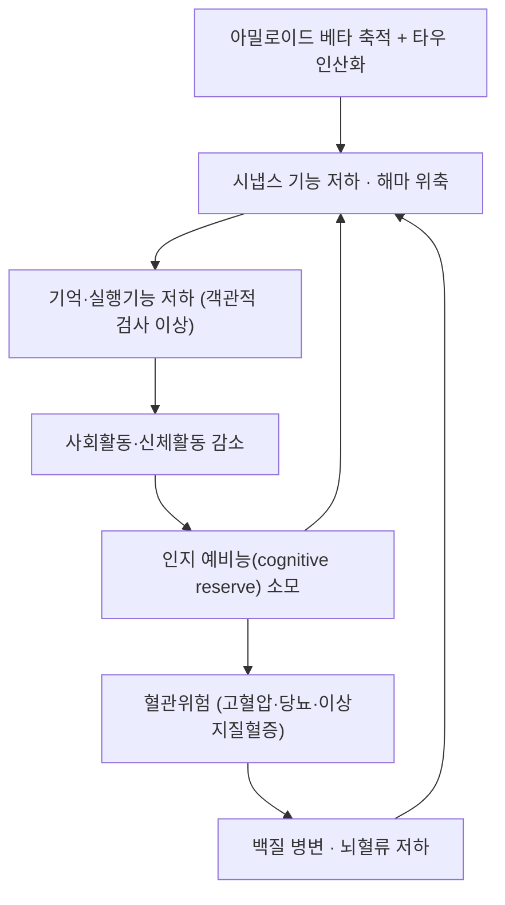

# 🩺 경도인지장애 (Mild Cognitive Impairment, MCI / 輕度認知障礙, ICD-10 F06.7)

> **핵심 3줄 요약 (Key Summary)**:
> - 📍 병소 부위 & 병태생리: [[해마]]와 [[내후각피질]]을 시작으로 [[아밀로이드 베타]] 축적·[[타우]] 병리가 진행하고 [[신경염증]]이 동반되어 시냅스 기능이 떨어지지만, **일상생활 수행능력(ADL)은 아직 유지**되는 단계다.
> - 🚩 전형적 임상 양상 & 3대 징후: 본인이 인지 저하를 호소하고 **객관적 검사에서 확인**되며(대개 [[MoCA]] 26점 미만), **일상생활은 독립적**이고 **치매 기준은 충족하지 않는다**. 기억형(amnestic)은 최근 기억부터, 비기억형은 실행·언어·시공간부터 떨어진다.
> - 🛠️ 핵심 감별 & 한·양방 치료 전략: 가역 원인(우울·갑상선·비타민 B12·수면무호흡·약물·정상압수두증)을 먼저 배제하고, **유산소+저항운동·혈관위험 관리·인지훈련·사회참여의 4축**을 축으로 삼는다. [[도네페질]] 등 아세틸콜린에스테라제 억제제는 MCI 적응증이 아니다.
> - ⚠️ 응급 의뢰 레드플래그: 수주~수개월 내 급격한 악화, 국소 신경학적 결손(편마비·실어·시야결손), 두부외상 후 발생, 발열·경부강직 동반, 요실금+보행장애+인지저하 3징후(정상압수두증)는 즉시 영상·전문과 의뢰.

---

## 📌 목차
1. [질환 개요 & 병태생리](#1-질환-개요--병태생리)
2. [병태생리 메커니즘 & 악순환 네트워크](#2-병태생리-메커니즘--악순환-네트워크)
3. [임상 증상 & 환자 소견](#3-임상-증상--환자-소견)
4. [감별 진단 매트릭스](#4-감별-진단-매트릭스)
5. [한의 통합 치료 프로토콜](#5-한의-통합-치료-프로토콜)
6. [양방 치료 & 병용·의뢰 기준](#6-양방-치료--병용의뢰-기준)
7. [식이·생활습관 & 자가관리 티칭](#7-식이생활습관--자가관리-티칭)
8. [💡 진료실 핵심 필기 & 임상 노하우](#8--진료실-핵심-필기--임상-노하우)
9. [출처 및 학술 참고 문헌](#9-출처-및-학술-참고-문헌)

---

## 1. 질환 개요 & 병태생리

![[경도인지장애_01_정상vs알츠하이머_뇌위축_도해.jpg|560]]
> [그림 1: 정상 뇌(좌)와 알츠하이머 뇌(우)의 관상단면 비교 — 대뇌피질·[[해마]]·[[내후각피질]] 위축과 뇌실 확대. MCI는 이 위축이 '임상적 치매 역치'에 이르기 전 단계로 이해한다 — 출처: Wikimedia Commons, Public domain]

- **정의**: 인지 기능(주로 기억)의 저하가 **주관적 호소 + 객관적 검사**로 확인되지만, 일상생활 기능은 유지되어 [[치매]] 기준을 충족하지 않는 상태. DSM-5에서는 **경도신경인지장애(mild neurocognitive disorder)** 로 부른다.
- **역치의 문제**: MCI는 질환이라기보다 **경계 상태(borderline state)** 다. 신경심리검사 규준에 따라 같은 사람이 '정상'과 'MCI'를 오가므로, 한 번의 검사 결과로 낙인을 찍지 않는다.
- **분류**:
  - 기억형(amnestic) 단일영역 / 기억형 다영역 / 비기억형 단일영역 / 비기억형 다영역.
  - 기억형 다영역이 [[알츠하이머병]]으로 전환될 위험이 가장 높다.
- **경과**: 지역사회 코호트에서 MCI의 연간 치매 전환율은 대략 5~10%로 보고되며, 정의에 따라 차이가 크다(Petersen, Arch Neurol 2009).
- **관련 구조물**:
  - 주 이환 부위: [[해마]] · [[내후각피질]](entorhinal cortex) — 알츠하이머 병리가 가장 먼저 시작되는 곳.
  - 연관 조절계: 콜린성 기저전뇌(마이네르트 기저핵) · [[신경염증]] 매개 미세아교세포.
  - 합병증 표적: [[노인의 낙상]](이중과제 수행 저하) · [[우울증]] · [[허약]].

---

## 2. 병태생리 메커니즘 & 악순환 네트워크

![[경도인지장애_02_해마아필드_해부도해.jpg|520]]
> [그림 2: 해마 단면과 아필드(CA1~CA4·치아이랑·지지대·해마곁이랑) 구조 — MCI·알츠하이머에서 CA1과 내후각피질이 먼저 손상된다. 우하단은 관상 MRI에서 해마 위치 — 출처: Wikimedia Commons, CC BY-SA 3.0 (Fg)]

### 1) 분자·세포 수준 기전
- 아밀로이드 전구단백질(APP) 절단 → [[아밀로이드 베타]] 응집 → 시냅스 독성.
- [[타우]] 과인산화 → 미세소관 안정성 상실 → 축삭 수송 장애.
- 미세아교세포 활성화와 [[신경염증]]이 만성화되면 시냅스 제거(pruning)가 항진된다.

### 2) 장기·계통 수준 결과
- 내측측두엽(해마·내후각피질) → 두정엽 → 전두엽 순으로 위축이 확장된다.
- 콜린성 입력 감소로 주의·기억 부호화가 먼저 흔들린다.
- **혈관성 병리와 알츠하이머 병리는 노년 뇌에서 흔히 공존**한다. 그래서 혈압·혈당 관리가 인지 축에도 직접 걸린다.

### 3) 위험인자와 진행 단계
- 위험인자: 고령, APOE ε4, [[제2형 당뇨병]], [[고혈압]], [[이상지질혈증]], 청력 손실, [[우울증]], 사회적 고립, 수면장애.
- 단계: 주관적 인지저하(SCD) → MCI → 경도 치매 → 중등도 치매.

---

## 3. 임상 증상 & 환자 소견

![[경도인지장애_03_PETMRI_해마아필드_대사.png|560]]
> [그림 3: 해마 아필드 분할 MRI(A) 위에 FDG-PET 대사(SUV)를 겹친 영상(B·C) — 해마 아필드별 포도당 대사 차이를 보여준다. 임상에서는 구조 MRI의 해마 위축과 함께 판독한다 — 출처: Open-i / PMC7374580, CC BY 4.0 (PMID 32694602)]

### 1) 주소증 및 핵심 증상
- **전형**: 최근 대화·약속을 잊음(단서를 주면 떠오르는 것이 정상 노화, 안 떠오르면 MCI 쪽), 같은 질문 반복, 물건 둔 곳 혼동.
- **비전형**: 기억은 멀쩡한데 **실행기능·언어(단어 찾기)·시공간(길 찾기)** 이 먼저 떨어지는 비기억형.
- **악화·완화 인자**: 수면 부족·감염·새 약물·우울감에 따라 하루 안에서도 변동. 변동이 크면 섬망·우울·약물을 먼저 본다.

### 2) 객관적 소견 (Signs & Labs)
- **선별검사**: [[MoCA]](26점 미만 시 이상, 교육연수 보정) · MMSE(21~30 구간) · CDR 0.5.
- **신경심리검사**: 언어·시공간·실행기능을 분리해 본다 — [[Trail Making Test]] B, 단어 유창성, Rey 복합도형.
- **필수 배제 검사**: CBC, TSH, 비타민 B12·엽산, 전해질·칼슘, 신기능, HbA1c, 우울척도(GDS-K), 약물 목록.
- **영상**: 구조 MRI(해마 위축·백질병변·경막하혈종·수두증 배제). FDG-PET·아밀로이드 PET은 연구·선별적 임상에서.

### 3) 병기·중증도 판정
- CDR 0.5 = MCI, CDR 1 이상 = 치매. **ADL 척도(일상생활 수행)가 정상이면 MCI, 저하되면 치매**로 넘어간다.

---

## 4. 감별 진단 매트릭스

| 감별 질환 | 특징적 양상 | 감별 포인트 |
| :--- | :--- | :--- |
| [[경도인지장애]] (본 질환) | 호소 + 객관적 저하, ADL 유지 | [[MoCA]] 26점 미만·CDR 0.5 |
| [[우울증]] (가성치매) | 무쾌감·수면·식욕 변화가 앞섬 | GDS-K, 항우울 치료 후 인지 회복 |
| [[알츠하이머병]] | ADL 저하·진행성 | CDR 1 이상, 일상생활 의존 |
| [[혈관성 치매]] | 계단식 악화·국소 신경학적 징후 | MRI 백질병변·다발성 경색 |
| 갑상선기능저하증 | 서한·부종·체중증가 | TSH 상승, 치료 후 호전 |
| 비타민 B12 결핍 | 감각이상·빈혈·보행장애 동반 | B12 측정, 대치 후 호전 |
| [[수면무호흡증]] | 코골이·주간졸림·아침두통 | 수면다원검사 |
| 정상압수두증 | 보행장애 + 요실금 + 인지저하 | 뇌 MRI 뇌실확대, 요추천자 후 보행 호전 |
| 만성 경막하혈종 | 두부외상력(경미해도)·두통 | 뇌 CT |

> 🚩 **레드플래그 감별**: 급격한 악화·발열·국소결손은 **감염·뇌졸중·종양**을 먼저 배제한다. '치매 진행'으로 단정하지 않는다.

---

## 5. 한의 통합 치료 프로토콜

- **변증 분류**:
  - 腎精不足(신정부족): 건망·요슬산연·이명·맥 침세 — 노화 축.
  - 痰濁阻竅(담탁조규): 두중·어둔·설태 후니 — 대사·혈관 축.
  - 瘀血阻絡(어혈조락): 두통 고정·설질 자암 — 혈관 축.
  - 心脾兩虛(심비양허): 건망·불면·식소·권태.
- **침구 치료**: 백회(GV20)·사신총(EX-HN1)·신정(GV24)·본신(GB13)·사신총 배혈에 변증 가감(신수 BL23·태계 KI3·풍지 GB20). 유침 20~30분, 주 2~3회. **혈위는 개별 변증에 따라 정하고, 표준화된 단일 프로토콜은 확립되어 있지 않다.**
- **약침**: 신수(BL23)·대추(GV14) 주변 소량 자극. 항응고제 복용자에서는 출혈 확인.
- **한약**: 변증별로 天王補心丹·歸脾湯·地黄丸類를 검토하되, **복용 중인 양방약(특히 항응고·항혈소판·혈당강하)과의 상호작용을 먼저 확인**한다.
- **뜸·부항**: 신수·관원(CV4) 온구. 노인은 화상 위험 때문에 온구기 사용.
- **근거 수준**: 인지기능을 1차 평가변수로 한 한약·침 RCT는 규모가 작고 이질성이 커서, 현재 근거로 "치매 예방"을 약속할 수 없다. 이 점을 환자에게 먼저 말한다.

---

## 6. 양방 치료 & 병용·의뢰 기준

- **약물**:
  - [[도네페질]]·갈란타민·리바스티그민(아세틸콜린에스테라제 억제제)은 **치매(알츠하이머) 적응증**이다. **MCI에는 적응증이 아니며**, 장기 추적에서 치매 전환 지연이 입증되지 않았다.
  - 메만틴은 중등도~중증 알츠하이머 영역.
  - 혈관위험 관리(혈압·혈당·지질)는 인지 축의 근거 있는 개입이다.
- **비약물**: 유산소·저항운동, 인지훈련, 사회참여, 청력 보조기, 수면·우울 치료.
- **한의 병용 판단**:
  - 병용 가능: 운동·인지훈련·변증 한약(상호작용 확인 후).
  - 주의: 항응고·항혈소판 복용자에서 약침·부항·매선. 혈당강하제 복용자에서 식욕·이뇨 작용 처방.
  - 금기: 원인 미상의 급격한 인지저하를 한약으로 덮는 것.
- **의뢰 기준**: 진단 자체가 불확실하거나, 40~50대 발병, 가족력이 강한 젊은 발병, 급격한 진행, 국소 신경학적 결손 → 신경과.

---

## 7. 식이·생활습관 & 자가관리 티칭

- **식이**: 지중해식·MIND 식이 패턴(채소·베리·견과·생선·올리브유 중심, 가공육·정제당 감소). [[단백질]]은 1.0~1.2 g/kg/일로 근육 축도 함께 지킨다.
- **운동**: 주 150분 중등도 [[유산소운동]] + 주 2회 [[저항운동]] + [[이중과제 훈련]](숫자 거꾸로 세며 걷기).
- **혈관위험**: 혈압·HbA1c·LDL 목표를 환자 눈높이로 합의. 노인은 저혈당이 인지에 더 나쁘다.
- **수면·청력·사회**: 주 3회 이상 외출, 대면 대화, 취미 모임. 청력 손실은 보조기 적응.
- **자가관리**: 약속·약 복용은 눈에 보이는 달력·알람으로 외부화한다(기억 훈련보다 환경 설계가 먼저다).
- **환자 교육 스크립트**: "지금은 치매가 아니라 '경계' 단계입니다. 여기서 혈압·혈당·운동·외출을 함께 잡으면 넘어가는 속도를 늦출 수 있습니다. 대신 갑자기 나빠지면 반드시 다시 오세요."

---

## 8. 💡 진료실 핵심 필기 & 임상 노하우

- **첫 방문 3분 문진 순서**: ① 언제부터·얼마나 빨리 ② 약속·약·금전 관리 실수(ADL) ③ 우울·수면·약물 변경 ④ 낙상력 ⑤ 보호자 관점(환자는 저평가, 보호자는 과대평가하는 경향).
- **'단서 반응'으로 정상노화와 감별**: "이름이 생각 안 나면 힌트를 드릴게요" — 힌트로 회복되면 정상 노화 쪽, 회복 안 되면 병적.
- **ADL 질문은 구체 행동으로**: "약 봉투를 스스로 챙기십니까? 지난달 관리비를 본인이 냈습니까?"
- **한의원에서 가장 흔한 함정**: 갑상선·B12·우울·수면무호흡을 확인하지 않고 '신정부족'으로만 접근하는 것. **배제 검사 없이 변증만 세우지 않는다.**
- **보호자 상담 원칙**: 검사 수치를 예후로 단정하지 않는다. "지금 점수는 나빠지는 속도를 보는 기준"으로 설명한다.

---

## 9. 출처 및 학술 참고 문헌

1. Petersen RC. Mild cognitive impairment: ten years later. **Arch Neurol** 2009;66(12):1447-55. [PMID 20008648](https://pubmed.ncbi.nlm.nih.gov/20008648/)
   - [연구 요약]: MCI 개념·진단 기준의 10년 경과를 정리한 리뷰. 정의에 따라 유병률·전환율이 크게 달라진다는 점을 명시했다.
2. Nasreddine ZS, et al. The Montreal Cognitive Assessment, MoCA: a brief screening tool for mild cognitive impairment. **J Am Geriatr Soc** 2005;53(4):695-9. [PMID 15817019](https://pubmed.ncbi.nlm.nih.gov/15817019/)
   - [연구 요약]: MCI 선별을 목적으로 개발된 30점 척도. 26점을 절단점으로 제시했고 교육연수 보정 규칙을 함께 보고했다.
3. Sugimoto T, Omura T, Araki A, et al. Long-term effects of a multidomain intervention on cognitive function and metabolic control in older adults with type 2 diabetes and mild cognitive impairment (J-MIND-Diabetes 42개월 추적). **Diabetes Obes Metab** 2026;28(3):2350-61. [PMID 41508766](https://pubmed.ncbi.nlm.nih.gov/41508766/)
   - [연구 요약]: 18개월 다영역 중재 후 42개월 시점에서 복합 인지 Z-score 차이는 유의하지 않았으나, Trail Making Test A·B와 CGM %TIR은 중재군이 유의하게 양호했다(소표본 탐색적).
4. 질병관리청 국가건강정보포털 — 경도 인지장애 (콘텐츠 ID 5376) [링크](https://health.kdca.go.kr)
   - [연구 요약]: 국민용 한국어 설명자료. 정의·원인·증상·진단·자가관리 항목을 환자 교육에 그대로 쓸 수 있다(공공저작물 출처표시).
