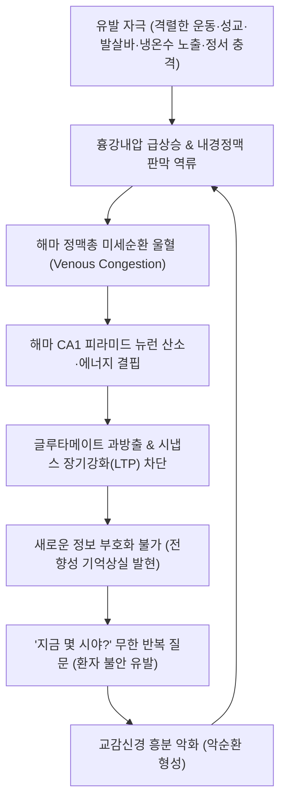

# 🩺 [[기억상실]] (Amnesia / 記憶喪失, ICD-10 R41.3, G45.4)

> **핵심 3줄 요약 (Key Summary)**:
> - 📍 병소 부위 & 해부·병태생리: 양측 내측 측두엽([[해마]], 특히 CA1 영역), 파페츠 회로([[변연계]])의 정맥 울혈·대사성 스트레스로 인한 급성 부호화 장애 및 회상 장애.
> - 🚩 전형적 임상 양상: 수 시간 전~최근 사건을 전혀 기억하지 못하고 "여기가 어디야?", "지금 몇 시야?"를 앵무새처럼 반복 질문하나, 자아 정체성과 일상 지능은 완벽히 보존됨.
> - 🛠️ 핵심 검사 & 치료 전략: 확산강조 MRI(DWI, 24~48시간 후 해마 점상 고신호), 뇌파 검사로 뇌전증성 기억상실(TEA) 감별 + 귀비탕·총명탕 및 백회·사신총 침구 치료로 뇌신경 대사 회복.
> - ⚠️ 응급 의뢰 레드플래그: 편측 사지 마비·구음장애 동반(뇌경색/후대뇌동맥 허혈), 24시간 초과 지속, 안구운동마비 동반(베르니케 뇌병증), 자아 정체성 소실(해리성/심인성 장애).

---

## 📌 목차
1. [질환 개요 & 해부학적 병태생리](#1-질환-개요--해부학적-병태생리)
2. [병태생리 메커니즘 & 생체역학적 악순환 네트워크](#2-병태생리-메커니즘--생체역학적-악순환-네트워크)
3. [임상 증상 & 이학적 검사(Physical Exam) 알고리즘](#3-임상-증상--이학적-검사physical-exam-알고리즘)
4. [감별 진단 매트릭스 (Differential Diagnosis)](#4-감별-진단-매트릭스-differential-diagnosis)
5. [한의 통합 치료 프로토콜 (침·약침·추나·한약)](#5-한의-통합-치료-프로토콜-침약침추나한약)
6. [양방 치료 & 병용·의뢰 기준 (Conventional Treatment & Referral)](#6-양방-치료--병용의뢰-기준-conventional-treatment--referral)
7. [재활 운동 & 생활습관 티칭 가이드](#7-재활-운동--생활습관-티칭-가이드)
8. [💡 사용자 진료실 핵심 필기 & 임상 노하우 (Melt-In 잔여 심화 집약)](#8--사용자-진료실-핵심-필기--임상-노하우-melt-in-잔여-심화-집약)
9. [출처 및 학술 참고 문헌 (References)](#9-출처-및-학술-참고-문헌-references)

---

## 1. 질환 개요 & 해부학적 병태생리

### 1) 질환 정의 및 분류
- **정의**: 의식의 혼탁이나 전반적 지능 저하 없이, 뇌의 특정 손상·대사 장애·심리적 충격으로 인해 새로운 사실을 학습·저장하지 못하거나([[전향성 기억상실]], Anterograde amnesia) 발생 이전의 과거 기억을 회상하지 못하는([[후향성 기억상실]], Retrograde amnesia) 신경학적 상태를 말한다.
- **임상적 대표 모델 — 일과성 전체기억상실증 (Transient Global Amnesia, TGA)**:
  - 50~70대 중장년층에서 갑작스럽게 심한 전향성 기억상실이 발생하여 보통 4~12시간(최대 24시간) 지속된 후 완전히 정상으로 회복되는 양성 신경학적 증후군이다.
- **기억의 시간 축 및 신경 해부 분류**:
  - **작업 기억 (Working memory)**: [[전두엽]] 배외측 피질 지배 (수초~수분 유지, 대화 지속 가능).
  - **서술 기억 (Declarative memory / 일화 기억 & 의미 기억)**: [[해마]] 및 내측 측두엽 지배 $
ightarrow$ 기억상실증의 핵심 표적.
  - **절차 기억 (Procedural memory / 비서술 기억)**: 기저핵, [[소뇌]] 지배 (자전거 타기, 악기 연주, 운전 등은 기억상실증에서도 완벽히 보존됨).

### 2) 관련 해부학적 구조물
- **해마체 (Hippocampal formation)**: 치상회(Dentate gyrus), 해마 고유층(CA1, CA2, CA3, CA4), 지각원(Subiculum).
  - 특히 **CA1 영역(Sommer's sector)**은 대사 요구량이 극히 높고 허혈 및 산화 스트레스에 가장 취약하다.
- **파페츠 회로 (Papez circuit)**: 해마 $
ightarrow$ 뇌궁(Fornix) $
ightarrow$ 유두체(Mammillary body) $
ightarrow$ 시상 전핵 $
ightarrow$ 대구회(Cingulate gyrus) $
ightarrow$ 해마방회로 이어지는 단기-장기 기억 공고화 경로.

---

## 2. 병태생리 메커니즘 & 생체역학적 악순환 네트워크

### 1) 해마 CA1 영역의 에너지 위기와 피질확산억제(CSD)
- 급격한 정서적 스트레스, 과도한 발살바 수기(Valsalva maneuver), 급격한 냉온수 침수 등으로 인해 자율신경계 교감 신경 폭풍이 발생한다.
- 이로 인해 해마 내 억제성 개재뉴런의 과부하가 초래되고, [[글루타메이트]] 대량 방출로 인한 국소 탈분극 파동이 유발된다.
- 이는 편두통의 기전인 [[피질확산억제]](Cortical Spreading Depression, CSD)와 유사한 세포성 에너지 고갈을 초래하여 단기 기억을 장기 기억으로 전환하는 시냅스 장기강화(LTP) 기전을 일시 정지시킨다.

### 2) 정맥 울혈 가설 (Venous Congestion Hypothesis)
- TGA 환자의 70% 이상에서 내경정맥(Internal jugular vein) 판막의 기능 부전이 관찰된다.
- 격렬한 기침, 배변, 성교, 무거운 물건 들기 등으로 인해 흉강 내압이 급상승하면 정맥혈이 두개강 내로 역류한다.
- 이 역류압이 기저 정맥(Basal vein of Rosenthal) 및 해마 정맥총에 전달되어 양측 해마 CA1 부위의 미세혈류 정체와 일시적 세포독성 부종(Cytotoxic edema)을 일으킨다.

---

## 3. 임상 증상 & 이학적 검사(Physical Exam) 알고리즘

### 1) 주소증 및 임상 양상
- **전향성 기억상실**: 방금 전 일어난 일, 자신이 병원에 온 이유, 식사 여부를 전혀 기억하지 못함.
- **반복적 보속성 질문 (Perseverative questioning)**: 1~2분 간격으로 "여기가 어디지?", "오늘 며칠이야?", "내가 왜 여기 있어?"라는 동일한 질문을 똑같은 억양으로 반복함.
- **역행성 기억상실의 동반**: 사건 발생 수 시간~수일 전의 기억이 일시적으로 사라지며, 호전되면서 점차 과거 기억부터 회복됨.
- **보존되는 핵심 기능**:
  - 자아 정체성(자신의 이름, 나이, 직업, 가족 구성원)은 완벽히 인지함.
  - 언어 구사 능력, 복잡한 산수 계산, 공간 지남력은 정상을 유지함.

### 2) 필수 이학적 검사법
1. **Hodges & Warlow 임상 진단 기준 점검**:
   - 목격자에 의해 확인된 명백한 전향성 기억상실 여부.
   - 의식 저하, 혼미, 자아 정체성 소실이 없는지 확인.
   - 사지 마비, 감각 저하, 실조증 등 국소 신경학적 결손이 전혀 없음을 확인.
   - 뇌전증의 특징적 증상(자동증, 근경련)이 없음을 확인.
   - 증상이 24시간 이내에 완전히 소실되는지 추적.
2. **간이 정신상태 검사 ([[MMSE]] / [[MoCA]])**:
   - 시간 지남력(년/월/일) 및 단기 회상(3단어 기억 등록 후 5분 뒤 회상) 항목에서 현저한 점수 저하 확인.
3. **뇌신경 검사 (Cranial Nerve Exam)**:
   - 후대뇌동맥 허혈 감별을 위한 시야 검사(대면 검사), 외안근 운동 및 안진 검사.

---

## 4. 감별 진단 매트릭스 (Differential Diagnosis)

| 감별 질환 | 발작 지속 시간 | 특징적 임상 양상 및 동반 증상 | 핵심 감별점 |
| :--- | :--- | :--- | :--- |
| **[[기억상실]] (TGA)** | 4~24시간 (단발성) | 전향성 기억상실, 앵무새 질문, 자아 정체성 보존 | 국소 신경결손 전무, 24시간 내 완전 회복 |
| **[[일과성 뇌전증성 기억상실]] (TEA)** | 수 분~1시간 (빈번한 재발) | 아침 기상 시 호발, 자가면역 뇌전증 연관 | 발작 시간 짧음, 항뇌전증제에 즉각 반응 |
| **후대뇌동맥([[PCA]]) 뇌경색** | 영구적 또는 수주 이상 | 동측성 반맹(Hemianopia), 편측 감각저하 | MRI 상 영구적 뇌경색 병변, 혈관 폐색 |
| **베르니케-코르사코프 증후군** | 만성 진행성 | 영양결핍/알코올, 안구운동마비, 보행실조, 작화증 | [[티아민]] 결핍 병력, 가역성 저하, 작화증 현저 |
| **심인성/해리성 기억상실** | 가변적 (수일~수개월) | 심한 정신적 외상 후 발생, 자신의 이름/신원 망각 | 자아 정체성 상실(TGA는 본인 이름 절대 안 잊음) |
| **초기 [[치매]] (알츠하이머병)** | 수개월~수년에 걸쳐 진행 | 점진적 건망증, 기물 분실, 성격 변화, 언어 저하 | 비가역적 만성 진행, 일상생활 수행능력(ADL) 저하 |

---

## 5. 한의 통합 치료 프로토콜 (침·약침·추나·한약)

### 1) 한의학적 병전 및 변증 체계
- 한의학에서 기억상실은 [[건망]](健忘), [[치매]](癡呆), [[전광]](癲狂), [[건망증]](健忘證)의 범주에 속하며, 뇌수(腦髓)와 심비(心脾), 신정(腎精)의 손상으로 파악한다.
- **심비양허(心脾兩虛)**: 사려과다로 인한 심혈 부족 및 비기 허약, 건망, 불면, 건망, 피로, 맥세약.
- **담몽심규(痰懞心竅)**: 담탁이 심규를 가로막아 발생, 두중, 현훈, 흉민, 반응 둔마, 설태백니, 맥활.
- **간신음허(肝腎陰虛)**: 노화 및 과로로 신정 부족, 두운, 이명, 요슬산연, 설홍소태, 맥세삭.
- **기체혈어(氣滯血瘀)**: 뇌락에 어혈이 맺혀 뇌혈류 장애 유발, 두통, 설자암, 맥삽.

### 2) 침구 치료 프로토콜
- **두부 기혈 순환 촉진 및 해마 대사 활성화**:
  - [[백회]](GV20), [[사신총]](EX-HN1), [[상성]](GV23) — 독맥을 통경하여 뇌수(腦髓) 영양 촉진.
  - [[풍지]](GB20), [[천주]](BL10) — 척추기저동맥 및 후대뇌동맥 순환 개선, 경부 정맥 환류 촉진.
- **안신녕심 및 급성 불안 완화**:
  - [[신문]](HT7), [[내관]](PC6) — 급격한 기억 소실로 인한 환자의 공포와 자율신경 과흥분 진정.
- **비신 보익(健脾補腎)**:
  - [[족삼리]](ST36), [[삼음교]](SP6), [[태계]](KI3) — 기혈 생성 촉진 및 신정 보충.

### 3) 한약 처방 프로토콜
- **귀비탕(歸脾湯)**: 심비양허형 기억상실의 명방. 원지, 석창포, 용안육, 당귀, 백출 등이 해마 신경세포의 산화 스트레스를 억제하고 신경전달물질 아세틸콜린 분비를 촉진.
- **총명탕(聰明湯) / 총명원**: 백복신, 원지, 석창포 3미로 구성되어 뇌신경 세포의 시냅스 가소성 회복 및 뇌혈류 개선에 탁월한 효과 입증.
- **반하백출천마탕(半夏白朮天麻湯) / 거담순기탕(祛痰順氣湯)**: 담탁으로 인한 두중감과 어지럼이 동반된 일과성 기억 장애 개선.
- **통도산(通導散) / 당귀수산(當歸鬚散)**: 기체혈어로 인한 두부 미세순환 정체 및 정맥 울혈을 신속히 소산.

---

## 6. 양방 치료 & 병용·의뢰 기준 (Conventional Treatment & Referral)

### 1) 진단적 검사 및 관리
- **확산강조 자기공명영상 ([[MRI]] - DWI)**:
  - 증상 발생 직후 12시간 이내에는 위음성일 수 있으며, **발병 24~48시간 시점**에 촬영 시 해마 CA1 영역에 1~3mm 크기의 점상 고신호 강도(Punctate hyperintensity)가 가장 높은 확률로 관찰된다.
- **뇌파 검사 (EEG)**: 일과성 뇌전증성 기억상실(TEA) 의심 시 측두엽 극파(Spike) 확인을 위해 시행.
- **약물 치료**: TGA 자체에 대한 특이적 치료 약물은 없으며, 자연 회복을 모니터링한다. 베르니케 의심 시 즉각 [[비타민 B1]](티아민) 500mg 정맥 주사 시행(포도당 수액 투여 전 반드시 선행).

### 2) 응급 의뢰 및 신경과 전원 레드플래그
1. **뇌졸중 징후 동반**: 한쪽 안면마비, 팔다리의 편측 부전마비, 구음장애(말 어눌함), 실어증, 시야 결손 동반 시 즉시 뇌졸중 집중치료실(Stroke Unit) 응급 전원.
2. **24시간 이상 지속**: 기억 장애가 24시간을 넘겨 지속되거나 악화되는 경우 $
ightarrow$ 해마 뇌염, 급성 뇌경색, 독성 뇌병증 감별 필요.
3. **반복 발작 (Frequent recurrence)**: TGA의 연간 재발률은 3~5% 미만이다. 만약 수주~수개월 내에 기억상실 에피소드가 2회 이상 반복된다면 TEA(측두엽 뇌전증)로 진단하고 항뇌전증제 복용 필요.
4. **자아 정체성 소실**: 환자가 "내가 누구인지 모르겠다"고 하는 경우 신경학적 질환이 아닌 정신건강의학과적 해리성 기억상실 의뢰.

---

## 7. 재활 운동 & 생활습관 티칭 가이드

### 1) 환자 및 보호자 정서적 안정 (Reassurance)
- **가장 중요한 치료는 '안심(Reassurance)'이다**: 환자와 가족은 알츠하이머 치매가 갑자기 발병했거나 뇌졸중으로 뇌가 망가졌다고 생각하여 극심한 공포에 빠진다.
- "이 질환은 일과성 전체기억상실증이라는 병으로, 뇌의 기억 저장 스위치가 일시적으로 꺼졌다가 켜지는 현상입니다. 24시간 이내에 뇌 기능이 완전히 정상으로 돌아오며, 영구적인 치매나 뇌졸중으로 진행하지 않습니다"라고 명확히 설명한다.

### 2) 유발 인자 예방 및 일상 복귀
- **급격한 발살바 수기 피하기**: 변비 시 과도한 배변 힘주기, 무거운 역기 들기 자제.
- **온도 급변 주의**: 한겨울 찬물 샤워나 사우나 후 곧바로 냉탕에 뛰어드는 행위 금지.
- **회복기 메모 활용**: 에피소드가 지나간 후 2~3일간은 경미한 집중력 저하가 있을 수 있으므로 중요 일정은 스마트폰이나 수첩에 메모하도록 지도.

---

## 8. 💡 사용자 진료실 핵심 필기 & 임상 노하우 (Melt-In 잔여 심화 집약)

- **진료실 문진 첫 질문 매뉴얼**:
  - 보호자가 "선생님, 이 사람이 방금 한 질문을 1분마다 똑같이 계속 물어봐요!"라며 사색이 되어 내원했을 때, 절대 당황하지 말고 환자의 눈을 보며 단 하나의 질문을 던진다:
  - 👉 **"환자분, 성함이 어떻게 되시나요? 옆에 계신 분은 누구신가요?"**
  - 환자가 "제 이름은 김○○이고요, 옆에는 제 아내인데... 그런데 제가 왜 한의원에 와 있는 거죠? 지금 몇 시예요?"라고 답한다면, 이것은 99.9% TGA의 전형적 소견이다. 자아 정체성이 유지되고 있다는 사실 하나만으로 심각한 뇌 손상 우려를 크게 덜 수 있다.
- **기억의 영구적 결손(Amnestic Gap)에 대한 사전 교육**:
  - 증상이 완전히 호전된 후에도, 기억상실이 지속되었던 그 4~12시간 동안의 기억은 영구적으로 뇌에 저장되지 않는다(Amnestic Gap).
  - 환자가 "선생님, 다른 기억은 다 돌아왔는데 그날 병원에 어떻게 왔는지는 통 생각이 안 나요"라고 불안해할 때, "그 시간 동안은 뇌의 녹화 버튼이 꺼져 있었기 때문에 컴퓨터 하드디스크에 파일이 없는 것과 같습니다. 이는 지극히 정상적인 회복 과정이며 재발이 아닙니다"라고 티칭해야 한다.

---

## 9. 출처 및 학술 참고 문헌 (References)

- Sander D, et al. (2023). Correction: Guideline "Transient Global Amnesia (TGA)" of the German Society of Neurology (Deutsche Gesellschaft für Neurologie): S1-guideline. *Neurol Res Pract*. 5(1):56. PMID: 37941049.
  - [연구 요약] 일과성 전체기억상실증의 진단 기준, 해마 CA1 점상 병변의 확산강조 자기공명영상 소견 및 예후를 정리한 독일신경과학회 임상 지침.
- Rahman S, et al. (2025). MRI in the Diagnosis of Transient Global Amnesia: A Case Series and Review of Current Evidence. *Cureus*. 17(2):e78921. PMID: 40486415.
  - [연구 요약] 일과성 전체기억상실증 환자에서 증상 발생 24~48시간 후 해마 확산제한 병변의 검출률과 뇌졸중 감별을 위한 자기공명영상 활용법.
- Jung I, et al. (2025). Dizziness and spatial disorientation in patients with transient global amnesia: clinical and vestibular correlates. *J Neurol*. PMID: 40864304.
  - [연구 요약] 일과성 전체기억상실증 환자에서 동반되는 공간 지남력 상실 및 어지럼의 전정신경계 연관성을 분석한 최신 임상 연구.
