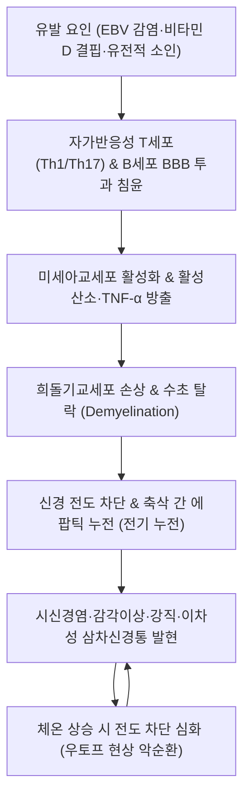

# 🩺 [[다발성 경화증]] (Multiple Sclerosis / 多發性硬化症, ICD-10 G35)

> **핵심 3줄 요약 (Key Summary)**:
> - 📍 병소 부위 & 해부·병태생리: 중추신경계([[시신경]], [[뇌실주위백질]], [[뇌간]], [[척수]])의 수초(Myelin)를 표적으로 하는 자가면역 탈수초 질환 — 시간적·공간적 다발성(DIT & DIS)이 진단의 대원칙.
> - 🚩 전형적 임상 양상: 시신경염(한쪽 시력 저하·안구운동통), 사지 감각이상·위약, 레르미트 징후([[Lhermitte sign]]), 우토프 현상([[Uhthoff phenomenon]]), 젊은 층·양측성 삼차신경통.
> - 🛠️ 핵심 검사 & 치료 전략: 뇌·척수 MRI(2024 McDonald 기준, OCBs 확인), 질환조절치료(DMT) 즉각 개시 + 한의학적 위증(痿證)·간신음허 변증 기반 보중익기탕·독활기생탕 및 전침 협진.
> - ⚠️ 응급 의뢰 레드플래그: 급성 시력 상실, 보행 불능, 양측성 삼차신경통(40세 이전 발병 시 즉시 뇌 MRI 의뢰), 면역억제제 복용 중 발열·기회감염.

---

## 📌 목차
1. [질환 개요 & 해부학적 병태생리](#1-질환-개요--해부학적-병태생리)
2. [병태생리 메커니즘 & 생체역학적 악순환 네트워크](#2-병태생리-메커니즘--생체역학적-악순환-네트워크)
3. [임상 증상 & 이학적 검사(Physical Exam) 알고리즘](#3-임상-증상--이학적-검사physical-exam-알고리즘)
4. [감별 진단 매트릭스 (Differential Diagnosis)](#4-감별-진단-매트릭스-differential-diagnosis)
5. [한의 통합 치료 프로토콜 (침·약침·추나·한약)](#5-한의-통합-치료-프로토콜-침약침추나한약)
6. [양방 치료 & 병용·의뢰 기준 (Conventional Treatment & Referral)](#6-양방-치료--병용의뢰-기준-conventional-treatment--referral)
7. [재활 운동 & 생활습관 티칭 가이드](#7-재활-운동--생활습관-티칭-가이드)
8. [💡 사용자 진료실 핵심 필기 & 임상 노하우 (Melt-In 잔여 심화 집약)](#8--사용자-진료실-핵심-필기--임상-노하우-melt-in-잔여-심화-집약)
9. [출처 및 학술 참고 문헌 (References)](#9-출처-및-학술-참고-문헌-references)

---

## 1. 질환 개요 & 해부학적 병태생리

### 1) 질환 정의 및 역학
- **정의**: 중추신경계(Central Nervous System, CNS)의 백질(White matter)을 침범하는 만성 자가면역성·염증성 탈수초(Demyelinating) 및 신경퇴행성 질환이다. 신경 섬유를 감싸고 있는 수초(Myelin sheath)가 파괴되어 신경 전도 장애와 축삭 손실(Axonal loss)이 발생한다.
- **역학적 특성**:
  - 주로 20~40대의 젊은 성인에서 호발하며, 여성의 발병률이 남성에 비해 2~3배 높다.
  - 고위도 지역(북미, 북유럽 등)에서 유병률이 높으며, 환경적 요인([[엡스타인-바 바이러스]](EBV) 감염, [[비타민 D]] 결핍, 흡연, 비만)과 유전적 감수성(HLA-DRB1*15:01 대립유전자)이 복합적으로 관여한다.
- **임상 아형 분류 (Clinical Subtypes)**:
  - **재발-완화형 (Relapsing-Remitting MS, RRMS)**: 전체 환자의 약 85%를 차지하며, 급성 악화(재발) 후 완전히 또는 부분적으로 회복되는 완화기가 반복됨.
  - **이차 진행형 (Secondary Progressive MS, SPMS)**: RRMS 환자가 수년~수십 년 경과 후 재발 여부와 무관하게 점진적인 신경학적 장애 축적으로 이행됨.
  - **일차 진행형 (Primary Progressive MS, PPMS)**: 발병 초기부터 완화기 없이 꾸준히 장애가 진행됨(약 10~15%).

### 2) 관련 해부학적 구조물
- **표적 부위**: [[뇌실주위백질]](Periventricular white matter), 피질하 백질, [[시신경]](Optic nerve), [[뇌간]](Brainstem), [[소뇌]](Cerebellum), [[척수]](Spinal cord, 특히 경수 및 흉수).
- **삼차신경근 진입부 (Root Entry Zone, REZ)**: 뇌교(Pons) 내 삼차신경 핵 및 REZ의 탈수초 병변 침범은 청장년층에서 이차성 [[삼차신경통]]을 격발하는 핵심 해부학적 표적이다.

---

## 2. 병태생리 메커니즘 & 생체역학적 악순환 네트워크

### 1) 자가면역 염증 반응과 수초 파괴
- 자가반응성 CD4+ 림프구(Th1 및 Th17)와 B세포가 활성화되어 [[혈뇌장벽]](Blood-Brain Barrier, BBB)을 투과하여 중추신경계 실질로 침윤한다.
- 분비된 염증성 사이토카인(IFN-γ, TNF-α, IL-17)이 미세아교세포(Microglia)와 성상교세포(Astrocyte)를 활성화시켜 일산화질소(NO)와 활성산소종(ROS)을 방출한다.
- 이로 인해 희돌기교세포([[Oligodendrocyte]])의 세포사멸과 수초 파괴(탈수초화)가 진행된다.

### 2) 전도 장애와 에팝틱 누전 (Ephaptic Transmission)
- 수초가 벗겨진 축삭에서는 전압개폐성 Na+ 통로가 비정상적으로 재분포되며 도약 전도(Saltatory conduction)가 불가능해져 전도 차단(Conduction block)과 전도 속도 저하가 발생한다.
- 인접한 신경 섬유 간의 절연막이 사라짐으로써, 하나의 신경 흥분이 이웃 축삭으로 누전되는 **에팝틱 누전(Ephaptic transmission)**이 발생하여 가벼운 촉각이나 온도 자극이 극심한 통증으로 증폭된다.

### 3) 삼차신경통의 발생 — 삼중 압박(Triple-Crush) 가설
- 다발성 경화증 환자에서 발생하는 삼차신경통은 단순한 혈관 압박이 아닌 **삼중 압박(Triple-crush)** 병태생리로 설명된다:
  - ① 뇌교(Pons) 내 원발성 탈수초 플라크(Demyelinating plaque) 형성.
  - ② 삼차신경근 진입부(REZ) 주변의 신경혈관 접촉(Neurovascular conflict).
  - ③ 신경근의 만성적 기계적 압박 및 비정상적 축삭 과흥분성의 누적.
- 따라서 40세 이전 발병, 양측성, 또는 안면 감각 저하를 동반한 삼차신경통은 MS 감별이 필수적이다.

---

## 3. 임상 증상 & 이학적 검사(Physical Exam) 알고리즘

### 1) 주소증 및 임상 양상
- **시신경염 (Optic neuritis)**: 환자의 20%에서 초기 증상으로 발현. 급격한 한쪽 시력 저하, 안구 운동 시 통증, 색각 장애(특히 적색 탈포화).
- **감각 이상**: 사지 말단 및 체간의 저림, 바늘로 찌르는 듯한 통증, 띠를 두른 듯한 압박감(MS hug).
- **운동 장애 및 경직**: 하지 무력감, 보행 장애, 경직성 대마비, 피로감(환자의 80% 이상이 극심한 만성 피로 호소).
- **뇌간 및 소뇌 장애**: 복시([[핵간안근마비]], INO), 현훈, 안진, 구음장애,企図振顫(Intention tremor).
- **신경인성 방광 및 장 기능장애**: 절박뇨, 빈뇨, 요실금, 변비.

### 2) 특이 징후 및 유발 검사
1. **레르미트 징후 ([[Lhermitte sign]])**:
   - 목을 앞으로 굴곡시킬 때 경추를 따라 등과 다리 쪽으로 전기가 통하듯 찌릿하게 뻗치는 감각 $
ightarrow$ 경추 후주(Posterior column) 탈수초 병변 시사.
2. **우토프 현상 ([[Uhthoff phenomenon]])**:
   - 뜨거운 물 목욕, 사우나, 운동, 발열 등으로 체온이 0.5도만 상승해도 기존 신경학적 증상(시력 저하, 위약감)이 급격히 일시 악화되는 현상 $
ightarrow$ 탈수초 신경의 열역학적 전도 차단 특성.
3. **상대구심성 동공운동장애 (Relative Afferent Pupillary Defect / Marcus Gunn 동공)**:
   - 교대 불빛 검사 시 환측 눈에 불빛을 비출 때 동공이 수축하지 않고 오히려 산대되는 소견.
4. **상위 운동신경원 징후**:
   - 심부건반사(DTR) 항진, 발목 간대(Clonus), [[바빈스키 징후]], [[호프만 징후]](Hoffmann's sign) 양성.

---

## 4. 감별 진단 매트릭스 (Differential Diagnosis)

| 감별 질환 | 호발 연령 및 영상(MRI) 특성 | 혈액 및 뇌척수액(CSF) 바이오마커 | 핵심 감별점 |
| :--- | :--- | :--- | :--- |
| **[[다발성 경화증]] (MS)** | 20~40대 여성, 뇌실주위 난원형 병변(Dawson's fingers) | 뇌척수액 올리고클론 밴드(OCBs) 90% 이상 양성 | 시간적·공간적 다발성, 우토프 현상 |
| **[[시신경척수염]] (NMOSD)** | 전 연령, 3개 척추분절 이상 LETM, 심한 양측 시신경염 | **[[AQP4-IgG]] (Anti-Aquaporin-4) 항체 양성** | 올리고클론 밴드 대개 음성, 뇌병변 드묾 |
| **[[MOGAD]]** | 소아·청년기, 척수 원추 침범, 시신경 유두 종창 | **[[MOG-IgG]] (Anti-MOG) 항체 양성** | 스테로이드에 매우 극적인 반응 및 호전 |
| **급성 파종성 뇌척수염 (ADEM)** | 소아 호발, 광범위 융합성 피질하 백질 병변 | 감염 또는 백신 접종 후 급성 발병 | 단발성(Monophasic) 경과, 뇌병증(의식 저하) 동반 |
| **중추신경계 혈관염 / [[루푸스]]** | 다발성 미세경색 및 백질 병변, 전신 혈관염 증상 | ANA, anti-dsDNA, 항인지질항체 양성 | 관절통, 피부 발진 등 전신 교원성 질환 소견 |
| **고전적 [[삼차신경통]]** | 50대 이상 호발, 편측성, 신경 결손 전무 | 뇌 MRI 상 탈수초 플라크 없음 | MS 환자는 40세 이전 발병, 양측성 빈번 |

---

## 5. 한의 통합 치료 프로토콜 (침·약침·추나·한약)

### 1) 한의학적 병전 및 변증 체계
- 한의학에서 다발성 경화증은 사지 무력과 근위축을 주소로 하는 [[위증]](痿證), 감각 이상과 저림을 호소하는 [[비증]](痺證), 현훈(眩暈), [[목현]](目眩)의 범주에 속한다.
- 《황제내경》의 "치위독취양명(治痿獨取陽明)" 원칙에 따라 비위(脾胃) 기혈을 보익하고 간신(肝腎)을 자양하는 것을 기본 치료 강령으로 삼는다.
- **비위허약(脾胃虛弱)**: 전신 피로, 사지 무력, 보행 곤란, 식욕 부진, 대변 연변, 설담태백, 맥세약.
- **간신음허(肝腎陰虛)**: 하지 경직, 보행 실조, 요슬산연, 수족심열, 현훈, 설홍소태, 맥세삭.
- **습열침음(濕熱浸淫)**: 급성기 직후 사지 무거움 및 열감 동반 감각이상, 소변 적삽, 설홍태황니, 맥유삭.
- **어혈조락(瘀血阻絡)**: 난치성 통증, 자통, 양측성 안면 삼차신경통 병발, 설자암 유어반, 맥삽.

### 2) 침구 치료 프로토콜
- **양명경 취혈 및 사지 근력 촉진 (治痿獨取陽明)**:
  - [[족삼리]](ST36), [[상거허]](ST37), [[양릉천]](GB34), [[삼음교]](SP6) — 비위 기능 강화 및 하지 근위축 방지.
  - [[곡지]](LI11), [[수삼리]](LI10), [[합곡]](LI4) — 상지 기능 촉진 및 면역 조절.
- **척수 신경 분절 및 경직 완화**:
  - 경추 및 흉요추 [[협척혈]](EX-B2) 전침 치료 (2Hz 저빈도 자극, 20분 유침) — 척수 분절 순환 개선 및 중추성 경직 완화.
  - [[대추]](GV14), [[풍지]](GB20), [[백회]](GV20) — 두부 기혈 순환 촉진.
- **신경인성 방광 기능 조절**:
  - [[중극]](CV3), [[관원]](CV4), [[차료]](BL32), [[삼음교]](SP6) 저주파 전침 자극 $
ightarrow$ 배뇨 반사 활성화 및 잔뇨량 감소.

### 3) 한약 처방 프로토콜
- **보중익기탕(補中益氣湯) / 삼령백출산(參苓白朮散)**: 비위허약형 환자의 극심한 만성 피로와 근위축 개선. 황기, 인삼 성분이 미토콘드리아 에너지 대사를 촉진하고 면역 조절 작용 발휘.
- **독활기생탕(獨活寄生湯) / 육미지황탕(六味地黃湯)**: 간신음허형 환자의 하지 경직, 보행 실조 및 척추 관절통 완화. 숙지황, 두충, 우슬 성분이 신경 영양 인자(BDNF) 발현을 유도.
- **오적산(五積散) / 혈부축어탕(血府逐瘀湯)**: 어혈조락으로 인한 신경병증성 통증 및 이차성 삼차신경통 병발 시 활혈화어(活血化瘀).
- **작약감초탕(芍藥甘草湯)**: 하지 근육 경련 및 족지 강직 완화에 1차 배오.

---

## 6. 양방 치료 & 병용·의뢰 기준 (Conventional Treatment & Referral)

### 1) 급성 재발기 치료 (Acute Relapse Management)
- **고용량 코르티코스테로이드 충격 요법**:
  - [[메틸프레드니솔론]](Methylprednisolone) 1,000mg 정맥 주사를 3~5일간 연속 투여 $
ightarrow$ 혈뇌장벽 안정화 및 급성 염증 부종 신속 감소.
- **혈장교환술 (Plasma Exchange, PLEX)**:
  - 스테로이드 치료에 불응하는 중증 장애(급성 대마비, 실명 위기) 시 5~7회 시행.

### 2) 질환조절치료 (Disease-Modifying Therapies, DMT)
- **주사제**: [[인터페론 베타]](Interferon-beta-1a/1b), [[글라티라머 아세테이트]](Glatiramer acetate).
- **경구용 1차 제제**: 테리플루노마이드(Teriflunomide), 디메틸푸마레이트(Dimethyl fumarate).
- **고효능 제제 (High-Efficacy DMTs)**:
  - **오크렐리주맙 ([[Ocrelizumab]])**: 항CD20 단클론항체, B세포 고갈을 통해 RRMS 및 PPMS 재발률 극적 억제.
  - **나탈리주맙 ([[Natalizumab]])**: 항α4-인테그린 항체, 림프구의 BBB 통과 차단 (JC 바이러스 활성화로 인한 PML 위험 추적 필수).
  - **핀골리모드 ([[Fingolimod]])**: S1P 수용체 조절제, 림프절 내 림프구 격리.

### 3) 협진 원칙 및 응급 의뢰 레드플래그
1. **재발 징후 발생**: 갑작스러운 시력 저하, 복시, 보행 불능, 배뇨 정지가 나타나면 침 시술을 보류하고 당일 신경과 응급실 전원.
2. **청장년층 삼차신경통**: 40세 이전 젊은 환자가 양측성 삼차신경통을 호소하면 뇌 MRI(3D-CISS 및 조영증강) 의뢰를 최우선으로 진행.
3. **면역억제제 감염 감시**: DMT 복용 중인 환자는 면역이 저하되어 있으므로 자침 시 1회용 호침 멸균 철저 준수, 피부 감염 부위 자침 금기. 발열 및 호흡기 감염 징후 발견 시 즉시 처방의와 상의.

---

## 7. 재활 운동 & 생활습관 티칭 가이드

### 1) 체온 관리 및 우토프 현상 방지
- **과열 절대 금지**: 사우나, 찜질방, 뜨거운 온천욕, 한여름 직사광선 노출은 신경 전도를 차단하여 증상을 급격히 악화시키므로 엄격히 금지.
- **체온 냉각 전략**: 운동 중 쿨링 조끼(Cooling vest) 착용, 시원한 얼음물 섭취, 실내 에어컨 적정 온도(20~22도) 유지.

### 2) 에너지 보존 전략 (Fatigue Management)
- **휴식 분배**: 피로가 누적되기 전 15~20분간의 짧은 휴식을 하루 3~4회 규칙적으로 배치.
- **오전 활동 집중**: 체온이 상대적으로 낮고 에너지가 충전된 오전에 주요 가사 및 업무를 수행.

### 3) 맞춤형 운동 요법
- **수중 운동 (Hydrotherapy)**: 수온 27~29도로 유지되는 온수풀에서의 수영 및 보행 훈련 $
ightarrow$ 관절 부하를 줄이고 체온 상승을 막으면서 근력 강화.
- **저강도 유산소 및 스트레칭**: 고정식 자전거, 스트레칭을 통해 하지 내전근 및 비복근 강직 예방.

### 4) 영양 및 대사 관리
- **[[비타민 D]] 보충**: 혈중 25-(OH) Vit D 농도를 40~60 ng/mL 수준으로 유지하기 위해 비타민 D3 일 2,000~4,000 IU 보충 권장.
- **금연 필수**: 흡연은 뇌실질 위축과 질환 진행 속도를 2배 이상 가속화하므로 철저한 금연 지도.

---

## 8. 💡 사용자 진료실 핵심 필기 & 임상 노하우 (Melt-In 잔여 심화 집약)

- **진료실 레드플래그 제1원칙**: "양측성 삼차신경통 또는 40세 이전의 삼차신경통은 한의원에서 가장 놓치기 쉬운 다발성 경화증의 조기 신호다. 젊은 환자가 턱이나 뺨의 전격통을 호소할 때, 뇌 MRI 검사 의뢰가 침·약침 치료보다 반드시 선행되어야 한다."
- **환자 소통 및 티칭 가이드라인**:
  - "이 질환은 면역계가 신경의 절연막(전선 피복)을 공격하여 신호가 새는 병입니다. 질환조절제(DMT)는 재발 빈도와 뇌 손상을 막아주는 중심 방패이므로 신경과 약을 임의로 끊어서는 절대 안 됩니다."
  - "한의 치료(침, 전침, 한약)는 신경 손상으로 인한 만성 피로, 근육 강직, 저림, 배뇨 장애를 개선하는 훌륭한 협진 파트너 역할을 수행합니다."
- **자침 전후 신경학적 변화 기록**: 환자의 근력 등급(MRC scale)과 보행 거리를 매 내원 시 기록하여 재발 조짐을 조기에 포착해야 한다.

---

## 9. 출처 및 학술 참고 문헌 (References)

- Oh J, et al. (2026). Challenges and future directions for multiple sclerosis after the 2024 McDonald diagnostic criteria. *Nat Med*. PMID: 42426222.
  - [연구 요약] 2024년 개정 맥도날드 진단 기준의 핵심 변경점, 시신경 침범 및 뇌척수액 올리고클론 밴드의 역할, 조기 질환조절제 치료 전망.
- Thompson AJ, et al. (2018). Diagnosis of multiple sclerosis: 2017 revisions of the McDonald criteria. *Lancet Neurol*. 17(2):162-173. PMID: 29275977.
  - [연구 요약] 시간적 및 공간적 다발성 입증을 위한 2017 McDonald 진단 기준과 자기공명영상 탈수초 병변 판독 원칙을 확립한 랜드마크 합의 논문.
- Reich DS, et al. (2018). Multiple Sclerosis. *NEJM*. 378(2):169-180. PMID: 29320652.
  - [연구 요약] 다발성 경화증의 자가면역 면역병리(T/B세포), 축삭 손상 기전 및 인터페론·단클론항체 등 분자 표적 치료의 포괄적 종설.
- Noseworthy JH, et al. (2000). Multiple Sclerosis. *NEJM*. 343(13):938-952. PMID: 11006371.
  - [연구 요약] 다발성 경화증의 자연 경과, 재발-완화형 및 진행형 임상 아형, 급성기 스테로이드 치료 및 재활 관리의 기본 골격을 정립한 대표 종설.
