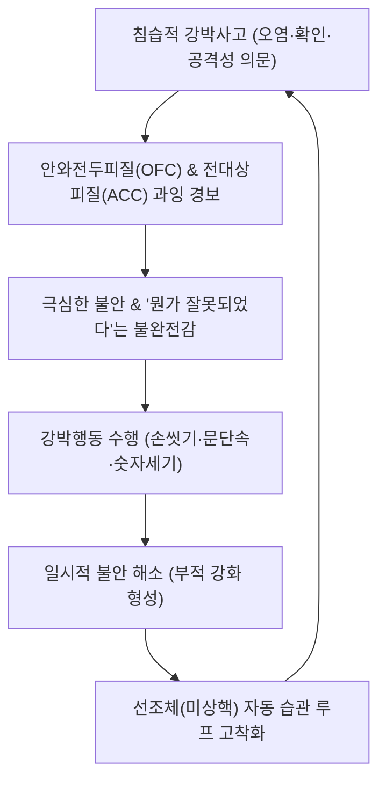

# 🩺 [[강박 장애]] (Obsessive-Compulsive Disorder / 強迫障礙, ICD-10 F42)

> **핵심 3줄 요약 (Key Summary)**:
> - 📍 병소 부위 & 해부·병태생리: 피질-선조체-시상-피질([[CSTC 회로]])의 과항진 및 안와전두피질([[OFC]]), 전대상피질([[ACC]]), 미상핵(Caudate)의 세로토닌·도파민·글루타메이트 불균형.
> - 🚩 전형적 임상 양상: 원치 않는 침습적 생각·충동([[강박사고]])과 이를 무마하기 위해 반복하는 청결·확인·정렬 행동([[강박행동]])이 일 1시간 이상 소요되어 일상 파탄.
> - 🛠️ 핵심 검사 & 치료 전략: Y-BOCS(Yale-Brown) 척도 평가, 고용량 [[SSRI]] 및 노출 및 반응 방지([[ERP]]) + 한의학적 간기울결·담화요심 변증 시호가용골모려탕·온담탕 및 백회·신문 전침 치료.
> - ⚠️ 응급 의뢰 레드플래그: 심한 절망감에 따른 자살 사고 및 자해 충동, 강박행동으로 인한 심각한 피부 손상/탈수, 조현병 스펙트럼의 피해망상으로의 이행.

---

## 📌 목차
1. [질환 개요 & 해부학적 병태생리](#1-질환-개요--해부학적-병태생리)
2. [병태생리 메커니즘 & 생체역학적 악순환 네트워크](#2-병태생리-메커니즘--생체역학적-악순환-네트워크)
3. [임상 증상 & 이학적 검사(Physical Exam) 알고리즘](#3-임상-증상--이학적-검사physical-exam-알고리즘)
4. [감별 진단 매트릭스 (Differential Diagnosis)](#4-감별-진단-매트릭스-differential-diagnosis)
5. [한의 통합 치료 프로토콜 (침·약침·추나·한약)](#5-한의-통합-치료-프로토콜-침약침추나한약)
6. [양방 치료 & 병용·의뢰 기준 (Conventional Treatment & Referral)](#6-양방-치료--병용의뢰-기준-conventional-treatment--referral)
7. [재활 운동 & 생활습관 티칭 가이드](#7-재활-운동--생활습관-티칭-가이드)
8. [💡 사용자 진료실 핵심 필기 & 임상 노하우 (Melt-In 잔여 심화 집약)](#8--사용자-진료실-핵심-필기--임상-노하우-melt-in-잔여-심화-집약)
9. [출처 및 학술 참고 문헌 (References)](#9-출처-및-학술-참고-문헌-references)

---

## 1. 질환 개요 & 해부학적 병태생리

### 1) 질환 정의 및 분류
- **정의**: 자신의 의지와 무관하게 통제할 수 없는 침습적이고 고통스러운 생각, 이미지, 충동([[강박사고]], Obsessions)이 반복되고, 이로 인해 유발되는 극심한 불안을 중화하거나 없애기 위해 특정 행동이나 정신적 행위([[강박행동]], Compulsions)를 규칙적으로 반복하는 신경정신과 질환이다.
- **역학**:
  - 평생 유병률은 2~3% 수준이며, 남녀 발생 비율은 유사하나 남성은 청소년기, 여성은 20대 초반에 호발하는 경향을 보인다.
  - 환자의 90% 이상이 강박사고와 강박행동을 모두 동반하며, 만성적이고 악화와 완화를 반복하는 경과를 밟는다.

### 2) 관련 해부학적 구조물
- **피질-선조체-시상-피질 회로 ([[CSTC 회로]])**:
  - **안와전두피질 (Orbitofrontal Cortex, OFC)**: 위험 평가, 오류 감지, 위협 예측 과잉 활성화.
  - **전대상피질 (Anterior Cingulate Cortex, ACC)**: 정서적 갈등 감지 및 '뭔가 잘못되었다'는 불완전감(Incompleteness) 증폭.
  - **선조체 ([[기저핵]] / 미상핵 Caudate nucleus)**: 습관 형성, 운동성 억제 실패 및 신호 필터링 장애.
  - **시상 (Thalamus)**: 감각 신호의 대뇌 피질 재전달 과잉.

---

## 2. 병태생리 메커니즘 & 생체역학적 악순환 네트워크

### 1) 신경전달물질계의 불균형
- **세로토닌([[5-HT]]) 수송체 기능 이상**: 세로토닌 재흡수 억제제(SSRI)가 주요 치료제로 작용하는 근거로, 세로토닌성 신경전달 저하가 CSTC 회로의 탈억제를 유발함.
- **도파민성 과항진**: 흑질-선조체 도파민 과잉은 정형화된 반복 행동(Stereotypy)을 촉진하며, 항정신병제 부가 요법의 근거가 됨.
- **글루타메이트성 과흥분**: 선조체 내 글루타메이트 농도 증가는 피질-시상 피드백 루프의 과도한 흥분성 발화를 유지시킴.

### 2) 강박의 인지 행동적 악순환 루프
- 침습적 생각 발생 $
ightarrow$ 인지적 파국화 및 위협 지각 $
ightarrow$ 극심한 불안 발생 $
ightarrow$ 불안을 경감시키기 위해 강박행동 수행 $
ightarrow$ 일시적 안도감 획득(부적 강화) $
ightarrow$ 뇌 회로에 행동 강화 $
ightarrow$ 다음 침습 시 불안 역치 저하(악순환 완성).

---

## 3. 임상 증상 & 이학적 검사(Physical Exam) 알고리즘

### 1) 주소증 및 4대 임상 아형
1. **오염 및 청결 (Contamination & Cleaning)**: 세균, 바이러스, 오염물질에 대한 공포로 수십 차례 손을 씻거나 샤워를 수 시간 지속하여 피부 궤양·습진 발생.
2. **의심 및 확인 (Doubt & Checking)**: 문이 잠겼는지, 가스 밸브를 껐는지 수십 번 확인하여 출근이 불가능해짐.
3. **대칭 및 정렬 (Symmetry & Ordering)**: 물건이 정확한 각도와 대칭을 이루지 않으면 참을 수 없는 불완전감을 느껴 정렬을 반복.
4. **금기적 사고 및 주술적 행위 (Forbidden thoughts & Neutralizing)**: 성적, 공격적, 종교적으로 불경한 생각이 떠오르면 특정 숫자 세기나 마음속 기도문 외우기로 중화.

### 2) 표준 평가 도구 및 알고리즘
- **Y-BOCS (Yale-Brown Obsessive Compulsive Scale)**:
  - 총 40점 만점: 0~7점(경미), 8~15점(경도), 16~23점(중등도), 24~31점(중증), 32~40점(극심).
  - 강박사고 소요 시간, 일상 방해 정도, 고통 수준, 저항 노력, 통제력 5개 영역 평가.
- **병식 (Insight) 평가**: 자신의 강박사고가 비합리적임을 인지하는지(양호한 병식) vs 확신하는지(불량한 병식/망상적 신념) 확인.

---

## 4. 감별 진단 매트릭스 (Differential Diagnosis)

| 감별 질환 | 사고의 특징 | 행동 및 징후 | 핵심 감별점 |
| :--- | :--- | :--- | :--- |
| **[[강박 장애]] (OCD)** | 자아이질적(Ego-dystonic), 괴롭고 침습적 | 불안 완화를 위한 규칙적 강박행동 동반 | 환자 스스로 생각이 비합리적임을 앎(병식 존재) |
| **[[범불안장애]] (GAD)** | 자아동질적(Ego-syntonic), 일상사 전반의 과도한 걱정 | 신체 증상(근육 긴장, 피로) 위주 | 정형화된 강박행동 없음 |
| **[[틱장애]] / 뚜렛 증후군** | 단순 감각적 전조 충동(Premonitory urge) | 불수의적 돌발 운동/음성 틱 | 복잡한 강박사고나 중화 목적이 아님 |
| **[[조현병]]** | 자아동질적 망상(피해망상, 조종망상) | 기괴한 행동, 환청 동반 | 병식 결여, 침습 사고가 아닌 실제 현실로 확신 |
| **강박성 인격장애 (OCPD)** | 완벽주의, 규칙 준수, 정리정돈이 '옳다'고 믿음 | 자아동질적, 스스로 고통스럽지 않음 | 완벽주의 성향, 불안에 의한 중화 행위 없음 |

---

## 5. 한의 통합 치료 프로토콜 (침·약침·추나·한약)

### 1) 한의학적 병전 및 변증 체계
- 한의학에서 강박 장애는 [[심신불교]](心腎不交), [[경계]](驚悸), [[정충]](怔忡), [[전증]](癲證)의 범주에 속하며, 담탁(痰濁)과 기체(氣滯), 화열(火熱)이 심규(心竅)를 어지럽히는 것으로 파악한다.
- **간기울결(肝氣鬱結) / 울화(鬱火)**: 억울한 감정, 가슴 답답함, 한숨, 반복적인 분노와 의심, 설홍태박황, 맥현삭.
- **담화요심(痰火擾心)**: 심한 초조, 청결 강박, 불면, 번열, 설태황니, 맥활삭.
- **심신불교(心腎不交) / 음허화왕**: 불완전감, 건망, 야간 식은땀, 요슬산연, 수족심열, 설홍소태, 맥세삭.
- **심비양허(心脾兩虛)**: 기운 없음, 과도한 확인 행동, 피로, 식욕 부진, 설담, 맥세약.

### 2) 침구 치료 프로토콜
- **CSTC 신경회로 과흥분성 진정 (평간식풍·청심안신)**:
  - [[백회]](GV20), [[인당]](EX-HN3), [[사신총]](EX-HN1) — 전두엽-변연계 과잉 경보 억제.
  - [[신문]](HT7), [[내관]](PC6) — 세로토닌 신경계 활성화 및 심계항진 진정.
  - [[태충]](LR3), [[합곡]](LI4) — 개사관, 간기 소통 및 전신 긴장 이완.
- **배수혈 및 자율신경 조절**:
  - [[심수]](BL15), [[간수]](BL18), [[신수]](BL23) 전침 치료(2Hz 저주파, 20분 유침).

### 3) 한약 처방 프로토콜
- **시호가용골모려탕(柴胡加龍骨牡蠣湯)**: 간울화화 및 담열로 인한 심한 번조, 불안, 반복적 강박 사고의 1차 선택 처방. 용골, 모려의 중진안신(重鎭安神) 작용이 대뇌 피질 흥분을 억제.
- **온담탕(溫膽湯) 가 황련**: 담화요심형 청결 강박 환자의 가슴 답답함과 불안정 완화.
- **귀비탕(歸脾湯)**: 심비양허형 만성 강박 환자의 뇌 피로 및 강박성 기력 저하 보익.
- **천왕보심단(天王補心丹)**: 심신불교형 음허번열 및 수면 장애 동반 강박 장애 치료.

---

## 6. 양방 치료 & 병용·의뢰 기준 (Conventional Treatment & Referral)

### 1) 1차 표준 치료
- **약물 치료**:
  - 선택적 세로토닌 재흡수 억제제([[SSRI]]): 에스시탈로프람(Escitalopram), 설트랄린(Sertraline), 플루옥세틴(Fluoxetine), 플루복사민(Fluvoxamine).
  - *특징*: 우울증 치료 용량보다 **고용량**이 필요하며, 최소 8~12주 이상의 충분한 투여 기간을 거쳐야 효과 판정 가능.
  - 삼환계 항우울제([[TCA]]): 클로미프라민(Clomipramine) — 세로토닌 재흡수 강력 억제(SSRI 불응 시).
- **정신치료 — 노출 및 반응 방지 ([[ERP]])**:
  - 불안을 유발하는 자극에 노출시킨 후(Exposure), 강박행동을 하지 못하도록 차단(Response Prevention)하여 불안이 시간 경과에 따라 자연 감쇄(Habituation)됨을 뇌에 재학습시키는 골드스탠다드 인지행동치료.

### 2) 응급 의뢰 및 전원 레드플래그
1. **자살 충동**: 강박 증상으로 인한 극심한 절망감으로 자살 계획 및 시도 징후 시 폐쇄병동 입원 의뢰.
2. **심각한 신체 손상**: 락스, 알코올 소독제 과다 사용으로 인한 피부 궤양, 화학 화상, 식사 거부로 인한 극단적 영양실조 동반 시 다학제 협진.
3. **병식 완전 상실 (망상화)**: 강박사고가 조현병 스펙트럼의 피해망상으로 전환되어 타인을 공격할 위험이 있는 경우 즉시 상급 정신건강의학과 의뢰.

---

## 7. 재활 운동 & 생활습관 티칭 가이드

### 1) 점진적 반응 지연 기법 (Delaying Tactics)
- 강박행동을 당장 완전히 멈추기 어려우므로, "행동 전 1분 기다리기" $
ightarrow$ "5분 기다리기" $
ightarrow$ "15분 기다리기"로 뇌의 충동-행동 연결 고리를 점진적으로 약화시킴.

### 2) 신체 운동 및 스트레스 분산
- 중강도 이상의 유산소 운동(조깅, 수영 일 30분): 뇌 유래 신경영양인자(BDNF)를 촉진하고 선조체 도파민 수용체 밀도를 안정화.
- 마인드풀니스(Mindfulness) 호흡: "생각은 단지 생각일 뿐이며, 뇌에서 흘러가는 구름과 같다"는 탈융합(Defusion) 명상 훈련.

---

## 8. 💡 사용자 진료실 핵심 필기 & 임상 노하우 (Melt-In 잔여 심화 집약)

- **환자 안심 티칭 제1원칙**: "환자분, 머릿속에 끔찍한 생각(가족을 해치는 상상, 불경한 생각)이 떠오른다고 해서 환자분이 나쁜 사람인 것은 절대 아닙니다. 이는 뇌의 경보 장치가 고장 나서 울리는 가짜 경보음일 뿐입니다."
- **보호자의 '안심시키기(Reassurance)' 공모 중단 지도**:
  - 가족들이 환자의 "문 잠겼어?", "나 병 안 걸렸지?"라는 질문에 매번 "응, 잠겼어", "괜찮아"라고 대답해 주는 것은 일시적으로 불안을 달래지만, 장기적으로는 강박행동을 가족이 대신 수행해 주는 결과를 낳아 병을 만성화시킨다.
  - 보호자에게 "질문에 매번 대답해 주지 마시고, '강박 뇌가 또 질문하게 만드는구나'라고 함께 넘기셔야 합니다"라고 교육해야 한다.

---

## 9. 출처 및 학술 참고 문헌 (References)

- Stein DJ, et al. (2019). Obsessive-compulsive disorder. *NRDP*. PMID: 31371720.
  - [연구 요약] 강박 장애의 유전학, 피질-선조체 신경회로 병태생리, 신경면역학적 기전 및 세로토닌 약물과 노출반응방지 통합 치료 최신 랜드마크 종설.
- Stein DJ. (2002). Obsessive-compulsive disorder. *Lancet*. 360(9330):397-405. PMID: 12241794.
  - [연구 요약] 강박 장애의 임상 아형, 진단 평가, 세로토닌 신경전달체계 역할 및 장기 약물 관리 가이드라인.
- Pittenger C, Bloch MH. (2014). Pharmacological treatment of obsessive-compulsive disorder. *Psychiatr Clin North Am*. 37(3):375-391. PMID: 25150568.
  - [연구 요약] 강박 장애 환자에서 1차 SSRI 치료 실패 시 비전형 항정신병제 부가 요법 및 글루타메이트 조절제 근거 중심 고찰.
