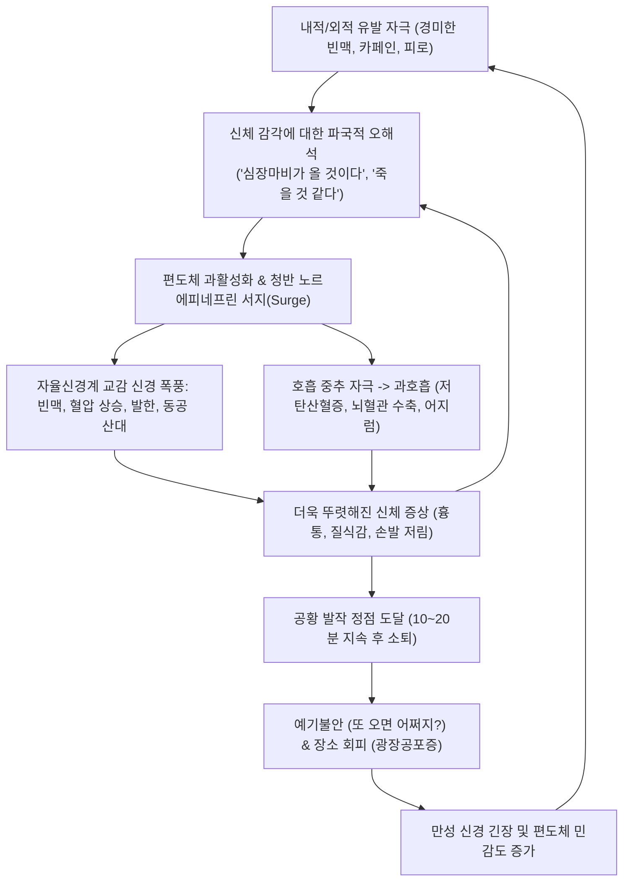
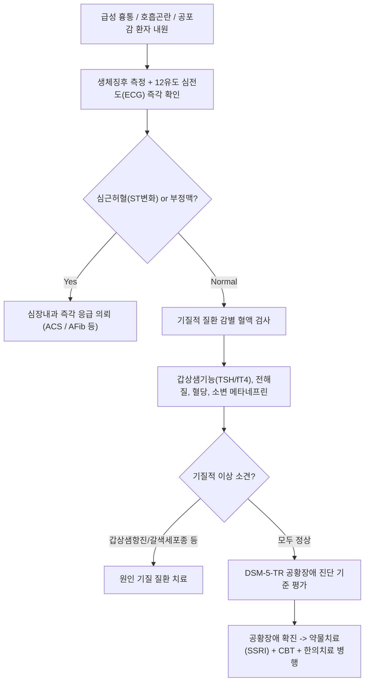

# 🩺 공황 발작과 공황 장애 (Panic Attack and Panic Disorder)

> **핵심 3줄 요약 (Key Summary)**:
> - 📍 병소 부위 & 해부·병태생리: 뇌 내 공포 네트워크(편도체 Amygdala, 청반 Locus coeruleus, 전두엽 피질)의 과민성 및 자율신경계 교감 신경 폭풍(Sympathetic surge)으로 인해 특별한 유발 요인 없이 급성 공포와 신체 증상이 폭발하는 신경정신과적 질환.
> - 🚩 전형적 임상 양상: 수분 내 정점에 달하는 극심한 공포감, 심계항진, 질식감, 흉통, 어지럼증, 발한, "곧 죽거나 미쳐버릴 것 같다"는 공포, 예기불안(Anticipatory anxiety) 및 광장공포증(Agoraphobia) 동반.
> - 🛠️ 핵심 검사 & 치료 전략: 심전도, 갑상샘 기능, 폐색전증, 갈색세포종 등 신체 질환 철저 배제; 선택적 세로토닌 재흡수 억제제(SSRI) 및 급성기 벤조디아제핀, 인지행동치료(CBT, 체내감각 노출); 한의 이완 침구치료 및 귀비탕/시호가용골모려탕.
> - ⚠️ 응급 의뢰 레드플래그: 최초 발병 고령 환자, 운동 시 악화되는 압박성 흉통, 실신, 심전도 ST 분절 변화, 서맥 또는 지속성 심방세동 -> 급성 심근경색(AMI) 및 부정맥 배제 응급실 의뢰.

---

## 📌 목차
1. [질환 개요 & 해부학적 병태생리](#1-질환-개요--해부학적-병태생리)
2. [병태생리 메커니즘 & 생체역학적 악순환 네트워크](#2-병태생리-메커니즘--생체역학적-악순환-네트워크)
3. [임상 증상 & 이학적 검사(Physical Exam) 알고리즘](#3-임상-증상--이학적-검사physical-exam-알고리즘)
4. [감별 진단 매트릭스 (Differential Diagnosis)](#4-감별-진단-매트릭스-differential-diagnosis)
5. [한의 통합 치료 프로토콜 (침·약침·추나·한약)](#5-한의-통합-치료-프로토콜--침-약침-추나-한약-)
6. [양방 치료 & 병용·의뢰 기준 (Conventional Treatment & Referral)](#6-양방-치료--병용의뢰-기준-conventional-treatment--referral)
7. [재활 운동 & 생활습관 티칭 가이드](#7-재활-운동--생활습관-티칭-가이드)
8. [💡 사용자 진료실 핵심 필기 & 임상 노하우 (Melt-In 잔여 심화 집약)](#8--사용자-진료실-핵심-필기--임상-노하우--melt-in-잔여-심화-집약-)
9. [출처 및 학술 참고 문헌 (References)](#9-출처-및-학술-참고-문헌--references)

---

## 1. 질환 개요 & 해부학적 병태생리

* **정의**: 공황 발작(Panic Attack)은 극심한 공포와 고통이 갑작스럽게 밀려와 수분 내에 최고조에 달하며 신체 및 인지적 증상이 동반되는 상태이다. **공황 장애(Panic Disorder)**는 이러한 예기치 못한 공황 발작이 반복되며, 추가 발작에 대한 지속적인 걱정(예기불안)이나 부적응적인 행동 변화(회피 행동, 광장공포증)가 1개월 이상 지속되는 만성 불안 장애이다.
* **신경생물학적 병소 및 공포 네트워크(Fear Network)**:
  * **편도체(Amygdala)**: 공포 기억의 저장과 조건반사적 불안 반응의 중심핵. 감각 자극에 대해 과민 반응하여 뇌간 및 시상하부로 과도한 위험 신호를 송출.
  * **청반(Locus Coeruleus)**: 뇌의 주요 노르에피네프린(NE) 생성 핵으로, 급성 발작 시 대량의 NE를 방출하여 전신 교감신경계를 폭발적으로 활성화.
  * **내측 전두엽 피질(mPFC) & 해마(Hippocampus)**: 정상적으로는 편도체의 공포 반응을 하향 조절(Top-down inhibition)해야 하나, 이 억제 기능이 약화되어 공황을 통제하지 못함.
  * **호흡 중추 화학수용체**: $\text{CO}_2$ 및 젖산(Lactate)에 대한 과민성(False Suffocation Alarm Theory, 거짓 질식 경보 가설).
* **역학**:
  * 평생 유병률은 약 2~4%이며, 여성이 남성에 비해 약 2배 호발하고 20대 전후 젊은 성인에서 가장 흔하게 발병한다.

---

## 2. 병태생리 메커니즘 & 생체역학적 악순환 네트워크

---

## 3. 임상 증상 & 이학적 검사(Physical Exam) 알고리즘

### 1) DSM-5-TR 공황 발작 진단 기준 (다음 중 4가지 이상이 수분 내 정점)
1. 심계항진, 심장 두근거림, 또는 심박수 증가.
2. 발한(식은땀).
3. 몸의 떨림 또는 후들거림(Tremor).
4. 숨이 가쁘거나 답답한 느낌(질식감).
5. 질식할 것 같은 느낌(Choking).
6. 흉통 또는 흉부 불쾌감.
7. 메스꺼움 또는 복부 불편감.
8. 어지럽고 불안정하거나 멍한 느낌, 실신할 것 같음.
9. 한기(오한) 또는 열감.
10. 감각 이상(저림 또는 마비감).
11. 비현실감(Derealization) 또는 이인증(Depersonalization).
12. 자제력을 잃거나 미쳐버릴 것 같은 두려움.
13. 죽을 것 같은 공포.

### 2) 이학적 검사 및 진단 알고리즘

---

## 4. 감별 진단 매트릭스 (Differential Diagnosis)

| 질환 | 주 임상 양상 | 발병 양상 | 심전도 / 검사 소견 | 감별 포인트 |
| :--- | :--- | :--- | :--- | :--- |
| **공황 장애** | 전형적 13가지 증상 중 $\ge 4$, 죽을 공포 | **돌발적, 10~20분 정점 후 소퇴** | **완전 정상** (동성 빈맥 외 정상) | 발작 사이 예기불안, 회피 행동 |
| **급성 관상동맥 증후군 (ACS)** | 쥐어짜는 흉통, 턱/어깨 방사 | 운동 시 악화, 지속적 | **ST 분절 변화, Troponin 상승** | **응급 레드플래그** (심장 질환) |
| **[[크롬친화세포종]]** | 두통, 발한, 빈맥, 악성 고혈압 | 발작성 수시간 지속 가능 | **메타네프린 2~3배 폭증** | 혈압 200 이상 지속 상승, 복부 종괴 |
| **[[갑상샘기능항진증]]** | 빈맥, 체중감소, 열 불내성, 진전 | 지속적, 만성적 | **TSH 저하, Free T4 상승** | 갑상샘종, 안구 돌출, 혈액검사 확진 |
| **[[과호흡 증후군]]** | 숨가쁨, 손발 저림, 카포페달 연축 | 호흡 과다 선행 | ABGA상 호흡성 알칼리증 | 심리적 불안과 과호흡이 주도 |

---

## 5. 한의 통합 치료 프로토콜 (침·약침·추나·한약)

### 1) 변증 분류
* **심담허겁(心膽虛怯)**: 사소한 일에도 잘 놀라고 가슴이 쿵쾅거림, 불안 초조, 불면, 악몽, 설담태박, 맥현세.
* **간기울결·간화상염(肝氣鬱結·肝火上炎)**: 스트레스 후 발작, 가슴 답답함, 분노, 안면 홍조, 두통, 설홍태황, 맥현삭.
* **심비양허(心脾兩虛)**: 만성적인 피로, 건망, 어지럼증, 식욕부진, 묽은 변, 설담반치흔, 맥세약.
* **담음정충(痰飲怔忡)**: 가슴 밑이 뛰고 메스꺼움, 어지럼증, 머리가 무거움, 설태백니, 맥활.

### 2) 침구 치료
* **주요 혈위**:
  * 안신정지(安神定志) 및 심계 안정: [[내관]](PC6), [[신문]](HT7), [[백회]](GV20), [[인당]](EX-HN3), [[안면]](Anmian).
  * 간화 청열 및 기혈 소통: [[태충]](LR3), [[합곡]](LI4), [[곡지]](LI11).
  * 담음 제거 및 중초 조절: [[전중]](CV17), [[중완]](CV12), [[풍륭]](ST40), [[족삼리]](ST36).
* **자침 기법**: 유침 20분, 심문-내관에 평보평사, 전중혈에는 횡자(橫刺)로 가슴의 결탁된 기운을 풀어줌.

### 3) 한약 처방
* **시호가용골모려탕(柴胡加龍骨牡蠣湯)**: 간담의 화와 담을 내리고 중추신경 흥분을 진정시키는 공황장애 대표 명방. (시호, 황금, 생강, 반하, 대추, 작약, 용골, 모려, 계지, 복령, 대황).
* **귀비탕(歸脾湯) 또는 온담탕(溫膽湯)**:
  * 심담허겁·기혈허약: 귀비탕 (불안, 불면, 심계 회복).
  * 담음·메스꺼움 동반: 가미온담탕 (담열을 식히고 담력을 키움).
* **천왕보심단(天王補心丹)**: 심음 부족으로 가슴이 답답하고 밤에 열감이 뜨며 잠 못 이루는 만성 불안증.

---

## 6. 양방 치료 & 병용·의뢰 기준 (Conventional Treatment & Referral)

* **약물 치료 (Medication)**:
  * **유지 치료 (1차 표준 약제)**:
    * **선택적 세로토닌 재흡수 억제제 (SSRI)**: 에스시탈로프람(Escitalopram 10~20 mg), 세르트랄린(Sertraline 50~150 mg), 파록세틴. (치료 초기 1~2주는 일시적 불안 악화 가능하므로 저용량에서 시작).
    * 세로토닌-노르에피네프린 재흡수 억제제(SNRI): 벤라팍신(Venlafaxine).
    * *투약 기간*: 관해 후에도 최소 12~24개월간 유지 복용 권고.
  * **급성 발작 시/초기 가교 요법 (PRN)**:
    * **벤조디아제핀(BZD)**: 알프라졸람(Alprazolam 0.25~0.5 mg), 로라제팜, 클로나제팜 (신속한 공황 차단, 단 의존성 고려하여 4주 이내 단기 사용 원칙).
* **인지행동치료 (CBT, 비약물 치료의 핵심)**:
  * 체내감각 노출(Interoceptive exposure): 제자리 돌기, 빨대 호흡 등으로 신체 증상을 의도적으로 유발하고 이것이 무해함을 뇌에 재학습.
* **양방·전문과 의뢰 기준 (Referral Criteria)**:
  * **즉각 심장 응급실 전원 (Red Flag)**:
    * 흉통이 30분 이상 지속되거나 턱, 좌측 팔로 방사될 때.
    * 어지럼증과 함께 실제 실신(Syncope)이 발생한 경우.
    * 심전도상 허혈성 변화 또는 맥박수 > 160회/분의 심실상성 빈맥.
  * 우울증 동반 및 자살 사고가 있는 경우 즉각 정신건강의학과 폐쇄병동 입원 의뢰.

---

## 7. 재활 운동 & 생활습관 티칭 가이드

* **3대 금기 물질 차단**:
  * **카페인(커피, 녹차, 에너지드링크)**: 아데노신 수용체를 차단하여 심박수를 올리고 공황을 100% 재발시킴.
  * **알코올(음주)**: 음주 당일에는 일시적 진정되나, 다음날 알코올 금단 반동으로 격렬한 공황 발작 촉발.
  * **니코틴(흡연)**: 니코틴의 교감 자극 효과 차단.
* **규칙적 유산소 운동**:
  * 빠르게 걷기나 가벼운 조깅은 신체 증상에 대한 뇌의 내성을 길러주고 엔도르핀을 분비시킴.
* **복식 호흡 및 이완 훈련**:
  * 공황 발생 시 4초 들이마시고 6초 천천히 내쉬는 이완 호흡 적용.

---

## 8. 💡 사용자 진료실 핵심 필기 & 임상 노하우 (Melt-In 잔여 심화 집약)

* **"심장마비가 아니라 뇌의 오경보일 뿐입니다" 안심 티칭**:
  * 공황 환자는 응급실을 10번 이상 돌고도 "심장병을 못 찾아낸 것"이라며 불안해한다.
  * 이때 한의사는 "화재경보기(편도체)가 너무 민감해서 연기도 안 났는데 사이렌을 울린 것과 같습니다. 심장은 튼튼하게 정상 반응을 한 것이며 사이렌 소리에 놀라지 않고 가만히 있으면 15분 뒤 저절로 꺼집니다"라고 기전을 명확히 도식화해 주어야 완치의 첫걸음이 된다.
* **사관혈(합곡·태충) 자침과 내관혈 지압의 즉각적 효과**:
  * 진료실에서 환자가 공황 발작을 일으키며 안절부절못할 때, 침대에 눕히고 양측 내관과 사관혈에 직자 유침하면 5분 이내에 심박수가 안정되고 부교감신경이 살아난다. 환자에게 비상시 내관혈 지압법을 가르쳐주면 예기불안을 크게 덜어줄 수 있다.

---

## 9. 출처 및 학술 참고 문헌 (References)

* Rumpf A, et al. (2025 Sep 24). Videoconference-delivered cognitive behavioral therapy in patients with symptomatic panic disorder following primary pharmacotherapy: a randomized, assessor-blinded, controlled trial. *BMC Psychiatry*, 25(1):789. PMID: 40993573.

* Shin C, et al. (2026 Oct 5). Efficacy of a Prescription-Based Mobile Digital Therapeutic as an Adjunct to Pharmacotherapy for the Acute Phase of Panic Disorder: Multicenter Randomized Controlled Trial. *J Med Internet Res*, 28:e62341. PMID: 42832728.

* Du Y, et al. (2026). Pharmacotherapy, acupoint stimulation, and psychotherapy for perimenopausal women with anxiety, depression, and panic disorder: a systematic review and network meta-analysis of randomized controlled trials. *Front Psychiatry*, 17:1489112. PMID: 42539596.

---

## 관련 노트

- [[_의학/03_이론/질환/신경정신과 질환/기분·불안/범불안장애|범불안장애]]
- [[_의학/03_이론/질환/호흡기 질환/기타 호흡기/과호흡 증후군|과호흡 증후군]]
- [[_의학/03_이론/질환/내분비 질환/부신/크롬친화세포종|크롬친화세포종]]
- [[불안]]
- [[우울장애]]
