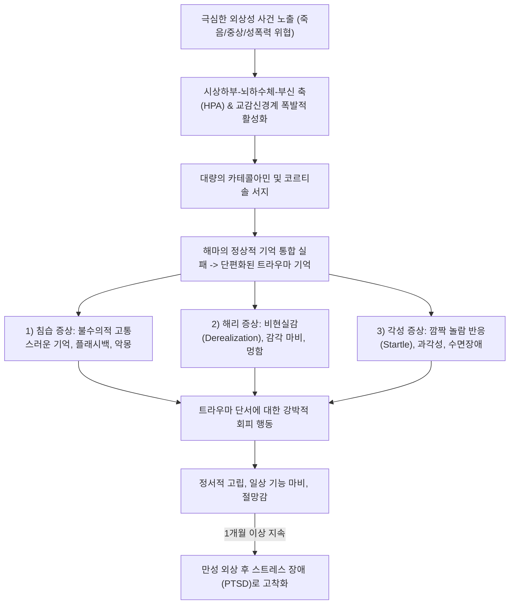

# 🩺 급성 스트레스 장애 (Acute Stress Disorder)

> **핵심 3줄 요약 (Key Summary)**:
> - 📍 병소 부위 & 해부·병태생리: 실제적이거나 위협적인 죽음, 심각한 부상, 성폭력 등 충격적 외상 사건(Trauma) 노출 후, 변연계 편도체의 과흥분 및 해마-전두엽 억제 제어 상실로 인해 3일~1개월 이내에 나타나는 급성 심리반응.
> - 🚩 전형적 임상 양상: 침습 증상(플래시백, 악몽), 해리 증상(Derealization, 기억 상실), 회피 행동, 각성 증상(과민성, 과각성, 수면장애), 부정적 기분이 사건 직후 복합 발현.
> - 🛠️ 핵심 검사 & 치료 전략: DSM-5-TR 14개 증상 중 $\ge 9$개 충족 확인; 1차 트라우마 초점 인지행동치료(TF-CBT), 지지 정신요법, 심리적 응급처치(PFA); 단기 수면장애 시 비벤조디아제핀/트라조돈; 한의 안신화담 및 이완 요법; 1개월 초과 시 [[외상 후 스트레스 장애]](PTSD) 이행 평가.
> - ⚠️ 응급 의뢰 레드플래그: 극심한 자살 충동 및 자해 기도, 심한 정신병적 증상(환각, 망상), 완전한 긴장성 혼미(Stupor) -> 즉각 정신건강의학과 응급 입원 의뢰.

---

## 📌 목차
1. [질환 개요 & 해부학적 병태생리](#1-질환-개요--해부학적-병태생리)
2. [병태생리 메커니즘 & 생체역학적 악순환 네트워크](#2-병태생리-메커니즘--생체역학적-악순환-네트워크)
3. [임상 증상 & 이학적 검사(Physical Exam) 알고리즘](#3-임상-증상--이학적-검사physical-exam-알고리즘)
4. [감별 진단 매트릭스 (Differential Diagnosis)](#4-감별-진단-매트릭스-differential-diagnosis)
5. [한의 통합 치료 프로토콜 (침·약침·추나·한약)](#5-한의-통합-치료-프로토콜--침-약침-추나-한약-)
6. [양방 치료 & 병용·의뢰 기준 (Conventional Treatment & Referral)](#6-양방-치료--병용의뢰-기준-conventional-treatment--referral)
7. [재활 운동 & 생활습관 티칭 가이드](#7-재활-운동--생활습관-티칭-가이드)
8. [💡 사용자 진료실 핵심 필기 & 임상 노하우 (Melt-In 잔여 심화 집약)](#8--사용자-진료실-핵심-필기--임상-노하우--melt-in-잔여-심화-집약-)
9. [출처 및 학술 참고 문헌 (References)](#9-출처-및-학술-참고-문헌--references)

---

## 1. 질환 개요 & 해부학적 병태생리

* **정의**: 급성 스트레스 장애(Acute Stress Disorder, ASD)는 생명을 위협하는 극심한 외상성 사건(교통사고, 폭력 범죄, 화재, 자연재해 등)을 직접 겪거나 목격한 직후, 침습·부정적 기분·해리·회피·각성 증상이 **외상 후 3일에서 1개월 이내에 지속**되는 급성 스트레스 증후군이다.
* **신경생물학적 병소 및 스트레스 축(HPA Axis)**:
  * **편도체(Amygdala)의 과반응**: 외상 기억에 대한 즉각적 공포 반응을 촉발하여 카테콜아민 분비를 유도.
  * **해마(Hippocampus) 기능 부전**: 급성 코르티솔 서지로 인해 외상 사건의 시공간적 맥락 부호화(Contextual encoding)가 실패하여 단편적이고 왜곡된 해리 기억 형성.
  * **내측 전두엽 피질(mPFC)**: 정상적인 공포 소거(Fear extinction) 기전이 마비됨.
* **역학 및 경과**:
  * 중증 교통사고나 범죄 피해자의 20~50%에서 발생한다.
  * ASD 환자의 약 50% 이상이 1개월 이후 만성적인 **[[외상 후 스트레스 장애]](PTSD)**로 이행하므로, 초기 개입이 예후를 결정한다.

---

## 2. 병태생리 메커니즘 & 생체역학적 악순환 네트워크

---

## 3. 임상 증상 & 이학적 검사(Physical Exam) 알고리즘

### 1) DSM-5-TR 진단 기준 (5개 범주 14개 증상 중 9개 이상 충족)
* **침습 증상(Intrusion)**:
  1. 사건에 대한 반복적이고 침습적인 고통스러운 기억.
  2. 사건과 관련된 고통스러운 꿈(악몽).
  3. 사건이 재현되는 것처럼 느끼는 해리 반응(플래시백).
  4. 사건 단서에 대한 극심한 심리적 고통 또는 생리적 반응.
* **부정적 기분(Negative Mood)**:
  5. 행복, 만족, 사랑과 같은 긍정적 정서를 느끼지 못함.
* **해리 증상(Dissociative)**:
  6. 주변 환경이나 자신에 대한 변형된 현실감(멍함, 시간 지연, 비현실감).
  7. 외상 사건의 중요한 부분을 기억하지 못함(해리성 기억상실).
* **회피 증상(Avoidance)**:
  8. 외상과 관련된 고통스러운 기억, 생각, 감정을 피하려는 노력.
  9. 외상을 상기시키는 외적 단서(사람, 장소, 대화, 물건)를 회피.
* **각성 증상(Arousal)**:
  10. 수면 교란(입면 곤란 또는 수면 유지 장애).
  11. 사소한 자극에 대한 과민성 및 분노 폭발.
  12. 지나친 경계심(과각성, Hypervigilance).
  13. 집중력 저하.
  14. 과장된 놀람 반응(Exaggerated startle response).

### 2) 기간 기준: **외상 후 3일 이상 ~ 1개월 이내** (1개월 초과 시 PTSD 재진단).

---

## 4. 감별 진단 매트릭스 (Differential Diagnosis)

| 질환 | 증상 지속 기간 | 주 특징적 증상 | 해리 증상 빈도 | 치료 원칙 |
| :--- | :--- | :--- | :--- | :--- |
| **급성 스트레스 장애 (ASD)** | **3일 ~ 1개월 이내** | 침습, 회피, 각성 + **뚜렷한 해리** | **매우 높음** | 심리적 응급처치, TF-CBT |
| **[[외상 후 스트레스 장애]] (PTSD)** | **1개월 초과** | 침습, 회피, 부정적 인지, 과각성 | 다양함 | 장기 인지처리치료, SSRI |
| **적응 장애 (Adjustment Disorder)** | 스트레스 후 3개월 내 | 우울, 불안 (스트레스 수준이 생명위협 수준 아님) | 없음 | 지지 치료, 환경 조정 |
| **[[공황 장애]]** | 발작 시 10~20분 정점 | 돌발적 심계항진, 질식감, 죽을 공포 | 비현실감 동반 가능 | 외상 사건과 무관하게 자발 발생 |
| **사별 반응 (Normal Grief)** | 기간 다양 | 슬픔, 고인에 대한 그리움 | 드묾 | 정상 애도 반응 지지 |

---

## 5. 한의 통합 치료 프로토콜 (침·약침·추나·한약)

### 1) 변증 분류
* **경자평지·심담허겁(驚者平之·心膽虛怯)**: 큰 충격 후 심장이 뛰고 멍함, 잘 놀람, 불면, 악몽, 설담태박, 맥현세동(動).
* **기체어혈·심신불안(氣滯瘀血·心神不安)**: 사고 후 가슴 통증, 억울함, 플래시백 시 분노 폭발, 설암유어점, 맥현삽.
* **음허화동·간양상항(陰虛火動·肝陽上亢)**: 과각성, 식은땀, 안면 상열감, 신경과민, 설홍소태, 맥세삭.

### 2) 침구 치료
* **주요 혈위**:
  * 진정 안신(安神) 및 교감신경 차단: [[신문]](HT7), [[내관]](PC6), [[백회]](GV20), [[인당]](EX-HN3).
  * 놀람을 가라앉히고 심담 강화: [[태충]](LR3), [[담수]](BL19), [[심수]](BL15), [[용천]](KI1).
* **자침 기법**: 유침 20분, 심문-내관에 평보평사, 미세 피내침(이침: 신문, 교감, 피질하) 병용으로 일상 긴장 완화.

### 3) 한약 처방
* **안신온담탕(安神溫膽湯) 가감**: 외상 후 심담허겁으로 인한 불면, 불안, 악몽, 멍한 해리 상태를 다스리는 최선 방제. (반하, 진피, 복령, 지실, 죽여, 인삼, 숙지황, 백자인, 산조인, 원지, 감초).
* **귀비탕(歸脾湯) 합 산조인탕(酸棗仁湯)**: 기혈이 마르고 잠을 이루지 못하며 깜짝깜짝 놀라는 환자의 진액과 심신 보양.
* **계지가용골모려탕(桂枝加龍骨牡蠣湯)**: 사소한 자극에도 심장이 뛰고 진은(땀)이 빠지는 자율신경 실조증 완화.

---

## 6. 양방 치료 & 병용·의뢰 기준 (Conventional Treatment & Referral)

* **초기 개입 원칙 (Psychological First Aid, PFA)**:
  * 안전 확보, 기본적 생리적 욕구 충족, 강요하지 않는 경청.
  * **주의**: 과거 널리 시행되었던 **강제적 심리적 디브리핑(Critical Incident Stress Debriefing)**은 트라우마 기억을 재경험시켜 오히려 PTSD 발병률을 높일 수 있어 **단독 강제 시행 금기**.
* **심리치료 (1차 표준 치료)**:
  * **트라우마 초점 인지행동치료 (TF-CBT)**: 인지 재구성 및 점진적 노출 기법 (ASD의 PTSD 이행을 50% 이상 차단).
* **약물 치료 (보조적 단기 사용)**:
  * 벤조디아제핀은 장기 투여 시 공포 기억 소거를 방해하므로 극심한 불면에 한해 며칠간만 제한적 사용.
  * 불면 및 과각성 조절: 트라조돈(Trazodone 25~50 mg), 미르타자핀(Mirtazapine), 또는 $\alpha_1$-차단제인 프라조신(Prazosin, 악몽 억제).
* **양방·전문과 의뢰 기준 (Referral Criteria)**:
  * **즉각 의뢰 (Red Flag)**:
    * 자살 충동이나 구체적 자해 계획을 호소하는 경우.
    * 해리성 둔주나 혼미로 자기 신변 처리가 불가능한 상태.
    * 외상 후 1개월이 경과하여 만성 PTSD로 이행된 환자.

---

## 7. 재활 운동 & 생활습관 티칭 가이드

* **안전지대(Safe Space) 구축**:
  * 환자가 신체적·심리적 위협으로부터 완전히 벗어났음을 반복적으로 체감할 수 있는 편안한 환경 조성.
* **미디어 및 뉴스 노출 차단**:
  * 사고나 재난 관련 뉴스, SNS 영상을 지속적으로 시청하는 것은 뇌에 2차 트라우마를 주므로 스마트폰 미디어 사용 중단 권고.
* **신체 접지(Grounding) 훈련**:
  * 플래시백이나 해리감이 올 때 발바닥으로 방바닥을 힘껏 딛고, 눈에 보이는 물건 5가지 이름을 말하는 감각 접지 기법 지도.

---

## 8. 💡 사용자 진료실 핵심 필기 & 임상 노하우 (Melt-In 잔여 심화 집약)

* **교통사고 후 "몸은 안 아픈데 차만 타면 심장이 터질 것 같아요" 환자 관리**:
  * 한의원 자보(자동차보험) 환자 중 경추 염좌 치료는 끝났으나 운전대를 잡지 못하고 불면과 공포를 호소하는 환자가 매우 많다.
  * 이는 꾀병이 아니라 전형적인 **교통사고 유발 급성 스트레스 장애(ASD)**이다. 신체 통증 치료에만 머물지 말고 온담탕이나 시호가용골모려탕을 배합하고, 안면혈과 내관혈 침 치료를 병행해야 조기에 PTSD로의 만성화를 막을 수 있다.
* **환자의 말을 억지로 끄집어내지 말 것**:
  * 환자가 사고 순간을 이야기하기 힘들어할 때 "다 털어놓아야 낫는다"며 억지로 캐묻는 것은 위험하다. 트라우마 기억이 다시 터져 나와 진료실에서 패닉에 빠질 수 있다. 환자가 준비될 때까지 안전한 지지적 태도를 유지하는 것이 명의의 태도이다.

---

## 9. 출처 및 학술 참고 문헌 (References)

* Al-Mutawa N, et al. (2026 Sep). Psychological distress, PTSD, and complex PTSD in a war-torn population: a two-wave longitudinal study among medical students in Gaza. *Soc Psychiatry Psychiatr Epidemiol*, 61(9):1456-1468. PMID: 41894012.

* Yilmaz O, et al. (2025 Nov 26). A brief religiously-adapted cognitive behavioral therapy intervention for Acute Stress Disorder (ASD) after Kahramanmaraş earthquake in Türkiye: a case series. *BMC Psychiatry*, 25(1):980. PMID: 41299306.

* Edmondson D, et al. (2026 Jun). Cardiac event-induced PTSD symptoms and continuous heart rate in coronary artery disease patients. *Health Psychol*, 45(6):512-521. PMID: 41712332.

---

## 관련 노트

- [[_의학/03_이론/질환/신경정신과 질환/기분·불안/공황 발작과 공황 장애|공황 발작과 공황 장애]]
- [[_의학/03_이론/질환/신경정신과 질환/기분·불안/범불안장애|범불안장애]]
- [[불안]]
- [[우울증]]
