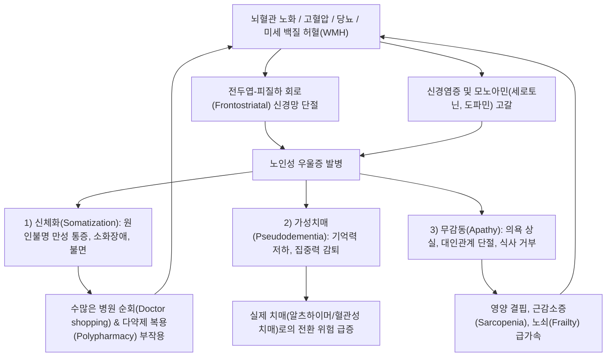
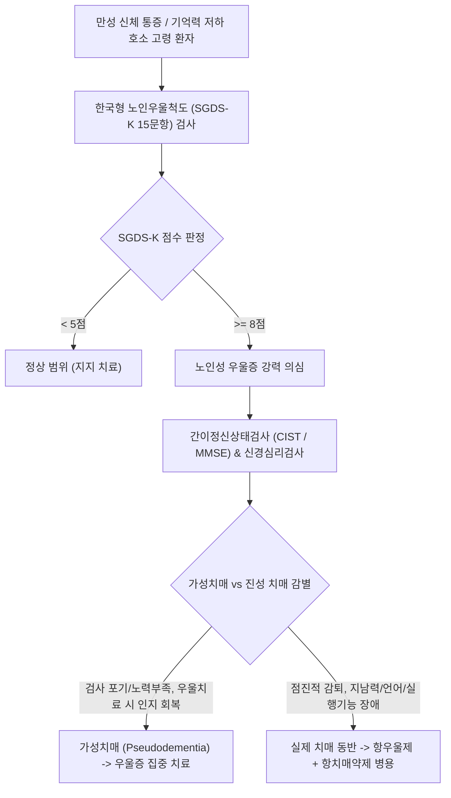

# 🩺 노인성 우울증 (Late-Life Depression, Geriatric Depression)

> **핵심 3줄 요약 (Key Summary)**:
> - 📍 병소 부위 & 해부·병태생리: 뇌 백질 고신호강도(White matter hyperintensities) 등 혈관성 뇌병변, 뇌혈관-피질하 회로(Frontostriatal circuit) 손상, 신경염증 및 신경퇴행성 변화를 기반으로 발생하는 65세 이상 노년기의 우울 장애.
> - 🚩 전형적 임상 양상: "우울하다"는 기분 호소 대신 원인 불명의 만성 신체 통증·소화불량·어지럼증 등 신체화 증상(Somatization), 기억력 감퇴 및 집중력 저하로 치매처럼 보이는 '가성치매(Pseudodementia)', 의욕 상실과 무감동(Apathy).
> - 🛠️ 핵심 검사 & 치료 전략: 한국형 노인우울척도(SGDS-K), 간이정신상태검사(MMSE), 뇌 MRI(혈관성 허혈 병변 확인); 1차 선택적 세로토닌 재흡수 억제제(에스시탈로프람, 세르트랄린) 또는 노르에피네프린/세로토닌 조절제(미르타자핀); 한의 기혈쌍보 및 침구 치료; 신체 질환 및 다약제 관리.
> - ⚠️ 응급 의뢰 레드플래그: 노인의 자살 시도는 젊은 층에 비해 치사율이 극단적으로 높음(암묵적 작별 인사, 신변 정리, 식사 전면 거부) -> 즉각 정신건강의학과 폐쇄병동 입원 의뢰.

---

## 📌 목차
1. [질환 개요 & 해부학적 병태생리](#1-질환-개요--해부학적-병태생리)
2. [병태생리 메커니즘 & 생체역학적 악순환 네트워크](#2-병태생리-메커니즘--생체역학적-악순환-네트워크)
3. [임상 증상 & 이학적 검사(Physical Exam) 알고리즘](#3-임상-증상--이학적-검사physical-exam-알고리즘)
4. [감별 진단 매트릭스 (Differential Diagnosis)](#4-감별-진단-매트릭스-differential-diagnosis)
5. [한의 통합 치료 프로토콜 (침·약침·추나·한약)](#5-한의-통합-치료-프로토콜--침-약침-추나-한약-)
6. [양방 치료 & 병용·의뢰 기준 (Conventional Treatment & Referral)](#6-양방-치료--병용의뢰-기준-conventional-treatment--referral)
7. [재활 운동 & 생활습관 티칭 가이드](#7-재활-운동--생활습관-티칭-가이드)
8. [💡 사용자 진료실 핵심 필기 & 임상 노하우 (Melt-In 잔여 심화 집약)](#8--사용자-진료실-핵심-필기--임상-노하우--melt-in-잔여-심화-집약-)
9. [출처 및 학술 참고 문헌 (References)](#9-출처-및-학술-참고-문헌--references)

---

## 1. 질환 개요 & 해부학적 병태생리

* **정의**: 노인성 우울증(Late-Life Depression, LLD)은 65세 이상 노년기 인구에서 발생하는 주요 우울 장애로, 젊은 성인의 우울증과 달리 심리적 슬픔보다는 **신체화 증상, 인지기능 저하, 무감동(Apathy), 신체 질환과의 높은 공존성**을 특징으로 하는 질환이다.
* **해부학적 병인 및 혈관성 우울증 가설 (Vascular Depression Hypothesis)**:
  * **전두엽-선조체 회로(Frontostriatal Circuit) 단절**: 뇌 소혈관 질환(Cerebral small vessel disease)으로 인한 피질하 백질 허혈(White matter hyperintensities, WMH)이 전두엽과 기저핵 사이의 감정 및 집행기능 조절 신경망을 손상시킴.
  * **신경염증 및 면역노화(Inflammaging)**: 노화에 따른 전신 미세염증(IL-6, TNF-$\alpha$, CRP 상승)이 미세아교세포(Microglia)를 활성화하여 세로토닌 및 도파민 합성 저하 유발.
  * **사회심리적 상실감**: 은퇴, 경제적 곤궁, 배우자 사별, 만성 통증/신체 장애에 따른 사회적 고립.
* **역학 및 위험성**:
  * 지역사회 거주 노인의 약 10~15%, 요양병원 및 만성 질환 입원 노인의 30~40%가 우울 증상을 겪는다.
  * 노인 자살률의 가장 강력한 독립적 위험 인자이며, 인지기능 저하를 가속화하여 [[알츠하이머병]] 및 혈관성 [[치매]] 발생 위험을 2~3배 높인다.

---

## 2. 병태생리 메커니즘 & 생체역학적 악순환 네트워크

---

## 3. 임상 증상 & 이학적 검사(Physical Exam) 알고리즘

### 1) 주요 임상 증상 (젊은 층과의 결정적 차이)
* **신체 증상의 가면(Masked Depression)**:
  * 환자 스스로 "기분이 우울하다"고 말하지 않고, "온몸이 쑤시고 아프다", "소화가 안 되고 밥맛이 없다", "머리가 맑지 않고 어지럽다"고 호소.
* **가성치매 (Pseudodementia, 인지기능 저하)**:
  * "기억력이 다 떨어져서 치매에 걸렸다"고 스스로 호소하며 검사 시 "모르겠어요"라며 대답을 쉽게 포기함(치매 환자는 기억력 저하를 숨기려 하거나 그럴듯하게 둘러댐).
* **불안 및 건강염려증**:
  * "몹쓸 불치병에 걸린 것 같다"는 신체망상에 가까운 극심한 불안, 초조(Agitation).
* **수면장애**:
  * 조기 각성(새벽 3~4시에 깨어 다시 잠들지 못함), 수면 유지 장애.

### 2) 선별 도구 및 진단 알고리즘

---

## 4. 감별 진단 매트릭스 (Differential Diagnosis)

| 감별 질환 | 발병 양상 | 인지 저하 호소 태도 | 주 호소 증상 | 뇌 영상 (MRI) | 치료 반응 |
| :--- | :--- | :--- | :--- | :--- | :--- |
| **노인성 우울증 (가성치매)** | **비교적 급성~아급성** | **과장되게 호소, "모르겠다" 포기** | **신체 통증, 무기력, 불면** | 뇌실주위 백질변성(WMH) | **항우울제 투여 시 인지 완치** |
| **[[알츠하이머병]] 치매** | 서서히 진행 (만성) | 기억력 저하 부인/변명 | 최근 기억 상실, 지남력 상실 | 해마 위축(Hippocampal atrophy) | 항치매제(Donepezil)로 진행 지연 |
| **혈관성 치매** | 계단식 악화 | 집행기능 장애 | 편마비 등 국소 신경학적 징후 | 다발성 열공성 뇌경색 | 혈관 위험인자 조절 |
| **갑상샘기능저하증** | 서서히 진행 | 인지 지연 | 추위 탐, 부종, 변비 | 정상 | T4(신지로이드) 보충 |
| **파킨슨병 동반 우울** | 서서히 진행 | 서동증, 경직 | 서동증, 떨림, 종종걸음 | 흑질 도파민 소실 | 레보도파 + 항우울제 |

---

## 5. 한의 통합 치료 프로토콜 (침·약침·추나·한약)

### 1) 변증 분류
* **심비양허·기혈고갈(心脾兩虛·氣血枯竭)**: 만성 신체 쇠약, 식욕부진, 체중 감소, 피로, 건망, 불면, 설담소태, 맥세약.
* **간신음허·허화요심(肝腎陰虛·虛火擾心)**: 요슬산연, 조열도한, 가슴 답답함, 두통, 현훈, 설홍소태, 맥세삭.
* **담음어혈·기체신체화(痰飲瘀血·氣滯身體化)**: 전신 유주성 통증, 매핵기(목 이물감), 가슴 흉협고만, 설암태백니, 맥현활.

### 2) 침구 치료
* **주요 혈위**:
  * 뇌기능 활성화 및 보기양혈: [[백회]](GV20), [[사신총]](EX-HN1), [[족삼리]](ST36), [[비수]](BL20), [[심수]](BL15).
  * 신체 통증 완화 및 안신: [[신문]](HT7), [[내관]](PC6), [[태충]](LR3), [[합곡]](LI4).
* **자침 기법**: 유침 15~20분, 고령자의 기운을 상하지 않도록 부드러운 보법 위주 자침, 온구(뜸) 요법을 족삼리·기해에 병용.

### 3) 한약 처방
* **귀비탕(歸脾湯) 가감**:
  * 노인성 우울증의 1차 표준 한약. 심비기혈을 크게 보하고 불면, 식욕부진, 기억력 저하를 동시에 개선. (당귀, 용안육, 산조인, 원지, 인삼, 황기, 백출, 복신, 목향, 감초).
* **보중익기탕(補中益氣湯)**: 기력 고갈로 종일 누워만 있고 식사를 전면 거부하는 노인의 비위 원기 보충.
* **분심기음(分心氣飮) 또는 반하후박탕(半夏厚朴湯)**: 신체화 통증과 가슴 답답함, 소화불량이 현저한 울체형 환자.

---

## 6. 양방 치료 & 병용·의뢰 기준 (Conventional Treatment & Referral)

* **약물 치료 (Medication - "Start Low, Go Slow")**:
  * 노인은 간·신장 대사 저하 및 약물 부작용 위험이 높으므로 성인 용량의 **1/3~1/2로 시작하여 천천히 증량**.
  * **1차 권고 약제**:
    * **에스시탈로프람 (Escitalopram 5~10 mg)**, **세르트랄린 (Sertraline 25~50 mg)**: 심혈관계 및 약물 상호작용이 가장 적고 안전.
    * **미르타자핀 (Mirtazapine 7.5~15 mg 취침 전)**: 심한 불면과 체중 감소(식욕부진)를 동반한 노인에게 최적의 선택 (진정 및 체중 증가 효과).
  * **노인 금기 약제**:
    * 삼환계 항우울제(TCA, 아미트립틸린): 강력한 항콜린 부작용(기립성 저혈압, 낙상, 요폐, 녹내장, 인지 악화, 부정맥)으로 노인에서 절대 금기.
* **양방·전문과 의뢰 기준 (Referral Criteria)**:
  * **즉각 입원 의뢰 (초응급 Red Flag)**:
    * 노인의 자살 충동(노인은 자살을 경고 없이 단번에 치명적 방법으로 완수함).
    * 식사와 물을 완전히 거부하여 생명이 위태로운 중증 쇠약 상태.
    * 항우울제 치료 수개월에도 호전되지 않는 난치성 우울증(전기경련요법 ECT 고려 필요).

---

## 7. 재활 운동 & 생활습관 티칭 가이드

* **햇볕 쬐며 평지 걷기**:
  * 아침 햇볕 노출(하루 30분 이상)은 멜라토닌과 세로토닌 합성을 촉진하여 야간 수면 주기 정상화에 필수적임.
* **사회적 연결망 유지**:
  * 경로당, 노인복지관, 종교 활동 등 타인과의 대화 시간을 억지로라도 일정표에 넣도록 지도.
* **영양 균형 관리**:
  * 단백질 섭취(체중 1kg당 1.2g)를 강화하여 근감소증을 예방하고 비타민 B12, 엽산 결핍 교정.

---

## 8. 💡 사용자 진료실 핵심 필기 & 임상 노하우 (Melt-In 잔여 심화 집약)

* **"원장님, 온몸이 아픈데 내과·정형외과에선 이상이 없대요" = 가면성 우울증**:
  * 환자가 수년째 허리, 어깨, 무릎, 명치가 돌아가며 아프다고 호소하고 온갖 검사에서 정상인데 침을 맞아도 그때뿐이라면, 반드시 **수면 상태와 체중 변화, 최근의 사별/가족 불화**를 물어보라.
  * "밤에 잠을 통 못 자고 새벽에 깨며 밥맛이 없다"고 하면 그것은 근골격계 질환이 아니라 **노인성 가면성 우울증(Masked Depression)**이다. 이때 귀비탕이나 항우울제를 투여하면 수년 묵은 전신 통증이 씻은 듯이 사라진다.
* **노인 우울증 환자의 '자살 암시 신호' 놓치지 말 것**:
  * 젊은 층과 달리 노인은 "자살하겠다"고 말하지 않는다. 대신 평소 아끼던 물건을 남에게 나누어주거나, 오랜 지인들에게 안부 전화를 돌리며 작별 인사를 하거나, "이제 살 만큼 살았다, 자식들 고생 그만 시켜야지"라며 식사를 끊는다. 이러한 징후는 초응급 상황이므로 보호자를 즉시 호출하여 안전 조치를 취해야 한다.

---

## 9. 출처 및 학술 참고 문헌 (References)

* Taylor WD, et al. (2026 Oct). Toward Precision Diagnosis of Late-Life Mood Disorders: A Neuropathology-Informed Framework and Research Agenda. *Am J Geriatr Psychiatry*, 34(10):1102-1115. PMID: 42103608.

* Reynolds CF 3rd, et al. (2026 Sep 8). A Scoping Review of Integrated Care Models for Managing Depression in Older Adults. *Geriatrics (Basel)*, 11(5):82. PMID: 42776715.

* Liu Z, et al. (2026). Integrated approaches to geriatric mental disorders: pathophysiology, interventions, and precision medicine horizons. *Front Psychiatry*, 17:1512345. PMID: 42787720.

---

## 관련 노트

- [[우울장애|우울증]]
- [[치매]]
- [[알츠하이머병]]
- [[불안]]
- [[기립성 저혈압]]
