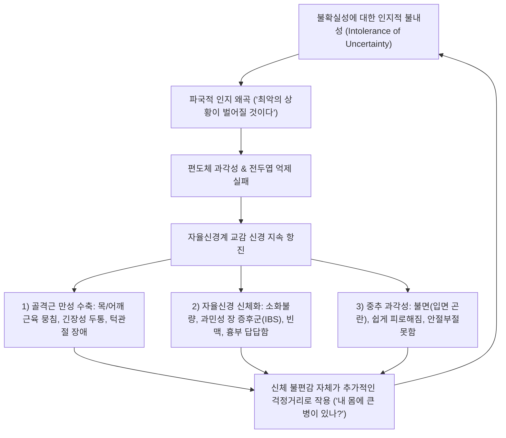
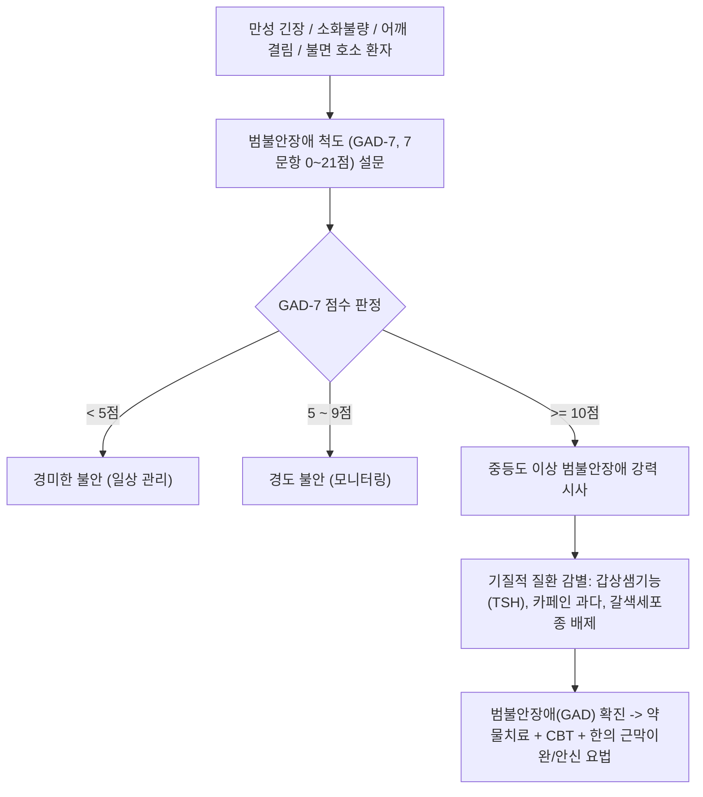

# 🩺 범불안장애 (Generalized Anxiety Disorder)

> **핵심 3줄 요약 (Key Summary)**:
> - 📍 병소 부위 & 해부·병태생리: 편도체(Amygdala)와 배외측 전두엽 피질(dlPFC) 간의 정서 조절 회로 결함, 억제성 GABA성 신경전달 저하, 세로토닌 및 노르에피네프린 불균형으로 인해 일상생활 전반에 통제 불가능한 과도한 걱정과 불안이 만성화된 상태.
> - 🚩 전형적 임상 양상: 최소 6개월 이상 지속되는 다방면의 만성적 걱정, 안절부절못함(Restlessness), 쉽게 피로해짐, 집중 곤란, 근육 긴장(어깨·목 결림), 수면장애(입면 곤란).
> - 🛠️ 핵심 검사 & 치료 전략: GAD-7 척도($\ge 10$점 중등도 이상), 갑상샘 기능 등 신체 질환 배제; 1차 약물 치료로 SSRI/SNRI 또는 프레가발린/부스피론, 인지행동치료(CBT, 걱정 시간 정하기, 인지 재구조화); 한의 분심기음/온담탕 및 이완 침구치료.
> - ⚠️ 응급 의뢰 레드플래그: 주요 우울 장애 병발로 인한 급성 자살 충동, 심한 불면과 알코올/진정제 남용에 따른 섬망, 공황 발작 빈발 -> 즉각 정신건강의학과 집중 치료 의뢰.

---

## 📌 목차
1. [질환 개요 & 해부학적 병태생리](#1-질환-개요--해부학적-병태생리)
2. [병태생리 메커니즘 & 생체역학적 악순환 네트워크](#2-병태생리-메커니즘--생체역학적-악순환-네트워크)
3. [임상 증상 & 이학적 검사(Physical Exam) 알고리즘](#3-임상-증상--이학적-검사physical-exam-알고리즘)
4. [감별 진단 매트릭스 (Differential Diagnosis)](#4-감별-진단-매트릭스-differential-diagnosis)
5. [한의 통합 치료 프로토콜 (침·약침·추나·한약)](#5-한의-통합-치료-프로토콜--침-약침-추나-한약-)
6. [양방 치료 & 병용·의뢰 기준 (Conventional Treatment & Referral)](#6-양방-치료--병용의뢰-기준-conventional-treatment--referral)
7. [재활 운동 & 생활습관 티칭 가이드](#7-재활-운동--생활습관-티칭-가이드)
8. [💡 사용자 진료실 핵심 필기 & 임상 노하우 (Melt-In 잔여 심화 집약)](#8--사용자-진료실-핵심-필기--임상-노하우--melt-in-잔여-심화-집약-)
9. [출처 및 학술 참고 문헌 (References)](#9-출처-및-학술-참고-문헌--references-)

---

## 1. 질환 개요 & 해부학적 병태생리

* **정의**: 범불안장애(Generalized Anxiety Disorder, GAD)는 특정한 대상이나 상황에 국한되지 않고, 건강, 재정, 가족, 직업 등 일상생활의 다양한 사건이나 활동에 대해 지나치고 통제하기 어려운 불안과 걱정이 **최소 6개월 이상 거의 매일 지속**되는 만성 정신질환이다.
* **신경생물학적 병소 및 조절 회로**:
  * **편도체(Amygdala)와 전전두엽(PFC) 간의 기능적 연결성 약화**: 정상적인 뇌에서는 배외측 전두엽(dlPFC)과 전측 대상회(ACC)가 편도체의 과도한 정서 반응을 하향 억제(Top-down inhibition)하지만, GAD 환자에서는 이 억제 경로가 취약하여 사소한 잠재적 위협에도 불안 반응이 지속된다.
  * **신경전달물질 이상**: 중추성 억제 신경전달물질인 $\text{GABA}_A$ 수용체 기능 저하, 세로토닌(5-HT) 활성 저하, 청반 노르에피네프린계의 만성 과각성.
* **역학**:
  * 평생 유병률은 약 5%로 매우 흔하며, 여성이 남성보다 약 2배 많고 만성적 경과를 밟으며 자연 관해율이 낮다. 환자의 60% 이상에서 주요 우울 장애, 공황 장애 등 타 정신과 질환이 동반된다.

---

## 2. 병태생리 메커니즘 & 생체역학적 악순환 네트워크

---

## 3. 임상 증상 & 이학적 검사(Physical Exam) 알고리즘

### 1) DSM-5-TR 진단 기준
* **A**: 다양한 일상 사건/활동에 대한 과도한 불안과 걱정이 **최소 6개월 이상, 며칠에 한 번 이상(대부분의 날에)** 나타남.
* **B**: 개인이 걱정을 통제하기 어렵다고 느낌.
* **C**: 다음 6개 신체/인지 증상 중 **3개 이상(소아는 1개 이상)** 동반:
  1. **안절부절못함** 또는 벼랑 끝에 선 느낌(Restlessness or feeling keyed up).
  2. **쉽게 피로해짐**(Easily fatigued).
  3. **집중 곤란** 또는 머릿속이 하얘지는 느낌(Difficulty concentrating).
  4. **과민성/짜증**(Irritability).
  5. **근육 긴장**(Muscle tension, 승모근/견갑거근/후두하근 만성 뭉침).
  6. **수면 교란**(입면 곤란, 수면 유지 장애, 불만족스러운 수면).

### 2) 선별 도구 및 진단 알고리즘

---

## 4. 감별 진단 매트릭스 (Differential Diagnosis)

| 질환 | 주된 걱정 / 불안의 성격 | 발병 기간 / 양상 | 신체 증상 특징 | 감별 포인트 |
| :--- | :--- | :--- | :--- | :--- |
| **범불안장애 (GAD)** | **일상생활 전반의 다방면 걱정 (자유부유 불안)** | **6개월 이상 만성적** | **만성 근육 긴장, 피로, 불면** | 특정 대상 없는 전방위적 걱정 |
| **[[공황 장애]]** | 추가 발작 및 죽음에 대한 두려움 | 돌발적 발작 (10~20분 정점) | 급성 호흡곤란, 심계항진, 흉통 | 발작 사이에는 비교적 안정 |
| **[[사회 불안 장애]]** | 타인의 부정적 평가, 무대 발표 두려움 | 특정 사회적 상황에 국한 | 얼굴 붉어짐, 떨림, 시선 회피 | 사회적 상황 회피가 주증상 |
| **[[질병 불안 장애]]** | 심각한 질병에 걸렸다는 확신 | 6개월 이상 | 특정 신체 부위 집착, 반복 확인 | '질병'에만 국한된 걱정 |
| **[[갑상샘기능항진증]]** | 기질적 호르몬 과다 | 지속적 빈맥, 체중감소 | 진전, 열 불내성, 안구 돌출 | TSH 저하, Free T4 상승 |

---

## 5. 한의 통합 치료 프로토콜 (침·약침·추나·한약)

### 1) 변증 분류
* **간기울결·목화형금(肝氣鬱結·木火刑金)**: 가슴 답답함, 한숨, 옆구리 팽만통, 사소한 일에 분노, 설암태박황, 맥현삭.
* **심담허겁·신신불교(心膽虛怯·心腎不交)**: 매사 사소한 걱정이 끊이지 않음, 잘 놀람, 불면, 야간 가슴 두근거림, 설홍소태, 맥세삭.
* **비허습담·담열요심(脾虛濕痰·痰熱擾心)**: 소화불량, 만성 피로, 목에 가래 걸림(매핵기), 머리가 무거움, 설담태백니, 맥활.

### 2) 침구 치료
* **주요 혈위**:
  * 뇌 신경계 이완 및 안신: [[백회]](GV20), [[신문]](HT7), [[내관]](PC6), [[인당]](EX-HN3).
  * 근육 긴장 해소: [[풍지]](GB20), [[견정]](GB21), [[천주]](BL10), [[대장수]](BL25).
  * 기혈 소통: [[태충]](LR3), [[합곡]](LI4), [[족삼리]](ST36).
* **자침 기법**: 견정·풍지 등 항배부 긴장 근육에 심자(深刺) 후 사법 유침, 전침 요법(2Hz Low frequency)으로 골격근 이완 유도.

### 3) 추나 요법
* **경항부 및 흉곽 이완 추나**:
  * 만성 불안으로 단축된 상부 승모근, 견갑거근, 후두하근군 근막이완기법(Myofascial Release).
  * 경추 및 상부 흉추 관절가동술을 통해 교감신경절 흥분성 완화.

### 4) 한약 처방
* **분심기음(分心氣飮) 가감**: 칠정 울결로 인한 전신성 불안, 가슴 답답함, 소화불량, 수족냉증을 소통시키는 1차 방제.
* **가미소요산(加味逍遙散)**: 간울혈허(肝鬱血虛)로 인한 만성 불안, 짜증, 상열감, 수면장애 개선.
* **가미온담탕(加味溫膽湯)**: 담열(痰熱)로 가슴이 뛰고 메스꺼우며 악몽을 꾸는 신경과민성 환자.

---

## 6. 양방 치료 & 병용·의뢰 기준 (Conventional Treatment & Referral)

* **약물 치료 (Medication)**:
  * **1차 권고 유지 약제 (항우울제)**:
    * **SSRI**: 에스시탈로프람 (Escitalopram 10~20 mg), 파록세틴, 세르트랄린.
    * **SNRI**: 벤라팍신 (Venlafaxine 75~225 mg), 둘록세틴 (Duloxetine - 근육통/신체 통증 동반 시 우수).
  * **기타 1차 약제**:
    * **프레가발린 (Pregabalin 150~600 mg)**: 전압의존성 칼슘 채널 억제로 신속한 항불안 효과 (SSRI 반응 전 가교 요법으로 유효).
    * **부스피론 (Buspirone 15~30 mg)**: 5-$\text{HT}_{1A}$ 부분 효능제 (진정/의존성 없음, 단 효과 발현에 2~4주 소요).
  * **2차/단기 보조제**:
    * 벤조디아제핀(BZD): 극심한 불안 초기에 2~4주 이내로만 단기 사용 (내성 및 의존성 위험).
* **인지행동치료 (CBT)**:
  * 인지 재구조화: 파국화 사고 교정.
  * **'걱정 시간(Worry Time)' 기법**: 하루 20~30분간만 정해진 시간에 집중해서 걱정하고, 나머지 시간에는 일상에 집중하도록 훈련.
* **양방·전문과 의뢰 기준 (Referral Criteria)**:
  * 중증 주요 우울 장애가 병발하여 자살 사고를 보이는 경우.
  * 불안 조절을 위해 알코올이나 진정제를 남용하여 의존성이 발생한 경우.

---

## 7. 재활 운동 & 생활습관 티칭 가이드

* **점진적 근육 이완법 (PMR, Progressive Muscle Relaxation)**:
  * 발끝부터 얼굴까지 전신 근육을 5초간 꽉 조였다가 10초간 힘을 완전히 빼는 훈련을 하루 1회 시행하여 신체 긴장 자각 및 해소.
* **카페인 엄격 차단**:
  * 커피, 녹차, 초콜릿, 탄산음료 섭취는 체내 아드레날린을 자극하므로 디카페인으로 전면 전환.
* **유산소 운동**:
  * 주 3회 이상 땀이 날 정도의 중등도 유산소 운동(조깅, 수영, 자전거)으로 신경전달물질 균형 도모.

---

## 8. 💡 사용자 진료실 핵심 필기 & 임상 노하우 (Melt-In 잔여 심화 집약)

* **"늘 어깨가 돌덩이처럼 굳어 있어요" = 범불안장애의 체감 징후**:
  * 진료실에서 40~50대 환자가 "마사지를 받고 침을 맞아도 다음날이면 어깨와 목이 또 돌처럼 굳는다"고 호소할 때, 근육만 보지 말고 **머릿속 생각의 흐름**을 문진해야 한다.
  * "평소에 자식 걱정, 돈 걱정, 건강 걱정 때문에 생각이 꼬리에 꼬리를 물지 않으시나요?"라고 물으면 십중팔구 울컥하며 동의한다. 범불안장애 환자는 24시간 내내 뇌가 위협 모드로 가동되어 승모근과 견갑거근에 지속적인 수축 신호를 보낸다. 이때 분심기음이나 소요산을 처방하고 인지 티칭을 병행해야 만성 근막통증증후군이 비로소 풀린다.

---

## 9. 출처 및 학술 참고 문헌 (References)

* Sluka M, et al. (2026 Oct 8). DT120 (MM120): a single-dose orally disintegrating formulation of lysergide tartrate for generalized anxiety disorder. *Expert Rev Neurother*, 26(10):1123-1135. PMID: 42848417.

* Morimoto H, et al. (2026 Apr 27). Effects of Morita therapy for anxiety disorders: A systematic review and meta-analysis. *Australas Psychiatry*, 34(2):189-198. PMID: 42046175.

* Faraji A, et al. (2026 Nov). Clinical Diagnosis and Treatment of Anxiety in Dementia With Lewy Bodies. *Am J Geriatr Psychiatry*, 34(11):1245-1258. PMID: 42331675.

---

## 관련 노트

- [[_의학/03_이론/질환/신경정신과 질환/기분·불안/공황 발작과 공황 장애|공황 발작과 공황 장애]]
- [[_의학/03_이론/질환/신경정신과 질환/기분·불안/노인성 우울증|노인성 우울증]]
- [[_의학/03_이론/질환/신경정신과 질환/기분·불안/우울증|우울증]]
- [[불안]]
