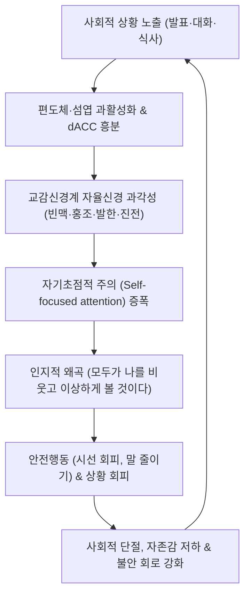

# 🩺 사회 불안 장애 (Social Anxiety Disorder / 卑怯·恐症)

> **핵심 3줄 요약 (Key Summary)**:
> - 📍 병소 부위 & 해부·병태생리: 타인의 부정적 평가와 관찰에 대한 극심한 두려움으로 유발되는 신경정신과적 질환으로, [[편도체]](Amygdala) 및 섬엽(Insula)의 공포 회로 과활성화와 전전두엽([[내측 전전두엽]], 배외측 전전두엽)의 하향식 억제(top-down inhibition) 부전이 핵심 병소이다.
> - 🚩 전형적 임상 양상: 대중 앞 발표·식사·대화 등 사회적 상황에 직면할 때 극심한 불안, 안면 홍조, 발한, 진전(손·목소리 떨림), 빈맥 등 자율신경계 과각성 징후가 나타나며, 상황을 집요하게 회피하거나 극심한 고통 속에 견딘다.
> - 🛠️ 핵심 검사 & 치료 전략: K-LSAS(한국판 라이보위츠 사회불안척도), SPIN(사회공포증 척도)으로 평가하며, 인지행동치료(CBT) 및 1차 약물([[SSRI]], [[SNRI]], 필요 시 [[베타차단제]])과 함께 한의학적 정지승상요법, 이정변기요법, [[신문]], [[내관]], [[백회]] 침치료, 분심기음·귀비탕 투여를 통합 적용한다.
> - ⚠️ 응급 의뢰 레드플래그: 만성 사회적 고립에 따른 심각한 이차성 주요우울장애 동반 및 자살 사고·계획, 불안 완화를 목적으로 한 알코올/진통수면제 남용 및 의존, 공황발작의 중첩으로 인한 급성 탈진 상태 시 즉시 상급 정신건강의학과로 전원한다.

---

## 📌 목차
1. [질환 개요 & 해부학적 병태생리](#1--질환-개요---해부학적-병태생리)
2. [병태생리 메커니즘 & 생체역학적 악순환 네트워크](#2--병태생리-메커니즘---생체역학적-악순환-네트워크)
3. [임상 증상 & 이학적 검사(Physical Exam) 알고리즘](#3--임상-증상---이학적-검사-physical-exam--알고리즘)
4. [감별 진단 매트릭스 (Differential Diagnosis)](#4--감별-진단-매트릭스--differential-diagnosis-)
5. [한의 통합 치료 프로토콜 (침·약침·추나·한약)](#5--한의-통합-치료-프로토콜--침-약침-추나-한약-)
6. [양방 치료 & 병용·의뢰 기준 (Conventional Treatment & Referral)](#6-양방-치료--병용의뢰-기준-conventional-treatment--referral)
7. [재활 운동 & 생활습관 티칭 가이드](#7--재활-운동---생활습관-티칭-가이드)
8. [💡 사용자 진료실 핵심 필기 & 임상 노하우 (Melt-In 잔여 심화 집약)](#8----사용자-진료실-핵심-필기---임상-노하우--melt-in-잔여-심화-집약-)
9. [출처 및 학술 참고 문헌 (References)](#9--출처-및-학술-참고-문헌--references-)

---

## 1. 질환 개요 & 해부학적 병태생리

### 1) 질환 정의 및 개념
* **정의**: 사회 불안 장애(Social Anxiety Disorder, SAD)는 타인에게 관찰되거나 부정적인 평가를 받을 수 있는 하나 이상의 사회적 상황(대중 연설, 낯선 사람과의 만남, 타인 앞에서의 식사나 서명 등)에 대해 현저하고 지속적인 공포와 불안을 느끼는 장애이다.
* **진단 분류**: DSM-5-TR 및 ICD-11(6B04)에 등재되어 있으며, 대중 발표에만 국한되는 '수행 전용(Performance only)' 아형과 전반적인 대인관계 상황을 두려워하는 '전반형'으로 구분된다.
* **유병률 및 역학**: 평생 유병률은 7~13%에 달하며, 여성에서 남성보다 약 1.5~2배 호발한다. 호발 연령은 초기 청소년기(10~15세)로 만성적인 경과를 보이며, 치료받지 않을 경우 학업 실패, 사회적 고립, 경제적 자립도 저하를 초래한다.

### 2) 신경해부학적 병소 및 네트워크
* **공포 과각성 회로 (Fear Conditioning Circuit)**:
  * [[편도체]](Amygdala)의 중심핵(central nucleus) 및 기저외측핵(basolateral nucleus)이 사회적 단서(타인의 시선, 표정 변화)를 즉각적 위협으로 과대 해석하여 공포 반응을 촉발한다.
  * 전대상피질([[전대상피질]], dACC) 및 섬엽(Insula)의 과활성화로 인해 신체 내수용감각(심계항진, 열감, 떨림)에 대한 주관적 고통과 공포가 증폭된다.
* **하향식 억제 통제 부전 (Top-Down Prefrontal Control Impairment)**:
  * 복내측 전전두엽(vmPFC) 및 배외측 전전두엽(dlPFC)의 기능적 연결성 저하로 인해, 편도체의 과잉 공포 신호를 인지적으로 재평가하고 억제하는 조절 기전이 붕괴된다.
* **신경전달물질계 교란**:
  * 세로토닌(5-HT) 수용체([[5-HT1A]])의 결합능 변화와 도파민(DA) D2 수용체 수송체 저하, [[GABA]] 신경전달 억제 부족이 맞물려 전반적인 불안 역치가 극도로 낮아진다.

---

## 2. 병태생리 메커니즘 & 생체역학적 악순환 네트워크

### 1) 인지-행동적 악순환 메커니즘
* **클라크 & 웰스(Clark & Wells) 모델**: 사회적 상황에 진입할 때 환자는 주의를 외부 환경이 아닌 자신의 신체 감각과 내부 상태로 돌린다(자기초점적 주의). 자신이 타인의 눈에 어색하고 우스꽝스럽게 비칠 것이라는 심상을 구성한다.
* **안전 행동(Safety Behaviors)**: 불안을 숨기기 위해 안경을 만지작거리거나, 목소리를 지나치게 낮추거나, 시선을 피하는 등의 안전 행동을 취하지만, 이는 오히려 자연스러운 사회적 상호작용을 방해하고 타인에게 경직된 인상을 주어 부정적 반응을 유도하는 역효과를 낳는다.

### 2) 신경내분비 및 자율신경계 악순환
* **[[HPA축]](시상하부-뇌하수체-부신축)의 과민반응**: 코르티솔 분비의 일주기 리듬 교란과 교감신경계 에피네프린 분비로 인해 말초 혈관 수축 및 이완 조절 장애(얼굴 붉어짐), 근육 떨림(진전), 구강 건조가 유발된다.

---

## 3. 임상 증상 & 이학적 검사(Physical Exam) 알고리즘

### 1) 주요 임상 증상
* **자율신경계 신체 증상**: 안면 홍조, 손 및 목소리 떨림, 다한증, 심계항진, 연하 곤란(목이 메임), 오심, 복통.
* **인지적 증상**: 부정적 평가에 대한 병적 공포, 상황 전 예기불안(사전 반추), 상황 후 사후 반추(Post-event processing, 과거 대화 되짚으며 자책하기).
* **행동적 증상**: 대인 접촉 회피, 낯선 자리 불참, 발표 기피, 식사 자리 회피.

### 2) 진단 및 평가 척도
* **K-LSAS (한국판 라이보위츠 사회불안척도)**: 사회적 상호작용 및 수행 상황 24개 문항에 대해 불안과 회피 정도를 0~3점으로 평가 (총점 50점 이상 중등도, 70점 이상 중증).
* **K-SPS / K-SIAS (사회공포증 척도 / 사회적 상호작용 불안 척도)**: 대인 불안 및 관찰 불안 평가.
* **PHQ-9 및 GAD-7**: 이차성 [[우울장애]] 및 [[범불안장애]] 공존 평가.

### 3) 이학적 진찰 및 자율신경 평가
* **자율신경 기능 검사(HRV)**: 심박변이도 검사를 통해 교감신경 지수(LF) 급상승 및 부교감신경 지수(HF) 저하 확인.
* **진전 검사**: 양손 전방 거상 시 안정 시 진전이 아닌 자세/활동성 진전(생리적 진전의 과장형) 여부 감별.

---

## 4. 감별 진단 매트릭스 (Differential Diagnosis)

| 감별 질환 | 핵심 감별점 및 특징 | 구체적 차이점 |
| :--- | :--- | :--- |
| **[[공황 발작과 공황 장애\|공황장애]]** | 신체 증상 자체(죽음, 미쳐버림)에 대한 공포 | 사회불안은 '타인의 부정적 평가와 창피당함'이 공포의 초점임 |
| **[[광장공포증]]** | 도망치기 어렵거나 즉각적 도움을 받기 어려운 장소 회피 | 사회적 평가에 대한 두려움 유무로 감별 |
| **[[범불안장애]]** | 일상 전반(재정, 건강, 가족 등)에 대한 통제되지 않는 만성적 걱정 | 불안의 대상이 사회적 상황과 수행에 한정되지 않음 |
| **회피성 인격장애** | 전반적인 거절에 대한 과민성과 사회적 무능감의 장기 지속 | 사회불안장애와 공존 빈도 높으나 인격장애는 자아동질적(ego-syntonic) 성향이 강함 |
| **본태성 진전** | 특정 긴장 상황 외에도 일상적 손 사용 시 항시 나타나는 떨림 | 베타차단제 반응성은 유사하나 사회적 공포와 인지적 왜곡 부재 |
| **[[갑상선기능항진증]]** | 안구 돌출, 체중 감소, 열 불내성, 상시 빈맥 | 갑상선 기능 혈액검사(TSH, Free T4)로 확진 배제 |

---

## 5. 한의 통합 치료 프로토콜 (침·약침·추나·한약)

### 1) 변증 분류
* **심담허겁(心膽虛怯)**: 평소 겁이 많고 사소한 일에 잘 놀라며, 낯선 사람 앞에서 가슴이 심하게 뛰고 목소리가 떨림. (설담태백, 맥현세)
* **간기울결(肝氣鬱結)**: 가슴과 옆구리가 답답하고 한숨을 자주 쉬며, 긴장하면 소화가 안 되고 목에 이물감(매핵기). (설암, 맥현)
* **심비양허(心脾兩虛)**: 생각이 지나치게 많아 기운이 없고 불면, 건망, 식욕 부진이 동반됨. (설담태박, 맥세약)
* **음허화왕(陰虛火旺)**: 긴장 시 얼굴이 붉게 달아오르고(홍조), 손발바닥에 땀이 나며 입이 마름. (설홍소태, 맥세삭)

### 2) 침구 치료
* **주요 혈위**: [[백회]](GV20), [[인당]](EX-HN3), [[신문]](HT7), [[내관]](PC6), [[태충]](LR3), [[합곡]](LI4), [[족삼리]](ST36).
* **자침 수기법**:
  * 뇌혈류 개선 및 자율신경 안정을 위해 백회, 인당 사침 후 20분 유침.
  * 심계항진과 긴장 완화를 위해 내관-공손, 신문혈에 평보평사(平補平瀉) 기법 적용.
  * 전침 치료: 양측 내관 또는 신문에 저주파(2Hz) 전기자극을 15분간 가하여 미주신경 활성을 유도.

### 3) 약침 치료
* **자하거 약침**: 심비양허 및 심담허겁 환자의 기혈을 보하고 신경계 안정을 도모하기 위해 심수(BL15), 비수(BL20)에 각 0.5cc 주입.
* **황련해독탕 약침**: 음허화왕 및 간울화화로 인한 극심한 안면홍조, 심계항진 시 전중(CV17), 풍지(GB20)에 각 0.2~0.3cc 시술.

### 4) 추나 및 이완 치료
* **경항부 근막이완 추나**: 후두하근군, 판상근, 흉쇄유돌근의 긴장을 수기 이완하여 경추 교감신경절 과흥분 완화.
* **흉곽 가동성 증진 기법**: 늑골 가동술과 횡격막 이완술을 병행하여 얕은 흉식호흡을 복식호흡으로 전환.

### 5) 한약 처방 프로토콜
* **분심기음(分心氣飮)**: 간기울결 및 기체(氣滯)로 인한 긴장성 흉민, 매핵기, 소화장애 동반 시 다용.
* **귀비탕(歸脾湯) / 가미귀비탕(加味歸脾湯)**: 심비양허형 불면, 사려과다, 심계항진, 자존감 저하 시 투여.
* **온담탕(溫膽湯) / 가미온담탕(加味溫膽湯)**: 심담허겁형 잘 놀람, 담음(痰飮)으로 인한 두근거림 및 불면 개선.
* **시호가용골모려탕(柴胡加龍骨牡蠣湯)**: 흉협고만, 극심한 가슴 두근거림, 불안, 뇌신경 과흥분 억제.

---

## 6. 양방 치료 & 병용·의뢰 기준 (Conventional Treatment & Referral)

### 1) 약물 치료 (Pharmacotherapy)
* **1차 표준 치료**:
  * **[[SSRI]](선택적 세로토닌 재흡수 억제제)**: Escitalopram 10~20mg/day, Sertraline 50~150mg/day, Paroxetine 20~40mg/day.
  * **[[SNRI]](세로토닌-노르에피네프린 재흡수 억제제)**: Venlafaxine XR 75~225mg/day.
  * 효과 발현에 최소 4~8주 소요되며, 유지 기간은 최소 6~12개월 권장.
* **수행 불안(Performance Anxiety) 단기 조절**:
  * **[[베타차단제]]**: Propranolol 10~40mg을 발표 30~60분 전 필요시 복용(PRN)하여 빈맥, 진전, 발한 등 말초 자율신경 증상을 억제. (단, 천식이나 서맥 환자 금기)
  * **[[벤조디아제핀]]**: Clonazepam, Lorazepam 등은 급성기 단기 완화용으로만 제한 사용(남용 위험).

### 2) 비약물 치료
* **인지행동치료(CBT)**: 인지적 재구성(자동적 사고 도전), 점진적 노출 치료(사고 노출 및 실제 상황 노출), 비디오 피드백을 통한 자기 심상 교정.

### 3) 한의 병용 및 상호작용
* SSRI 복용 환자가 한약(귀비탕, 시호소간산 등)을 병용할 경우 세로토닌 증후군 위험은 극히 낮으며, 소화기 장애나 기력 저하 등 SSRI 초기 부작용을 한약으로 완화하는 병용 시너지가 크다.
* 세인트존스워트(St. John's Wort) 등 세로토닌 재흡수를 억제하는 외인성 약초 제제는 SSRI와의 병용을 금한다.

### 4) 응급 전원 및 전문과 의뢰 기준
* 자살 사고가 구체화되거나 자살 계획/시도력이 확인되는 경우.
* 알코올 의존이나 약물 남용이 동반되어 통제 불능인 경우.
* 망상적 수준의 관계사고(타인이 나를 비웃고 도청한다는 등)가 동반되는 정신병적 상태.

---

## 7. 재활 운동 & 생활습관 티칭 가이드

* **복식 호흡 및 4-7-8 이완 호흡**: 긴장 발생 직전 복식호흡을 통해 부교감신경(미주신경) 긴장도를 활성화.
* **유산소 운동 (Aerobic Exercise)**: 중등도 강도의 유산소 운동(주 3회, 30분 이상)은 엔도르핀과 BDNF 분비를 촉진하고 자율신경 적응력을 향상시킨다.
* **카페인 및 알코올 제한**: 카페인은 교감신경계를 자극하여 떨림과 빈맥을 악화시키며, 알코올은 일시적 긴장 완화 후 반동성 불안(Rebound Anxiety)을 유발하므로 철저히 차단한다.
* **점진적 노출 과제 실천**: 회피하던 사회적 상황 목록(Hierarchy)을 작성하고, 난이도가 낮은 단계부터 하루 1회씩 노출 과제를 실행하도록 지도.

---

## 8. 💡 사용자 진료실 핵심 필기 & 임상 노하우 (Melt-In 잔여 심화 집약)

* **진료실 라포 형성 노하우**: 사회불안 환자는 진료실 문을 열고 들어오는 순간부터 한의사의 눈빛과 말투에 극도로 긴장한다. 초진 시 직접적인 아이컨택을 강요하지 말고, 차트를 보며 부드러운 목소리로 질문을 건네야 한다.
* **말초 신체화 증상 공략이 관건**: "마음의 문제입니다"라고 접근하면 환자는 자책감만 커진다. "교감신경이 지나치게 예민해져서 혈관과 근육이 과민반응하는 것입니다"라고 신경생리학적으로 설명한 후 침 치료와 한약으로 신체 증상(두근거림, 떨림)을 먼저 가라앉혀 주면 치료 신뢰도가 급상승한다.
* **발표 전 응급 한방 처방**: 발표 공포가 심한 환자에게는 양방 프로프라놀롤 외에도 천왕보심단(또는 우황청심원)을 발표 1시간 전에 따뜻한 물과 함께 복용하도록 지도하면 뛰어난 진정 효과를 발휘한다.

---

## 9. 출처 및 학술 참고 문헌 (References)

1. Li Y, 2026, Front Psychiatry, Efficacy of digital interventions in social anxiety disorder: a systematic review and Bayesian network meta-analysis. PMID: 42500313
2. Nardi B, 2026, World J Biol Psychiatry, Peripheral biochemical correlates of social anxiety disorder: a systematic review focused on inflammatory markers, neuropeptides, hormones, and gut microbiota. PMID: 42384599
3. Lele L, 2026, Front Psychol, Exercise as an adjunct intervention for social anxiety disorder: a mini-review. PMID: 42558442

---

## 관련 노트

- [[_의학/03_이론/질환/신경계 질환/기타 신경/우울장애|우울장애]]
- [[_의학/03_이론/질환/신경정신과 질환/기분·불안/공황 발작과 공황 장애|공황 발작과 공황 장애]]
- [[_의학/03_이론/질환/신경정신과 질환/기분·불안/범불안장애|범불안장애]]
- [[_의학/02_약리/약리성분/00_약리성분_MOC|약리성분 MOC]]
