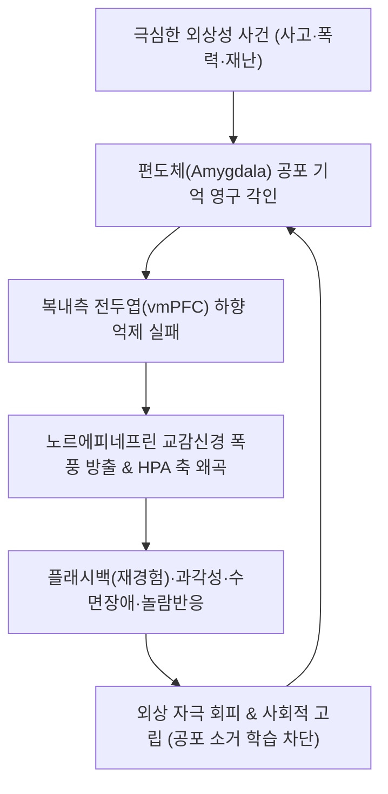

# 🩺 [[외상후 스트레스 장애]] (Post-Traumatic Stress Disorder / 創傷後壓力症, ICD-10 F43.1)

> **핵심 3줄 요약 (Key Summary)**:
> - 📍 병소 부위 & 해부·병태생리: 생명을 위협하는 극심한 외상 사건 후 [[편도체]] 과항진, 복내측 전두엽([[vmPFC]]) 기능 저하, [[해마]] 위축 및 시상하부-뇌하수체-부신([[HPA 축]]) 조절 파탄.
> - 🚩 전형적 임상 양상: 4대 핵심 증상군 — 침습적 재경험([[Flashback]]·악몽), 지속적 회피, 인지 및 기분의 부정적 변화, 교감신경계 과각성(놀람 반응·수면 장애)이 1개월 이상 지속.
> - 🛠️ 핵심 검사 & 치료 전략: PCL-5 척도 평가, 트라우마 중심 CBT/[[EMDR]] 및 [[SSRI]] 약물 요법 + 안신정지환·귀비탕·시호가용골모려탕 및 이침(NADA 프로토콜) 통합 진정.
> - ⚠️ 응급 의뢰 레드플래그: 자살 충동 및 구체적 자해 계획, 알코올·약물 의존 악화, 심한 해리 증상(이인증·비현실감)에 따른 통제력 상실.

---

## 📌 목차
1. [질환 개요 & 해부학적 병태생리](#1-질환-개요--해부학적-병태생리)
2. [병태생리 메커니즘 & 생체역학적 악순환 네트워크](#2-병태생리-메커니즘--생체역학적-악순환-네트워크)
3. [임상 증상 & 이학적 검사(Physical Exam) 알고리즘](#3-임상-증상--이학적-검사physical-exam-알고리즘)
4. [감별 진단 매트릭스 (Differential Diagnosis)](#4-감별-진단-매트릭스-differential-diagnosis)
5. [한의 통합 치료 프로토콜 (침·약침·추나·한약)](#5-한의-통합-치료-프로토콜-침약침추나한약)
6. [양방 치료 & 병용·의뢰 기준 (Conventional Treatment & Referral)](#6-양방-치료--병용의뢰-기준-conventional-treatment--referral)
7. [재활 운동 & 생활습관 티칭 가이드](#7-재활-운동--생활습관-티칭-가이드)
8. [💡 사용자 진료실 핵심 필기 & 임상 노하우 (Melt-In 잔여 심화 집약)](#8--사용자-진료실-핵심-필기--임상-노하우-melt-in-잔여-심화-집약)
9. [출처 및 학술 참고 문헌 (References)](#9-출처-및-학술-참고-문헌-references)

---

## 1. 질환 개요 & 해부학적 병태생리

### 1) 질환 정의 및 기준
- **정의**: 실제적이거나 위협적인 죽음, 심각한 부상, 성폭력 등 신체적·심리적 안녕을 파괴하는 극심한 외상성 사건(Trauma)을 직접 경험하거나 목격한 후, 사건이 종결되었음에도 공포 기억이 소거되지 않고 침습, 회피, 인지 저하, 과각성 상태가 1개월 이상 만성적으로 지속되는 질환이다.
- **DSM-5 진단 기준상 4대 핵심 증상군**:
  1. **침습 증상 (Intrusion)**: 반복적 악몽, 불수의적 회상, 플래시백(Flashback, 마치 사건이 지금 일어나는 것처럼 재경험).
  2. **회피 증상 (Avoidance)**: 외상 관련 생각, 감정, 장소, 사람, 대화의 철저한 기피.
  3. **인지 및 기분의 부정적 변화 (Negative alterations in cognitions and mood)**: 사건의 핵심 망각, 자신과 타인에 대한 왜곡된 자책, 소외감, 긍정 정동 상실.
  4. **각성 및 반응성의 현저한 변화 (Arousal and reactivity)**: 과도한 놀람 반응, 경계 태세, 불면, 분노 폭발, 무모한 자기파괴적 행동.

### 2) 관련 해부학적 구조물
- **편도체 (Amygdala)**: 공포 조건화(Fear conditioning) 중심부, 과잉 활성화되어 미세 자극에도 투쟁-도피(Fight-or-Flight) 반응 격발.
- **복내측 전두엽피질 (vmPFC / mPFC)**: 정상 상태에서 편도체의 공포 반응을 하향 조절(Top-down inhibition)하는 억제 피질이나, PTSD 환자에서는 기능이 저하되어 억제 실패.
- **해마 (Hippocampus)**: 외상 기억의 시공간적 맥락(Contextual memory) 부호화 담당, 만성 코르티솔 독성으로 인해 신경세포 위축 및 부피 감소.

---

## 2. 병태생리 메커니즘 & 생체역학적 악순환 네트워크

### 1) 신경내분비계 및 HPA 축의 역설적 조절 장애
- 만성 스트레스 질환과 달리, PTSD 환자에서는 글루코코르티코이드 수용체의 음성 피드백 감수성이 극도로 항진되어 있어 **기저 혈중 [[코르티솔]] 농도는 낮고**, 부신피질자극호르몬 방출호르몬(CRH) 및 교감신경계 **노르에피네프린 농도는 비정상적으로 과다 방출**되는 불균형을 보인다.
- 높은 카테콜아민 수치는 각성도를 높이고 악몽과 침습적 플래시백을 지속적으로 재점화한다.

### 2) 공포 소거(Fear Extinction) 결함
- 안전한 환경에 처해 있음에도 공포 기억을 안전 신호로 덮어쓰는 공포 소거 학습(vmPFC-해마 회로)이 작동하지 않아, 작은 소음(자동차 경적, 문 닫히는 소리)에도 폭발적 공포 반응이 영구 재생된다.

---

## 3. 임상 증상 & 이학적 검사(Physical Exam) 알고리즘

### 1) 주소증 및 임상 양상
- **플래시백 (Flashback)**: 유사한 냄새, 소리, 장면에 노출 시 현실 감각을 잃고 당시 외상 현장에 있는 것처럼 느끼며 비명을 지르거나 숨음.
- **수면 장애 및 야간 악몽**: 외상 사건이 변형되어 재현되는 악몽으로 인한 심한 입면 및 수면 유지 장애.
- **과각성 및 놀람**: 등 뒤에 사람이 서 있는 것을 견디지 못하고 벽을 등지고 앉으려 하며, 작은 자극에도 심장이 터질 듯 뜀.
- **해리 증상 (Dissociative symptoms)**:
  - *이인증(Depersonalization)*: 자신의 신체나 정신과 분리되어 외부 관찰자가 된 듯한 느낌.
  - *비현실감(Derealization)*: 주변 세상이 꿈속 같거나 가짜처럼 느껴짐.

### 2) 표준 선별 검사
- **PCL-5 (PTSD Checklist for DSM-5)**:
  - 총 20문항(80점 만점), 31~33점 이상 시 PTSD 강력 의심.
- **자율신경계 반응도 검사**:
  - 심박변이도([[HRV]]) 측정 시 저주파(LF) 교감신경 활성도 극단적 상승 및 부교감신경 지표(HF) 억제 확인.

---

## 4. 감별 진단 매트릭스 (Differential Diagnosis)

| 감별 질환 | 증상 지속 기간 | 특징적 양상 | 핵심 감별점 |
| :--- | :--- | :--- | :--- |
| **[[외상후 스트레스 장애]] (PTSD)** | 사건 발생 후 1개월 이상 지속 | 침습, 회피, 인지 부정성, 과각성 4대 증상군 | 장기 만성화, 심각한 기능 장애 |
| **[[급성 스트레스 장애]] (ASD)** | 사건 발생 후 3일 ~ 1개월 이내 | PTSD와 유사하나 단기 경과 | 1개월 이내 자연 완화 여부 관찰 |
| **[[적응 장애]] (Adjustment disorder)** | 스트레스 발생 후 3개월 이내 | 가벼운 일상 스트레스(실직, 이혼)에 반응 | 생명을 위협하는 극단적 외상 사건 아님 |
| **[[우울증]] (주요우울장애)** | 2주 이상 지속 | 무쾌감증, 죄책감, 전반적 의욕 상실 | 외상 기억의 침습적 플래시백 없음 |
| **[[공황장애]]** | 수분~수십 분의 급성 발작 | 예기치 못한 돌발 공황발작, 광장공포 | 특정 외상성 사건과의 인과관계 없음 |

---

## 5. 한의 통합 치료 프로토콜 (침·약침·추나·한약)

### 1) 한의학적 병전 및 변증 체계
- 한의학에서 PTSD는 [[경계]](驚悸), [[정충]](怔忡), [[전증]](癲證), [[울증]](鬱證), [[심담허겁]](心膽虛怯)의 범주에 속한다.
- 《소문·거통론》의 "경즉기란(驚則氣亂, 놀라면 기가 어지러워진다)", "공즉기하(恐則氣下, 두려우면 기가 아래로 처진다)"의 기전에 기인한다.
- **심담허겁(心膽虛怯)**: 작은 소리에도 잘 놀람, 의심, 공포, 불면, 악몽, 설담, 맥현세.
- **간울화화(肝鬱化火) / 기체혈어**: 분노 폭발, 가슴 답답함, 안면 홍조, 두통, 설홍태황, 맥현삭.
- **심비양허(心脾兩虛)**: 기운 없음, 만성 피로, 멍함, 건망, 식욕 부진, 맥세약.

### 2) 침구 치료 프로토콜
- **NADA 5혈 이침(耳針) 프로토콜**:
  - 외상 및 중독 치료에 국제적으로 공인된 프로토콜: **신문(Shenmen), 교감(Sympathetic), 신(Kidney), 간(Liver), 폐(Lung)** 자침 $
ightarrow$ 부교감신경 항진 및 급성 불안 차단.
- **체침 배혈**:
  - [[인당]](EX-HN3), [[백회]](GV20) — 전두엽 활성화 및 두부 긴장 완화.
  - [[신문]](HT7), [[내관]](PC6) — 청심안신 및 심박수 안정화.
  - [[태충]](LR3), [[구허]](GB40) — 평간식풍 및 담기 보익.
- **배수혈 전침 치료**:
  - [[심수]](BL15), [[간수]](BL18), [[담수]](BL19) 저주파 전침 유침.

### 3) 한약 처방 프로토콜
- **안신정지환(安神定志丸)**: 심담허겁형 PTSD의 1차 처방. 원지, 석창포, 복신, 용치 등이 담력을 북돋우고 공포 반응을 진정.
- **시호가용골모려탕(柴胡加龍骨牡蠣湯)**: 교감신경 과각성, 분노, 놀람, 불면이 극심한 환자에서 중진안신 및 자율신경계 안정.
- **귀비탕(歸脾湯)**: 만성 외상 스트레스로 인한 심비 기혈 고갈 환자의 피로 회복 및 수면 개선.
- **가미소요산(加味逍遙散)**: 간울화화로 인한 가슴 답답함과 감정 조절 장애 개선.

---

## 6. 양방 치료 & 병용·의뢰 기준 (Conventional Treatment & Referral)

### 1) 1차 표준 치료
- **근거 중심 정신치료 (1차 권고)**:
  - **외상 중심 인지행동치료 (TF-CBT)**: 인지 재구성 및 지속 노출 치료(Prolonged Exposure, PE).
  - **안구운동 민감소실 및 재처리요법 ([[EMDR]])**: 양측성 안구 운동을 통해 해마 내 외상 기억을 재처리 및 공고화 해제.
- **약물 치료**:
  - 1차: [[SSRI]](설트랄린 Sertraline, 파록세틴 Paroxetine) — FDA 승인 약물.
  - 야간 악몽 치료: 알파-1 아드레날린 길항제인 **프라조신([[Prazosin]])** 취침 전 투여 $
ightarrow$ 외상 관련 악몽 억제에 효과적.
  - *⚠️ 금기*: 벤조디아제핀(BZD)은 공포 소거 학습을 방해하고 탈억제 및 약물 의존을 유발하므로 권장되지 않음.

### 2) 응급 의뢰 레드플래그
1. **자살 위기**: 구체적인 자살 계획, 유서 작성, 주변 정리 등 고위험 징후 시 지체 없이 정신건강의학과 폐쇄병동 응급 입원 의뢰.
2. **정신증적 증상 동반**: 현실 검증력 소실, 환청, 피해망상이 겹치는 경우.
3. **심각한 알코올 및 약물 남용**: 고통을 잊기 위해 알코올에 의존하여 급성 금단 섬망이나 폭력성이 발현될 위험이 높은 경우.

---

## 7. 재활 운동 & 생활습관 티칭 가이드

### 1) 신체 중심 안정화 기법 (Grounding Technique)
- 플래시백이나 해리 증상이 나타날 때 '현재의 시공간'으로 의식을 되돌리는 **5-4-3-2-1 접지 기법**:
  - 눈에 보이는 것 5가지 말하기 $
ightarrow$ 만질 수 있는 것 4가지 만지기 $
ightarrow$ 들리는 소리 3가지 집중 $
ightarrow$ 냄새 2가지 맡기 $
ightarrow$ 입안의 맛 1가지 느끼기.

### 2) 호흡 이완 및 신체 이완
- 4-7-8 복식호흡: 4초 들이쉬고, 7초 멈추고, 8초간 천천히 내쉬며 미주신경(부교감신경) 자극.
- 안전지대(Safe Place) 시각화 훈련: 자신이 가장 안전하고 평화롭다고 느끼는 장소를 구체적으로 상상하며 심신 안정 도모.

---

## 8. 💡 사용자 진료실 핵심 필기 & 임상 노하우 (Melt-In 잔여 심화 집약)

- **외상 재경험 방지 문진 수칙**:
  - 진료실에서 환자에게 "그때 사고 상황을 처음부터 자세히 말씀해 보세요"라고 다그치는 것은 환자를 재트라우마화(Re-traumatization)시키는 치명적인 실수다.
  - 진료 초기에는 사건의 구체적 세부 묘사를 묻지 말고, "현재 몸에서 느껴지는 긴장감, 잠잘 때의 불편함, 놀라는 반응" 등 **신체 증상과 현재의 고통에 초점을 맞추어 공감**해야 치료적 라포(Rapport)가 형성된다.
- **침 시술 시 체위 배려**:
  - PTSD 환자는 엎드려 눕는 자세(Prone position)에서 등 뒤가 노출되어 극심한 공포와 공황을 느낄 수 있다.
  - 반드시 앙와위(Supine)나 편안한 측와위(Side-lying)로 눕히고, 시술 전 "지금 팔에 침을 놓겠습니다"라고 언어적 예고를 분명히 해야 급작스러운 놀람 발작을 막을 수 있다.

---

## 9. 출처 및 학술 참고 문헌 (References)

- Yehuda R, et al. (2015). Post-traumatic stress disorder. *NRDP*. PMID: 27189040.
  - [연구 요약] 외상후 스트레스 장애의 신경생물학적 기전, 스트레스 축 왜곡, 후성유전학적 요인 및 근거 중심 심리·약물 치료 랜드마크 종설.
- Fischer IC, et al. (2023). Post-traumatic stress disorder: rethinking diagnosis. *Lancet Psychiatry*. 10(9):716-726. PMID: 37499676.
  - [연구 요약] DSM-5 및 ICD-11 진단 기준 비교, 복합 외상후 스트레스 장애(Complex PTSD) 개념 및 최신 임상적 접근법.
- Li X, et al. (2026). The neuroendocrine network imbalance in post-traumatic stress disorder: from core mechanisms to clinical translation. *Biochem Pharmacol*. PMID: 42595095.
  - [연구 요약] PTSD 환자의 신경내분비 네트워크 불균형, 편도체-전두엽 시냅스 가소성 장애 및 표적 치료제 개발 전략 최신 고찰.
