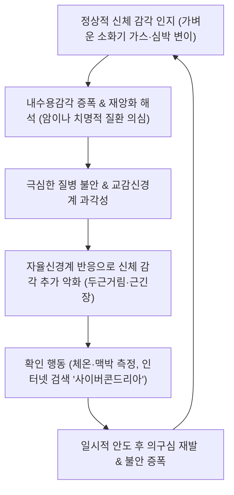

# 🩺 질병 불안 장애 (Illness Anxiety Disorder / 疑病·虛勞心悸)

> **핵심 3줄 요약 (Key Summary)**:
> - 📍 병소 부위 & 해부·병태생리: 실제로는 심각한 신체 질환이 없거나 경미한 신체 감각(생리적 심계항진, 근육 경련, 소화기 가스 등)에 불과함에도 중증·치명적 질병(암, 뇌졸중, 희귀병 등)에 걸렸다는 집착과 공포가 6개월 이상 지속되는 질환으로, [[편도체]]-내수용감각(섬엽, Insula) 피질 경로의 과민성과 전전두엽의 인지적 통제 부전이 중심 병소이다.
> - 🚩 전형적 임상 양상: 사소한 신체 변화에 대한 극단적 재앙화 해석, 반복적인 병원 쇼핑 및 의학적 검사 요구(진료추구형) 또는 질병 확인이 두려워 진료를 회피하는 행동(진료회피형), 매일 신체를 촉진·검진하는 강박적 확인 행동이 주소증이다.
> - 🛠️ 핵심 검사 & 치료 전략: 신체 증상 장애(SSD) 및 기질적 질환을 정밀 배제(혈액, 영상 검사 최소화 확인)하고, 인지행동치료(CBT) 및 1차 약물([[SSRI]])과 함께 한의학적 지언고론(至言高論) 요법, 이정변기요법, [[신문]], [[내관]], [[백회]], [[족삼리]] 자침 및 가미소요산·온담탕 투여를 시행한다.
> - ⚠️ 응급 의뢰 레드플래그: 망상적 확신으로 발전하여 신체형 망상(Delusional disorder, somatic type)에 이르거나, 암이나 불치병에 걸렸다는 절망감으로 인한 급성 자살 기도·자살 계획이 확인될 경우 즉시 상급 정신건강의학과로 전원한다.

---

## 📌 목차
1. [질환 개요 & 해부학적 병태생리](#1--질환-개요---해부학적-병태생리)
2. [병태생리 메커니즘 & 생체역학적 악순환 네트워크](#2--병태생리-메커니즘---생체역학적-악순환-네트워크)
3. [임상 증상 & 이학적 검사(Physical Exam) 알고리즘](#3--임상-증상---이학적-검사-physical-exam--알고리즘)
4. [감별 진단 매트릭스 (Differential Diagnosis)](#4--감별-진단-매트릭스--differential-diagnosis-)
5. [한의 통합 치료 프로토콜 (침·약침·추나·한약)](#5--한의-통합-치료-프로토콜--침-약침-추나-한약-)
6. [양방 치료 & 병용·의뢰 기준 (Conventional Treatment & Referral)](#6-양방-치료--병용의뢰-기준-conventional-treatment--referral)
7. [재활 운동 & 생활습관 티칭 가이드](#7--재활-운동---생활습관-티칭-가이드)
8. [💡 사용자 진료실 핵심 필기 & 임상 노하우 (Melt-In 잔여 심화 집약)](#8----사용자-진료실-핵심-필기---임상-노하우--melt-in-잔여-심화-집약-)
9. [출처 및 학술 참고 문헌 (References)](#9--출처-및-학술-참고-문헌--references-)

---

## 1. 질환 개요 & 해부학적 병태생리

### 1) 질환 정의 및 개념
* **정의**: 질환 불안 장애(Illness Anxiety Disorder, IAD)는 심각한 질병에 걸렸거나 걸릴 것이라는 선입견과 불안에 사로잡혀 있는 상태를 말한다. 신체 증상이 아예 없거나 경미한 수준임에도 불구하고 불안의 강도가 매우 높다.
* **진단 기준 (DSM-5-TR)**:
  * 심각한 질병을 앓고 있거나 걸릴 것이라는 집착.
  * 신체 증상이 전혀 없거나, 있더라도 강도가 매우 경미함. (질병에 걸릴 고위험군인 경우 과도하거나 균형을 잃은 집착이 나타남)
  * 건강에 대한 높은 수준의 불안 및 건강 상태에 대해 쉽게 경각심을 가짐.
  * 건강과 관련된 과도한 행동(예: 질병 징후를 찾기 위해 반복해서 거울을 보거나 맥박을 짚음) 또는 부적응적 회피(예: 의사 진료나 병원 예약을 피함).
  * 이러한 집착이 최소 6개월 이상 지속됨.
* **아형 분류**:
  * **진료추구형 (Care-seeking type)**: 잦은 병원 방문, 다학제 검사 반복 요청.
  * **진료회피형 (Care-avoidant type)**: 불치병 선고가 두려워 건강검진이나 병원 방문을 전면 거부.

### 2) 신경생물학적 및 인지적 병태생리
* **내수용감각 피질의 과민화**:
  * 전측 섬엽(Anterior Insula)과 전대상피질([[전대상피질]], ACC)의 과잉 연결성으로 인해 장내 가스, 정상적인 심장 박동 변이, 가벼운 근육 떨림 등 정상 생리 감각을 비정상적 위협 신호로 확대 해석한다.
* **인지적 편향과 재앙화**:
  * 뇌의 배외측 전전두엽(dlPFC) 기능 저하로 인해 "이 통증은 췌장암의 신호다", "이 어지럼증은 뇌종양이다"라는 파국적 자동사고를 억제하지 못한다.
* **안심의 역설 (Reassurance Paradox)**:
  * 의사의 "검사 결과 이상이 없습니다"라는 안심은 극히 일시적인 불안 감소만 가져오며, 곧이어 "검사가 부정확했을 것이다", "놓친 것이 분명하다"는 의심으로 이어져 불안 회로가 재점화된다.

---

## 2. 병태생리 메커니즘 & 생체역학적 악순환 네트워크

### 1) 확인 행동과 사이버콘드리아 (Cyberchondria)
* 환자는 스마트폰과 인터넷으로 의학 정보를 검색하며 수많은 희귀 암과 난치병 정보를 탐독한다. 이 과정에서 확인된 불길한 정보들이 새로운 불안을 촉발하며 강박적 검색의 늪에 빠진다.

### 2) 자율신경계-신체 긴장 악순환
* 질병에 대한 공포로 방출된 코르티솔과 에피네프린이 전신의 근긴장도 상승, 흉식 과호흡, 위장관 운동 저하를 유발하여 실제 신체 불편감을 가중시킨다.

---

## 3. 임상 증상 & 이학적 검사(Physical Exam) 알고리즘

### 1) 주요 임상 양상
* 신체 부위를 반복적으로 만져보고 림프절을 촉진하거나 피부 점의 크기를 측정.
* 의료진의 명확한 검사 결과 설명에도 불구하고 불신과 회의감 지속.
* 주변인에게 "나 괜찮아 보여?"라는 안심 유도 질문을 끝없이 반복.
* 건강 관련 기사나 질병 뉴스를 접하면 즉시 자신에게 대입하여 공포 반응.

### 2) 평가 및 선별 척도
* **WHITELY Index (화이틀리 지수)**: 건강염려증 척도로 신체적 불안, 질병에 대한 공포를 14개 문항으로 정량화.
* **SHAI (Short Health Anxiety Inventory)**: 건강 불안 및 질병 발생 시의 파국화 정도를 민감하게 측정.
* **PHQ-15**: 신체 증상 자체의 중증도를 스크리닝하여 신체증상장애와의 감별에 활용.

### 3) 이학적 진찰 및 진료실 원칙
* 환자가 호소하는 신체 부위는 반드시 정중하고 체계적으로 진찰하되, 무분별한 특수 검사(CT, MRI)를 반복 의뢰하는 것은 회피해야 한다.
* 신체 검진 시 "완벽하게 정상입니다"라는 단정적 표현보다 "현재 우려하시는 악성 질환의 징후는 관찰되지 않으며, 신경계 과민에 의한 감각 증상으로 보입니다"라고 공감적으로 설명한다.

---

## 4. 감별 진단 매트릭스 (Differential Diagnosis)

| 감별 질환 | 핵심 감별점 및 특징 | 구체적 차이점 |
| :--- | :--- | :--- |
| **[[신체증상장애]](SSD)** | 실제로 심각하고 고통스러운 다발성 신체 증상(통증, 위장장애 등) 존재 | IAD는 신체 증상이 없거나 경미하며, '질병에 걸렸다는 불안' 자체가 주소증임 |
| **[[공황 발작과 공황 장애\|공황장애]]** | 급성적이고 폭발적인 죽음의 공포와 발작 (수분~수십 분 내 소실) | IAD는 만성적이고 지속적인 질병 집착 (수개월 이상) |
| **[[강박 장애]]** | 오염, 청결, 대칭 등에 대한 침투적 사고와 강박 행동 | IAD는 오직 '자신의 신체 질병'에 집착이 한정됨 |
| **신체형 망상장애** | "내 몸속에 기생충이 파먹고 있다", "내 장기가 썩었다"는 확고한 망상 | IAD는 자신의 질병 염려가 지나칠 수 있다는 병식(Insight)이 어느 정도 유지됨 |
| **초기 신경계·자가면역 질환** | 다발성 경화증, 파킨슨병, 루푸스 등의 비전형적 초기 증상 | 객관적 신경학적 결손 징후나 혈액 염증 수치 확인 필요 (Fatahi et al., 2025) |

---

## 5. 한의 통합 치료 프로토콜 (침·약침·추나·한약)

### 1) 변증 분류
* **간울기체(肝氣鬱結)**: 가슴과 옆구리가 그득하고 답답하며, 신체 증상에 대한 걱정으로 한숨을 자주 쉬고 정서적 억울감이 심함. (설암태박, 맥현)
* **심담허겁(心膽虛怯)**: 사소한 건강 뉴스나 신체 감각에도 가슴이 덜컥 내려앉고 쉽게 놀라며 밤에 잠을 잘 이루지 못함. (설담태백, 맥세현)
* **심비양허(心脾兩虛)**: 질병에 대한 지나친 걱정과 사려과다로 기력이 쇠하고 소화가 안 되며 건망증이 동반됨. (설담태백, 맥세약)
* **음허내열(陰虛內熱)**: 입안이 마르고 손발바닥에 미열감이 있으며 밤마다 불안하여 식은땀을 흘림. (설홍소태, 맥세삭)

### 2) 침구 치료
* **주요 혈위**: [[백회]](GV20), [[상성]](GV23), [[신문]](HT7), [[내관]](PC6), [[태충]](LR3), [[합곡]](LI4), [[족삼리]](ST36), [[전중]](CV17).
* **자침 기법**:
  * 뇌신경 흥분 완화: 백회-사신총, 인당 혈위에 15~20분간 자침.
  * 불안 및 심계 조절: 내관-신문 혈에 침자 후 유침하며 호흡 이완 유도.
  * 소화기 및 기운 회복: 족삼리, 중완에 자침하여 위장관 미주신경 활성화.

### 3) 약침 치료
* **자하거 약침**: 심비양허 및 허로(虛勞) 상태의 환자에게 심수(BL15), 비수(BL20)에 각 0.5cc 주입하여 전신 신경계 자양.
* **황련해독탕 약침**: 간울화화 및 극심한 불안 초조 상태 시 전중(CV17), 풍지(GB20)에 0.2~0.3cc 시술.

### 4) 한방 정신요법
* **지언고론(至言高論) 요법**: 환자의 왜곡된 의학 지식을 바로잡고, 인체의 정상적인 생리적 변이와 감각에 대해 논리적이고 권위 있는 의학적 설명 제공.
* **이정변기(移情變氣) 요법**: 주의를 자신의 신체 내부에서 외부 취미, 운동, 사회적 활동으로 전환하도록 상담 유도.

### 5) 한약 처방 프로토콜
* **가미소요산(加味逍遙散)**: 간기울결 및 간울화화로 인한 건강 염려, 상열감, 소화불량에 1차 처방.
* **온담탕(溫膽湯) / 가미온담탕(加味溫膽湯)**: 담음(痰飮)으로 인한 심담허겁, 두근거림, 메스꺼움, 불면증 개선.
* **귀비탕(歸脾湯)**: 심비양허형의 만성적인 생각 과다, 피로, 쇠약, 불안 완화.
* **계지가용골모려탕(桂枝加龍骨牡蠣湯)**: 사소한 자극에도 심장이 두근거리고 식은땀이 나며 신경이 쇠약해진 환자에게 탁월한 진정 효과.

---

## 6. 양방 치료 & 병용·의뢰 기준 (Conventional Treatment & Referral)

### 1) 약물 치료
* **1차 약물**: [[SSRI]](Fluoxetine, Sertraline, Paroxetine)가 건강 불안과 강박적 확인 행동 완화에 가장 효과적이다. 일반 우울증 용량보다 다소 고용량이 요구될 수 있다.
* **보조 약물**: 불안이 극심한 초기 단계에서 단기간 저용량 [[벤조디아제핀]]을 병용할 수 있으나, 약물 의존성을 방지하기 위해 장기 투여는 지양한다.

### 2) 비약물 치료
* **인지행동치료(CBT)**: 건강 불안에 대한 가장 확실한 근거 중심 치료(Lai et al., 2026). 신체 감각에 대한 파국적 해석 교정, 신체 확인 행동(체온 재기 등) 점진적 중단, 의학 검색 금지 훈련.

### 3) 한의 병용 가이드
* 한약 투여 시 SSRI와의 약물 상호작용 위험이 매우 낮으며, 오히려 양약 복용에 대한 환자의 극심한 부작용 불안("이 약 먹고 간이 망가지면 어쩌죠?")을 한의 치료가 완화하고 복약 순응도를 높여줄 수 있다.

### 4) 응급 전원 기준
* 질병에 대한 절망감으로 인해 자살 사고 및 구체적 자살 계획이 나타날 때.
* 신체 증상에 대한 집착이 확고한 망상으로 고착화되어 일상생활이 완전히 와해된 경우.

---

## 7. 재활 운동 & 생활습관 티칭 가이드

* **사이버콘드리아 차단 (인터넷 검색 금지)**: 증상 검색을 하루 0회로 제한하는 명확한 생활 수칙 수립.
* **신체 점검 행동 지연 (Delaying Technique)**: 맥박을 재거나 거울을 보고 싶은 충동이 들 때 타이머를 맞추고 30분 뒤로 미루는 훈련.
* **자연 속 유산소 걷기**: 숲이나 공원에서 주 3~5회, 40분 이상 걷기를 통해 주의를 외부 자연 자극으로 강제 전환.
* **충분한 수면과 카페인 중단**: 수면 부족과 카페인은 체내 자율신경계를 자극하여 가슴 두근거림을 유발하므로 필수적으로 교정.

---

## 8. 💡 사용자 진료실 핵심 필기 & 임상 노하우 (Melt-In 잔여 심화 집약)

* **절대로 "아무 이상 없으니 마음 편히 가지세요"라고만 하지 말 것**: 환자는 자신의 고통이 무시당했다고 느끼고 다른 한의원이나 병원으로 떠난다. "환자분이 느끼시는 그 두근거림과 찌릿함은 실제로 존재하는 진짜 감각입니다. 다만 그것이 큰 병의 징후가 아니라 예민해진 자율신경이 보내는 신호입니다"라고 공감해야 치료적 동맹이 형성된다.
* **단호한 검사 제한 계약**: "한의원에서 한약과 침 치료를 받는 3개월 동안은 추가적인 대학병원 정밀 검사나 인터넷 검색을 멈추고 저를 믿고 따라오셔야 합니다"라는 명확한 치료 프레임을 설정해야 환자가 안정을 찾는다.

---

## 9. 출처 및 학술 참고 문헌 (References)

1. Lai L, 2026, Br J Psychiatry, The comparative effectiveness of psychological interventions for health anxiety: systematic review and a network meta-analysis of randomised controlled trials. PMID: 42169209

2. Kikas K, 2024, Curr Psychiatry Rep, Illness Anxiety Disorder: A Review of the Current Research and Future Directions. PMID: 38748190

3. Fatahi R, 2025, Clin Case Rep, Parkinson's Disease as Illness Anxiety Disorder: A Rare Case Report. PMID: 41018995

---

## 관련 노트

- [[_의학/03_이론/질환/신경계 질환/기타 신경/우울장애|우울장애]]
- [[_의학/03_이론/질환/신경정신과 질환/기분·불안/범불안장애|범불안장애]]
- [[_의학/03_이론/질환/신경정신과 질환/기분·불안/공황 발작과 공황 장애|공황 발작과 공황 장애]]
- [[_의학/02_약리/의약품/00_양방약_MOC|양방약 MOC]]
