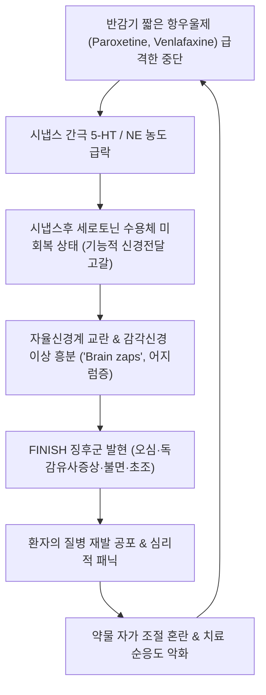

# 🩺 항우울제 중단증후군 (Antidepressant Discontinuation Syndrome / 藥毒·虛損眩暈)

> **핵심 3줄 요약 (Key Summary)**:
> - 📍 병소 부위 & 해부·병태생리: 만성적으로 투여되던 항우울제([[SSRI]], [[SNRI]], TCA 등)를 급격히 중단하거나 감량할 때 발생하는 신경약리학적 반동 상태로, 시냅스 간극의 급격한 세로토닌(5-HT) 및 노르에피네프린(NE) 농도 급감, 하향조절(Down-regulation)되어 있던 시냅스후 수용체의 적응 지연, 콜린성 리바운드(Cholinergic rebound)가 핵심 병소이다.
> - 🚩 전형적 임상 양상: 'FINISH' 징후군(Flu-like symptoms 독감 유사 증상, Insomnia 불면, Nausea 오심, Imbalance 어지럼증·보행불안, Sensory disturbances 전격통/뇌진탕 느낌 'Brain zaps', Hyperarousal 불안·초조)이 약물 중단 1~3일 이내에 급격히 발현된다.
> - 🛠️ 핵심 검사 & 치료 전략: 원인 약물 재투여 또는 원용량 복귀 시 수시간~수일 내 극적인 증상 호전 여부로 원질환 재발과 감별하며, 장기 지속형 약물(Fluoxetine)로의 치환 후 쌍곡선형(Hyperbolic) 초미세 점진적 감량 스케줄을 적용하고 한의학적 영계출감탕·귀비탕·온담탕 투여와 침치료를 병용한다.
> - ⚠️ 응급 의뢰 레드플래그: 세로토닌 증후군(Serotonin syndrome)과의 오인 감별 필요성(고열, 근간대경련, 자율신경 불안정), 약물 중단 후 유발된 조증/경조증 전환(Discontinuation-induced mania), 급격한 절망감에 따른 충동적 자살 기도 발생 시 즉시 응급 정신건강의학과로 전원한다.

---

## 📌 목차
1. [질환 개요 & 해부학적 병태생리](#1--질환-개요---해부학적-병태생리)
2. [병태생리 메커니즘 & 생체역학적 악순환 네트워크](#2--병태생리-메커니즘---생체역학적-악순환-네트워크)
3. [임상 증상 & 이학적 검사(Physical Exam) 알고리즘](#3--임상-증상---이학적-검사-physical-exam--알고리즘)
4. [감별 진단 매트릭스 (Differential Diagnosis)](#4--감별-진단-매트릭스--differential-diagnosis-)
5. [한의 통합 치료 프로토콜 (침·약침·추나·한약)](#5--한의-통합-치료-프로토콜--침-약침-추나-한약-)
6. [양방 치료 & 병용·의뢰 기준 (Conventional Treatment & Referral)](#6-양방-치료--병용의뢰-기준-conventional-treatment--referral)
7. [재활 운동 & 생활습관 티칭 가이드](#7--재활-운동---생활습관-티칭-가이드)
8. [💡 사용자 진료실 핵심 필기 & 임상 노하우 (Melt-In 잔여 심화 집약)](#8----사용자-진료실-핵심-필기---임상-노하우--melt-in-잔여-심화-집약-)
9. [출처 및 학술 참고 문헌 (References)](#9--출처-및-학술-참고-문헌--references-)

---

## 1. 질환 개요 & 해부학적 병태생리

### 1) 질환 정의 및 개념
* **정의**: 항우울제 중단증후군(Antidepressant Discontinuation Syndrome, ADS)은 최소 4~6주 이상 항우울제를 지속 복용하던 환자가 약물을 갑작스럽게 중단하거나 복용량을 급격히 줄였을 때 일시적으로 나타나는 다양한 신체적·정신적 불쾌 증상의 복합체이다.
* **약물 의존성과의 차이**: 중단증후군은 약물 갈망(Craving)이나 강박적 물질 추구 행동을 동반하지 않으므로 전형적인 '약물 중독'이나 '약물 남용'과는 구별되는 생리학적 금단 반응(Physiological withdrawal)이다.
* **발생률 및 고위험 약물**:
  * 메타분석 연구(Henssler et al., 2024)에 따르면 항우울제 중단 환자의 약 15%에서 진정한 약물학적 중단 증상이 발생하며, 중증 증상은 약 3% 미만으로 보고된다.
  * **반감기가 짧은 약물**일수록 발생률이 현저히 높다: Paroxetine(SSRI, 반감기 ~21시간), Venlafaxine(SNRI, 반감기 ~5시간, 활성대사체 ~11시간, McClure et al., 2026), Duloxetine.
  * 반면 반감기가 매우 긴 Fluoxetine(활성대사체 노르플루옥세틴 반감기 7~15일)은 중단증후군 발생 위험이 극히 낮다.

### 2) 신경생물학적 병태생리
* **세로토닌 농도 급감 및 수용체 불일치**:
  * 만성적인 세로토닌 재흡수 억제로 인해 시냅스후 [[5-HT1A]], 5-HT2 수용체는 하향조절(Down-regulation) 및 탈감작(Desensitization)되어 있다. 약물을 급격히 끊으면 시냅스 간극 세로토닌 농도는 순식간에 고갈되나 수용체 밀도는 수일~수주 내에 회복되지 못하여 일시적인 세로토닌성 신경전달 결핍 상태에 빠진다.
* **콜린성 리바운드 (Cholinergic Rebound)**:
  * Paroxetine이나 삼환계 항우울제(TCA)처럼 무스카린성 콜린 수용체 차단 작용을 갖는 약물을 끊을 경우, 억제되었던 아세틸콜린계가 폭발적으로 과활성화되어 발한, 오심, 구토, 복통, 설사가 발생한다.
* **GABA-글루타메이트계 불균형**:
  * 노르에피네프린 및 세로토닌성 긴장 완화로 인해 이차적인 중추 흥분성 신경전달물질의 탈억제가 발생하여 감각 이상('전기 쇼크감')과 불안이 촉발된다.

---

## 2. 병태생리 메커니즘 & 생체역학적 악순환 네트워크

### 1) 전격통 및 뇌진탕 느낌 (Brain Zaps)
* 고개를 돌리거나 안구를 좌우로 움직일 때 뇌 속에서 번개가 치거나 전기가 통하는 듯한 기괴한 감각(Electric shock sensations)은 ADS의 가장 특징적인 병리 소견이다. 이는 전정신경계와 안구운동핵의 세로토닌성 신호 전달 이상에서 기인하는 것으로 추정된다.

---

## 3. 임상 증상 & 이학적 검사(Physical Exam) 알고리즘

### 1) FINISH 징후군 (핵심 증상)
* **F (Flu-like symptoms)**: 피로감, 전신 근육통, 두통, 오한, 발한 등 독감 유사 증상.
* **I (Insomnia)**: 입면 장애, 생생한 악몽(Vivid dreams).
* **N (Nausea)**: 오심, 구토, 복부 경련, 설사.
* **I (Imbalance)**: 어지럼증, 현훈, 보행 실조, 경미한 비틀거림.
* **S (Sensory disturbances)**: 뇌진탕 느낌(Brain zaps), 사지 감각이상, 이상감각.
* **H (Hyperarousal)**: 극심한 초조, 불안, 과민성, 분노 폭발.

### 2) 증상 발현 및 경과 타임라인
* 발현 시기: 마지막 약물 복용 후 24~72시간 이내에 발생.
* 지속 기간: 치료적 개입이 없을 경우 통상 1~2주 내에 자연 소실되나, Venlafaxine 등의 경우 수주~수개월간 지속되는 경우도 보고됨.

### 3) 재발(Relapse)과의 임상적 감별 알고리즘
* **중단증후군**: 약 중단 수일 내 급발진, 신체 증상(Brain zaps, 어지럼증, 오심)이 정신 증상보다 선행, 원 약물 1회 재복용 시 수 시간 내에 드라마틱하게 증상 소실.
* **원질환 재발**: 약 중단 후 수주~수개월에 걸쳐 점진적 진행, 무쾌감증과 점진적 기분 저하 중심, 약물 재복용 시 효과 발현까지 2~4주 이상 소요.

---

## 4. 감별 진단 매트릭스 (Differential Diagnosis)

| 감별 질환 | 핵심 감별점 및 특징 | 구체적 차이점 |
| :--- | :--- | :--- |
| **원래 우울장애/불안장애 재발** | 약물 중단 후 수주~수개월 뒤 서서히 우울감·불안 재발 | ADS는 중단 수일 내 급성 발현하며 전기 감전감 등 신체 증상 우세 |
| **세로토닌 증후군** | 세로토닌 약물 용량 증량 또는 병용 시 발생 (고열, 간대성 근경련, 설사) | 중단증후군은 약물 감량/중단 시 발생하며 고열이나 근간대경련이 없음 |
| **급성 바이러스성 감염** | 발열, 기침, 인후통 등 실제 염증 반응 | ADS는 염증 지표(CRP) 정상이며 상기도 호흡기 징후 부재 |
| **내이성 현훈 (이석증, 전정신경염)** | 두위 변화에 따른 회전성 어지럼증, 안진 | ADS는 머리를 돌릴 때 찌릿한 전격통이 동반되며 청각 증상 없음 |
| **뇌혈관 질환 (일과성 허혈 발작)** | 국소 신경학적 결손 (편마비, 구음장애 등) | 국소 마비나 언어 장애 없이 전반적인 감각 과민과 불안 동반 |

---

## 5. 한의 통합 치료 프로토콜 (침·약침·추나·한약)

### 1) 변증 분류
* **풍담상요(風痰上擾)**: 머리가 맑지 않고 어지러우며 뇌 속이 울리고 찌릿하며 메스꺼움이 동반됨. (설태백니, 맥활)
* **간양상항(肝陽上亢)**: 가슴이 답답하고 화가 치밀며 얼굴로 열이 오르고 두통, 불면이 극심함. (설홍태황, 맥현삭)
* **기혈양허(氣血兩虛)**: 전신 기력이 쇠약하고 사지가 무거우며 식은땀이 나고 가슴이 심하게 뜀. (설담태박, 맥세약)
* **담음어조(痰飮瘀阻)**: 소화가 안 되고 속이 메스꺼우며 몸살기처럼 온몸이 쑤시고 저림. (설암태백, 맥현현)

### 2) 침구 치료
* **주요 혈위**: [[백회]](GV20), [[풍지]](GB20), [[내관]](PC6), [[족삼리]](ST36), [[풍륭]](ST40), [[신문]](HT7), [[태충]](LR3), [[현종]](GB39).
* **자침 기법**:
  * 뇌신경 전기 감전감 및 어지럼증 완화: 풍지, 백회, 솔곡 혈위에 자침하여 후두부 및 뇌저 혈류 순환 촉진.
  * 오심 및 자율신경계 안정: 내관-공손 혈에 평보평사 자침, 전침 2Hz 저주파 통전.
  * 사지 감각이상 조절: 합곡-태충(사관혈) 자침으로 전신 기혈 순환 촉진.

### 3) 약침 치료
* **황련해독탕 약침**: 간양상항 및 교감신경 과흥분으로 인한 두통, 안면열감, 초조 시 풍지(GB20), 전중(CV17)에 0.2~0.3cc 주입.
* **자하거 약침**: 기혈양허 및 만성 탈진 상태의 환자에게 비수(BL20), 신수(BL23)에 각 0.5cc 주입하여 신경계 영양 공급.

### 4) 추나 요법
* **경추 및 두개저 이완 추나**: 후두하근군 및 상부 경추 분절의 비틀림을 바로잡고 경추 교감신경절 긴장을 완화하여 어지럼증과 Brain zaps를 즉각 완화.

### 5) 한약 처방 프로토콜
* **영계출감탕(苓桂朮甘湯)**: 풍담상요형 어지럼증, 머리 속의 찌릿함, 심계항진, 소변 이상에 탁월한 수독(水毒) 개선 효과.
* **반하백출천마탕(半夏白朮天麻湯)**: 비위 허약으로 담음이 정체되어 발생하는 극심한 오심, 구토, 현훈 개선.
* **온담탕(溫膽湯) / 가미온담탕(加味溫膽湯)**: 담화(痰火)로 인한 불면, 악몽, 불안, 신경 과민 완화.
* **귀비탕(歸脾湯)**: 만성적인 항우울제 복용으로 기혈이 쇠약해진 환자의 쇠약감, 불면, 식욕부진 회복.

---

## 6. 양방 치료 & 병용·의뢰 기준 (Conventional Treatment & Referral)

### 1) 양방학적 표준 대처 가이드라인
* **약물 재투여 (Reinstatement)**:
  * 중단 증상이 심각할 경우, 중단 직전 용량으로 즉시 복귀시킨다. 통상 24시간 이내에 증상이 극적으로 호전된다.
* **쌍곡선형(Hyperbolic) 점진적 감량 (Tapering)**:
  * 세로토닌 수송체(SERT) 점유율은 약물 용량에 선형적이 아니라 쌍곡선형으로 비례한다. 따라서 저용량 구간일수록 더 길고 완만하게 감량해야 한다.
  * 매 2~4주마다 이전 용량의 10%씩 줄여나가는 마이크로 테이퍼링(Micro-tapering) 기법 적용.
* **장기 지속형 약물로의 치환 (Fluoxetine Bridge)**:
  * Paroxetine이나 Venlafaxine 감량이 극도로 어려운 환자는 동등 역가의 Fluoxetine(반감기 매우 김)으로 전환한 후 수개월에 걸쳐 서서히 중단.

### 2) 한의 병용의 치료적 가치
* 양방 정신과 주치의와의 협의 하에 점진적 테이퍼링을 진행하면서 한약(영계출감탕, 온담탕)과 침치료를 병용할 경우, 감량 과정에서 발생하는 자율신경 반동과 불면, 어지럼증을 한의학적으로 완충시켜 성공적인 약물 중단을 달성할 수 있다.

### 3) 응급 전원 기준
* 약물 중단 후 자살 충동이 급격히 증가하거나 실행 의도를 보이는 경우.
* 급성 조증이나 정신병적 상태로 이행하는 경우.
* 수분 섭취 불가 및 전해질 불균형(Morena et al., 2026)이 의심되는 심각한 구토 상태.

---

## 7. 재활 운동 & 생활습관 티칭 가이드

* **임의 중단 절대 금지 교육**: "증상이 좋아졌다고 해서 하루아침에 약을 끊으면 심각한 신체 증상이 옵니다"라는 복약 교육 철저.
* **충분한 수분 섭취와 전해질 보충**: 오심과 발한으로 인한 탈수 예방을 위해 미온수와 전해질 음료 섭취 지도.
* **급격한 두부 회전 자제**: Brain zaps를 유발하는 빠른 고개 돌림이나 시선 이동을 피하고 천천히 움직이도록 안내.
* **규칙적인 수면 위생 준수**: 약물 중단 초기 악몽과 불면을 완화하기 위해 일정한 취침/기상 시간 유지.

---

## 8. 💡 사용자 진료실 핵심 필기 & 임상 노하우 (Melt-In 잔여 심화 집약)

* **"양약을 완전히 끊고 한약으로 바꾸고 싶어요" 환자 대처법**:
  * 환자가 찾아와 양약을 단번에 끊었다고 자랑스럽게 말할 때가 가장 위험하다. 며칠 뒤 심각한 중단증후군으로 응급실에 갈 수 있다.
  * "양약을 끊는 것은 훌륭한 목표이지만, 계단을 한 칸씩 내려오듯 뇌신경이 적응할 시간을 주어야 합니다"라고 설명하고, 즉시 양방 처방의와 상의하여 감량 스케줄을 잡고 한의 치료를 보조적으로 병행하도록 안심시켜야 한다.
* **영계출감탕의 놀라운 Brain zaps 완화력**:
  * 환자가 "머릿속에서 전기가 통하는 것 같아요"라며 어지럼증을 호소할 때, 영계출감탕(또는 오령산 합 이진탕)을 처방하면 중추신경계 수독과 뇌저 순환 장애를 해소하여 2~3일 내에 전격통이 눈에 띄게 줄어든다.

---

## 9. 출처 및 학술 참고 문헌 (References)

1. Henssler J. (2024). Incidence of antidepressant discontinuation symptoms: a systematic review and meta-analysis. *Lancet Psychiatry*. PMID: 38851198

2. McClure E. (2026). Psychopharmacological Mechanisms of Antidepressant Withdrawal: Insights From Venlafaxine. *Hum Psychopharmacol*. PMID: 42663396

3. Cohen D. (2026). Antidepressant Use and Withdrawal: A Review of Current Evidence and Clinical Recommendations. *Psychiatr Clin North Am*. PMID: 42547120

---

## 관련 노트

- [[_의학/03_이론/질환/신경계 질환/기타 신경/우울장애|우울장애]]
- [[_의학/03_이론/질환/신경정신과 질환/기분·불안/범불안장애|범불안장애]]
- [[_의학/02_약리/의약품/00_양방약_MOC|양방약 MOC]]
- [[_의학/03_이론/질환/신경정신과 질환/기분·불안/공황 발작과 공황 장애|공황 발작과 공황 장애]]
