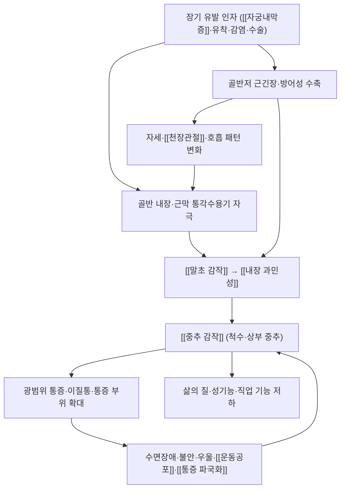

# 🩺 만성 골반통 (Chronic Pelvic Pain, CPP)

> **핵심 3줄 요약 (Key Summary)**:
> - 📍 병소 부위 & 해부·병태생리: **골반 부위에 6개월 이상 지속되는 통증**으로, 단일 질환이 아니라 증상 복합체다. [[자궁내막증]]·유착·골반저 과긴장·[[과민성 장 증후군]]·방광 통증 증후군·[[중추 감작]]이 서로 얽힌다.
> - 🚩 전형적 임상 양상: 하복부·골반·요천추·둔부의 둔한 통증, 성교통, 배뇨·배변 연관 통증, 월경 주기와의 연관성. 통증 강도보다 **지속 기간과 삶의 질 저하**가 진단적 핵심이다.
> - 🛠️ 핵심 감별 & 한·양방 치료 전략: 원인 감별이 곧 진단이다(부인과·비뇨·소화기·근골격·심리 축). 치료는 **다중모달** — 약물·호르몬 + 물리·도수치료([[HVLA]]·복부 가동술·[[광인대]] 가동술·골반저 이완) + 운동·호흡 + 심리·통증 재개념화를 조합한다.
> - ⚠️ **응급 의뢰 레드플래그**: 발열 동반 급성 악화(골반 농양), 임신 가능성 + 하복부 통증·출혈(자궁외임신), 실신·어지럼(복강 내 출혈), 체중 감소·야간 통증·비정상 질출혈(종양 감별).

---

## 📌 목차
1. [질환 개요 & 병태생리 (Disease Overview)](#1-질환-개요--병태생리-disease-overview)
2. [병태생리 메커니즘 & 대사·장기부전 악순환 네트워크](#2-병태생리-메커니즘--대사장기부전-악순환-네트워크)
3. [임상 증상 & 환자 소견 (Clinical Presentation)](#3-임상-증상--환자-소견-clinical-presentation)
4. [감별 진단 매트릭스 (Differential Diagnosis)](#4-감별-진단-매트릭스-differential-diagnosis)
5. [한의 통합 치료 프로토콜 (침·약침·한약)](#5-한의-통합-치료-프로토콜-침약침한약)
6. [양방 치료 & 병용·의뢰 기준 (Conventional Treatment & Referral)](#6-양방-치료--병용의뢰-기준-conventional-treatment--referral)
7. [식이·생활습관 & 자가관리 티칭 가이드](#7-식이생활습관--자가관리-티칭-가이드)
8. [💡 진료실 핵심 필기 & 임상 노하우](#8--진료실-핵심-필기--임상-노하우)
9. [출처 및 학술 참고 문헌 (References)](#9-출처-및-학술-참고-문헌-references)

---

## 1. 질환 개요 & 병태생리 (Disease Overview)

![[만성 골반통_01_해부_여성생식기_측면도해.png|460]]
> [그림 1: 여성 골반의 시상면 해부 도해 — 난소·난관·자궁·질·방광·요도·회음, 그리고 천골·미골·치골결합의 위치 관계를 번호로 표시 — Wikimedia Commons, File:Female reproductive system lateral 1.png, CC BY-SA 4.0]

* **질환 정의 및 분류**
  * 정의: **6개월 이상 지속되는 골반 부위 통증**(하복부·골반·요천추부·둔부). 월경 주기·배뇨·배변·성교와의 연관성을 함께 평가한다.
  * 분류: 원인별로 ① 부인과성([[자궁내막증]]·자궁샘근종·유착·골반 울혈) ② 비뇨기성(방광 통증 증후군·간질성 방광염) ③ 소화기성([[과민성 장 증후군]]·[[기능성 소화불량]]·염증성 장질환) ④ 근골격성(골반저 과긴장·[[천장관절 증후군]]·복직근·내전근 병변) ⑤ 심리사회적(우울·불안·외상력·[[통증 파국화]])로 나눈다.
* **관련 장기 및 조직**
  * **주 이환 부위**: 자궁·난소·난관·[[광인대]]·자궁천골인대, 방광·요도, 직장·S상 결장, 골반저근군.
  * **연관 조절계**: [[자율신경계]]·[[내장 과민성]]·[[중추 감작]]·[[하행성 통증억제계]]
  * **합병증 표적**: 수면장애·우울·불안·성기능 저하·직업 기능 저하.

---

## 2. 병태생리 메커니즘 & 대사·장기부전 악순환 네트워크

![[만성 골반통_02_해부_골반저근_도해.jpg|460]]
> [그림 2: 골반저(골반격막) 근육의 상면 도해 — 항문거근·치골미골근 등 골반저근군의 배열 — Wikimedia Commons, File:1115 Muscles of the Pelvic Floor.jpg (OpenStax), CC BY 4.0]

### 1) 분자·세포 수준 기전
* **말초 감작**: 염증·유착 부위에서 [[PGE2]]·[[Substance P]]·[[CGRP]]·[[IL-1β]]가 증가해 통각수용기 역치가 낮아진다 → [[말초 감작]]
* **내장 과민성**: 장·방광의 구심 신호가 정상 자극에도 통증으로 인식된다 → [[내장 과민성]] · [[장-뇌축]]
* **중추 감작**: 반복 자극이 척수 후각의 [[WDR 뉴런]] 흥분성과 상위 중추의 통증 네트워크를 재조직해 통증이 국소를 넘어 확산한다 → [[중추 감작]] · [[디폴트모드네트워크]]
* **내림 억제계 기능 저하**: [[하행성 통증억제계]]의 억제 능력이 떨어지면 통증 조절 폭이 좁아진다 → [[하행성 통증억제계]]
* **근막·근긴장 축**: 골반저 과긴장이 통증을 유지시키고, 통증이 다시 근긴장을 높이는 자기강화 고리를 만든다 → [[골반저근]]

### 2) 장기·계통 수준 결과
* 통증 만성화 → 수면 붕괴·기분 저하 → 통증 역치 하락(악순환).
* 골반저 과긴장 → 성교통·배뇨 곤란·배변 곤란 → 회피 행동 → [[디트레이닝]].
* 골반 정렬·호흡 패턴 변화 → [[천장관절]]·요천추부 이차 통증.

### 3) 위험인자와 진행 단계
* 위험인자: [[자궁내막증]]·골반 염증성 질환·골반 수술력, 성적·신체적 외상력, 우울·불안, 반복적인 장·방광 증상.
* 단계: 급성 유발 사건 → 지속성 통증 → 중추 감작·심리 고통 동반 → 만성화·기능 저하.

---

## 3. 임상 증상 & 환자 소견 (Clinical Presentation)

![[만성 골반통_03_병태_자궁내막종_초음파_영상.jpg|440]]
> [그림 3: 난소 자궁내막종(초콜릿 낭종)의 초음파 영상 — 병변 크기 측정용 캘리퍼가 표시돼 있다 — Wikimedia Commons, File:Endometrioma.jpg, CC0]

> 🖼️ **이미지 3장 확보 — 질환 노트 최소 장수(6장)에 미달.** 부인과 질환의 개방 소스 도해가 질병관리청 포털에 '만성 골반통' 항목이 없고, Commons 공인 임상 사진도 확인되지 않아 3장에서 멈췄다(미확보 3장: 병태생리 구조도·술기 실사·재활 운동). 표로 대체한다.

### 1) 주소증 및 핵심 증상
* **전형 증상**: ① 하복부·골반의 둔하고 무거운 통증 ② 심부 성교통 ③ 배뇨통·빈뇨·잔뇨감 ④ 월경 중·배변 시 악화 ⑤ 앉아 있으면 악화·서 있으면 완화(골반저 과긴장 양상).
* **비전형·경증 발현**: 통증이 아니라 '불편감·압박감'으로 표현, 요통으로 오인.
* **악화·완화 인자**: 자세·월경 주기·배변·식이·스트레스.

### 2) 객관적 소견 (Signs & Labs)
* **신체 소견**: 복부·골반저 근 압통과 과긴장, 자궁천골인대 압통, [[천장관절]] 유발검사 양성 여부, 항문거근·[[골반저근]] 긴장도.
* **검사 수치**: 염증 표지자·소변검사로 감염 배제, [[CA125]] 보조(선별 아님).
* **영상·기능검사**: 경질·경직장초음파(자궁·난소·심부 병변), MRI(심부 침윤), 필요 시 방광 내시경·대장내시경.

### 3) 병기·중증도 판정
* 단일 병기가 없다. **통증 일수/월·강도·기능 제한·심리 지표**로 중증도를 판단하고, 원인 축을 함께 표시해 치료 조합을 정한다.

---

## 4. 감별 진단 매트릭스 (Differential Diagnosis)

| 감별 질환 | 특징적 양상 | 감별 포인트 (검사·수치) |
| :--- | :--- | :--- |
| [[자궁내막증]] | 월경통·성교통·배변통 + 불임 | 임상 진단(ESHRE 2022)·초음파·MRI |
| [[과민성 장 증후군]] | 배변으로 완화·변화, 복부 팽만 | Rome 기준, 경보 증상 배제 |
| 방광 통증 증후군 | 방광 충만 시 통증·빈뇨 | 방광 내시경(헌너 병변), 소변검사 정상 |
| 골반저 과긴장·근막통증 | 앉을 때 악화, 근 압통 | 골반저 촉진, [[통증유발점]] |
| [[천장관절 증후군]] | PSIS 부위 통증, 한 발 딛을 때 악화 | 유발검사 3개 이상 양성 |
| **자궁외임신·골반 농양** (레드플래그) | **임신 가능성 + 급성 통증·출혈·발열** | β-hCG·초음파·즉시 응급 평가 |
| **악성 종양** | 체중 감소·야간통·비정상 출혈 | 초음파·MRI·종양 표지자 |

> 🚩 **레드플래그 감별**: 임신 가능성 있는 급성 골반통은 자궁외임신을 먼저 배제한다. 발열·압통·농성 대하는 골반 농양.

---

## 5. 한의 통합 치료 프로토콜 (침·약침·한약)

* **변증 분류(교과서 범위)**: 기체혈어(氣滯血瘀) · 한응(寒凝) · 습열(濕熱) · 기허(氣虛) · 간울(肝鬱). 통증이 정서 변화와 동반되면 간울·기체 축을, 냉감·월경 지연 동반 시 한응 축을 본다.
* **침구 치료 (Acupuncture)**
  * 배혈 원칙: 하복부([[중극(CV3)]]·[[관원(CV4)]]·[[기해(CV6)]]·[[귀래(ST29)]]) + 요천추(신수·차료 계열) + 원위혈([[삼음교(SP6)]]·[[태충(LR3)]]·[[족삼리(ST36)]]) + 아시혈. 혈위명은 볼트 표준에 따라 순수 텍스트로 표기한다.
  * 전침은 저주파(2 Hz) 계열을 기본으로 하되, 골반저 과긴장이 주 원인이면 근이완 목적의 배혈·기법을 우선한다 → [[전침]] · [[득기]] · [[침 자극 강도와 용량]]
  * **근거 수준**: 만성 골반통을 종점으로 한 침 치료 고품질 근거는 제한적이다 — '동반 증상 관리'로 위치시키고, 원인 질환 치료를 대체하지 않는다.
* **약침 치료 (Pharmacopuncture)**: 하복부·요천추 압통점, 자궁천골인대 주변. **임신 계획 중·임신 중 금기** → [[약침]] · [[아시혈]]
* **한약 치료 (Herbal Medicine)**: 기체혈어에는 이기활혈, 한응에는 온경산한, 습열에는 청열이습, 간울에는 소간이기. 출혈 경향·월경 과다 동반 시 활혈제 강도를 조절한다.
* **도수·물리 치료(2026-10-11 근거)**
  * 자궁내막증 골반통 RCT에서 **복부 가동술(5분)·[[광인대]] 가동술(5분)·골반격막 이완(5분)** 을 포함한 8주 프로토콜이 통증을 약 30% 줄이고 효과가 6개월까지 유지됐다. HVLA(후두-환추-축·흉요추·천장관절)는 같은 프로토콜에 포함되지만, 시술 부담이 큰 환자에게는 **저강도 버전부터** 시작하는 설계가 근거 범위 안에 있다 → [[도수치료]] · [[HVLA]] · [[근막이완술]] · [[근에너지기법]]
  * 복부 기법은 식후 2시간 이내·방광 충만 상태를 피하고, 통증 NRS 5/10 초과·어지럼·오심 시 중단한다.
* **운동·호흡·기타**
  * 골반저 **이완** 프로그램(호흡·이완 위주, 과긴장형에서 근력운동보다 먼저), 저강도 유산소, 요가·이완 호흡 훈련 → [[골반저근훈련]] · [[요가]]
  * 통증 재개념화 교육과 인지행동 접근을 병행한다 → [[통증신경과학 교육]] · [[인지행동치료(CBT-I)]]

---

## 6. 양방 치료 & 병용·의뢰 기준 (Conventional Treatment & Referral)

* **약물 치료 (Medication)**
  * **진통·신경조절**: [[NSAIDs]]([[아세트아미노펜]] 병용 주의), 신경병증성 성분이 있으면 [[아미트립틸린]]·[[둘록세틴]]·[[프레가발린]]·[[가바펜틴]] 계열.
  * **호르몬**: 복합 경구피임약(연속)·프로게스토젠·LNG 자궁내장치·[[GnRH]] agonist(+add-back) — [[자궁내막증]]·자궁샘근종 등 원인 질환에 따라 선택한다.
  * **골반저 근이완**: 골반저 과긴장 우세형에서 근이완제·국소 주사(통증유발점)를 검토한다.
* **비약물 치료 (Procedures)**
  * 골반저 물리치료(바이오피드백·이완 훈련), 통증유발점 주사, 신경 차단(상하복신경총·천골신경조절), 심리치료(CBT), 다학제 통증 프로그램.
* **수술·시술 적응증**: 자궁내막증 병변·유착 박리, 자궁적출(보존적 치료 실패·다른 적응증 동반 시), 난소 낭종 절제.
* **한의 병용 판단 (Combination Therapy)**
  * **병용 가능**: 약물·호르몬 치료 + 침·한약(변증) + 도수치료 + 이완 운동. 축이 다르므로 동시 진행이 원칙이다.
  * **주의**: 신경병증성 약물([[아미트립틸린]]·[[둘록세틴]])과 진정 효과가 있는 처방 병용 시 졸림·어지럼을 확인한다. 항응고제·출혈 경향 환자는 자침·부항·도수 심부 기법에 주의한다.
  * **금기**: 임신 중에는 복부·골반 도수기법(특히 [[HVLA]])과 하복부 심자를 피한다 → [[골반대 통증]]
* **양방·전문과 의뢰 기준 (Referral Criteria)**
  * **즉시 응급 의뢰**: 임신 가능성 + 급성 하복부 통증(자궁외임신), 발열 + 골반 압통(농양), 실신·복막 자극(복강 내 출혈), 마미증후군 징후(요추 병변 동반 시) → [[마미증후군]]
  * **전문과 의뢰**: 1년 이상 난임, 체중 감소·야간통·비정상 출혈, 3개월 이상 다중모달 치료에도 악화 → 산부인과·통증의학·소화기·비뇨기 다학제.

---

## 7. 식이·생활습관 & 자가관리 티칭 가이드

* **식이 지도 (Diet)**
  * 항염 지향 식이, 과도한 카페인·알코올 감소. [[과민성 장 증후군]] 동반 시 저FODMAP 시도를 검토하되 무기한 제한하지 않는다.
  * 변비가 있으면 식이섬유·수분을 조정한다(복부 압력·골반저 긴장 완화).
* **생활습관 (Lifestyle)**
  * 앉는 자세·시간 조정(과긴장형에서 앉은 자세 악화), 좌욕·온열, 저강도 유산소, 수면 규칙성.
  * 호흡 재교육: 복식호흡으로 [[횡격막]]-골반저 협응을 회복한다 → [[횡격막]] · [[골반저근]]
* **자가관리 (Self-monitoring)**: 통증 일지(시점·강도·유발 요인), 배뇨·배변 일지, 수면 기록. 치료 반응을 통증 점수·기능으로 판정 → [[시각아날로그척도(VAS)]] · [[수면효율]]
* **환자 교육 스크립트**
  * "골반통이 6개월 이상 이어지면 한 가지 원인만 있는 경우가 드뭅니다. 자궁·장·방광·근육·신경이 서로 영향을 주고받기 때문에, 한 축씩 확인하면서 여러 치료를 조합합니다. 손으로 하는 이완 치료를 8주 정도 하면 통증이 30% 정도 줄고 그 효과가 6개월까지 유지된다는 연구가 있습니다. 다만 우울감·불안은 따로 치료해야 하고, 갑자기 심해지거나 열이 나면 응급 확인이 먼저입니다."
* **정기 추적 항목**: 통증 일수·강도, 성기능·수면, 골반저 촉진 소견, 원인 질환 추적(초음파·[[CA125]] 보조).

---

## 8. 💡 진료실 핵심 필기 & 임상 노하우

* **실전 문진 체크리스트(레드플래그 먼저)**
  1. 임신 가능성 있는가? 출혈·실신 여부 → 자궁외임신 배제.
  2. 발열·압통·농성 대하 → 감염·농양 배제.
  3. 통증 일지: 월경·배변·배뇨·성교 어느 동작에서 악화되는가.
  4. 앉을 때/서 있을 때 변화 — 골반저 과긴장 감별의 핵심 질문.
  5. 과거 골반 수술·감염·외상력, 수면·기분·약물 복용.
* **치료 순서 및 노하우**
  * 진료실 순서: ① 레드플래그 배제 ② 원인 축 분류(부인과·비뇨·소화기·근골격·심리) ③ 통증 일지 확보 ④ 저강도 도수 이완 → 침·약침 ⑤ 이완 운동·호흡 교육 ⑥ 4주·6개월 추적.
  * **"약물·수술의 대체가 아니라 병행 부가요법"** 이라는 위치를 환자에게 처음부터 정확히 설명하는 편이 장기 신뢰를 지킨다 — 2026-10-11 리뷰 2번 저자들의 해석과 같은 방향이다.
  * 우울·불안·사회적 지지는 30분×4회 저용량 도수치료로 바뀌지 않았다. 정서 지표가 주 호소이면 도수치료로 해결하려 하지 말고 심리·약물 축으로 의뢰하는 것이 정직하다.
* **환자 티칭 스크립트(안전 설계)**
  * "골반·요추를 강하게 교정하는 기법은 임신 중, 출혈 경향이나 항응고제를 복용할 때, 최근 복부·골반 수술 직후에는 쓰지 않습니다. 복부 이완은 식후 2시간 이내나 방광이 많이 찬 상태를 피하고, 시술 중 통증이 5점을 넘거나 어지럽고 메스꺼우면 바로 멈춥니다."
* **상부에 담지 못한 고유 필기**
  * 만성 골반통은 '질환'이 아니라 '증상 복합체'라는 원칙을 진료실 문진 순서에 그대로 반영한다 — 원인 감별이 곧 진단이라는 문장을 환자에게도 그대로 전달하면 치료 기대치가 현실화된다.

---

## 9. 출처 및 학술 참고 문헌 (References)

1. **Cordeiro M 등 (2023)**. *Effectiveness of a Manual Therapy Protocol in Women with Pelvic Pain Due to Endometriosis: A Randomized Clinical Trial*. **J Clin Med**, 12(9):3310. [PMID 37176750](https://pubmed.ncbi.nlm.nih.gov/37176750/) · [DOI 10.3390/jcm12093310](https://doi.org/10.3390/jcm12093310)
   - [연구 요약] 만성 골반통(자궁내막증성) 41명 RCT — 통증 강도 감소(중재 후 약 30.8%, 1개월 추적 약 27.3%)와 6개월 유지(d=2.28), 요추 가동성·신체적 삶의 질 개선을 보고했다. 정서 지표는 변화가 없었다.
2. **ESHRE Endometriosis Guideline 2022** — Becker CM 등. [링크](https://www.eshre.eu/Guidelines-and-Legal/Guidelines/Endometriosis-Guideline)
   - [연구 요약] 만성 골반통의 흔한 원인인 자궁내막증의 진단·통증 치료·불임 관리 국제 지침 — 다중모달 접근과 물리·도수 요법의 병행 위치를 뒷받침한다.
3. **Wikimedia Commons** — File:Female reproductive system lateral 1.png (CC BY-SA 4.0, 그림 1) · File:1115 Muscles of the Pelvic Floor.jpg (OpenStax, CC BY 4.0, 그림 2) · File:Endometrioma.jpg (CC0, 그림 3).
   - [연구 요약] 골반 해부·골반저근 배열·자궁내막종 초음파 영상의 자유 라이선스 원본이다.

## 함께 보기
- [[자궁내막증]] · [[과민성 장 증후군]] · [[기능성 소화불량]] · [[천장관절 증후군]] · [[골반저근]] · [[골반저근훈련]] · [[광인대]] · [[골반대 통증]] · [[월경통]] · [[마미증후군]] · [[요통]] · [[내장 과민성]] · [[중추 감작]] · [[말초 감작]] · [[하행성 통증억제계]] · [[WDR 뉴런]] · [[장-뇌축]] · [[디폴트모드네트워크]] · [[HVLA]] · [[도수치료]] · [[근막이완술]] · [[근에너지기법]] · [[추나]] · [[약침]] · [[전침]] · [[아시혈]] · [[통증유발점]] · [[바이오피드백]] · [[운동요법]] · [[요가]] · [[유산소운동]] · [[통증신경과학 교육]] · [[인지행동치료(CBT-I)]] · [[운동공포]] · [[통증 파국화]] · [[자기효능감]] · [[시각아날로그척도(VAS)]] · [[NPRS]] · [[SF-36]] · [[수면효율]] · [[NSAIDs]] · [[아세트아미노펜]] · [[아미트립틸린]] · [[둘록세틴]] · [[프레가발린]] · [[가바펜틴]] · [[GnRH]] · [[CA125]]
- [[2026-10-11_부인과소아과_심층리뷰]] 2번 · [[2026-10-11_부인과소아과_개념학습]]
