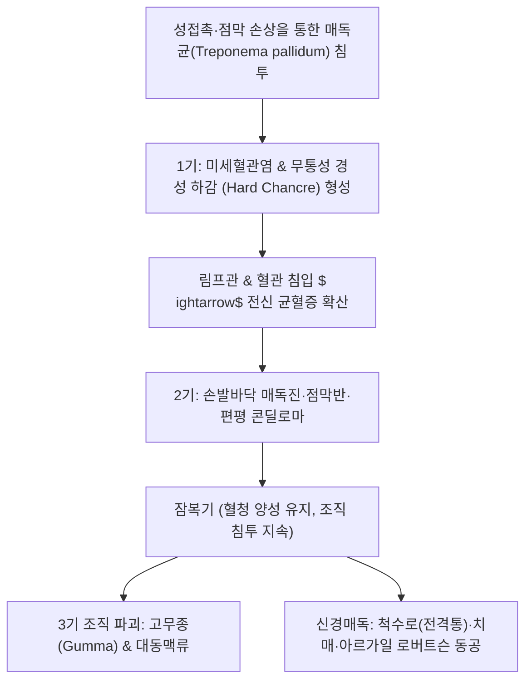

# 🩺 [[매독]] (Syphilis / 楊梅瘡·梅毒, ICD-10 A51~A53)

> **핵심 3줄 요약 (Key Summary)**:
> - 📍 병소 부위 & 해부·병태생리: 스피로헤타균인 [[트레포네마 팔리둠]](Treponema pallidum) 감염에 의한 전신성 만성 성매개 감염병 — 혈관염(Endarteritis obliterans) 유발 및 림프계·중추신경계 침범.
> - 🚩 전형적 임상 양상: 1기 무통성 경성 하감([[Chancre]]), 2기 전신 매독진 및 편평 콘딜로마, 3기 고무종([[Gumma]]), 심혈관 매독, 신경매독([[척수로]]·[[아르가일 로버트슨 동공]]).
> - 🛠️ 핵심 검사 & 치료 전략: VDRL/RPR 비트레포네마 선별 후 FTA-ABS/TPHA 확진, 벤자틴 [[페니실린 G]] 근주(신경매독은 수용성 페니실린 G 고용량 정맥 주사) + 토복령·금은화 청열해독 한의 협진.
> - ⚠️ 응급 의뢰 레드플래그: 신경매독(급격한 시력 저하, 청력 상실, 뇌경색 증상, 급성 뇌수막염, 정신 착란), 대동맥류 파열 징후, 야리시-헤륵스하이머 반응(발열·쇼크).

---

## 📌 목차
1. [질환 개요 & 해부학적 병태생리](#1-질환-개요--해부학적-병태생리)
2. [병태생리 메커니즘 & 생체역학적 악순환 네트워크](#2-병태생리-메커니즘--생체역학적-악순환-네트워크)
3. [임상 증상 & 이학적 검사(Physical Exam) 알고리즘](#3-임상-증상--이학적-검사physical-exam-알고리즘)
4. [감별 진단 매트릭스 (Differential Diagnosis)](#4-감별-진단-매트릭스-differential-diagnosis)
5. [한의 통합 치료 프로토콜 (침·약침·추나·한약)](#5-한의-통합-치료-프로토콜-침약침추나한약)
6. [양방 치료 & 병용·의뢰 기준 (Conventional Treatment & Referral)](#6-양방-치료--병용의뢰-기준-conventional-treatment--referral)
7. [재활 운동 & 생활습관 티칭 가이드](#7-재활-운동--생활습관-티칭-가이드)
8. [💡 사용자 진료실 핵심 필기 & 임상 노하우 (Melt-In 잔여 심화 집약)](#8--사용자-진료실-핵심-필기--임상-노하우-melt-in-잔여-심화-집약)
9. [출처 및 학술 참고 문헌 (References)](#9-출처-및-학술-참고-문헌-references)

---

## 1. 질환 개요 & 해부학적 병태생리

### 1) 질환 정의 및 병기 분류
- **정의**: 나선형 세균인 [[트레포네마 팔리둠]](Treponema pallidum subspecies pallidum)에 감염되어 발생하는 만성 전신성 감염 질환이다. 주로 성접촉이나 수직 감염(선천성 매독)을 통해 전파되며, 체내 모든 장기와 조직을 침범할 수 있다.
- **잠복기**: 평균 21일(10~90일).
- **병기별 분류 (Stages of Syphilis)**:
  - **1기 매독 (Primary syphilis)**: 감염 부위의 무통성 궤양인 **경성 하감(Hard chancre)** 발생. 2~6주 후 자연 소실되나 체내 균은 림프액과 혈류를 타고 전신으로 확산됨.
  - **2기 매독 (Secondary syphilis)**: 감염 6주~6개월 후 전신 피부 발진(손바닥·발바닥 매독진), 편평 콘딜로마(Condyloma lata), 점막 반점 및 전신 림프절염 발현.
  - **잠복 매독 (Latent syphilis)**: 임상 증상은 소실되었으나 혈청학적 검사는 양성인 상태.
    - *조기 잠복 매독(감염 1년 이내)*: 재발성 2기 증상 발현 및 감염력 존재.
    - *후기 잠복 매독(감염 1년 이상)*: 감염력은 낮으나 조직 파괴 진행 가능.
  - **3기 매독 (Tertiary syphilis)**: 감염 5~20년 후 발현. 파괴성 육아종인 고무종(Gumma), 심혈관 매독(상행 대동맥류, 대동맥판 폐쇄부전), 신경매독(Neurosyphilis).
  - **선천성 매독 (Congenital syphilis)**: 임신 중 태반을 통해 태아로 전파(임신 4개월 이후 태아 감염 증가). 허치슨 치아(Hutchinson teeth), 간질성 각막염, 난청(Hutchinson triad).

### 2) 관련 해부학적 구조물
- **외음부 및 점막**: 귀두, 음경 포피, 소음순, 자궁경부, 항문, 직장, 입술, 구강 점막.
- **혈관계**: 영양동맥(Vasa vasorum) 주변 폐쇄성 내막염(Endarteritis obliterans) $
ightarrow$ 대동맥궁 파괴.
- **중추신경계**: 뇌수막, 척수 후주(Posterior columns) $
ightarrow$ 감각실조 및 전격통(Tabes dorsalis).

---

## 2. 병태생리 메커니즘 & 생체역학적 악순환 네트워크

### 1) 혈관염 및 조직 허혈성 괴사
- 트레포네마 매독균은 미세혈관의 내피세포 간극을 뚫고 침투하여 소혈관 주변 림프구 및 형질세포 침윤을 유발한다.
- 이로 인해 **폐쇄성 내피내막염(Endarteritis obliterans)**이 유발되며, 혈관 내경이 좁아져 조직 괴사와 허혈성 궤양이 형성된다.
- 3기 매독의 특징인 **고무종(Gumma)**은 매독균 항원에 대한 지연성 과민반응(Type IV Hypersensitivity)으로 인해 중심성 응고괴사를 동반한 만성 육아종성 병변이다.

### 2) 신경매독(Neurosyphilis)의 침범 기전
- 매독균은 감염 수일 만에 중추신경계로 침투할 수 있다.
- **수막혈관성 매독**: 뇌혈관의 내막염으로 인해 청장년층에서 급성 뇌경색을 유발.
- **실질성 신경매독**:
  - *진행성 마비(General paresis)*: 대뇌 피질 전두엽 침범 $
ightarrow$ 성격 변화, 과대망상, 급격한 치매.
  - *척수로(Tabes dorsalis)*: 척수 후근 및 후주(Dorsal columns)의 진행성 탈수초 $
ightarrow$ 고유수용감각 상실, 감각성 운동실조, 벼락같은 전격통(Lightning pain).
  - *아르가일 로버트슨 동공(Argyll Robertson pupil)*: 중뇌 덮개핵(Tectum) 침범으로 대광 반사는 소실되나 조절 반사(폭주)는 유지되는 특징적 동공 이상.

---

## 3. 임상 증상 & 이학적 검사(Physical Exam) 알고리즘

### 1) 주소증 및 병기별 임상 양상
- **1기**: 외음부나 구강에 1~2cm 크기의 단발성 궤양 발생. 궤양의 기저부가 단단하고(경성), **통증이 전혀 없는 것**이 연성 하감과의 결정적 차이. 양측 서혜부 림프절 비대 동반(무통성).
- **2기**: 전신 권태감, 미열 후 전신 피부 발진 발생. 특히 **손바닥과 발바닥에 나타나는 인설성 구진(Biett's collarette)**이 특징적. 생식기 주변 사마귀 형태의 편평 콘딜로마, 벌레 먹은 듯한 탈모(Moth-eaten alopecia).
- **3기 및 신경매독**:
  - 심한 다리의 번개 치는 듯한 통증(전격통, Lightning pain), 어두운 곳에서 걷지 못하는 감각 실조 보행.
  - 동공 검진 시 빛을 비추어도 줄어들지 않으나 손가락을 코앞으로 가져갈 때는 모아지는 **아르가일 로버트슨 동공**.

### 2) 표준 진단 검사 알고리즘
1. **비트레포네마 선별 검사 (Non-treponemal tests)**:
   - **VDRL** (Venereal Disease Research Laboratory) 및 **RPR** (Rapid Plasma Reagin).
   - *임상적 의의*: 매독 활성도 및 치료 반응 판정에 활용. 역가(Titer, 예: 1:32 $
ightarrow$ 1:4)가 4배(2 dilution) 이상 감소하면 치료 성공 판정.
   - *위양성*: 자가면역질환(루푸스), 임신, 고령, 간질환 등에서 발생 가능.
2. **트레포네마 확진 검사 (Treponemal tests)**:
   - **FTA-ABS**, **TPHA**, **CIA** (Chemiluminescence immunoassay).
   - *임상적 의의*: 매독균 특이 항체 검출. 한번 양성이면 평생 양성으로 유지되는 경우가 많아 치료 판정용으로는 부적합하며 확진용으로만 사용.
3. **신경매독 의심 시 요추천자**:
   - 신경학적 증상이 있거나, 적절한 치료 후에도 RPR 역가가 떨어지지 않는 환자는 뇌척수액 VDRL 검사 필수.

---

## 4. 감별 진단 매트릭스 (Differential Diagnosis)

| 감별 질환 | 궤양 및 발진의 특징 | 통증 유무 및 전신 증상 | 핵심 감별점 |
| :--- | :--- | :--- | :--- |
| **[[매독]] (1기 경성하감)** | 기저부가 연골처럼 단단함, 단발성 | **무통성 (통증 없음)** | 암시야 현미경 매독균 확인, RPR/VDRL |
| **연성 하감 (Chancroid)** | 기저부가 무르고 지저분한 삼출물, 다발성 | **극심한 통증 동반** | 헤모필루스 듀크레이(H. ducreyi) 균 |
| **생식기 헤르페스 ([[HSV]])** | 군집된 다발성 소수포 및 얕은 궤양 | 타는 듯한 작열감 및 찌르는 통증 | 단순포진바이러스 PCR 검사 |
| **장미색 비강진** | 체간의 원발반(Herald patch) 후 크리스마스트리형 발진 | 가려움증 경미, 손발바닥 침범 드묾 | 손발바닥 침범 없음, 매독 혈청 음성 |
| **편평 사마귀 / 콘딜로마 (HPV)** | 유두종 형태의 닭벼슬 모양 융기 | 통증 없음 | 2기 매독의 편평 콘딜로마는 넓고 평평함 |

---

## 5. 한의 통합 치료 프로토콜 (침·약침·추나·한약)

### 1) 한의학적 병전 및 변증 체계
- 한의학에서 매독은 [[양매창]](楊梅瘡), [[매독]](梅毒), [[광창]](廣瘡), [[비양선]](飛揚癬)의 범주에 속한다.
- 명대 명의 진사탁(陳士鐸)의 《외과비록》 및 명대 이천(李梴)의 《의학입문》에서 매독의 독기(毒氣) 전변을 상세히 다루었다.
- **습열온결(濕熱蘊結)**: 하감 발생, 소변 적삽, 음부 궤양, 설홍태황니, 맥활삭.
- **풍열음독(風熱淫毒) / 기영양번**: 2기 전신 매독진, 신열, 인후통, 설홍태황, 맥삭.
- **독사내함(毒邪內陷) / 간신음허**: 3기 골통(骨痛), 마목(저림), 전격통, 뇌수 부족, 설강무태, 맥세삭.

### 2) 한약 치료의 핵심 약재와 처방
- **토복령(土茯苓, 청미래덩굴 뿌리)**:
  - 《본초강목》: "건비위, 강근골, 거풍습, 이관절, 지설사, 치수은독, 양매창독(楊梅瘡毒)의 요약".
  - 매독균의 증식을 억제하고 수은 중독과 만성 매독의 골통을 해독하는 최고 명약.
- **선유량탕(仙遺糧湯) / 수비양매탕(搜風敗毒湯)**: 토복령을 군약(君藥)으로 금은화, 방풍, 백선피, 목통, 의이인을 배오하여 체내 매독 독소를 소변과 대변으로 배출.
- **삼령백출산(參苓白朮散) 가 토복령**: 비위 기능을 보강하여 항생제 치료 후 위장관 쇠약을 방지.

### 3) 침구 치료 프로토콜
- **청열해독 및 비뇨생식기 습열 제거**:
  - [[중극]](CV3), [[곡골]](CV2), [[음릉천]](SP9), [[삼음교]](SP6) — 비뇨생식기 림프 순환 촉진.
  - [[곡지]](LI11), [[합곡]](LI4), [[혈해]](SP10) — 피부 발진 진정 및 청혈해서(淸血解暑).
- **신경매독 전격통 및 감각실조 보완**:
  - 척수 후주 손상 부위 협척혈(EX-B2) 및 [[양릉천]](GB34), [[현종]](GB39) 자침.

---

## 6. 양방 치료 & 병용·의뢰 기준 (Conventional Treatment & Referral)

### 1) 질병관리청 및 CDC 표준 항생제 치료
- **1기, 2기 및 조기 잠복 매독 (1년 이내)**:
  - **벤자틴 페니실린 G ([[Benzathine penicillin G]])**: 240만 IU 1회 둔부 심부 근육 주사 (양측 둔부에 120만 IU씩 분할).
- **후기 잠복 매독 및 기간 미상의 잠복 매독, 3기 매독 (신경매독 제외)**:
  - 벤자틴 페니실린 G 240만 IU를 주 1회씩 **총 3주 연속 투여** (총 720만 IU).
- **신경매독 (Neurosyphilis) 및 안매독(Ocular syphilis)**:
  - **수용성 결정성 페니실린 G (Aqueous crystalline penicillin G)**: 1,800만~2,400만 IU/일을 매 4시간마다 300만~400만 IU씩 정맥 주사로 **10~14일간 연속 투여**.
- **페니실린 알레르기 환자**: 독시사이클린(Doxycycline) 100mg 1일 2회 14일(조기) 또는 28일(후기) 투여. 임산부 및 신경매독 환자는 반드시 페니실린 탈감작(Desensitization) 후 페니실린 투여 필수.

### 2) 주의 반응 및 의뢰 기준
- **야리시-헤륵스하이머 반응 (Jarisch-Herxheimer Reaction)**:
  - 페니실린 주사 후 2~24시간 이내에 대량의 매독균이 급격히 사멸하면서 방출된 내독소로 인해 고열, 오한, 두통, 근육통, 빈맥, 혈압 강하 발생.
  - 정상적인 치료 반응임을 사전 교육하고, 아세트아미노펜 등 대증 치료 시행. 임산부의 경우 조기 진통을 유발할 수 있으므로 주의 깊게 감시.
- **전문과 응급 의뢰 레드플래그**:
  - 급성 시력 저하, 포도막염, 청력 소실(신경매독 의심 $
ightarrow$ 즉시 3차 병원 입원 의뢰).
  - 흉부 팽만통, 목소리 쉼(대동맥류 의심).
  - 적절한 페니실린 치료 후 6개월, 12개월 추적 RPR 역가가 4배 이상 감소하지 않는 경우(치료 실패 또는 신경매독 의심 $
ightarrow$ 요추천자 의뢰).

---

## 7. 재활 운동 & 생활습관 티칭 가이드

### 1) 성 파트너 통지 및 치료 동반
- **핑퐁 감염(Ping-pong infection) 방지**: 증상 발생 전 90일 이내의 모든 성 파트너에게 통지하여 혈청 검사 및 동반 치료를 받도록 지도.
- **치료 종료 판정 시까지 성관계 전면 금지**: 궤양이 완전히 아물고 역가 감소가 확인될 때까지 성접촉 엄격 금지.

### 2) 환자 프라이버시 보호 및 정서적 지지
- 매독 환자는 극심한 수치심과 죄책감으로 인해 의료진에게 사실을 숨기거나 자의로 치료를 중단하는 경우가 많음.
- "매독은 페니실린으로 완치될 수 있는 질환이며, 조기에 정확히 치료받으면 후유증을 완전히 예방할 수 있습니다"라는 확신을 주고 치료 순응도를 유지시킴.

---

## 8. 💡 사용자 진료실 핵심 필기 & 임상 노하우 (Melt-In 잔여 심화 집약)

- **진료실 감별 제1원칙 (하감의 촉진 손맛)**: "생식기 주변 궤양 환자가 내원했을 때, 라텍스 장갑을 끼고 궤양의 밑바닥을 조심스럽게 만져보라. 판자나 연골을 만지는 것처럼 단단하고 경계가 명확하며 환자가 별 통증을 느끼지 않는다면 십중팔구 경성 하감(1기 매독)이다. 반대로 물렁물렁하고 고름이 나오며 손만 대도 비명을 지를 정도로 아프다면 연성 하감이나 헤르페스다."
- **손바닥·발바닥 발진의 비밀**: "젊은 환자가 손바닥과 발바닥에 붉은 구진(발진)이 생겼다며 습진이나 한포진으로 내원했을 때, 성접촉 병력을 반드시 확인해야 한다. 손바닥을 침범하는 피부 질환은 다형홍반, 손습진 외에 2기 매독진이 대표적이다. 무턱대고 스테로이드 연고만 처방하면 병을 3기 잠복기로 숨겨버리는 꼴이 된다."
- **환자의 은폐 심리 극복 노하우**: "비뇨기 성매개 감염 환자는 대다수 증상을 숨기려 하기에 진단이 늦어진다. 의사가 편견 없는 태도로 신뢰를 형성하고, VDRL/RPR 스크리닝의 필요성을 편안하게 설명해야 환자가 검사에 동의한다."

---

## 9. 출처 및 학술 참고 문헌 (References)

- Hook EW 3rd. (2017). Syphilis. *Lancet*. 389(10078):1550-1557. PMID: 27993382.
  - [연구 요약] 매독의 전 세계적 역학 재유행, 트레포네마 팔리둠 병태생리, 병기별 임상 양상 및 페니실린 기반 표준 치료 종합 종설.
- Workowski KA, et al. (2021). Sexually Transmitted Infections Treatment Guidelines. *MMWR*. PMID: 34292926.
  - [연구 요약] 질병통제예방센터의 성매개 감염 진료지침으로 벤자틴 페니실린 투여 용량 및 신경매독 관리 지침 제시.
- Ropper AH. (2019). Neurosyphilis. *N Engl J Med*. 381(14):1358-1363. PMID: 31577877.
  - [연구 요약] 신경매독의 다양한 임상 스펙트럼(수막혈관성, 척수로, 진행성 마비), 뇌척수액 진단 기준 및 고용량 수용성 페니실린 치료 권고.
