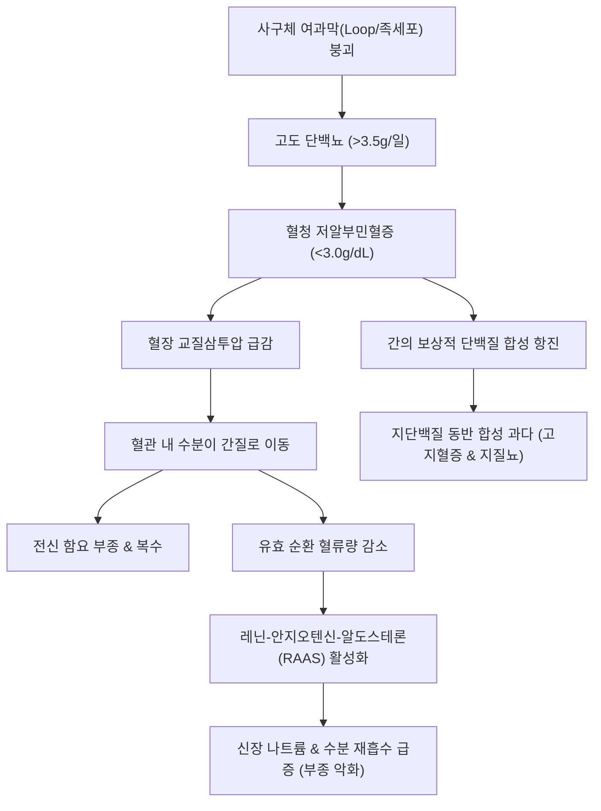

# 🩺 신장 증후군 (腎症候群, Nephrotic Syndrome)

> **핵심 3줄 요약 (Key Summary)**:
> - 📍 정의: 사구체 모세혈관 여과 장벽(족세포 및 슬릿막)의 중증 손상으로 인해 하루 3.5g 이상의 고도 [[단백뇨]], [[저알부민혈증]](<3.0 g/dL), 전신 부종, [[고지혈증]](지질뇨)을 특징으로 하는 임상 증후군.
> - 🚩 주요 증상 및 병태생리: 족세포 발돌기 융합 $\rightarrow$ 대량 알부민 유출 $\rightarrow$ 혈장 교질삼투압 급감 $\rightarrow$ 간질액 저류 및 2차성 알도스테론 분비로 전신 함요 부종 발생; 간에서의 보상적 알부민 합성 항진 시 지단백질이 동반 합성되어 혈중 콜레스테롤 급증 및 소변 내 지방방울(지방뇨, Maltese cross) 출현.
> - 🛠️ 한양방 통합 치료 및 관리: 조직형(MCD, FSGS, MN)에 따른 고용량 스테로이드, 면역억제제(CNI, 리툭시맙), 부종 완화(루프 이뇨제) 및 항응고 요법을 시행하며, 한의학적으로 수종(水腫)·신구(腎水)·비신양허(脾腎兩虛) 변증 하에 [[진무탕]], [[실비음]], [[보중익기탕]] 가감으로 건비온신·온화수습 및 신정 고섭을 도모함.

---

## 📌 목차
1. [개요 및 정의](#1-개요-및-정의)
2. [병태생리 및 4대 핵심 메커니즘](#2-병태생리-및-4대-핵심-메커니즘)
3. [원인 질환 분류 (원발성 vs 속발성)](#3-원인-질환-분류-원발성-vs-속발성)
4. [임상 증상 및 합병증 평가](#4-임상-증상-및-합병증-평가)
5. [양방 치료 및 단계별 가이드라인](#5-양방-치료-및-단계별-가이드라인)
6. [한의학적 변증 및 복합 치료 프로토콜](#6-한의학적-변증-및-복합-치료-프로토콜)
7. [임상 예후 및 재발 관리](#7-임상-예후-및-재발-관리)
8. [임상 메모 및 환자 교육 (Melt-In)](#8-임상-메모-및-환자-교육-melt-in)
9. [출처 및 현대 학술 연구](#9-출처-및-현대-학술-연구)

---

## 1. 개요 및 정의

**신장 증후군(신증후군, Nephrotic Syndrome)**은 신장의 사구체 여과 장벽의 심각한 투과성 증가로 인해 발생하는 질환군으로, 단일 질환이 아니라 공통된 4대 임상 징후를 공유하는 복합 임상 증후군이다.

### 4대 진단 기준
1. **고도 [[단백뇨]] (Nephrotic-range Proteinuria)**: 성인 기준 24시간 소변 단백질 배설량 **>3.5 g/day** (소아 기준 >40 mg/m²/hr 또는 무작위 소변 UPCR >2.0 g/g).
2. **[[저알부민혈증]] (Hypoalbuminemia)**: 혈청 알부민 농도 **<3.0 g/dL** (중증 시 <2.0 g/dL).
3. **전신 부종 (Generalized Edema)**: 안면 안검 부종, 하지 함요 부종, 심할 경우 복수 및 흉수.
4. **[[고지혈증]] 및 지질뇨 (Hyperlipidemia & Lipiduria)**: 혈청 총콜레스테롤, LDL-C, 중성지방의 현저한 상승 및 소변 내 타원형 지방체(Oval fat bodies) 관찰.

---

## 2. 병태생리 및 4대 핵심 메커니즘

사구체 여과 장벽의 붕괴로부터 4대 징후가 연쇄적으로 파생된다.

### 1) 고도 단백뇨 발생 기전
사구체 여과막의 모세혈관 루프(Loop)를 감싸고 있는 족세포(Podocyte)의 발돌기가 소실(Effacement)되고 슬릿막(Slit diaphragm) 단백질인 네프린(Nephrin)과 포도신(Podocin)의 결합이 파괴된다. 이로 인해 거대 분자량인 알부민이 여과 장벽을 통과하여 대량으로 소변에 쏟아져 나온다.

### 2) 저알부민혈증과 간의 지질 동반 합성
- 소변으로 배출되는 알부민의 양이 간(Liver)에서의 최대 알부민 합성 능력을 초과하여 심각한 저알부민혈증이 발생한다.
- 저알부민혈증과 혈청 교질삼투압 저하를 감지한 간세포는 알부민 합성을 보상적으로 최대로 늘리는데, 이 과정에서 **ApoB 및 지단백질(VLDL, LDL)의 합성이 불가피하게 함께 동반 항진**된다.
- 동시에 말초 조직에서 지단백질 분해효소(Lipoprotein lipase) 활성이 저하되어 혈중 콜레스테롤과 중성지방이 극단적으로 치솟는 **고지혈증**이 유발되고, 사구체를 통과한 지단백질이 세뇨관에 축적되어 소변으로 배출되는 **지방뇨(지방방울, Oval fat bodies)**가 관찰된다.

### 3) 부종 발생 기전 (Underfill vs Overfill 이론)
- **저충만설 (Underfill Theory)**: 교질삼투압 저하로 체액이 혈관에서 간질로 이동하여 혈관 내 유효 순환 혈액량이 감소한다. 이에 대응하여 교감신경과 알도스테론이 활성화되어 원위세뇨관에서 나트륨과 물을 재흡수하여 부종이 가속화된다(소아 미세변화신증에서 우세).
- **과충만설 (Overfill Theory)**: 여과된 단백질이 원위세뇨관 상피나트륨통로(ENaC)를 직접 자극하여 혈액량 감소와 무관하게 일차적으로 신장에서 나트륨 저류를 일으킨다(성인 막성신병증 등에서 우세).

---

## 3. 원인 질환 분류 (원발성 vs 속발성)

### 1) 일차성 사구체 질환 (원발성 신증후군)
- **미세변화신증 (Minimal Change Disease, MCD)**: 소아 신증후군의 80~90%, 성인의 10~15%. 광학현미경 정상, 전자현미경상 족세포 발돌기 융합. 스테로이드에 극히 잘 반응함.
- **막성신병증 (Membranous Nephropathy, MN)**: 성인 신증후군의 가장 흔한 원인(약 30~40%). 항-PLA2R 항체에 의한 상피하 면역 침착 및 기저막 비후.
- **국소분절성 사구체경화증 (FSGS)**: 성인과 소아 모두에서 호발. 족세포 유전 변이나 손상으로 사구체 일부가 경화됨. 스테로이드 저항성이 흔함.

### 2) 이차성 신증후군 (전신 질환 동반)
- **[[당뇨병]]성 신증**: 성인 이차성 신증후군의 가장 흔한 원인.
- **자가면역 질환**: 전신 홍반성 [[루푸스]](루푸스 신염 Class V 또는 IV).
- **이상단백혈증 및 종양**: 아밀로이드증(Amyloidosis), [[다발골수종]], 호지킨 림프종, 고형암.
- **감염증**: B형 간염, C형 간염, 매독.
- **약물**: 소염진통제([[NSAIDs]]), 페니실라민, 금 제제.

---

## 4. 임상 증상 및 합병증 평가

### 1) 주요 임상 양상
- 아침 기상 시 심한 안검 부종, 저녁에 신발이 맞지 않는 하지 부종, 복부 팽만(복수) 및 호흡 곤란(흉수).
- 소변에 하얗고 짙은 거품이 풍성하게 일어남.
- 단백질 결핍에 따른 손톱 가로선(Muehrcke's lines), 모발 건조 및 탈모.

### 2) 치명적 합병증
- **혈전색전증 (Thromboembolism)**: 간의 응고인자(피브리노겐) 합성 증가와 소변을 통한 항응고인자(안티트롬빈 III) 유실로 고응고 상태가 유발됨 $\rightarrow$ 신정맥 혈전증, 심부정맥 혈전증, 폐색전증 위험 급증.
- **중증 감염증**: 면역글로불린(IgG) 및 보체 유실로 피막성 세균(폐렴구균 등)에 대한 저항력이 급감하여 자발성 세균성 복막염, 폐렴, 봉와직염 빈발.
- **급성 신손상 (AKI)**: 극심한 저알부민혈증에 의한 신허혈 또는 과도한 이뇨제 투여 시 발생.

---

## 5. 양방 치료 및 단계별 가이드라인

### 1) 면역억제 유도 요법
- **미세변화신증 (MCD)**: 경구 프레드니솔론(1 mg/kg/day, 최대 60~80 mg) 투여 시 80~90%에서 완전 관해 달성.
- **막성신병증 (MN) 및 FSGS**: 항-PLA2R 항체 역가 및 위험도에 따라 칼시뉴린 억제제(타크로리무스, 사이클로스포린) 또는 리툭시맙(Rituximab, B세포 제거), 알킬화제(사이클로포스파마이드) 요법 적용.

### 2) 부종 조절 및 대증 신보호
- **루프 이뇨제 (Furosemide, Torsemide)**: 저알부민혈증 환자는 이뇨제 결합 단백이 부족하므로 일반 용량보다 고용량이 필요함.
- **알부민 정맥 주사 병용**: 심한 저혈압이나 핍뇨를 동반한 불응성 부종 환자에서 20% 알부민을 이뇨제 투여 직전 점적하여 혈관 내로 체액을 끌어들인 뒤 이뇨 유도.
- **신보호 요법**: SGLT2 억제제 및 RAS 차단제([[ACEI]]/ARB)로 단백뇨 경감.
- **고지혈증 조절**: 스타틴(Statin) 투여.
- **항응고 예방**: 혈청 알부민 <2.0~2.5 g/dL인 고위험 환자에서 헤파린/와파린 투여 고려.

---

## 6. 한의학적 변증 및 복합 치료 프로토콜

한의학에서 신장 증후군은 **수종(水腫)** 중에서도 전신이 붓고 피부를 누르면 쑥 들어가서 바로 나오지 않는 **음수(陰水)**, **신구(腎水)**, **허손(虛損)**, **요탁(尿濁)**에 해당한다. 비신양허(脾腎兩虛)로 인해 수습이 정체되고 기혈이 동반 손상된다고 파악한다.

### 1) 주요 변증 분류 및 대표 처방
- **비신양허증 (脾腎兩虛證) / 수습범람 (水濕氾濫)**:
  - 증상: 전신 부종(얼굴과 사지가 심하게 붓고 함요됨), 복수, 추위를 심하게 탐, 허리와 무릎 시림, 소변량 감소, 설담반치흔, 맥침세무력.
  - 치법: 온신건비(溫腎健脾), 화기행수(化氣行水).
  - 대표 처방: [[진무탕]](眞武湯), [[실비음]](實脾飮) 가감.
  - 구성: [[부자]], [[백출]], [[복령]], [[백작약]], [[생강]], [[후박]], [[대복피]], [[목향]] — 양기를 회복하여 수습을 온화시킴.
- **비허습곤증 (脾虛濕困證) / 기혈양허 (氣血兩虛)**:
  - 증상: 부종과 함께 극심한 피로 무력감, 식욕 부진, 안색이 어둡고 창백함, 어지럼증, 설담태백니.
  - 치법: 익기건비(益氣健脾), 삼습소종(滲濕消腫).
  - 대표 처방: [[보중익기탕]](補中益氣湯) 합 [[사령탕]](四苓湯), [[당귀보혈탕]](當歸補血湯).
  - 구성: [[황기]](대량 투여), [[당삼]], [[백출]], [[당귀]], [[복령]], [[저령]], [[택사]].
- **간신음허증 (肝腎陰虛證) / 습열내온 (濕熱內蘊)**:
  - 증상: 장기 스테로이드 복용 후 문페이스(Moon face), 조열, 번갈, 소변이 짙고 거품이 많음, 설홍소태, 맥세삭.
  - 치법: 자음강화(滋陰降火), 청열이습.
  - 대표 처방: [[지백지황탕]](知柏地黃湯), [[청호별갑탕]](淸蒿鼈甲湯) 가감.
  - 구성: [[지모]], [[황백]], [[숙지황]], [[산수유]], [[산약]], [[목단피]].

### 2) 침구 치료 프로토콜
- **주요 혈위**: [[신수]](BL23), [[비수]](BL20), [[음릉천]](SP9), [[수분]](CV9), [[기해]](CV6), [[관원]](CV4), [[족삼리]](ST36), [[삼음교]](SP6).

---

## 7. 임상 예후 및 재발 관리

- **조직형에 따른 임상 경과 및 예후**:
  - **미세변화신증(MCD)**: 스테로이드 치료 반응률이 85~90%에 달하여 신기능 보존 예후는 매우 우수하나, 소아 및 성인의 약 50~70%에서 잦은 재발(Frequent Relapsing) 또는 스테로이드 의존성(Steroid-Dependent)을 보여 면역억제제 교체 투여가 요구된다.
  - **막성신병증(MN)**: 1/3은 자발적 완전 관해, 1/3은 단백뇨 지속 상태 유지, 1/3은 10~15년에 걸쳐 말기 신부전으로 점진 진행하는 '1/3 법칙'을 따른다.
  - **초점분절사구체경화증(FSGS)**: 스테로이드 불응성이 높고, 완전 관해에 실패할 경우 5~10년 내 절반 이상의 환자가 만성 신부전 및 말기 신질환(ESRD)으로 진행한다.
- **재발 방지 및 합병증 감시 체크포인트**:
  - 정기적 자가 요단백 시험지봉 검사를 통한 조기 재발 감지.
  - 감염 예방(폐렴구균 백신 접종, 조기 항생제) 및 혈전색전증 예방을 위한 신속한 항응고제 적응증 평가.

---

## 8. 임상 메모 및 환자 교육 (Melt-In)

- **사구체 구조 손상과 신증후군의 본질 (Melt-In 원본 필기 집약)**:
  - **사구체 부위별 발병 기전**:
    1. **여과지(Loop, 족세포)가 찢어진 경우**: 거대 분자 단백질이 필터링되지 못하고 대량 누출되어 **[[신장 증후군]](고도 단백뇨, 저알부민혈증, 부종, 고지혈증)**으로 진행한다.
    2. **사이질(Mesangium)에 면역복합체가 침착된 경우**: 염증으로 모세혈관이 파열되어 **사구체 신염(혈뇨)**으로 진행한다.
  - **간의 지방 동반 합성 원리**: 대량 단백질 배출로 혈중 알부민이 고갈되면, 간에서 이를 보충하기 위해 알부민 합성을 최대화하는 과정에서 **지질(콜레스테롤, 지단백질)도 함께 합성**되므로 고지혈증과 소변 내 지방방울(지방뇨)이 동반된다.
  - **부종의 발생 경로**: 저알부민혈증으로 교질삼투압이 저하되어 수분이 조직 사이질로 빠져나가고, 순환 혈류량이 감소함에 따라 2차적으로 알도스테론이 분비되어 물과 나트륨의 신장 재흡수가 촉진되어 부종이 극대화된다.
- **식이 관리 지침 (Melt-In 원본 필기 집약)**:
  - **저단백 식이 기준**: 단백뇨가 심하다고 무작정 고단백식을 하면 사구체 여과 부하가 급증하여 신손상이 가속화되므로, **성인은 0.8~1.0 g/kg/day, 소아는 1.2 g/kg/day** 수준으로 엄격히 제한한다.
  - **저염식**: 체액 저류와 복수 악화를 막기 위해 하루 소금 섭취를 2~3g 이하로 엄격히 제한한다.
- **감염 및 피부 관리**:
  - 피부 부종 부위는 혈류가 불량하여 작은 상처에도 봉와직염이 쉽게 발생하므로 보습을 철저히 하고 압박 손상을 피하도록 교육한다.

---

## 9. 출처 및 현대 학술 연구

1. **Dotis J, et al. (2026)**. Acute Kidney Injury in Childhood Nephrotic Syndrome: From Hemodynamic Vulnerability and Tubular Stress Toward Biomarker-Guided Management. *Medicina (Kaunas)*. PMID: 42942510
   - [연구 요약]: 소아 신증후군에서 저알부민혈증에 따른 혈역학적 취약성과 세뇨관 손상 스트레스에 의한 급성 신손상 발생 병태생리 및 바이오마커 기반 환자 관리 지침 리뷰.
2. **Ulinski T, et al. (2026)**. Thromboembolic prophylaxis in childhood idiopathic nephrotic syndrome. From pathophysiology to clinical management. *Front Pediatr*. PMID: 42840564
   - [연구 요약]: 특발성 신증후군 환자의 고응고 상태 병태생리, 혈전색전증 발생 위험도 층화 및 임상적 항응고 예방 요법 가이드라인을 고찰한 연구.

