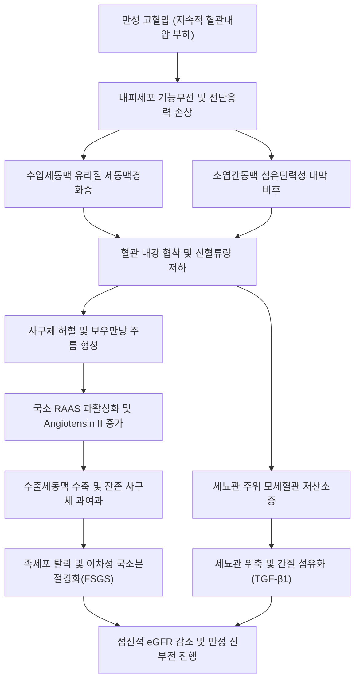

# 🩺 양성 고혈압성 세동맥 신경화증 (Benign Hypertensive Arteriolar Nephrosclerosis)

> **핵심 3줄 요약 (Key Summary)**:
> - 📍 병소 부위 & 해부·병태생리: 장기간 지속된 만성 [[고혈압]]에 의해 [[신장]]의 수입세동맥(afferent arteriole) 및 소엽간동맥(interlobular artery)에 유리질화(hyaline arteriolosclerosis) 및 내막 섬유탄력성 비후(myointimal hyperplasia)가 발생하여 혈관 내강이 좁아지고, 사구체 허혈성 위축, 족세포 손상, 사구체 경화 및 간질 섬유화로 점진적 신기능 저하가 유발되는 혈관성 만성 신장병증.
> - 🚩 전형적 임상 양상: 수년에서 수십 년간의 고혈압 병력을 가진 고령 또는 흑인 환자에서 무증상으로 진행하며, 경미한 단백뇨(대개 < 1g/day), 서서히 상승하는 혈청 크레아티닌 및 혈압 조절 불량, 심비대나 고혈압성 망막병증 등의 표적 장기 손상이 동반됨.
> - 🛠️ 핵심 검사 & 치료 전략: 혈청 크레아티닌, 사구체여과율([[eGFR]]), 미세알부민뇨/소변 단백뇨 정량 검사, 신장 초음파(양측 신장의 대칭적 크기 감소 및 피질 박소, 표면 과립상 변화). 목표 혈압 조절(< 130/80 mmHg), [[ACE 억제제]] 또는 [[ARB]] 투여를 통한 사구체내압 강하 및 단백뇨 감소, 저염 식이 요법.
> - ⚠️ 응급 의뢰 레드플래그: 급격한 혈압 상승(수축기 > 180 mmHg 또는 이완기 > 120 mmHg)과 함께 두통, 시야장애, 급성 신부전 징후가 동반되는 악성 고혈압 전환, 3g/day 이상의 신증후군 범위 단백뇨 급발, 급성 폐부종 또는 핍뇨(Urine output < 0.5 mL/kg/h) 발생 시 즉시 상급병원 응급 전원.

---

## 📌 목차
1. [질환 개요 & 해부학적 병태생리](#1--질환-개요---해부학적-병태생리)
2. [병태생리 메커니즘 & 생체역학적 악순환 네트워크](#2--병태생리-메커니즘---생체역학적-악순환-네트워크)
3. [임상 증상 & 이학적 검사(Physical Exam) 알고리즘](#3--임상-증상---이학적-검사physical-exam-알고리즘)
4. [진단 검사 & 감별 진단 패널](#4--진단-검사---감별-진단-패널)
5. [양방 치료 프로토콜 & 약물 상호작용](#5--양방-치료-프로토콜---약물-상호작용)
6. [한의 기능의학적 치료 프로토콜](#6--한의-기능의학적-치료-프로토콜)
7. [재활 운동 & 생활습관 티칭 가이드](#7--재활-운동---생활습관-티칭-가이드)
8. [💡 사용자 진료실 핵심 필기 & 임상 노하우 (Melt-In 잔여 심화 집약)](#8--사용자-진료실-핵심-필기---임상-노하우-melt-in-잔여-심화-집약)
9. [출처 및 학술 참고 문헌 (References)](#9--출처-및-학술-참고-문헌-references)

---

## 1. 질환 개요 & 해부학적 병태생리

### 1) 정의 및 역학
양성 고혈압성 세동맥 신경화증(Benign Hypertensive Arteriolar Nephrosclerosis)은 만성적인 원발성 [[고혈압]]의 혈역학적 부하에 의해 신장의 소동맥 및 세동맥 벽이 비후되고 내강이 협착되어 사구체 허혈과 간질 섬유화를 유발하는 진행성 [[만성 콩팥병]](CKD)의 주요 원인 질환이다. '양성(Benign)'이라는 용어는 악성 고혈압(Malignant hypertension)에 의한 급격한 섬유소양 괴사(fibrinoid necrosis) 및 급성 신부전과 대비하여 수년에서 수십 년에 걸쳐 완만하게 진행한다는 임상 경과를 나타내는 역사적 명칭이다. 전 세계적으로 말기 신부전(ESRD) 환자의 약 25~30%가 고혈압성 신경화증으로 진단되며, 당뇨병성 신증에 이어 두 번째로 흔한 투석 원인 질환이다. 고령자, 남성, 특히 아프리카계 흑인(APOL1 유전자 변이 보유군)에서 유병률과 진행 속도가 현저히 높다.

### 2) 미세 해부학적 병소 구조
- **수입세동맥(Afferent arteriole)**: 만성적인 혈관 내 전단 응력(shear stress)과 관내압 상승으로 인해 혈장 단백질(피브리노겐, 면역글로불린, 지질 등)이 내피세포를 투과하여 혈관 중막에 침착되는 유리질 세동맥경화증(Hyaline arteriolosclerosis)이 발생한다.
- **소엽간동맥(Interlobular artery) 및 궁상동맥(Arcuate artery)**: 혈관 평활근 세포의 증식과 내탄력판의 중복(duplication), 교원질 침착이 일어나는 양파껍질 모양 또는 동심원상의 내막 섬유탄력성 증식증(Fibroelastic intimal hyperplasia)이 관찰된다.
- **사구체(Glomerulus)**: 수입세동맥의 협착으로 인한 관류압 저하로 허혈성 모세혈관 기저막의 주름 형성(wrinkling/folding), 보우만낭 비후, 메산지움 기질 증가가 나타나며, 결국 사구체 전체가 유리질화되어 허혈성 사구체 경화(Ischemic glomerulosclerosis)에 이른다. 일부 잔존 사구체는 대상성 과여과(hyperfiltration)로 인해 이차성 국소분절성 사구체경화증(FSGS) 형태를 띠기도 한다.
- **세뇨관-간질 복합체(Tubulointerstitium)**: 모세관후 모세혈관(peritubular capillaries)의 관류 감소로 세뇨관 상피세포의 만성 저산소증, 위축(tubular atrophy), 그리고 섬유모세포 활성화에 의한 광범위한 간질 섬유화(interstitial fibrosis)가 유발된다.

---

## 2. 병태생리 메커니즘 & 생체역학적 악순환 네트워크

### 1) 혈역학적 자가조절 파탄과 혈관 리모델링
신장 미세혈관은 전신 혈압 변동에 대해 수입세동맥의 근원성 수축(myogenic response)과 세뇨관사구체 피드백(tubuloglomerular feedback)을 통해 사구체내압을 일정하게 유지하는 자가조절(autoregulation) 기전을 가진다. 그러나 장기간의 중등도 이상 고혈압에 노출되면:
1. 내피세포의 일산화질소([[산화질소]], NO) 합성 장애와 엔도텔린-1(Endothelin-1) 등 혈관수축 인자의 과발현이 발생한다.
2. 혈관벽 투과성이 증가하여 혈장 성분이 중막으로 유출·응고되면서 유리질(hyaline) 복합체를 형성한다.
3. 혈관 내경이 심각하게 좁아지며 신혈류량(RBF)이 감소하고 신혈관 저항(RVR)이 상승한다.

### 2) 레닌-안지오텐신-알도스테론계(RAAS) 활성화와 산화 스트레스
국소 허혈에 반응하여 방사구체 장치(JGA)에서 [[레닌]](Renin) 분비가 자극되고, 이는 [[안지오텐신 II]](Angiotensin II)의 생성을 촉진한다.
- 안지오텐신 II는 수출세동맥(efferent arteriole)을 선택적으로 수축시켜 잔존 사구체의 관내압을 인위적으로 상승시킴으로써 단기적으로 eGFR을 유지하려 하지만, 장기적으로는 모세혈관벽에 기계적 신장 자극을 가해 족세포 손상을 가속화한다.
- NADPH 산화효소를 활성화하여 활성산소종(ROS)을 대량 발생시키고, TGF-β1, NF-κB 경로를 촉발하여 세포외기질(ECM) 합성을 촉진하고 분해를 억제하여 섬유화를 비가역적으로 고착시킨다.

---

## 3. 임상 증상 & 이학적 검사(Physical Exam) 알고리즘

### 1) 단계별 임상 양상
- **초기 무증상기**: 전신 고혈압 외에 신장 특이 증상이 전혀 없으며, 우연히 시행한 건강검진에서 미세알부민뇨 또는 경미한 혈청 크레아티닌 상승(1.2~1.5 mg/dL)으로 발견된다.
- **진행기**: 야뇨증(nocturia, 세뇨관 농축능 저하에 기인), 경도의 하지 부종, 피로감, 혈압 조절을 위해 2~3종 이상의 항고혈압제가 요구되는 저항성 고혈압 양상이 나타난다.
- **말기(요독증기)**: eGFR < 15 mL/min/1.73m² 도달 시 식욕 부진, 오심, 피부 소양감, 호흡곤란, 난치성 체액 과부하 및 빈혈이 동반된다.

### 2) 이학적 검사 알고리즘
1. **혈압 측정**: 양팔 혈압 동시 측정 및 맥압(Pulse pressure) 평가. 맥압 증가는 대동맥 경직도 및 표적장기 손상의 간접 지표.
2. **안저 검사(Fundoscopy)**: 고혈압성 망막병증(Keith-Wagener-Barker 등급) 확인. 동정맥 교차 현상(AV nicking), 은선/동선 동맥(silver/copper wiring), 면화반(cotton-wool spots) 동반 여부는 신혈관 손상 정도와 밀접하게 비례.
3. **심혈관계 진찰**: 제4심음(S4 gallop, 좌심실 비대 및 탄성 감소), 심첨박동 전위, 경동맥 및 대퇴동맥 잡음 청진.
4. **복부 청진**: 신동맥 잡음(Renal bruit) 청진을 통해 신동맥 협착증과의 감별 필수.

---

## 4. 진단 검사 & 감별 진단 패널

### 1) 진단 기준 및 임상적 진단 패널
양성 고혈압성 세동맥 신경화증은 임상적으로 배제 진단(diagnosis of exclusion)을 통해 확정되는 경우가 많다. 확진은 신생검(Renal biopsy)이나, 전형적인 임상 양상을 만족하면 생검 없이 임상적으로 진단한다:
- 최소 5~10년 이상의 오랜 본태성 [[고혈압]] 병력.
- 망막병증, 좌심실 비대 등 다른 고혈압성 표적장기 손상의 존재.
- 경미한 단백뇨 (소변 단백/크레아티닌 비 < 1.0 g/g, 대개 < 0.5 g/g).
- 무균성 소변 침사 (비활동성 침사: 적혈구 원주나 심한 혈뇨 없음).
- 신기능 저하의 완만한 진행 속도 (연간 eGFR 감소 < 2~5 mL/min/1.73m²).

### 2) 검사실 소견
| 검사항목 | 소견 | 임상적 의미 |
| :--- | :--- | :--- |
| 소변 검사 | 단백뇨 음성~1+, 비활동성 침사 | 현미경적 혈뇨는 드물며, 적혈구 원주 관찰 시 사구체신염 의심 |
| 소변 알부민/크레아티닌 비(UACR) | 30 ~ 300 mg/g (미세알부민뇨) | 1,000 mg/g 초과 시 FSGS, 당뇨병성 신증 또는 원발성 사구체질환 감별 |
| 신장 초음파 (US) | 양측 신장의 대칭적 크기 감소 (장축 < 9~10 cm) | 신피질 에코음영 증가, 피질 박소, 표면 과립상 요철 |
| 신혈관 도플러 초음파 | 저항지수(Resistive Index, RI) 상승 (> 0.70) | 세동맥 및 세관간질 경화 반영, 신동맥 주간부 협착 배제 |

### 3) 감별 진단 감별점
- **신동맥 협착증(Renovascular hypertension)**: 급격히 악화되는 저항성 고혈압, ACEI/ARB 복용 후 크레아티닌 30% 이상 급상승, 비대칭적 신장 크기(양측 차이 > 1.5 cm), 복부 잡음.
- **당뇨병성 신장질환(Diabetic Kidney Disease)**: 당뇨병 병력, 다량의 단백뇨(신증후군 범위), 당뇨병성 망막병증 선행.
- **원발성 만성 사구체신염(예: [[IgA 신병증]])**: 활동성 소변 침사(이형 적혈구, 적혈구 원주), 현미경적 또는 육안적 혈뇨 동반, 조기에 나타나는 중등도 이상의 단백뇨.

---

## 5. 양방 치료 프로토콜 & 약물 상호작용

### 1) 혈압 조절 목표 및 일차 약제
- **목표 혈압**: KDIGO 가이드라인 기준 수축기 혈압 < 120~130 mmHg, 이완기 혈압 < 80 mmHg (단백뇨 UACR > 30 mg/g인 경우 엄격한 조절 권고).
- **1차 약제**: 
  - [[ACE 억제제]](예: Enalapril, Ramipril) 또는 [[ARB]](예: Losartan, Telmisartan): 수출세동맥을 확장시켜 사구체내 정수압을 낮추고, 단백뇨 감소 및 신장 섬유화 억제 효과 제공.
  - 주의점: 투약 개시 후 2~4주 내 혈청 크레아티닌 최대 30% 상승 및 경도 칼륨 상승은 사구체내압 감소에 따른 예측된 생리적 반응으로 용인 가능하나, 30% 초과 급상승 시 양측 신동맥 협착 또는 탈수 배제 필요.
- **병용 2차 약제**:
  - 칼슘 통로 차단제([[CCB]], 예: Amlodipine): 강력한 전신 혈관 확장. 신장 보호를 위해 단독 투여보다는 ARB와 병용이 이상적임.
  - 티아지드계/유사 이뇨제(예: Chlorthalidone, Indapamide): 체액량 과부하 조절 및 염분 감수성 고혈압 교정. (eGFR < 30 mL/min 시 루프 이뇨제인 Furosemide나 Torsemide로 교체).
  - SGLT2 억제제(예: Dapagliflozin, Empagliflozin): 최근 임상 연구(DAPA-CKD, EMPA-KIDNEY)에 근거하여 비당뇨병성 신장병증 환자에서도 사구체내압 강하 및 CKD 진행 지연 목적으로 권고됨.

---

## 6. 한의 기능의학적 치료 프로토콜

### 1) 변증 분형 (TCM Differentiation)
한의학적으로 고혈압성 세동맥 신경화증은 [[간양상항]](肝陽上亢), [[음허양항]](陰虛陽亢)에서 출발하여 질환이 만성화됨에 따라 [[기체혈어]](氣滯血瘀), [[비신양허]](脾腎陽虛), [[수습저류]](水濕沮溜)로 전변되는 복합 병태로 파악한다.

| 변증 | 전형적 증상 | 설태 및 맥상 | 대표 처방 |
| :--- | :--- | :--- | :--- |
| **음허양항·어혈조체(陰虛陽亢·瘀血阻滯)** | 두통, 현훈, 이명, 안면홍조, 요슬산연, 야뇨, 설하정맥 노창 | 설홍소태 또는 어반, 맥현세삭(弦細數) | [[천마구등음]] 합 [[혈부축어탕]] 가감 |
| **기음양허·수습정체(氣陰兩虛·水濕停滯)** | 만성 피로, 기운 없음, 구갈, 하지 경도 부종, 소변자리(야간뇨) | 설담반 치흔, 맥세약(細弱) | [[삼령백출산]] 합 [[육미지황탕]] |
| **비신양허·탁음범람(脾腎陽虛·濁陰氾濫)** | 외한지랭(추위 탐), 안면창백, 전신 부종, 핍뇨, 오심, 식욕부진 | 설담백체반 백활태, 맥침지무력(沈遲無力) | [[진무탕]] 합 [[오령산]] |

### 2) 침구 치료 혈위
- **혈압 강하 및 간양 평간**: [[태충]](LR3), [[곡지]](LI11), [[풍지]](GB20).
- **신음 보익 및 사구체 관류 개선**: [[태계]](KI3), [[신수]](BL23), [[삼음교]](SP6), [[부류]](KI7).
- **체액 저류 및 수습 배출**: [[음릉천]](SP9), [[수분]](CV9), [[족삼리]](ST36).
- **전침(EA) 프로토콜**: 신수(BL23)-태계(KI3)에 2Hz 저주파 전침을 20분간 적용하여 신교감신경 활성도를 억제하고 신혈류 저항을 낮춤.

---

## 7. 재활 운동 & 생활습관 티칭 가이드

- **엄격한 나트륨 제한**: 일일 소금 섭취량 < 5g (나트륨 < 2,000 mg/day). 염분 섭취 과다는 혈압 자가조절을 파탄시키고 수입세동맥 저항을 악화시킴.
- **적정 단백질 섭취**: eGFR 저하 진행 시 단백질 과다 섭취는 잔존 사구체의 과여과(hyperfiltration) 부하를 유발하므로 0.6~0.8 g/kg/day 수준으로 조절 권고.
- **유산소 운동 요법**: 중강도 유산소 운동(빠르게 걷기, 고정식 자전거 타기)을 주 3~5회, 회당 30~45분 실시. 급격한 발살바(Valsalva) 호흡을 유발하는 고중량 무산소 웨이트는 일시적 혈압 급상승을 일으키므로 피하도록 지도.
- **금연 및 체중 감량**: 니코틴은 신장 미세혈관 수축을 유발하고 동맥경화를 가속화함. 체질량지수(BMI) 25 kg/m² 이하 유지.
- **신독성 물질 철저 회피**: [[NSAIDs]](이부프로펜, 나프록센 등), 조영제, 불필요한 성분 미상의 민간 건강보조식품 복용 금지.

---

## 8. 💡 사용자 진료실 핵심 필기 & 임상 노하우 (Melt-In 잔여 심화 집약)

- **'양성'이라는 단어의 함정에 빠지지 말 것**:
  - 이름이 '양성(Benign)'이라 하여 위험하지 않다는 뜻이 절대 아니다. 악성 고혈압처럼 며칠 만에 파탄나지 않을 뿐, 10~20년에 걸쳐 사구체와 세뇨관을 소리 없이 말려 죽이는 침묵의 살인자이다. 혈청 크레아티닌이 1.5 mg/dL를 넘어서면 이미 신원(nephron)의 50% 이상이 섬유화로 소실된 상태이다.
- **단백뇨의 양이 감별의 결정적 열쇠**:
  - 고혈압 환자에서 단백뇨가 1g/day 미만(대개 수백 mg 수준)이면 고혈압성 세동맥 신경화증에 부합하지만, 단백뇨가 2~3g/day 이상으로 쏟아진다면 고혈압 단독 원인이 아닐 가능성이 매우 높다. 즉시 막성 신병증, 당뇨병성 신증, FSGS, 또는 미세변화 신질환(MCD) 같은 원발성 사구체질환을 의심하고 상급병원 신장내과 생검을 의뢰해야 한다.
- **혈압을 떨어뜨릴 때 크레아티닌 수치 변화 해석법**:
  - ACEI나 ARB를 시작했을 때 크레아티닌이 1.2에서 1.4 mg/dL로 약간 오르는 것은 약물이 수출세동맥을 열어 사구체 내부의 과도한 압력을 낮춰주었다는 정상적인 신보호 생리 반응이다. 놀라서 약을 바로 끊지 말고, 30% 이내 상승이고 고칼륨혈증이 없다면 유지하며 2주 후 재검한다. 단, 50% 이상 치솟는다면 신동맥 협착을 반드시 감별해야 한다.

---

## 9. 출처 및 학술 참고 문헌 (References)

- Meyrier, A. (2015). Nephrosclerosis: update on a centenarian. *Nephrol Dial Transplant*. PMID: 25488894.

- Meyrier, A. (2015). Nephrosclerosis: a term in quest of a disease. *Nephron*. PMID: 25871843.

- 대한신장학회. (2021). *임상신장학 (제3판)*. 군자출판사.

- 대한내과학회. (2020). *Harrison's 내과학 (제20판)*. 도서출판 MIP.

- 한방내과학회. (2021). *신계내과학*. 도서출판 정담.

---

## 관련 노트

- [[고혈압]]
- [[만성 콩팥병]]
- [[사구체신염]]
- [[ACE 억제제]]
- [[ARB]]
- [[천마구등음]]
