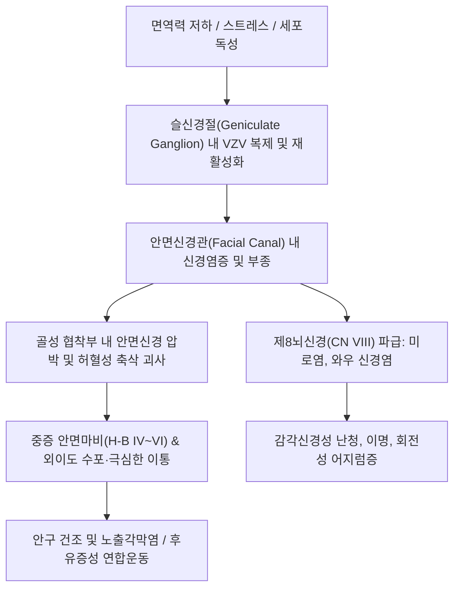

# 🩺 [[귀 대상포진]] (Herpes Zoster Oticus / Ramsay Hunt Syndrome / 耳性帶狀疱疹)

> **핵심 3줄 요약 (Key Summary)**:
> - 📍 병소 부위 & 해부·병태생리: 수두-대상포진 바이러스(VZV)가 제7뇌신경 안면신경의 슬신경절(Geniculate Ganglion)에 잠복해 있다가 재활성화되어 안면신경 및 제8뇌신경 전정와우신경을 침범하는 급성 감염성 신경병증.
> - 🚩 전형적 임상 양상 & 3대 징후: 외이도 및 이개(귓바퀴)의 유합성 수포 및 극심한 이통(Earache), 동측의 말초성 [[안면마비]](Bell's palsy 대비 중증), 청력 저하·이명·회전성 현훈(Vertigo).
> - 🛠️ 핵심 감별 검사 & 한·양방 다각적 치료 전략: 외이도경 검사 및 하우스-브랙만(House-Brackmann) 등급 평가, 발병 72시간 이내 고용량 항바이러스제(Famciclovir/Valacyclovir) + 경구 스테로이드 투여, 한의 침구(예풍, 하관, 협거, 지창), 황련해독탕 약침, 간담습열/풍열독 변증 한약(용담사간탕, 시호청간탕).
> - ⚠️ 응급 의뢰 레드플래그: 제9, 10, 11, 12번 뇌신경으로의 다발성 뇌신경염(Polyneuropathy) 파급으로 인한 연하 곤란, 사래들림, 쉰 목소리 또는 뇌막염·뇌혈관염(VZV Vasculopathy) 의심 소견 시 즉시 상급병원 이비인후과/신경과 응급 의뢰.

---

## 📌 목차
1. [질환 개요 & 해부학적 병태생리](#1-질환-개요--해부학적-병태생리)
2. [병태생리 메커니즘 & 생체역학적 악순환 네트워크](#2-병태생리-메커니즘--생체역학적-악순환-네트워크)
3. [임상 증상 & 이학적 검사(Physical Exam) 알고리즘](#3-임상-증상--이학적-검사physical-exam-알고리즘)
4. [감별 진단 매트릭스 (Differential Diagnosis)](#4-감별-진단-매트릭스--differential-diagnosis)
5. [한의 통합 치료 프로토콜 (침·약침·추나·한약)](#5-한의-통합-치료-프로토콜--침약침추나한약)
6. [양방 치료 & 병용·의뢰 기준 (Conventional Treatment & Referral)](#6-양방-치료--병용의뢰-기준-conventional-treatment--referral)
7. [재활 운동 & 생활습관 티칭 가이드](#7-재활-운동--생활습관-티칭-가이드)
8. [💡 사용자 진료실 핵심 필기 & 임상 노하우 (Melt-In 잔여 심화 집약)](#8--사용자-진료실-핵심-필기--임상-노하우--melt-in-잔여-심화-집약-)
9. [출처 및 학술 참고 문헌 (References)](#9-출처-및-학술-참고-문헌--references-)

---

## 1. 질환 개요 & 해부학적 병태생리

* **정의 및 핵심 병태**:
  * 귀 대상포진(Herpes Zoster Oticus)은 제7뇌신경(안면신경)의 슬신경절에 잠복 감염되어 있던 수두-대상포진 바이러스(Varicella-Zoster Virus, VZV)가 면역 저하 시 재활성화되어 발생하는 질환이다.
  * 여기에 **말초성 안면마비** 및 **내이 신경(제8뇌신경) 손상으로 인한 청력 저하, 이명, 현훈**이 동반되는 고전적 복합 임상 증후군을 **람세이 헌트 증후군(Ramsay Hunt Syndrome, RHS)**이라 부른다.
* **관련 해부학적 구조물**:
  * **슬신경절(Geniculate Ganglion)**: 안면신경관(Facial canal)의 첫 번째 굴곡부에 위치하며, 혀 전방 2/3의 미각(고삭신경), 외이도 및 이개 일부의 감각, 누선·악하선 분비 섬유가 연접한다.
  * **전정와우신경(CN VIII)**: 내이도(Internal Auditory Canal) 내에서 안면신경과 인접하여 주행하므로, 슬신경절의 염증 및 부종이 내이 신경으로 쉽게 파급된다.
  * **외이도 및 귓바퀴(Concha & Antihelix)**: 안면신경의 지각 가지(Ramsay Hunt 영역)가 분포하여 특이적인 수포가 형성된다.
* **역학 및 위험 인자**:
  * 급성 말초성 안면마비의 약 12%를 차지하며, 벨마비(Bell's palsy)에 비해 마비의 정도가 심하고 영구적 후유증(안면근 수축 부전, 난청) 발생률이 3배 이상 높다.
  * 60세 이상의 고령자, 당뇨병 환자, 면역억제제 투여 환자, 만성 과로 환자에서 호발한다.

---

## 2. 병태생리 메커니즘 & 생체역학적 악순환 네트워크

* **신경병리학적 메커니즘**:
  * 재활성화된 VZV가 신경 축삭을 따라 역행성으로 이동하면서 염증 반응과 사이토카인 분비를 유발한다.
  * 안면신경관은 단단한 골성 터널이므로 미세한 염증과 부종만으로도 관내 압력이 급상승하여 신경 미세혈관이 압박되고 허혈성 축삭 단열(Axonotmesis)이 발생한다.
* **인접 뇌신경으로의 파급 위험**:
  * 심한 경우 후두와(Posterior fossa)를 따라 설인신경(CN IX), 미주신경(CN X), 부신경(CN XI), 설하신경(CN XII)으로 염증이 파급되어 다발성 뇌신경 마비(Polyneuritis cranialis)를 일으킬 수 있다.

---

## 3. 임상 증상 & 이학적 검사(Physical Exam) 알고리즘

* **람세이 헌트 증후군의 전형적 3대 징후 (Classic Triad)**:
  1. **심한 이통 및 외이도 수포**: 귓바퀴(이갑개), 외이도 입구, 고막, 구개 수포 형성.
  2. **급성 편측성 말초 안면신경마비**: 이마 주름 소실, 토안(Lagophthalmos), 입꼬리 처짐.
  3. **내이 기능 부전**: 난청(Sensorineural hearing loss), 이명(Tinnitus), 회전성 현훈(Vertigo) 및 자발성 안진.
* **이학적 검사 및 진단 도구**:
  * **하우스-브랙만 등급 (House-Brackmann Facial Nerve Grading System)**:
    * Grade I(정상)부터 Grade VI(완전 마비)까지 세밀히 평가. 람세이 헌트는 초기에 Grade IV~V의 중증 마비로 시작하는 경우가 흔함.
  * **외이도경 및 이경 검사**: 외이도 벽과 고막의 홍반, 수포, 딱지(가피) 유무 확인. 간혹 수포가 없는 '무수포성 대상포진(Zoster sine herpete)'이 존재하므로 심한 이통 시 주의.
  * **음차 검사 (Weber & Rinne test)**: 감각신경성 난청 여부 확인.
  * **안구 및 각막 검사**: 눈이 완전히 감기지 않는 토안으로 인한 각막 미란 및 궤양 여부 즉시 평가.

---

## 4. 감별 진단 매트릭스 (Differential Diagnosis)

| 감별 질환 | 주 증상 및 병소 | 통증 및 수포 양상 | 핵심 감별점 및 예후 |
| :--- | :--- | :--- | :--- |
| **[[귀 대상포진]] (Ramsay Hunt)** | 제7, 8 뇌신경 침범 | 극심한 박동성 이통, 외이도/귓바퀴 수포 | 수포 동반, 난청/현훈 빈발, 벨마비 대비 예후 불량(완전 회복률 20~30% 낮음) |
| **[[벨마비]] (Bell's Palsy)** | 제7 뇌신경 단독 특발성 마비 | 경미한 이후부 뻐근함, 수포 없음 | 외이도 수포 절대 없음, 내이 증상 드묾, 완전 회복률 약 70~80% |
| **급성 중이염 (Acute Otitis Media)** | 중이강 내 세균/바이러스 감염 | 이통, 발열, 전음성 난청 | 고막 팽륜 및 화농성 삼출액, 안면마비는 드묾 |
| **악성 외이도염 (Necrotizing Otitis Externa)** | 당뇨 고령 환자, 녹농균 감염 | 극심한 야간성 이통, 외이도 육아종 | 외이도 바닥의 육아조직, 두개골 저부 골수염 파급 |
| **소뇌교각부 종양 (Acoustic Neuroma)** | 제8뇌신경 슈반세포종 | 수개월~수년에 걸친 점진적 난청 | 급성 발병이 아닌 만성 진행성, 통증 및 수포 없음, 뇌 MRI 확진 |

---

## 5. 한의 통합 치료 프로토콜 (침·약침·추나·한약)

* **침구 치료**:
  * **선혈 원칙**: 거풍청열(祛風淸熱), 해독소종(解毒消腫), 서근활락(舒筋活絡).
  * **안면 및 귀 주변 특효혈**: [[예풍(TE17)]], [[이문(TE21)]], [[청궁(SI19)]], [[청회(GB2)]], [[완골(GB12)]], [[하관(ST7)]], [[협거(ST6)]], [[지창(ST4)]], [[찬죽(BL2)]], [[양백(GB14)]].
  * **원위 배혈**: [[합곡(LI4)]], [[태충(LR3)]], [[족임읍(GB41)]], [[중저(TE3)]].
  * **치료 요령**: 급성기(수포 발생 및 통증 극심기)에는 환측 안면 강자극을 피하고 예풍, 완골 주변 완만 자침 및 원위혈 사법 위주. 아급성기 이후 2Hz 저주파 전침을 협거-지창, 양백-찬죽에 적용하여 신경 재생 촉진.
* **약침 요법**:
  * **황련해독탕 약침** 또는 **중성어혈 약침**:
    * 급성 염증기에는 예풍(TE17), 하관(ST7) 혈위에 0.2~0.3cc씩 자입하여 국소 신경 부종과 작열성 신경통을 신속히 소퇴시킴.
  * **자하거 약침 (만성 회복기)**:
    * 마비 잔여기 및 안면근 위축 예방을 위해 주 2~3회 시술.
* **추나 및 두경부 근막 이완**:
  * 흉쇄유돌근(SCM), 익상근, 교근 이완 기법을 통해 안면신경 주행 경로의 연조직 긴장 해소.
* **변증 한약 처방**:
  * **간담습열·화독치성(肝膽濕熱·火毒熾盛형 — 급성기 극심한 이통, 수포, 두통, 구고)**:
    * [[용담사간탕]] 가 우방자, 연교, 금은화, 현삼: 습열화독을 청열사화하여 바이러스 증식 억제.
  * **풍열침습·기혈어체(風熱侵襲·氣血瘀滯형 — 안면마비 진행기, 이명, 현훈)**:
    * [[시호청간탕]] 또는 대진구탕 가감.
  * **기혈양허·어혈조락(氣血兩虛·瘀血阻絡형 — 회복기 마비 잔여, 후포진 신경통)**:
    * [[보양환오탕]] 가 천궁, 당귀, 지룡, 전갈: 혈액순환을 촉진하고 미세 신경 재생을 가속화.

---

## 6. 양방 치료 & 병용·의뢰 기준 (Conventional Treatment & Referral)

* **약물 치료 (골든타임 72시간 이내 투여 필수)**:
  * **고용량 항바이러스제**:
    * **발라시클로버(Valacyclovir)**: 1,000mg 1일 3회, 7~14일간 경구 투여.
    * 또는 팜시클로버(Famciclovir) 500mg 1일 3회, 아시클로버(Acyclovir) 800mg 1일 5회.
  * **경구 코르티코스테로이드**:
    * **프레드니솔론(Prednisolone)**: 1mg/kg/day(최대 60mg)로 시작하여 5~7일간 유지 후 점진적 감량(Tapering). 골성 안면신경관 내 부종 억제.
  * **신경통 조절제**:
    * 가바펜틴(Gabapentin 300~900mg/d) 또는 프레가발린(Pregabalin 75~150mg/d)을 조기 병용하여 [[대상포진후신경통]](PHN) 예방.
* **안과적 합병증 예방 조치**:
  * 토안(토끼눈)으로 인한 각막 건조증 방지를 위해 인공눈물 수시 점안 및 취침 시 안연고 도포, 안대 착용 필수 티칭.
* **한·양방 병용 판단**:
  * 발병 72시간 내 항바이러스제 및 스테로이드 양방 처방을 즉시 개시하도록 지도하며, 이와 동시에 한의 침구·약침 치료를 조기 병용할 때 안면신경 완전 회복률이 유의미하게 상승함.
* **상급병원 응급 의뢰 기준**:
  * 음식물을 삼키지 못하는 연하 곤란(CN IX, X 마비), 흉쇄유돌근 마비(CN XI), 혀 편위(CN XII) 등 다발성 뇌신경 마비 발생 시.
  * 고열, 경부 강직, 의식 변화 등 VZV 뇌수막염 의심 소견 시 즉시 3차 병원 응급실 전원.

---

## 7. 재활 운동 & 생활습관 티칭 가이드

* **안면근 거울 재활 운동 (Mirror Biofeedback Rehabilitation)**:
  * 마비 발생 2주 후부터 하루 3~4회, 10분씩 시행.
  * 이마에 주름 잡기, 눈 꽉 감기, 코 찡그리기, "이-우-아-오" 발음하기, 볼에 바람 넣기.
  * 무리하게 힘을 주면 비정상적 신경 재생으로 인한 안면 연합운동(Synkinesis, 눈을 감을 때 입꼬리가 올라감)이 발생하므로 부드럽게 대칭을 맞추며 운동.
* **귀 및 안면 보온 티칭**:
  * 찬 바람, 에어컨 직풍을 피하고 귓바퀴 부위를 따뜻하게 유지.
* **안구 관리 수칙**:
  * 눈이 감기지 않을 때 절대 눈을 손으로 비비지 말 것. 외출 시 선글라스 착용으로 바람과 먼지 차단.

---

## 8. 💡 사용자 진료실 핵심 필기 & 임상 노하우 (Melt-In 잔여 심화 집약)

* **이통(Earache)의 위치와 성격 확인**:
  * 환자가 "귓속 깊은 곳이 쑤시고 찢어질 듯 아프다"고 호소하며 안면마비가 동반된다면, 겉으로 수포가 보이지 않더라도 귓바퀴 안쪽 홈(Concha)과 외이도 깊은 곳을 반드시 라이트로 확인해야 함.
* **람세이 헌트의 초기 예후 판정 포인트**:
  * 발병 1주 차에 미각 상실과 어지럼증, 난청이 심할수록 예후가 불량한 경향이 있음. 환자에게 초기에 벨마비보다 치료 기간이 길고(최소 3~6개월) 후유증 가능성이 있음을 사전 고지하여 치료 순응도 확보.
* **예풍혈 사혈 및 약침의 임상적 체감**:
  * 급성기 귀 뒤 유양돌기 부위 극심한 압통 시 [[예풍]] 및 완골혈 주변에 황련해독탕 약침 주입과 가벼운 점자출혈을 시행했을 때 박동성 신경통이 극적으로 경감됨.

---

## 9. 출처 및 학술 참고 문헌 (References)

* Jiao S, et al. (2026). From zoster to polyneuropathy: manifestations, mechanisms, and differential diagnosis of cranial nerve involvement in Ramsay Hunt Syndrome. *Front Neurol*. PMID: 42037679
* Fujiwara T, et al. (2024 Jun). Antiviral treatment for Ramsay Hunt syndrome: A systematic review and meta-analysis. *Auris Nasus Larynx*. PMID: 38520982
* Goswami Y, et al. (2023 Jan). Ramsay Hunt Syndrome: An Introduction, Signs and Symptoms, and Treatment. *Cureus*. PMID: 36793818
