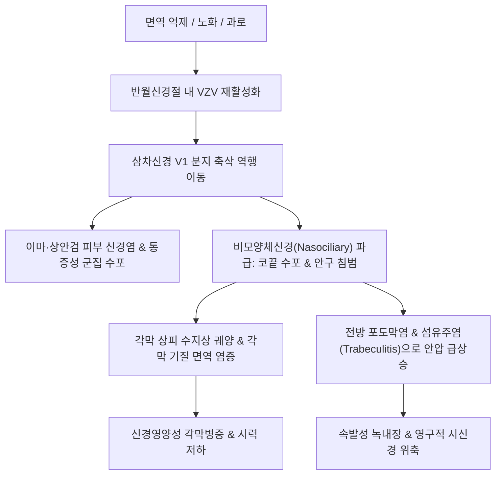

# 🩺 [[눈대상포진]] (Herpes Zoster Ophthalmicus / 眼帶狀疱疹)

> **핵심 3줄 요약 (Key Summary)**:
> - 📍 병소 부위 & 해부·병태생리: 수두-대상포진 바이러스(VZV)가 제5뇌신경 삼차신경(Trigeminal Nerve)의 반월신경절(Gasserian Ganglion) 내 제1분지인 안신경(V1, Ophthalmic division)에 잠복해 있다가 재활성화되어 안구 및 안와 주변을 침범하는 급성 감염증.
> - 🚩 전형적 임상 양상 & 3대 징후: 이마, 두피, 상안검 부위의 편측성 신경통 및 홍반성 수포, 코끝과 콧망울에 수포가 발생하는 허치슨 징후(Hutchinson's sign), 안구 충혈·통증·시력 저하.
> - 🛠️ 핵심 감별 검사 & 한·양방 다각적 치료 전략: 세극등 현미경 검사(수지상 각막염, 각막 실질염 감별) 및 안압 측정, 72시간 내 경구/정맥 항바이러스제(Valacyclovir/Acyclovir) 투여, 한의 침구(찬죽, 태양, 동자료, 풍지, 곡지), 황련해독탕 약침, 풍열독·간화치성 변증 한약(시호청간탕, 용담사간탕).
> - ⚠️ 응급 의뢰 레드플래그: 각막 기질 혼탁, 전방 축농(Hypopyon), 안압 급상승(녹내장), 시신경염(Optic Neuritis), 망막 괴사(ARN)로 인한 급격한 시력 상실 징후 포착 시 즉시 안과 응급 전원.

---

## 📌 목차
1. [질환 개요 & 해부학적 병태생리](#1-질환-개요--해부학적-병태생리)
2. [병태생리 메커니즘 & 생체역학적 악순환 네트워크](#2-병태생리-메커니즘--생체역학적-악순환-네트워크)
3. [임상 증상 & 이학적 검사(Physical Exam) 알고리즘](#3-임상-증상--이학적-검사physical-exam-알고리즘)
4. [감별 진단 매트릭스 (Differential Diagnosis)](#4-감별-진단-매트릭스--differential-diagnosis)
5. [한의 통합 치료 프로토콜 (침·약침·추나·한약)](#5-한의-통합-치료-프로토콜--침약침추나한약)
6. [양방 치료 & 병용·의뢰 기준 (Conventional Treatment & Referral)](#6-양방-치료--병용의뢰-기준-conventional-treatment--referral)
7. [재활 운동 & 생활습관 티칭 가이드](#7-재활-운동--생활습관-티칭-가이드)
8. [💡 사용자 진료실 핵심 필기 & 임상 노하우 (Melt-In 잔여 심화 집약)](#8--사용자-진료실-핵심-필기--임상-노하우--melt-in-잔여-심화-집약-)
9. [출처 및 학술 참고 문헌 (References)](#9-출처-및-학술-참고-문헌--references-)

---

## 1. 질환 개요 & 해부학적 병태생리

* **정의 및 핵심 병태**:
  * 눈대상포진(Herpes Zoster Ophthalmicus, HZO)은 삼차신경의 제1분지(안신경, V1)를 침범하는 수두-대상포진 바이러스 감염 질환이다.
  * 전체 대상포진 환자의 약 10~20%를 차지하며, 이 중 약 50%에서 각막염, 포도막염, 공막염, 녹내장 등 심각한 안구 합병증이 동반되어 영구적 시력 손상을 초래할 수 있는 고위험 안질환이다.
* **관련 해부학적 구조물**:
  * **삼차신경 반월신경절(Gasserian/Semilunar Ganglion)**: VZV가 무증상 잠복 상태로 머무는 감각신경절.
  * **안신경(V1 Branch)**: 전두신경(Frontal nerve), 누선신경(Lacrimal nerve), 비모양체신경(Nasociliary nerve)의 세 분지로 나뉨.
  * **비모양체신경(Nasociliary Nerve)**: 안구의 각막, 홍채, 모양체 및 사골동, 코끝(비첨) 피부의 감각을 지배함.
  * **허치슨 징후(Hutchinson's Sign)**: 비모양체신경의 외비신경 가지가 침범되어 코끝과 비익(콧망울)에 수포가 형성되는 임상 징후로, 안구 자체 침범 위험도가 3~4배 증가함을 시사함.
* **역학 및 위험 요인**:
  * 고령(60세 이상), 면역 결핍(HIV, 항암 화학요법, 면역억제제 복용), 세포매개성 면역(CMI) 저하 환자에서 호발.
  * 안구 대상포진을 앓은 환자는 뇌졸중(허혈성 뇌경색) 발생 위험이 발병 후 1년간 유의미하게 증가함.

---

## 2. 병태생리 메커니즘 & 생체역학적 악순환 네트워크

* **각막 병변의 단계별 병태생리**:
  * **초기 (바이러스 직접 침범)**: 각막 상피에 미세한 점상 각막염 및 특징적인 '가성 수지상 궤양(Pseudodendrite)' 형성(단순포진의 말단 팽대부가 있는 전형적 수지상 궤양과 감별).
  * **후기 (면역 매개성 염증)**: 면역 반응으로 인한 각막 기질염(Stromal keratitis), 각막 내피염, 심층 신생혈관 형성.
  * **만성 (신경 손상)**: 각막 지각 상실로 인한 신경영양성 각막병증(Neurotrophic keratopathy), 무통성 각막 궤양 및 천공 위험.
* **포도막염 및 녹내장 기전**:
  * 모양체 혈관의 폐쇄성 혈관염(Occlusive vasculitis)과 홍채 위축, 섬유주염으로 방수 유출로가 막혀 안압이 급격히 상승함.

---

## 3. 임상 증상 & 이학적 검사(Physical Exam) 알고리즘

* **주요 임상 양상**:
  * **전구 증상**: 수포 발생 2~4일 전부터 편측 이마와 눈 주위의 작열통, 찌르는 듯한 두통, 감각 이상.
  * **피부 병변**: 정중선을 넘지 않는 편측성 홍반과 구진, 투명한 수포, 농포, 가피 형성.
  * **안구 증상**: 눈부심(광선공포증), 눈물 흘림, 이물감, 충혈, 안구 통증, 시야 흐림.
* **이학적 및 안과적 검사 알고리즘**:
  * **허치슨 징후(Hutchinson's sign) 확인**: 코끝, 콧등, 비익 피부에 발진이나 수포가 있는지 육안 관찰.
  * **각막 지각 검사 (Corneal Sensitivity Test)**: 멸균 면봉 솜실을 이용하여 각막 지각 저하 여부 평가(양측 비교).
  * **플루오레신 염색 및 세극등 검사**: 가성 수지상 병변, 각막 상피 결손 염색 확인.
  * **안압 측정 (Tonometry)**: 포도막염 및 섬유주염에 의한 급성 안압 상승 여부 선별.
  * **동공 반사 및 안저 검사**: 상대적 구심성 동공운동장애(RAPD) 확인으로 시신경염 배제, 망막 혈관염 유무 관찰.

---

## 4. 감별 진단 매트릭스 (Differential Diagnosis)

| 감별 질환 | 원인체 및 침범 부위 | 각막 병변 특징 | 감별 핵심 포인트 |
| :--- | :--- | :--- | :--- |
| **[[눈대상포진]] (HZO)** | VZV, 삼차신경 V1 피부분절 | 가성 수지상 궤양(돌출형, 말단 구근 없음), 기질염 빈발 | 이마/두피 분절성 수포, 허치슨 징후, 심한 신경통 |
| **단순포진 각막염 (HSV Keratitis)** | HSV-1, 각막 상피 위주 | 진성 수지상 궤양(말단 터미널 벌브 동반, 중심부 궤양) | 피부 발진이 국소적이거나 없음, 재발성 각막 궤양 |
| **접촉성 안검염 (Contact Blepharitis)** | 알레르기/화장품 접촉 | 양측성 안검 부종 및 소양감 | 가려움증 위주, 정중선 침범, 신경통 없음 |
| **봉와직염 (Preseptal/Orbital Cellulitis)** | 세균 감염 (포도구균 등) | 안와 주변 발적 및 열감 | 수포 없음, 안구 돌출, 안구 운동 제한(안와 봉와직염 시) |
| **급성 폐쇄각 녹내장 (Acute Angle-Closure Glaucoma)** | 전방각 폐쇄로 인한 안압 급상승 | 각막 부종, 동공 중등도 산대 | 극심한 안통 및 오심/구토, 피부 수포 절대 없음 |

---

## 5. 한의 통합 치료 프로토콜 (침·약침·추나·한약)

* **침구 치료**:
  * **선혈 원칙**: 소풍청열(疏風淸熱), 청간사화(淸肝瀉火), 활혈지통(活血止痛).
  * **안구 주변 혈위**: [[찬죽(BL2)]], [[어요(EX-HN4)]], [[사죽공(TE23)]], [[동자료(GB1)]], [[태양(EX-HN5)]], [[정명(BL1)]], [[승읍(ST1)]].
  * **원위 배혈**: [[풍지(GB20)]], [[곡지(LI11)]], [[합곡(LI4)]], [[태충(LR3)]], [[광명(GB37)]].
  * **주의사항**: 급성 수포 형성기에는 수포 부위를 직접 자침하지 않고, 수포 주변 정상 피부나 원위혈 위주로 자침. 정명·승읍혈은 숙련된 한의사가 출혈에 극히 주의하여 자침.
* **약침 요법**:
  * **황련해독탕 약침**:
    * 풍지(GB20), 태양(EX-HN5), 찬죽(BL2) 주변에 0.1~0.2cc씩 얕게 주입하여 삼차신경 안신경 분지의 급성 염증성 부종을 신속히 완화.
* **추나 요법**:
  * 상부 경추(C1-C2) 관절 가동술 및 후두하근막 이완을 통해 상경신경절(Superior Cervical Ganglion)의 교감신경 흥분을 안정화하고 안구 혈류 순환 개선.
* **변증 한약 처방**:
  * **풍열독성·간화상염(風熱毒盛·肝火上炎형 — 급성기 극심한 안통, 충혈, 이마 수포, 번조, 구고)**:
    * [[시호청간탕]] 또는 [[용담사간탕]] 가 백질려, 결명자, 국화, 밀몽화: 풍열과 간담의 화독을 청사하여 안구 충혈과 각막 염증 억제.
  * **열독치성·기혈어체(熱毒熾盛·氣血瘀滯형 — 심한 부종, 암자색 수포, 찌르는 듯한 통증)**:
    * [[황련해독탕]] 합 선방활명음 가감.
  * **음허화왕·기체혈어(陰虛火旺·氣滯血瘀형 — 만성 회복기, 후포진 신경통, 안구 건조, 시력 감퇴)**:
    * [[기국지황탕]] 가 당귀, 적작약, 지룡, 전갈: 간신(肝腎)을 보하고 혈맥을 소통시켜 시신경 영양 공급.

---

## 6. 양방 치료 & 병용·의뢰 기준 (Conventional Treatment & Referral)

* **전신 항바이러스제 치료 (골든타임 72시간 이내 개시)**:
  * **발라시클로버(Valacyclovir)**: 1,000mg 1일 3회, 7~10일간 경구 투여.
  * **아시클로버(Acyclovir)**: 800mg 1일 5회, 7~10일간 투여 (정맥 투여 필요 시 $10\,\mathrm{mg/kg}$ 8시간마다 정주).
  * **팜시클로버(Famciclovir)**: 500mg 1일 3회.
* **안과 국소 치료**:
  * **국소 스테로이드 점안제**: 각막 기질염, 포도막염, 상공막염 조절을 위해 프레드니솔론 점안액 사용(단, 상피 가성수지상 병변 활성기에는 상피 궤양을 악화시키므로 안과 전문의의 엄격한 모니터링 하에 사용).
  * **안압 강하제 점안액**: 포도막염성 녹내장 동반 시 티몰롤, 브리모니딘 등 점안(프로스타글란딘 제제는 염증을 악화시킬 수 있어 주의).
  * **인공눈물 점안 및 각막 보호 렌즈**: 신경영양성 각막병증 예방.
* **백신 예방 접종**:
  * 50세 이상 성인에게 재조합 대상포진 백신(Shingrix) 2회 접종 권고(HZO 발생률 및 후포진 신경통 대폭 감소).
* **안과 즉시 응급 전원 기준 (Critical Referral)**:
  * 허치슨 징후 양성인 모든 환자는 증상이 경미하더라도 즉시 안과 세극등 검사 의뢰.
  * 환자가 시력 감퇴, 안구 통증 악화, 동공 불일치를 호소하는 경우.

---

## 7. 재활 운동 & 생활습관 티칭 가이드

* **안구 위생 및 각막 보호**:
  * 손으로 눈을 비비거나 수포를 긁는 행위 절대 금지(각막 2차 세균 감염 방지).
  * 실내 조명을 어둡게 유지하고 외출 시 자외선 차단 선글라스 착용(눈부심 완화).
* **온도 자극 관리**:
  * 급성 수포기에는 뜨거운 찜질을 피하고 차가운 생리식염수 거즈로 가볍게 냉찜질하여 작열감 완화.
* **면역력 회복과 휴식**:
  * 음주 및 흡연 엄격 금지, 충분한 수면 확보.

---

## 8. 💡 사용자 진료실 핵심 필기 & 임상 노하우 (Melt-In 잔여 심화 집약)

* **코끝 수포(허치슨 징후)를 놓치지 않는 시진 요령**:
  * 이마에 대상포진 수포가 보이면 반드시 환자의 마스크를 벗기고 코끝과 콧구멍 안쪽 점막까지 확인해야 함. 작은 물집 하나라도 발견되면 즉시 안구 침범으로 간주하고 안과 협진을 의뢰해야 안전함.
* **눈 주변 침 치료 시 출혈 방지 노하우**:
  * 정명, 승읍, 동자료 등 안와 주변 혈위는 혈관망이 풍부하므로 극세호침(0.16~0.20mm)을 사용하고 발침 후 3분 이상 가볍게 압박하여 혈종 형성을 예방함.
* **급성기 이후 후포진 신경통(PHN)으로의 이행 차단**:
  * 이마와 안와 주변은 피부가 얇고 골막에 신경이 인접해 있어 PHN 이행률이 매우 높음. 급성기 통증이 가라앉더라도 황련해독탕 약침과 한약 치료를 최소 4주 이상 지속해야 만성 통증을 방지할 수 있음.

---

## 9. 출처 및 학술 참고 문헌 (References)

* Milligan AL, et al. (2026 Jun 10). Update on treatment and prophylaxis of herpes zoster ophthalmicus. *Br J Ophthalmol*. PMID: 42270293

* Heen E, et al. (2026 Sep). Efficacy and Effectiveness of the Recombinant Zoster Vaccine Against Herpes Zoster, Herpes Zoster Ophthalmicus, Postherpetic Neuralgia and Dementia: A Systematic Review and Meta-Analysis. *Rev Med Virol*. PMID: 42748460

* Manders IG, et al. (2026 Nov). Continuous Intravenous Acyclovir as Outpatient Parenteral Antimicrobial Therapy for HSV and VZV Neurological Infections: A Case Series With Pharmacokinetic and Cost Evaluation, and Review of Literature. *Rev Med Virol*. PMID: 42809744

