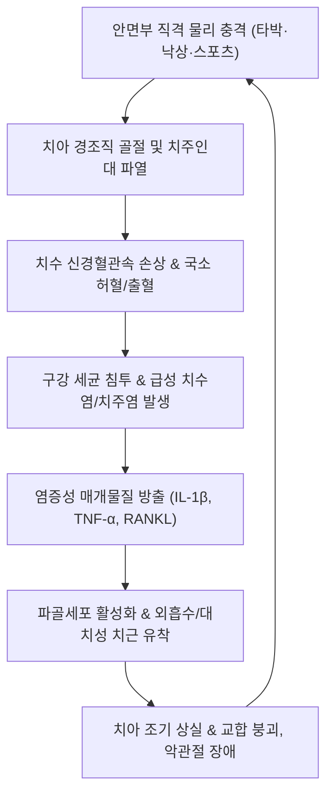

# 🩺 골절 흔들림 치아 외상 (Traumatic Dental Injuries / 齒痛·齒齒動搖)

> **핵심 3줄 요약 (Key Summary)**:
> - 📍 병소 부위 & 해부·병태생리: 안면부 타박·낙상·교통사고 등으로 인해 법랑질(Enamel), 상아질(Dentin), 치수(Pulp) 및 치주인대(Periodontal Ligament, PDL)와 치조골(Alveolar bone)에 가해지는 물리적 역학 충격 질환으로, 치아 골절(균열, 비치수 노출, 치수 노출) 및 탈구(진탕, 아탈구, 정출, 측방 탈구, 함입, 완전 탈구)로 대별된다.
> - 🚩 전형적 임상 양상: 외상 직후 출혈, 치아의 유동성(흔들림), 저작 시 격심한 통증, 치아의 위치 이상(전위) 또는 탈락, 냉온 자극에 대한 과민 반응 또는 치수 괴사로 인한 감각 소실이 나타난다.
> - 🛠️ 핵심 검사 & 치료 전략: 치근단 방사선(Periapical X-ray), 치수 전기 치수 검사(EPT)로 진단하며, 국제치아외상학회(IADT) 가이드라인에 따른 응급 치아 재식술(Replantation), 유연성 레진 와이어 스플린트(Flexible Splinting) 고정 및 근관 치료를 시행하고, 한의학적으로는 급성기 소종진통(당귀수산, 청열해독) 및 회복기 치주조직 재생 촉진(신양·신음 보양, 육미지황탕·보골공진단)과 안면부 침치료를 병용한다.
> - ⚠️ 응급 의뢰 레드플래그: 하악골/상악골 골절 동반 징후(부정교합, 턱관절 가동 제한, 안면 비대칭), 뇌진탕 등 중추신경계 외상 징후(의식 소실, 구토, 경련, 뇌척수액 비루), 완전 탈구(Avulsion) 발생 시 골든타임(60분 이내) 내 즉각적인 구강악안면외과/치과 응급 전원이 필수적이다.

---

## 📌 목차
1. [질환 개요 & 해부학적 병태생리](#1--질환-개요---해부학적-병태생리)
2. [병태생리 메커니즘 & 생체역학적 악순환 네트워크](#2--병태생리-메커니즘---생체역학적-악순환-네트워크)
3. [임상 증상 & 이학적 검사(Physical Exam) 알고리즘](#3--임상-증상---이학적-검사-physical-exam--알고리즘)
4. [감별 진단 매트릭스 (Differential Diagnosis)](#4--감별-진단-매트릭스--differential-diagnosis-)
5. [한의 통합 치료 프로토콜 (침·약침·추나·한약)](#5--한의-통합-치료-프로토콜--침-약침-추나-한약-)
6. [양방 치료 & 병용·의뢰 기준 (Conventional Treatment & Referral)](#6-양방-치료--병용의뢰-기준-conventional-treatment--referral)
7. [재활 운동 & 생활습관 티칭 가이드](#7--재활-운동---생활습관-티칭-가이드)
8. [💡 사용자 진료실 핵심 필기 & 임상 노하우 (Melt-In 잔여 심화 집약)](#8----사용자-진료실-핵심-필기---임상-노하우--melt-in-잔여-심화-집약-)
9. [출처 및 학술 참고 문헌 (References)](#9--출처-및-학술-참고-문헌--references-)

---

## 1. 질환 개요 & 해부학적 병태생리

### 1) 질환 정의 및 분류
* **정의**: 치아 외상(Traumatic Dental Injuries, TDI)은 외부 물리적 충격으로 인해 치아 경조직, 치수 조직, 지지 치주 조직(치주인대 및 치조골)에 발생하는 급성 손상을 총칭한다.
* **WHO 및 IADT(국제치아외상학회) 분류 체계**:
  * **치아 경조직 및 치수 손상 (Bourguignon et al., 2020)**:
    * 법랑질 균열(Enamel infraction): 결손 없는 불완전 파절.
    * 단순 치관 골절(Uncomplicated crown fracture): 법랑질 또는 법랑질-상아질 파절(치수 노출 없음).
    * 복합 치관 골절(Complicated crown fracture): 치수가 노출된 치관 파절.
    * 치관-치근 골절(Crown-root fracture): 치관과 치근에 걸친 골절.
    * 치근 골절(Root fracture): 상아질, 백악질, 치수가 모두 관여된 치근 횡골절/사골절.
  * **치주 지지조직 손상 (탈구 손상, Luxation injuries)**:
    * 진탕(Concussion): 치아 변위나 동요도 없이 타진통만 존재.
    * 아탈구(Subluxation): 변위 없이 비정상적인 동요도와 치은 열구 출혈 동반.
    * 정출성 탈구(Extrusive luxation): 치조와 밖으로 부분적 돌출.
    * 측방 탈구(Lateral luxation): 편위된 방향으로 치조골 골절을 동반하며 흔들림 없이 고정됨.
    * 함입성 탈구(Intrusive luxation): 치조골 깊숙이 밀려 들어간 상태.
    * 완전 탈구(Avulsion, Fouad et al., 2020): 치아가 치조와 밖으로 완전히 이탈된 상태.

### 2) 구강 해부학 및 지지 구조
* **치주인대 (Periodontal Ligament, PDL)**: 치근과 치조골을 연결하는 콜라겐 섬유 다발과 신경혈관망으로 구성되어 기계적 완충 작용을 수행한다. 치아 외상 후 치주인대 세포의 생존 여부가 치근 흡수(대치성 골유착/흡수성 흡수) 및 영구 치아 보존의 결정적 요인이다.
* **치수-상아질 복합체**: 치수 내 신경망과 모세혈관총은 치아에 영양과 감각을 공급하며, 상아모세포(Odontoblast)를 통해 2차 및 3차 수복 상아질을 형성한다. 치수 노출 시 세균 감염으로 인한 치수 괴사가 신속하게 진행된다.

---

## 2. 병태생리 메커니즘 & 생체역학적 악순환 네트워크

### 1) 기계적 외상 후 치수 괴사 메커니즘
* 치근단 공(Apical foramen)을 통과하는 미세 신경혈관속이 견인되거나 단열되면 치수 조직의 급성 허혈과 괴사가 초래된다. 특히 치근단이 완전히 형성된 영구치는 혈관 재생능력이 제한적이어서 괴사율이 높다.

### 2) 치근 외흡수 및 골유착 (Ankylosis)
* 완전 탈구 시 건조 상태로 방치되면 치주인대 세포가 괴사한다. 재식 후 손상된 치근 표면으로 파골세포가 침윤하여 치근이 점진적으로 뼈로 대체되는 대치성 흡수(Replacement resorption/Ankylosis)가 발생한다.

---

## 3. 임상 증상 & 이학적 검사(Physical Exam) 알고리즘

### 1) 주요 임상 증상
* **동통**: 타진통(Percussion pain), 교합통, 자발통, 냉온 자극통.
* **동요도 (Mobility)**: 치아가 핀셋 조작 시 수평적/수직적으로 흔들림.
* **변위 (Displacement)**: 치아가 튀어나오거나, 혀 쪽 또는 뺨 쪽으로 틀어짐.
* **출혈 및 부종**: 치은 열구(치아와 잇몸 경계) 출혈, 입술과 안면 연조직 열상 및 혈종.

### 2) 이학적 검사 및 진단 도구
* **시진 및 타진 (Inspection & Percussion)**:
  * 치관 파절선 확인, 노출된 치수의 붉은 점(Pulp exposure) 여부 점검.
  * 치경이나 기구 손잡이로 치아를 가볍게 두드렸을 때의 금속성 둔탁음(측방 탈구/골유착 시 고음의 쇳소리 확인).
* **전기 치수 검사 (EPT) 및 한랭 검사 (Cold test)**:
  * 외상 직후에는 신경 충격(Neuropraxia)으로 인해 가음성(False-negative)이 나타날 수 있으므로, 2~4주 간격으로 추적 검사하여 치수 생활력 회복 여부를 판정.
* **방사선 검사**:
  * 치근단 방사선(PA), 파노라마(Panorama), 필요 시 Cone-Beam CT를 촬영하여 치근 파절선 및 치조골 골절 확인.

---

## 4. 감별 진단 매트릭스 (Differential Diagnosis)

| 감별 질환 | 핵심 감별점 및 특징 | 구체적 차이점 |
| :--- | :--- | :--- |
| **치아 진탕 (Concussion)** | 변위 및 동요도 없음, 오직 타진 시 경미한 통증 | 치수 출혈이나 인대 파열 부재로 예후 우수 |
| **치아 아탈구 (Subluxation)** | 위치 변위는 없으나 1~2도 동요도 및 치은 출혈 | 진탕보다 동요도가 명확하며 인대 손상 동반 |
| **치근 골절 (Root fracture)** | 치관 파절 없이 치아가 심하게 흔들리고 출혈 | 방사선 사진 상 치근 부위의 방사선 투과성 골절선 확인 |
| **치조골 복합 골절** | 인접한 2~3개 이상의 치아가 뼈 블록째 함께 흔들림 | 개별 치아 손상이 아닌 악골 지지체의 분쇄 골절 |
| **하악골 골절 (턱뼈 골절)** | 하악 신경 손상으로 인한 아래입술 감각마비, 부정교합 | 안면 비대칭, 턱관절 개구 장애 동반 |

---

## 5. 한의 통합 치료 프로토콜 (침·약침·추나·한약)

### 1) 변증 분류
* **기체혈어(氣滯血瘀)**: 외상 직후 국소 부위가 붓고 찌르는 듯이 아프며 입술과 잇몸에 자흑색 어혈이 맺힘. (설암어반, 맥삽)
* **열독치성(熱毒熾盛)**: 외상 부위에 세균 감염이 동반되어 잇몸이 빨갛게 붓고 고름이 나오며 열감이 심함. (설홍태황, 맥삭)
* **신허치동(腎虛齒動)**: 외상 후 수개월이 지나도 치아가 아물지 않고 흔들리며 은은한 통증이 지속되고 잇몸이 위축됨. (설담태백, 맥세약)
* **기혈양허(氣血兩虛)**: 안면부 외상 후 회복이 지연되고 안색이 창백하며 피로하고 잇몸 출혈이 지속됨. (설담, 맥허약)

### 2) 침구 치료
* **주요 혈위**: [[합곡]](LI4), [[하관]](ST7), [[협거]](ST6), [[승읍]](ST1), [[지창]](ST4), [[인중]](GV26), [[태충]](LR3), [[풍지]](GB20), [[태계]](KI3), [[조해]](KI6).
* **자침 기법**:
  * 안면부 통증 및 혈종 흡수 촉진: 협거, 하관, 지창에 사침(斜刺)하여 교근 및 협근의 긴장을 풀고 국소 혈류 개선.
  * 원위부 진통 혈위: 대장경의 원혈인 [[합곡]]혈에 강자극을 가하여 삼차신경 안면 감각 경로를 통한 하행성 통증 억제 활성화.
  * 신허 치동형 보신 자침: [[태계]](KI3), [[조해]](KI6) 자침으로 골조직 및 치아 지지대 강화.

### 3) 약침 치료
* **황련해독탕 약침**: 급성기 연조직 열상 및 치은 염증, 열독 완화를 위해 하관(ST7), 협거(ST6)에 각 0.2~0.3cc 피내/근막 주입.
* **자하거 약침 / 중성어혈 약침**: 급성 어혈기에는 중성어혈약침을 턱관절 및 하악연에 시술하고, 만성 회복기에는 자하거약침을 시술하여 치주인대 섬유아세포 재생 유도.

### 4) 추나 및 두개하악 교정
* **악관절 복합체 이완 추나**: 외상 충격으로 인한 턱관절(TMJ) 과긴장과 외측익돌근 경련을 완화하여 저작 시 손상 치아에 가해지는 과도한 교합 간섭 차단.

### 5) 한약 처방 프로토콜
* **[[당귀수산]](當歸鬚散)**: 외상 초기 타박 어혈을 신속히 제거하고 연조직 종창과 통증을 완화하는 1차 기본방.
* **청위산(淸胃散)**: 위열(胃熱)로 인한 잇몸 발적, 급성 치은 출혈, 구취 및 격렬한 치통 개선.
* **[[육미지황탕]](六味地黃湯) 합 보골지·골쇄보**: 신주골(腎主骨), 치위골지여(齒爲骨之餘) 원리에 입각하여 손상된 치조골 재생 및 치주인대 유착 촉진.
* **보영양영탕(保元養榮湯)**: 기혈 손상 환자의 외상 후 창상 치유 촉진.

---

## 6. 양방 치료 & 병용·의뢰 기준 (Conventional Treatment & Referral)

### 1) 외상 유형별 치과 표준 처치 가이드라인
* **완전 탈구(Avulsion)의 응급 처치 (Fouad et al., 2020)**:
  * 치관(머리) 부위만 잡고 치근(뿌리)은 손대지 않음.
  * 생리식염수나 우유로 가볍게 헹군 후 현장에서 즉시 치조와에 재식(Replantation) 시도.
  * 불가능할 경우 **Hank's Balanced Salt Solution (HBSS)**, **차가운 우유**, 또는 타액에 담가 60분 이내 치과 도착.
  * 유연성 스플린트(Flexible wire-composite splint)로 2주간 고정.
* **아탈구 및 정출/측방 탈구**:
  * 국소마취 하에 원래 위치로 정복(Repositioning) 후 2~4주간 가요성 부목 고정.
* **치관 파절**:
  * 비노출 파절: 복합레진 수복.
  * 노출 파절: 부분 치수절단술(Cvek pulpotomy) 또는 근관 치료(Root canal treatment).

### 2) 파상풍 및 항생제 투여
* 오염된 토양에 노출된 외상 치아의 경우 파상풍 예방접종력 확인 및 독소소(Tetanus toxoid) 추가 접종.
* 아목시실린(Amoxicillin) 또는 독시사이클린(Doxycycline) 전신 항생제 투여로 감염 및 치근 흡수 예방.

### 3) 한의 병용 시너지
* 치과의 해부학적 정복 및 와이어 고정이 선행된 상태에서, 한약(당귀수산, 골쇄보 보강 처방)과 안면부 침치료를 병용하면 부목 제거 후 치아 동요도 소실 기간을 단축시키고 치주인대 골유착 합병증을 유의하게 줄일 수 있다.

### 4) 응급 전원 기준
* **완전 탈구(Avulsion)** 발생 시: 치주인대 세포 생존을 위해 골든타임 60분 내 치과 응급실 전원.
* 악골(턱뼈) 골절, 안면부 다발성 열상 및 대량 출혈이 동반된 경우 구강악안면외과 또는 응급의학과 즉시 이송.
* 두부 외상 및 뇌진탕 의심 징후(의식 소실, 구토 등) 발생 시 신경외과 응급 의뢰.

---

## 7. 재활 운동 & 생활습관 티칭 가이드

* **부드러운 유동식 식이 (Soft Diet)**: 부목 고정 기간(2~4주) 동안 손상 치아로 단단하거나 질긴 음식을 씹지 않도록 철저 지도.
* **구강 위생 관리**: 손상 부위는 부드러운 칫솔로 조심스럽게 닦고, 0.12% 클로르헥시딘(Chlorhexidine) 양치액을 하루 2회 사용하여 화학적 플라크 억제.
* **마우스가드(Mouthguard) 착용 티칭**: 격투기, 구기 종목 등 스포츠 활동 시 맞춤형 마우스가드 착용 교육.

---

## 8. 💡 사용자 진료실 핵심 필기 & 임상 노하우 (Melt-In 잔여 심화 집약)

* **외상성 치아 흔들림에 골쇄보(骨碎補)의 위력**:
  * 치과에서 "더 이상 해줄 게 없고 흔들리다 빠지면 임플란트 해야 합니다"라는 판정을 받고 온 아탈구 환자에게, 육미지황탕에 골쇄보 15g, 속단 10g을 가미하여 1개월 투여하고 협거·하관혈 침치료를 병행하면 놀랍게도 잇몸 뼈가 치아를 굳건히 잡아 치아 동요도가 0으로 회복되는 사례가 다수 확인된다.
* **타박 어혈성 안면 마비와의 감별**:
  * 치아 외상 시 강한 충격으로 하치조신경이나 안면신경 분지가 일시적으로 진탕(Concussion)되어 입술 감각 둔마가 올 수 있다. 이때 침치료와 한약(당귀수산 합 오약순기산)을 조기 투여하면 비가역적 신경 손상으로 진행하는 것을 막을 수 있다.

---

## 9. 출처 및 학술 참고 문헌 (References)

1. Bourguignon C, 2020, Dent Traumatol, International Association of Dental Traumatology guidelines for the management of traumatic dental injuries: 1. Fractures and luxations. PMID: 32475015
2. Fouad AF, 2020, Dent Traumatol, International Association of Dental Traumatology guidelines for the management of traumatic dental injuries: 2. Avulsion of permanent teeth. PMID: 32460393
3. Aykanat B, 2026, Dent Traumatol, Awareness and Educational Effectiveness of the ToothSOS Mobile Application for Traumatic Dental Injuries: A Systematic Review and Meta-Analysis. PMID: 42850873

---

## 관련 노트

- [[_의학/03_이론/질환/근골격계 질환/두경부/편타 손상|편타 손상]]
- [[_의학/00_기본의학/01. 레드플래그·응급 감별/척수증·마미증후군_선별_2026-10-12|레드플래그 선별]]
- [[_의학/02_약리/의약품/01_근골격·진통소염제/아세트아미노펜|아세트아미노펜]]
- [[_의학/03_이론/치료기법/추나|추나]]
