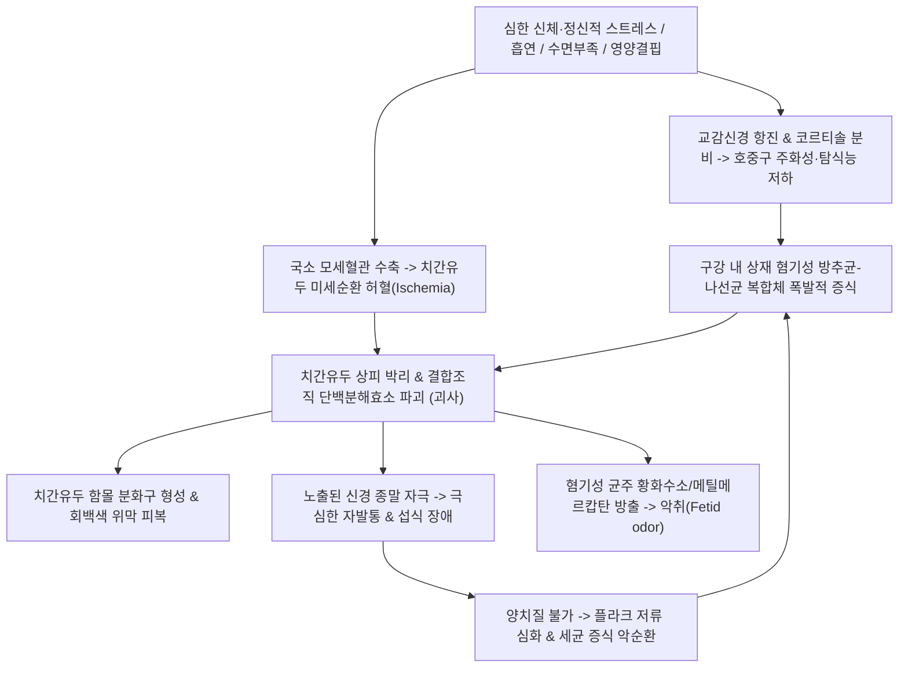

# 🩺 [[급성 괴사성 궤양성 치은염]] (Acute Necrotizing Ulcerative Gingivitis, ANUG / 急性 壞死性 潰瘍性 齒齦炎, A69.1)

> **핵심 3줄 요약 (Key Summary)**:
> - 📍 병소 부위 & 해부·병태생리: [[치간유두]](Interdental papilla) 및 변연 치은. 혐기성 방추균-나선균 복합체(Fusobacterium nucleatum, Treponema denticola)의 급성 증식과 극심한 스트레스·면역 저하·흡연에 따른 미세 순환 허혈 및 급격한 치은 상피·결합조직 괴사.
> - 🚩 전형적 임상 양상 & 3대 징후: 펀치로 뚫은 듯한 분화구형 치간유두 궤양(Punched-out cratered papillae), 회백색 위막(Pseudomembrane) 형성, 자발성 출혈, 찌르는 듯한 격렬한 치통 및 특징적인 부패성 구취(Fetid odor).
> - 🛠️ 핵심 감별 검사 & 한·양방 다각적 치료 전략: 치주 임상 검진(괴사성 결손 시진), 1차 표재성 부드러운 치석제거(Gentle debridement) 및 0.12% 클로르헥시딘/과산화수소 가글, 전신 징후 시 메트로니다졸(Metronidazole) 투여, 한의 위열치통·열독을 다스리는 [[청위산]], [[황련상청환]], [[양격산]] 처방 및 합곡·내정·하관 침구 중재.
> - ⚠️ 응급 의뢰 레드플래그 & 악화 요인: 치은 괴사가 치조골로 침범하는 괴사성 치주염(NUP), 입술·볼 점막 전층이 괴사되는 주마간(走馬疳, Noma / Cancrum oris), 구강저 연조직염([[루드비히 안지나]]), 백혈병 및 HIV 감염 의심 시 즉시 상급병원 구강악안면외과/혈액내과 응급 전원.

---

## 📌 목차
1. [질환 개요 & 해부학적 병태생리](#1-질환-개요--해부학적-병태생리)
2. [병태생리 메커니즘 & 생체역학적 악순환 네트워크](#2-병태생리-메커니즘--생체역학적-악순환-네트워크)
3. [임상 증상 & 이학적 검사(Physical Exam) 알고리즘](#3-임상-증상--이학적-검사physical-exam-알고리즘)
4. [감별 진단 매트릭스 (Differential Diagnosis)](#4-감별-진단-매트릭스-differential-diagnosis)
5. [한의 통합 치료 프로토콜 (침·약침·추나·한약)](#5-한의-통합-치료-프로토콜-침약침추나한약)
6. [양방 치료 & 병용·의뢰 기준 (Conventional Treatment & Referral)](#6-양방-치료--병용의뢰-기준-conventional-treatment--referral)
7. [재활 운동 & 생활습관 티칭 가이드](#7-재활-운동--생활습관-티칭-가이드)
8. [💡 사용자 진료실 핵심 필기 & 임상 노하우 (Melt-In 잔여 심화 집약)](#8--사용자-진료실-핵심-필기--임상-노하우-melt-in-잔여-심화-집약)
9. [출처 및 학술 참고 문헌 (References)](#9-출처-및-학술-참고-문헌-references)

---

## 1. 질환 개요 & 해부학적 병태생리

* **질환 정의 및 2018 치주질환 국제 분류**:
  * 급성 괴사성 궤양성 치은염(ANUG)은 치간유두와 변연 치은에 급격히 발생하는 비전염성의 파괴성 궤양·괴사성 염증 질환이다.
  * 제1차 세계대전 참호에 배치된 군인들에게서 극심한 스트레스와 영양 결핍으로 집단 발병하여 **참호구강염(Trench mouth)**으로 불렸으며, 원인균을 규명한 프랑스 의사 뱅상의 이름을 따 **뱅상 치은염(Vincent's gingivitis)**이라고도 칭한다.
  * 2018년 미국치주과학회(AAP)와 유럽치주학회(EFP)의 신분류에서는 **괴사성 치주질환(Necrotizing Periodontal Diseases, NPD)**의 범주로 통합되었으며, 병변이 치은에 국한된 괴사성 치은염(Necrotizing Gingivitis, NG)과 치조골 및 치주인대로 파급된 괴사성 치주염(Necrotizing Periodontitis, NP)으로 구분된다.
* **관련 해부학적 구조물**:
  * **[[치간유두]](Interdental papilla)**: 인접 치아 사이의 치은 공간을 채우는 원뿔형 점막 조직으로, ANUG의 최초 침범 병소이며 괴사 시 정상적인 첨부가 파괴되어 함몰된 분화구(Crater)를 형성한다.
  * **변연 치은(Marginal gingiva) 및 치은열구(Gingival sulcus)**: 치아 경경부를 둘러싸는 유리치은 부위로 상피 박리와 궤양이 동반된다.
  * **치조골(Alveolar bone)**: 치아를 지지하는 골성 구조로, 단순 치은염 단계에서는 골 파괴가 없으나 치료가 지연되면 급속한 수평·수직적 골 소실(NP)로 이환된다.
  * **신경 및 혈관망**: 상·하악 신경(CN V2, V3)의 치조신경가지(Alveolar nerves), 외경동맥에서 분지하는 안면동맥 및 악동맥의 치은 모세혈관망.

---

## 2. 병태생리 메커니즘 & 생체역학적 악순환 네트워크

### 1) 미생물학적 및 면역학적 기전
* ANUG는 단순한 세균 감염이 아니라 **숙주 면역 방어 체계의 급격한 파탄**이 선행하는 복합성 질환이다.
* 주요 병원균은 구강 내 정상 상재균인 방추상 세균(*Fusobacterium nucleatum*)과 나선균(*Treponema denticola*, *Borrelia vincentii*), *Prevotella intermedia*, *Porphyromonas gingivalis* 등 혐기성 복합균이다.
* 정서적 스트레스와 수면 박탈은 코르티솔과 카테콜아민을 급증시켜 치은 모세혈관을 수축시키고, 다형핵호중구(PMN)의 주화성과 식균 작용을 억제하여 혐기성 세균이 치은 결합조직 심부로 침습할 수 있는 환경을 조성한다.

### 2) 특징적인 조직학적 4대 층 (Listgarten's Zones)
1. **세균층 (Bacterial zone)**: 표면의 다양한 세균 및 나선균 집락.
2. **호중구층 (Neutrophil-rich zone)**: 수많은 백혈구와 세균이 뒤엉킨 급성 염증성 삼출물층.
3. **괴사층 (Necrotic zone)**: 붕괴된 상피세포, 콜라겐 기질의 융해성 괴사물, 피브린 침착 위막.
4. **나선균 침윤층 (Spirochetal infiltration zone)**: 괴사되지 않은 심부 결합조직 내로 중간 및 대형 나선균이 단독으로 깊숙이 침투한 영역.

---

## 3. 임상 증상 & 이학적 검사(Physical Exam) 알고리즘

### 1) 3대 핵심 징후 및 임상 양상
* **분화구 모양의 치간유두 괴사 (Punched-out, crater-like depression)**:
  * 정상적으로 뾰족한 치간유두가 잘려 나간 듯 편평해지거나 오목하게 파인 궤양을 형성.
  * 궤양 표면은 괴사 조직과 피브린으로 이루어진 쉽게 벗겨지는 회백색 가막(Pseudomembrane)으로 덮여 있음.
* **극심한 자발통 및 작열통 (Severe acute pain)**:
  * 칫솔질, 저작 시뿐만 아니라 가만히 있어도 욱신거리는 격렬한 통증 호소.
* **자발성 치은 출혈 (Spontaneous gingival bleeding)**:
  * 살짝 건드리거나 뺨이 닿기만 해도 선홍색 출혈이 발생하며, 아침에 베개에 피가 묻어나는 증상 호소.
* **특이 구취 및 전신 징후**:
  * 혐기성 대사 산물로 인한 독특하고 역겨운 부패성 구취(Fetid odor, 금속성 맛 호소).
  * 림프절 비대: 하악하 림프절(Submandibular lymph node)의 압통성 종창.
  * 전신 발열, 권태감, 식욕 부진.

### 2) 이학적 검사 진단 프로토콜
* **시진**: 전치부 및 구치부 치간유두의 함몰 결손, 회백색 위막, 변연 치은의 홍반성 경계선(Erythematous halo) 확인.
* **촉진**: 하악하 림프절의 유통성 종창 평가, 치아 동요도 평가(심한 골 소실 감별).
* **치주낭 측정(Probing) 주의**: 급성기에는 극심한 통증과 출혈로 치주낭 측정이 불가능하며 조직 손상을 악화시키므로 급성기 경과 후로 연기.

---

## 4. 감별 진단 매트릭스 (Differential Diagnosis)

| 감별 질환 | 호발 병소 및 병인 | 임상 증상 및 병변 특징 | 감별 핵심 진단 포인트 |
| :--- | :--- | :--- | :--- |
| [[급성 괴사성 궤양성 치은염]] (본 질환) | 치간유두 및 변연 치은, 혐기균 | 펀치 분화구 궤양, 회백색 위막, 격심한 통증, 부패성 악취 | 치간유두의 선택적 괴사 결손, 전염성 없음 |
| 원발성 포진성 치은구내염 (PHGS) | 치은 및 구강 점막 전체 (HSV-1) | 다발성 소수포가 터진 원형 궤양, 잇몸 전체 미만성 발적 | 치간유두 결손 없음, 소아 호발, 바이러스 전염성 |
| [[아프타성 구내염]] (Aphthous Stomatitis) | 비각화 점막(볼, 입술, 혀) | 붉은 테두리를 가진 2~5mm 원형/타원형 궤양 | 부착치은/치간유두 침범 드묾, 치은 출혈 없음 |
| 급성 백혈병 치은 침윤 | 치은 결합조직 (백혈병 세포 침윤) | 잇몸의 거대한 부종, 창백함, 지속적 조절 불능 출혈 | 혈액검사상 백혈구 이상치 및 범혈구감소증 |
| 박탈성 치은염 (Desquamative Gingivitis) | 자가면역 (천포창, 유천포창, 편평태선) | 치은 상피가 껍질처럼 벗겨짐 (Nikolsky 징후 양성) | 만성 경과, 중년 여성 호발, 조직 생검 확진 |

---

## 5. 한의 통합 치료 프로토콜 (침·약침·추나·한약)

한의학에서 본 질환은 **치뉵(齒衄)**, **위화치통(胃火齒痛)**, **치감(齒疳)**의 범주에 속하며, 족양명위경(足陽明胃經)에 울체된 열독(熱毒)과 풍열(風熱), 습열이 상염하여 치은을 침범한 것으로 변증합니다.

### 1) 한약 치료 (Herbal Medicine)
* **위화치통·혈열망행형 (극심한 치은 종통, 자발성 출혈, 구취, 변비, 설태황채)**:
  * **[[청위산]](淸胃散)**: 《동의보감》 유래의 치주 염증 최고 명방.
  * **조성**: 승마(升麻), 황련(黃連), 당귀(當歸), 생지황(生地黃), 목단피(牡丹皮).
  * **약리 기전**: 황련이 위경의 군화(君火)를 사하고, 승마가 울열을 발산하며, 생지황과 목단피가 청열양혈(淸熱凉血)하여 치은 출혈을 지혈하고 모세혈관 투과성을 정상화하며, 당귀가 어혈을 풀고 조혈을 돕습니다.
* **열독치성·궤양 화농기 (고열, 오한, 림프절 비대, 광범위한 점막 괴사)**:
  * **[[황련상청환]](黃連上淸丸)** 또는 **[[양격산]](凉膈散)** 합 배농산급탕: 대황, 망초, 치자, 연교를 가미하여 상초의 열독을 대소변으로 신속히 배출시키고 조직 재생 촉진.
* **음허화왕형 (만성 재발성, 신체 쇠약, 야간 치통 악화)**:
  * **[[지백지황탕]](知柏地黃湯)** 또는 옥녀전(玉女煎: 석고, 지황, 맥문동, 지모, 우슬).

### 2) 외용 한약 세정 요법 (Gargling & Irrigation)
* **청열해독 외용수**:
  * 금은화(金銀花), 포공영(蒲公英), 황백(黃柏), 박하(薄荷)를 각 15g 달인 농축액을 미온수로 식혀 하루 4~6회 구강 내에 머금고 헹구어 혐기성 세균 증식 억제 및 점막 궤양 진정.

### 3) 침구 치료 (Acupuncture)
* **원위 사열 요혈**:
  * **합곡(LI4)**: 수양명대장경 원혈. 안면·치은부 통증 차단 및 두경부 기혈 소통.
  * **내정(ST44)**: 족양명위경 형혈(滎穴). 위열(胃熱)을 내리는 최고 요혈로 치통 및 잇몸 출혈 즉각 진정.
  * **태충(LR3)**: 간경의 울화를 내리고 진통 효과 보조.
* **근위 순경 취혈**:
  * **하관(ST7)** 및 **협차(ST6)**: 교근 및 삼차신경 지배 영역 이완, 치조혈류 개선.
  * **승읍(ST1)**, **지창(ST4)**: 구순 및 치은 점막 미세혈류 촉진.

---

## 6. 양방 치료 & 병용·의뢰 기준 (Conventional Treatment & Referral)

> 🎯 **이 섹션의 목적**: 환자가 **양방약을 이미 복용 중인 경우가 많다.** 한의원 1차 진료에서 양방 치료를 이해하고, 병용 가능·주의·금기를 판단하며, 언제 의뢰할지 결정한다.

* **약물 치료 (Medication)**:
  * **항생제 요법 (전신 증상 동반 시 필수)**:
    * 1차 선택: **메트로니다졸(Metronidazole 250~500mg tid 5~7일)** — 혐기성 방추균 및 나선균에 특이적이고 강력한 살균 작용.
    * 대체제: 아목시실린-클라불라네이트(Augmentin 625mg tid) 또는 페니실린 알레르기 시 클린다마이신(Clindamycin 300mg qid).
    * 국소 소독제: **0.12% 클로르헥시딘(Chlorhexidine gluconate)** 구강 용액 1일 2회 30초간 헹굼, 또는 1.5~3% 과산화수소수(H2O2)를 온수와 1:1 희석하여 산소 발생을 통한 혐기균 사멸.
  * **진통소염제**: 이부프로펜(Ibuprofen 400~600mg tid) 또는 나프록센(Naproxen)으로 격심한 치은통 조절.
* **비약물 시술 (Procedures)**:
  * **부드러운 표재성 치석제거(Gentle superficial debridement)**: 급성기에는 통증이 극심하므로 초음파 스케일러 대신 수기 큐렛을 이용하여 궤양 표면의 위막과 괴사 조직, 치태를 조심스럽게 제거. 마취가 필요할 수 있음.
* **수술·시술 적응증 (Surgical Indication)**:
  * 급성기 염증 소실 후(치료 1~2개월 뒤), 파괴된 치간유두의 영구적 분화구 함몰로 인해 음식물 저류 및 만성 치주염이 지속되는 경우 **치은성형술(Gingivoplasty)** 또는 치주판막수술을 시행하여 정상 생리적 치은 외형 재건.
* **한의 병용 판단 (Combination Therapy)**:
  * **병용 권장**: 양방 항생제(메트로니다졸) 및 소독 가글 치료 중인 환자에게 [[청위산]] 복용 및 침구 치료를 병용하면 치은 모세혈관 순환을 촉진하고 항생제 장기 사용에 따른 위장장애를 완화하며 상피 재생 시간을 절반으로 단축.
* **양방·전문과 의뢰 기준 (Referral Criteria)**:
  * **응급 의뢰 레드플래그**:
    * 궤양이 치은을 벗어나 볼 점막, 입술, 안면부 전층으로 파급되어 괴저가 일어나는 **주마간(走馬疳, Noma / Cancrum oris)** 의심 시 즉시 대학병원 구강악안면외과 응급 전원.
    * 악하선 및 설하선 간극으로 감염이 번져 기도 폐쇄를 유발하는 구강저 연조직염([[루드비히 안지나]]).
    * 전신 고열(>39°C), 패혈증 징후, 통상 치료에 반응하지 않는 급성 백혈병이나 무과립구증 의심 시 혈액내과 즉시 의뢰.

---

## 7. 재활 운동 & 생활습관 티칭 가이드

* **급성기 구강 위생 관리**:
  * 궤양 병변 부위는 칫솔로 직접 문지르지 말고, 0.12% 클로르헥시딘이나 생리식염수로 가볍게 헹구어 세척.
  * 치유기(3~5일 후 통증 완화 시)부터는 매우 부드러운 초극세모 칫솔을 사용하여 잇몸에서 치아 방향으로 부드럽게 롤링 브러싱.
* **생활 습관 및 면역 증진**:
  * **절대적 금연**: 니코틴은 잇몸 모세혈관을 강력 수축시켜 허혈을 유발하므로 치료 기간 중 흡연은 엄격히 금지.
  * **영양 및 수분 공급**: 비타민 C, B 복합체 섭취 및 고단백 유동식(미음, 달걀찜) 섭취.
  * **수면 및 스트레스 제어**: 하루 8시간 이상의 충분한 수면으로 코르티솔 분비를 정상화.

---

## 8. 💡 사용자 진료실 핵심 필기 & 임상 노하우 (Melt-In 잔여 심화 집약)

* **진료실 문을 열고 들어올 때의 '냄새 진단' 노하우**:
  * ANUG 환자는 진료실 문을 열고 들어와 마스크를 벗는 순간 특유의 썩은 달걀과 쇠 냄새가 섞인 듯한 **강렬한 부패취(Fetid odor)**가 진료실 전체에 퍼집니다.
  * 단순 치주염의 구취와는 확연히 구별되는 악취이므로, 냄새를 맡는 즉시 전치부 치간유두의 펀치 분화구를 최우선으로 확인해야 합니다.
* **청위산(淸胃散) 실전 임상 손맛**:
  * "잇몸이 욱신거리고 피가 철철 나며 아파서 잠을 못 잔다"고 호소하는 환자에게 [[청위산]] 탕약을 3~5일분 처방하고 내정(ST44)과 합곡(LI4)에 강자극 자침을 시행하면, **단 24시간 만에 자발통이 80% 이상 소실되고 잇몸 출혈이 멎는 극적인 진통·지혈 효과**를 확인할 수 있습니다.
* **양치질 티칭의 주의점**:
  * 환자가 잇몸에서 냄새가 나고 피가 난다고 억지로 뻣뻣한 칫솔로 문지르면 치간유두 괴사가 걷잡을 수 없이 번집니다.
  * 3일간은 칫솔질을 멈추고 한방 가글액(금은화·황백 달인 물)이나 클로르헥시딘으로 헹구기만 하도록 단단히 주의를 주어야 합니다.

---

## 9. 출처 및 학술 참고 문헌 (References)

1. Daley JO, Basile K, Grewal P. (2026). Acute Necrotizing Ulcerative Gingivitis. *StatPearls*. PMID: 32965914.

  - [연구 요약]: 급성 괴사성 궤양성 치은염의 병인론, 혐기성 방추균-나선균 공생 복합체, 분화구형 치간유두 궤양의 임상적 특징 및 기계적 표재성 세정, 국소 클로르헥시딘, 전신 메트로니다졸 투여를 포함한 최신 표준 진료 지침을 집대성한 전문가 종설.

2. Herrera D, Retamal-Valdes B, Alonso B, Feres M. (2018). Acute periodontal lesions (periodontal abscesses and necrotizing periodontal diseases) and endo-periodontal lesions. *J Clin Periodontol*. 45 Suppl 20:S78-S94. PMID: 29926493.

  - [연구 요약]: 2018년 세계치주학회(AAP/EFP) 공식 합의 보고서로, 괴사성 치주질환(괴사성 치은염, 괴사성 치주염, 괴사성 구내염)의 병기 분류, 치간유두 괴사 기전 및 전신 위험인자(스트레스, 면역 결핍)와의 연관성을 규명한 핵심 가이드라인.
