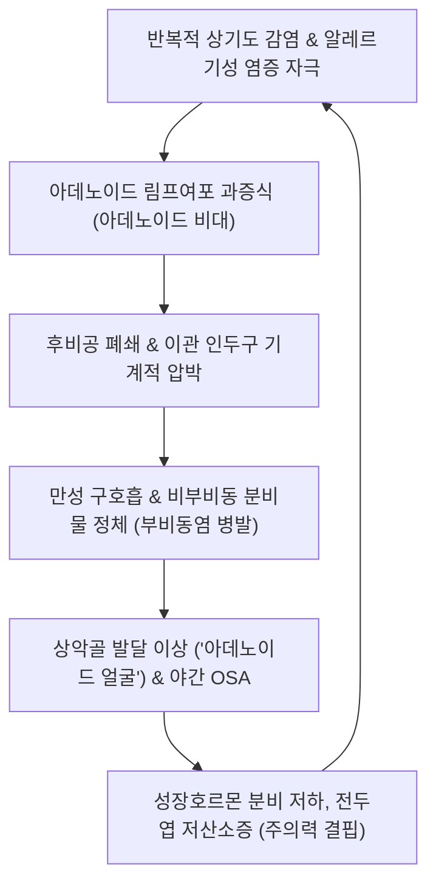

# 🩺 인두편도 장애 (Adenoid Disorders / 鼻咽腺樣體肥大·鼻窒)

> **핵심 3줄 요약 (Key Summary)**:
> - 📍 병소 부위 & 해부·병태생리: 비인두(Nasopharynx) 상벽 및 후벽에 위치한 발트이어 인두륜(Waldeyer's ring)의 림프 상피 조직인 인두편도(Pharyngeal tonsil, 아데노이드)의 병적 증식 또는 만성 감염증으로, 비인두 강 폐쇄(후비공 폐색) 및 이관 인두구(Eustachian tube orifice) 기계적 압박이 핵심 병소이다.
> - 🚩 전형적 임상 양상: 만성 구호흡(Mouth breathing), 수면 시 코골이 및 소아 폐쇄성 수면무호흡증(OSA), 비폐색·비음(폐쇄성 비음), 악안면 골격 변형('아데노이드 얼굴', Adenoid facies), 삼출성 중이염(OME) 재발이 주소증이다.
> - 🛠️ 핵심 검사 & 치료 전략: 비인두 측면 단순 X선(Adenoid-Nasopharyngeal ratio, AN ratio) 및 소아 굴곡성 비인두 내시경으로 진단하며, 비강 분무 스테로이드(INCS) 및 류코트리엔 조절제와 함께 한의학적 풍열/담어 변증에 따른 이비인후 침치료([[영향]], [[비통]], [[인당]], [[합곡]]), 비강 배농 요법, [[형개연교탕]]·[[이진탕]]·[[은교산]] 투여를 적용한다.
> - ⚠️ 응급 의뢰 레드플래그: 중증 소아 폐쇄성 수면무호흡증(야간 흉벽 함몰, 무호흡 10초 이상 지속), 성장 장애 및 이차성 야뇨증, 지속적인 전도성 난청에 따른 언어 발달 지연, 두개안면 기형 진행 시 즉시 이비인후과 아데노이드 절제술(Adenoidectomy)을 의뢰한다.

---

## 📌 목차
1. [질환 개요 & 해부학적 병태생리](#1--질환-개요---해부학적-병태생리)
2. [병태생리 메커니즘 & 생체역학적 악순환 네트워크](#2--병태생리-메커니즘---생체역학적-악순환-네트워크)
3. [임상 증상 & 이학적 검사(Physical Exam) 알고리즘](#3--임상-증상---이학적-검사-physical-exam--알고리즘)
4. [감별 진단 매트릭스 (Differential Diagnosis)](#4--감별-진단-매트릭스--differential-diagnosis-)
5. [한의 통합 치료 프로토콜 (침·약침·추나·한약)](#5--한의-통합-치료-프로토콜--침-약침-추나-한약-)
6. [양방 치료 & 병용·의뢰 기준 (Conventional Treatment & Referral)](#6-양방-치료--병용의뢰-기준-conventional-treatment--referral)
7. [재활 운동 & 생활습관 티칭 가이드](#7--재활-운동---생활습관-티칭-가이드)
8. [💡 사용자 진료실 핵심 필기 & 임상 노하우 (Melt-In 잔여 심화 집약)](#8----사용자-진료실-핵심-필기---임상-노하우--melt-in-잔여-심화-집약-)
9. [출처 및 학술 참고 문헌 (References)](#9--출처-및-학술-참고-문헌--references-)

---

## 1. 질환 개요 & 해부학적 병태생리

### 1) 질환 정의 및 개념
* **정의**: 인두편도 장애(Adenoid Disorders)는 비인두 점막 하 림프 조직인 아데노이드의 양성 림프 증식증(아데노이드 비대증, Adenoid Hypertrophy) 및 반복적인 세균/바이러스 감염에 의한 만성 염증(아데노이드염, Adenoiditis)을 포괄하는 질환군이다.
* **역학 및 발달 생리**:
  * 아데노이드는 생후 점막 면역계 발달과 함께 점진적으로 커져 만 3~6세경에 상대적 크기가 최대에 달한다.
  * 정상적으로는 사춘기(만 10~12세 이후)에 점진적으로 퇴축(Involutive atrophy)하나, 알레르기 비염이나 반복성 상기도 감염이 동반된 소아에서는 병적 과형성이 지속되어 호흡기 폐쇄를 유발한다.

### 2) 비인두 해부학 및 지지 구조
* **발트이어 인두륜(Waldeyer's Ring)**: 비인두의 인두편도(아데노이드), 이관편도, 구개편도, 설편도로 구성된 원형 림프 상피 조직망.
* **주변 인접 해부 구조**:
  * **후비공 (Choana)**: 비강 후방 통로로 아데노이드가 커지면 후비공이 직접 폐쇄되어 비강 호흡이 불가능해진다.
  * **이관 인두구 (Pharyngeal opening of Eustachian tube)**: 아데노이드 외측에 위치하며, 비대해진 아데노이드가 이관구를 압박하거나 세균 저장소(Bacterial reservoir) 역할을 하여 삼출성 중이염을 유발한다.
  * **인두후간극 (Retropharyngeal space)**: 심부 경부 염증 파급 통로.

---

## 2. 병태생리 메커니즘 & 생체역학적 악순환 네트워크

### 1) 기계적 폐색과 두개안면 변형 (Adenoid Facies)
* 코로 숨을 쉬지 못해 상시 입을 벌리고 있는 만성 구호흡 상태가 지속되면, 혀의 위치가 구강 저부로 처지고 협근의 압력이 상악치열궁을 압박한다. 그 결과 상악골 협착, 고구개궁(High-arched palate), 상악 전치 돌출(뻐드렁니), 하악골 후하방 회전이 유발되는 전형적인 '아데노이드 얼굴'이 형성된다.

### 2) 세균 바이오필름(Biofilm)과 소아 만성 부비동염/중이염
* 아데노이드 음와 표면에 형성된 세균 생막(Haemophilus influenzae, Streptococcus pneumoniae 등)은 항생제 저항성을 나타내며 만성 비부비동염과 삼출성 중이염을 끊임없이 재발시키는 감염원으로 작용한다(Pratomo et al., 2026).

---

## 3. 임상 증상 & 이학적 검사(Physical Exam) 알고리즘

### 1) 주요 임상 증상
* **호흡 증상**: 상시 코막힘, 입으로 숨쉬기, 수면 중 거친 호흡, 코골이, 폐쇄성 수면무호흡.
* **음성 및 발성**: 폐쇄성 비음(Hyponasality, '맹맹한 콧소리').
* **구강 및 악안면 징후**: 아침 기상 시 구강 건조 및 인후통, 입술 갈라짐, 부정교합.
* **이비인후과적 동반 질환**: 만성 삼출성 중이염, 재발성 급성 중이염, 만성 부비동염.

### 2) 진단 및 영상 검사
* **경부 측면 단순 방사선 검사 (Neck Lateral X-ray)**:
  * **AN ratio (Adenoid-Nasopharyngeal ratio)**: 아데노이드의 가장 돌출된 두께(A)와 접형후두연골-경구개 후연 간 거리(N)의 비를 측정. (0.6 이상 비대 의심, 0.7 이상 중증 폐쇄)
* **소아 굴곡성 비인두 내시경 (Flexible Nasopharyngoscopy)**:
  * 후비공 폐색 정도를 1도(<25%), 2도(25~50%), 3도(50~75%), 4도(>75%)로 직접 육안 평가하는 표준 검사법.
* **수면다원검사 (Polysomnography, PSG)**:
  * 무호흡-저호흡 지수(AHI) 1 초과 시 소아 수면무호흡증 진단.

---

## 4. 감별 진단 매트릭스 (Differential Diagnosis)

| 감별 질환 | 핵심 감별점 및 특징 | 구체적 차이점 |
| :--- | :--- | :--- |
| **[[알레르기 비염]]** | 재채기, 맑은 수양성 비루, 비소양감 동반 | 비경 상 하비갑개 창백 종창 관찰, X선 상 비인두 폐쇄 없음 |
| **비중격 만곡증** | 비중격 연골/골부의 구조적 편위 | 소아에서는 드물며 비강 내 시진으로 구조적 만곡 확인 |
| **후비공 폐쇄증 (Choanal Atresia)** | 선천적 후비공 막힘 (신생아기 수유 곤란, 청색증) | 출생 직후 발현하며 도관 통과 불능으로 진단 |
| **비인두 섬유혈관종** | 사춘기 남아에서 반복되는 대량 비출혈과 비폐색 | 혈관 증식이 풍부한 양성 종양으로 조영 CT/MRI 감별 필수 |
| **구개편도 비대증** | 구강 개구 시 좌우 목젖 양옆 구개편도의 거대 종창 | 구강 시진으로 즉각 확인 가능하나 아데노이드와 흔히 동반(아데노-구개편도 비대) |

---

## 5. 한의 통합 치료 프로토콜 (침·약침·추나·한약)

### 1) 변증 분류
* **풍열범폐(風熱犯肺)**: 감기 후 비폐색이 악화되고 누런 콧물이 나며 목이 붓고 미열이 있음. (설홍태박황, 맥부삭)
* **담어조체(痰瘀阻滯)**: 비인두 림프 조직이 단단하게 붓고 코골이가 심하며 입을 벌리고 자고 혀에 어반이 관찰됨. (설자암태백니, 맥현활)
* **폐비기허(肺脾氣虛)**: 체력이 약하고 밥을 잘 안 먹으며 맑은 콧물, 만성 중이염이 반복되고 안색이 창백함. (설담태백, 맥세약)
* **음허폐조(陰虛肺燥)**: 목안이 건조하고 밤에 마른기침을 하며 코딱지가 많이 끼고 미열이 뜸. (설홍소태, 맥세삭)

### 2) 침구 치료
* **주요 혈위**: [[영향]](LI20), [[비통]](EX-HN8), [[인당]](EX-HN3), [[합곡]](LI4), [[열결]](LU7), [[풍지]](GB20), [[족삼리]](ST36), [[예풍]](TE17).
* **자침 기법**:
  * 비강 순환 촉진: 영향-비통 혈위에 15도 사침하여 비점막 수축 유도.
  * 중이 배액 및 이관 기능 개선: 예풍, 이문, 청궁 혈위 자침으로 이관 주변 림프 순환 촉진.
  * 소아 무통 레이저침 및 소아침: 레이저침을 영향, 인당, 합곡에 1분간 조사하여 공포감 없이 기혈 순환 유도.

### 3) 약침 치료
* **황련해독탕 약침**: 풍열 및 급성 염증 악화기 시 풍지(GB20), 대추(GV14)에 각 0.1~0.2cc 주입.
* **증류 신이 약침**: 비통, 영향 혈위에 미량 주입하여 비갑개 및 비인두 점막 부종 신속 경감.

### 4) 비강 온담 배농 요법 (한방 배농치료)
* 신이, 박하, 창이자, 황련 전탕액을 멸균 면봉에 묻혀 비강 내(중비도 및 하비도)에 15~20분간 삽입하여 비점막 부종 감압 및 저류 삼출물 배출 유도.

### 5) 한약 처방 프로토콜
* **[[형개연교탕]](荊芥連翹湯)**: 풍열형 소아 선병질(림프구 체질)의 만성 편도·아데노이드 비대 및 부비동염에 1차 기본방.
* **[[이진탕]](二陳湯) 합 소청룡탕**: 담음 정체로 인한 가래, 코막힘, 맑은 비루 및 야간 기침 개선.
* **보중익기탕(補中益氣湯)**: 폐비기허형 소아의 면역력 저하, 만성 무기력, 잦은 감기 재발 방지.
* **소자강기탕(蘇子降氣湯)**: 야간 수면 중 호흡곤란, 천명 및 상기(上氣) 완화.

---

## 6. 양방 치료 & 병용·의뢰 기준 (Conventional Treatment & Referral)

### 1) 약물 치료
* **비강 분무 스테로이드제 (INCS, Intranasal Corticosteroids)**:
  * Mometasone, Fluticasone 비강 분무제를 6~12주간 투여하여 아데노이드 림프 조직의 크기를 20~30% 감소시킴(Papadopoulou et al., 2026).
* **류코트리엔 조절제 (LTRA)**:
  * Montelukast를 병용하여 알레르기 염증 경로를 차단하고 기도 과민성 완화.

### 2) 수술적 치료 (Adenoidectomy, 아데노이드 절제술)
* **절대적 적응증**:
  * 소아 폐쇄성 수면무호흡증(PSG 상 AHI > 5 또는 중증 야간 저산소증).
  * 아데노이드 비대로 인한 심각한 악안면 골격 기형 진행.
  * 3개월 이상의 적절한 약물 치료에도 반응하지 않는 만성 삼출성 중이염 및 전도성 난청.
* **수술 방법**: 전신마취 하 미세흡인절삭기(Microdebrider) 또는 코블레이터(Coblation)를 이용한 내시경적 아데노이드 절제술.

### 3) 한의 병용 및 보존적 치료 가치
* 수술 적응증 이전 단계(경도~중등도 비대)에서는 한약과 침, 배농 치료를 통해 수술 없이 증상을 완화하고 사춘기 자연 퇴축기까지 안정적으로 관리할 수 있다(Guo et al., 2026).

### 4) 응급 전원 기준
* 야간 수면 중 심각한 청색증 및 지속적 무호흡 발작.
* 흉벽 함몰 및 급성 호흡곤란.
* 지속적인 청력 저하로 인한 언어 장애 의심 시.

---

## 7. 재활 운동 & 생활습관 티칭 가이드

* **비강 호흡 재훈련 및 구강 근기능 훈련 (Myofunctional Therapy)**:
  * 입술 다물기 연습, 혀를 입천장(경구개)에 밀착시키는 훈련(Mewing 기법)을 지도하여 올바른 안면 골격 발달 유도.
* **생리식염수 비강 세척**: 하루 1~2회 미온수 생리식염수로 비인두 분비물을 세척하여 바이오필름 축적 방지.
* **실내 습도 유지**: 실내 습도를 50~60%로 유지하여 비인두 점막 건조 및 딱지 형성 예방.

---

## 8. 💡 사용자 진료실 핵심 필기 & 임상 노하우 (Melt-In 잔여 심화 집약)

* **보호자 상담의 핵심 포인트**:
  * "아이가 잘 때 코를 심하게 골거나 숨을 멈추면 뇌로 가는 산소가 부족해져 성장이 멈추고 낮에 산만해집니다(ADHD 오인)." 아데노이드 비대는 단순한 잠버릇이 아니라 성장 및 인지 기능과 직결됨을 명확히 교육해야 한다.
* **형개연교탕에 길경·백지·패모 가미의 묘미**:
  * 형개연교탕 원방에 패모 6g, 백지 6g, 길경 6g을 가미하여 3개월간 투여하면 비인두 림프 증식이 부드럽게 연화되어 코골이 소리가 현저히 줄어드는 임상 효과를 관찰할 수 있다.

---

## 9. 출처 및 학술 참고 문헌 (References)

1. Guo F. (2026). Non-pharmacological therapy for pediatric adenoid hypertrophy: a systematic review and network meta-analysis. *Front Pediatr*. PMID: 42774242

2. Pratomo GRA. (2026). Mechanistic Insights into the Role of Adenoid Hypertrophy and Chronic Adenoiditis in the Pathogenesis of Pediatric Chronic Rhinosinusitis: A Systematic Review. *Iran J Otorhinolaryngol*. PMID: 42764928

3. Papadopoulou A. (2026). Intranasal corticosteroids in pediatric airway inflammation: From pharmacokinetics and evidence to optimized clinical practice. *Pediatr Allergy Immunol*. PMID: 42851129

---

## 관련 노트

- [[_의학/03_이론/질환/이비인후·안과 질환/인두·후두·구강/급성 편도염|급성 편도염]]
- [[_의학/03_이론/질환/이비인후·안과 질환/코·부비동/부비동염|부비동염]]
- [[비염|만성 비염]]
- [[_의학/02_약리/의약품/00_양방약_MOC|양방약 MOC]]
