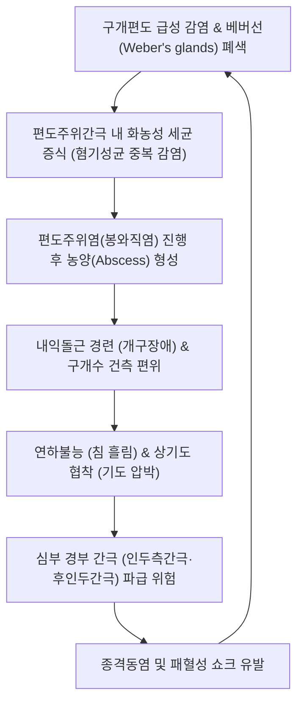

# 🩺 편도선 농양 (Peritonsillar Abscess / 喉癰·乳蛾化膿)

> **핵심 3줄 요약 (Key Summary)**:
> - 📍 병소 부위 & 해부·병태생리: 구개편도 피막(Tonsillar capsule)과 상인두수축근([[상인두수축근]], Superior pharyngeal constrictor) 사이의 잠재적 소성 결합조직 공간인 편도주위간극(Peritonsillar space)에 발생하는 급성 화농성 농양 질환으로, 베버선(Weber's glands, 타액선)의 화농성 감염 및 급성 편도염의 피막 외 파급이 핵심 병소이다.
> - 🚩 전형적 임상 양상: 편측성의 극심한 인후통, 귀로 방사되는 연관통(Referred otalgia), 개구장애(Trismus, 내익돌근 연축), 전형적인 뜨거운 감자를 문 듯한 쉰 목소리('Hot potato voice'), 구개수(목젖, Uvula)의 건측 편위 및 환측 연구개의 심한 팽륭이 3대 징후이다.
> - 🛠️ 핵심 감별 검사 & 치료 전략: 구강 시진 및 조영 증강 경부 CT로 진단하며, 즉각적인 응급 침흡인(Needle aspiration) 또는 절개배농(I&D)과 정맥 항생제(Ampicillin-sulbactam 또는 Penicillin + Metronidazole)를 투여하고, 배농 후 안정기 한의학적 청열해독·소종배농(황련해독탕 약침, [[은교산]], [[선방활명음]], [[배농산급탕]])과 침치료를 병용한다.
> - ⚠️ 응급 의뢰 레드플래그: 기도 폐쇄 징후(호흡곤란, 천명, 앙와위 불능), 인두측간극(Parapharyngeal space) 및 후인두간극 파급에 따른 하행성 괴사성 종격동염(DNM), 내경정맥 패혈성 혈전정맥염(Lemierre 증후군), 대량 구강 출혈(경동맥 가성동맥류 파열) 의심 시 1분 1초를 다투는 상급 이비인후과 응급실 전원이 절대적이다.

---

## 📌 목차
1. [질환 개요 & 해부학적 병태생리](#1--질환-개요---해부학적-병태생리)
2. [병태생리 메커니즘 & 생체역학적 악순환 네트워크](#2--병태생리-메커니즘---생체역학적-악순환-네트워크)
3. [임상 증상 & 이학적 검사(Physical Exam) 알고리즘](#3--임상-증상---이학적-검사-physical-exam--알고리즘)
4. [감별 진단 매트릭스 (Differential Diagnosis)](#4--감별-진단-매트릭스--differential-diagnosis-)
5. [한의 통합 치료 프로토콜 (침·약침·추나·한약)](#5--한의-통합-치료-프로토콜--침-약침-추나-한약-)
6. [양방 치료 & 병용·의뢰 기준 (Conventional Treatment & Referral)](#6-양방-치료--병용의뢰-기준-conventional-treatment--referral)
7. [재활 운동 & 생활습관 티칭 가이드](#7--재활-운동---생활습관-티칭-가이드)
8. [💡 사용자 진료실 핵심 필기 & 임상 노하우 (Melt-In 잔여 심화 집약)](#8----사용자-진료실-핵심-필기---임상-노하우--melt-in-잔여-심화-집약-)
9. [출처 및 학술 참고 문헌 (References)](#9--출처-및-학술-참고-문헌--references-)

---

## 1. 질환 개요 & 해부학적 병태생리

### 1) 질환 정의 및 개요
* **정의**: 편도선 농양(편도주위농양, Peritonsillar Abscess, PTA / Quinsy)은 구개편도를 둘러싸고 있는 섬유성 피막과 인두벽 근육 사이의 편도주위강에 고름(농양)이 고이는 가장 흔한 심부 두경부 감염 질환이다.
* **역학**: 소아기보다는 주로 청소년 및 젊은 성인(20~40대)에서 가장 빈발한다(Pallon et al., 2026). 급성 편도염 환자의 약 1~2%에서 합병증으로 발생한다.

### 2) 구개인두 해부학 및 감염 전파 경로
* **편도주위간극 (Peritonsillar Space)**:
  * 내측 경계: 구개편도 피막(Tonsillar capsule).
  * 외측 및 후방 경계: 상인두수축근([[상인두수축근]], Superior pharyngeal constrictor).
  * 전방 경계: 구개설근([[구개설근]], Palatoglossus).
  * 후방 경계: 구개인두근([[구개인두근]], Palatopharyngeus).
  * 상부: 구개편도 상극 부위의 점액 타액선인 베버선(Weber's glands).
* **개구장애(Trismus)의 해부학적 기전**:
  * 염증이 상인두수축근을 뚫고 외측의 내익돌근([[익돌근]], Medial pterygoid muscle)으로 파급되면 강직성 근경련(Spasm)이 유발되어 입을 1~2cm 이상 벌리지 못하는 심각한 개구장애가 발생한다.
* **신경 주행과 방사통**:
  * [[설인신경]](CN IX)의 편도지 자극이 고실신경(Jacobson's nerve)을 통해 동측 중이강으로 전달되어 극심한 이통(Otalgia)이 동반된다.

---

## 2. 병태생리 메커니즘 & 생체역학적 악순환 네트워크

### 1) 미생물학적 병인론
* 화농성 연쇄상구균(Streptococcus pyogenes, GAS)과 황색포도상구균(Staphylococcus aureus) 외에도, 농양 형성 단계에서는 구강 내 상재 혐기성균(Fusobacterium necrophorum, Prevotella, Peptostreptococcus)이 복합적으로 관여하는 혼합 감염(Polymicrobial infection) 양상을 띤다(Moen et al., 2023).

### 2) 심부 두경부 및 종격동 파급 위험
* 편도주위간극의 외측 근막이 파열되면 염증이 즉시 인두측간극(Parapharyngeal space)으로 진입한다. 이는 경동맥초(Carotid sheath)를 타고 흉곽 내부의 후종격동으로 하행하여 치명적인 하행성 괴사성 종격동염(DNM)을 유발할 수 있다.

---

## 3. 임상 증상 & 이학적 검사(Physical Exam) 알고리즘

### 1) 3대 전형적 임상 징후
* **편측성 격심한 인후통 및 이통**: 편측으로 치우친 극심한 통증으로 물조차 삼키지 못해 침을 흘림(Drooling).
* **개구장애 (Trismus)**: 손가락 1~2개 이상 입을 벌리지 못함.
* **뜨거운 감자 음성 (Hot potato voice)**: 입안에 뜨거운 음식을 물고 말하는 듯한 전형적인 둔탁한 비음 섞인 어조.

### 2) 구강 내 시진 소견
* **환측 연구개 및 전구개궁의 심한 팽륭과 발적**: 편도가 전내측 및 하방으로 밀려나 있음.
* **구개수(목젖, Uvula)의 건측 편위**: 부종과 농양의 압력으로 인해 목젖이 반대쪽(정상 측)으로 강하게 밀려남.
* **악취 및 유통성 경부 림프절염**: 동측 악하 및 상경부 심부 림프절 종대.

### 3) 진단 도구
* **진단적 주사 천자 (Needle aspiration)**: 국소마취 후 18G 바늘로 팽륭 부위를 찔러 농(Pus)을 흡인함으로써 봉와직염과 농양을 확진 감별.
* **조영 증강 경부 CT (Neck CT with contrast)**: 편도주위간극 내 저음영의 농양 포켓과 주변 조영증강 림프절 확인, 심부 경부 간극 파급 여부 정밀 평가.

---

## 4. 감별 진단 매트릭스 (Differential Diagnosis)

| 감별 질환 | 핵심 감별점 및 특징 | 구체적 차이점 |
| :--- | :--- | :--- |
| **편도주위 봉와직염 (Cellulitis)** | 편도 발적 및 팽륭은 있으나 고름(농양 포켓)이 형성되지 않음 | 바늘 흡인 시 농이 나오지 않으며 항생제만으로 호전 가능 |
| **[[급성 편도염]]** | 양측성 편도 종창, 편도 표면의 백색 삼출물 | 구개수 편위 및 개구장애가 없거나 매우 경미함 |
| **인두측간극 농양 (Parapharyngeal Abscess)** | 외경부(목 옆)의 심한 종창과 압통, 경부 강직 | 구강 내 편도 팽륭보다 목 외부의 종괴가 두드러짐 |
| **후두개염 (Epiglottitis)** | 후두개의 체리빛 부종, 흡기성 천명(Stridor) | 구강 내 병변 없이 후두 내시경 상 후두개 폐색 확인 |
| **편도 악성 종양 (편도암, 림프종)** | 통증 없는 비대칭적 편도 종대, 궤양, 단단한 경도 | 발열이나 급성 염증 소견 없이 만성적으로 진행 |

---

## 5. 한의 통합 치료 프로토콜 (침·약침·추나·한약)

### 1) 임상 원칙 (주의 사항)
* **급성 화농기 (Acute Suppurative Phase)**: 활동성 농양 형성 시에는 즉각적인 배농(양방 외과 처치)이 생명을 구하는 최우선 치료이다. 한의 치료는 절개배농 완료 후의 잔여 염증 제거, 조직 재생, 재발 방지에 집중한다.

### 2) 변증 분류
* **열독옹성(熱毒壅盛)**: 목이 찢어질 듯이 아프고 고열, 갈증이 심하며 입안에 악취가 나고 변비가 동반됨. (설홍태황조, 맥홍삭)
* **담열상옹(痰熱上壅)**: 목에 가래가 끓고 침을 삼키기 어려우며 목소리가 잠기고 가슴이 답답함. (설홍태황니, 맥활삭)
* **기혈양허(氣血兩虛) / 허화상염**: 배농 후 상처가 잘 아물지 않고 기운이 없으며 미열이 지속됨. (설담태박, 맥세삭)

### 3) 침구 치료 (배농 후 안정기)
* **주요 혈위**: [[합곡]](LI4), [[곡지]](LI11), [[소상]](LU11), [[상양]](LI1), [[풍지]](GB20), [[예풍]](TE17), [[인당]](EX-HN3), [[내관]](PC6).
* **자침 기법**:
  * 소상-상양 점자방혈: 급성기 고열과 인두부 종창 시 삼릉침으로 2~3방울 점자방혈하여 폐위 열독 배출.
  * 합곡-곡지 자침: 강자극을 주어 안면 및 인두부 소염 진통 유도.
  * 예풍, 하관 자침: 내익돌근 연축을 풀어 개구장애 완화.

### 4) 약침 치료 (배농 후 안정기)
* **황련해독탕 약침**: 풍지(GB20), 예풍(TE17) 혈위에 각 0.3cc 주입하여 잔여 두경부 열독 소퇴.

### 5) 한약 처방 프로토콜
* **[[선방활명음]](仙方活命飮)**: 화농 초기 또는 배농 후 잔여 농독을 신속히 삭히고 연조직 괴사를 방지하는 외과 성약(聖藥).
* **[[배농산급탕]](排膿散及湯)**: 국소 농양 배농 후 배농 촉진 및 육아조직 형성 촉진.
* **[[은교산]](銀翹散) 합 양격산**: 열독옹성형의 극심한 발열, 인후통, 변비 완화.
* **탁리소독음(托裏消毒飮)**: 기혈이 허약하여 농이 깨끗이 빠지지 않고 치유가 지연되는 만성기에 투여.

---

## 6. 양방 치료 & 병용·의뢰 기준 (Conventional Treatment & Referral)

### 1) 외과적 배농 (표준 치료)
* **침흡인술 (Needle Aspiration)**: 18G 바늘로 3개 부위(상극, 중부, 하극)를 흡인 (초치료 성공률 약 85~90%, Galioto, 2017).
* **절개배농술 (Incision and Drainage, I&D)**: 국소마취 하에 11번 메스로 팽륭 최심부를 절개하고 지혈겸자로 벌려 고름을 완전히 배출.
* **응급 편도절제술 (Quinsy Tonsillectomy)**: 재발성 편도염 병력이 있거나 절개배농 실패, 기도 폐쇄 위험 시 즉시 편도 전체를 절제.

### 2) 항생제 및 스테로이드 요법
* **경정맥 항생제**: Ampicillin-sulbactam 1.5~3.0g q6h 또는 Ceftriaxone + Metronidazole (혐기성균 커버 필수, Moen et al., 2023).
* **전신 스테로이드**: Dexamethasone 10mg IV 1회 투여로 연하곤란, 통증, 개구장애를 신속히 완충.

### 3) 응급 전원 기준 (Red Flags)
* **모든 급성 편도선 농양 의심 환자는 진단 즉시 이비인후과/응급실로 전원한다.**
* 호흡곤란, 천명(Stridor), 청색증이 관찰되는 기도 응급 상태.
* 내익돌근 강직을 넘어선 경부 강직(목을 숙이지 못함) 및 흉통 동반 시.

---

## 7. 재활 운동 & 생활습관 티칭 가이드

* **배농 후 연하 회복 관리**: 초기 24시간 동안은 차가운 미음이나 이온음료 섭취 지도.
* **구강 살균 가글링**: 0.12% 클로르헥시딘 또는 온식염수로 하루 4~6회 구강 세척하여 상처 감염 방지.
* **절대 안정 및 금연**: 니코틴은 구강 점막 혈관을 수축시켜 상처 회복을 지연시키므로 최소 2주간 철저 금연.

---

## 8. 💡 사용자 진료실 핵심 필기 & 임상 노하우 (Melt-In 잔여 심화 집약)

* **진료실에서 편도주위농양을 의심하는 순간의 골든 룰**:
  * 환자가 문을 열고 들어오며 침을 삼키지 못해 티슈에 침을 뱉고, 입을 제대로 벌리지 못하며 "목소리가 이상해졌어요"라고 한다면 99% 편도주위농양이다.
  * 설압자로 무리하게 혀를 누르면 미주신경 반사나 기도 폐쇄가 올 수 있으므로, 환자 스스로 가볍게 입을 벌리게 하고 펜라이트로 목젖의 편위(Uvula deviation)만 신속히 확인한 후 즉시 상급병원 이비인후과로 전원서를 써주어야 한다.

---

## 9. 출처 및 학술 참고 문헌 (References)

1. Galioto NJ. (2017). Peritonsillar Abscess. *Am Fam Physician*. PMID: 28409615

2. Pallon J. (2026). Peritonsillitis in primary care: patient characteristics and care pathways - a population-based registry study. *BMC Prim Care*. PMID: 42563151

3. Moen CM. (2023). A systematic review of the role of penicillin versus penicillin plus metronidazole in the management of peritonsillar abscess. *J Laryngol Otol*. PMID: 37194922

---

## 관련 노트

- [[_의학/03_이론/질환/이비인후·안과 질환/인두·후두·구강/급성 편도염|급성 편도염]]
- [[_의학/03_이론/질환/이비인후·안과 질환/코·부비동/부비동염|부비동염]]
- [[_의학/00_기본의학/01. 레드플래그·응급 감별/척수증·마미증후군_선별_2026-10-12|레드플래그 선별]]
- [[_의학/02_약리/의약품/00_양방약_MOC|양방약 MOC]]
