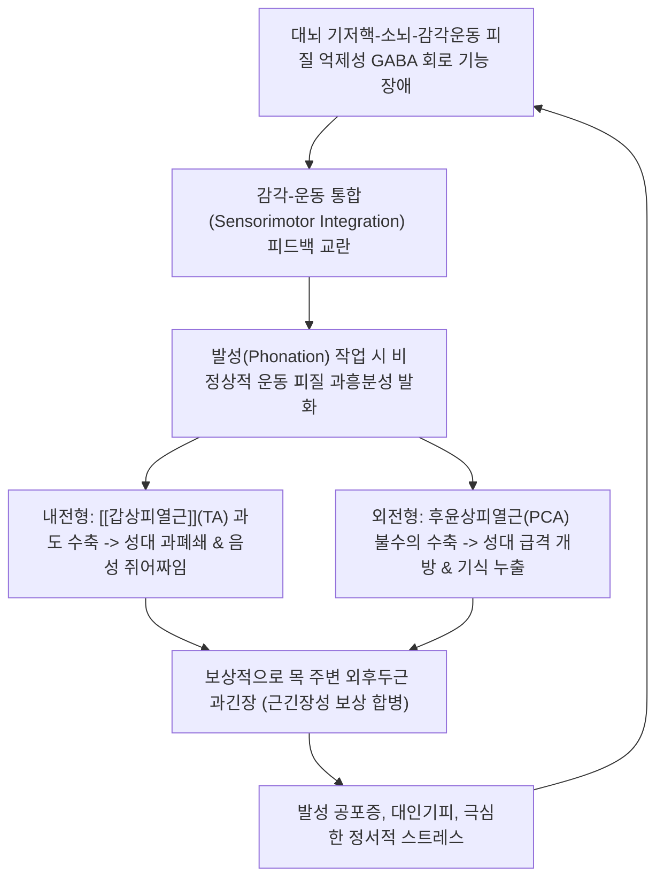

# 🩺 [[후두 근긴장이상]] (Laryngeal Dystonia / Spasmodic Dysphonia / 喉頭筋緊張異常, G24.8)

> **핵심 3줄 요약 (Key Summary)**:
> - 📍 병소 부위 & 해부·병태생리: 후두 내재근군([[갑상피열근]] Thyroarytenoid, 후윤상피열근 Posterior cricoarytenoid) 및 대뇌 기저핵-소뇌-감각운동 피질 신경망 조절 부전. 말을 할 때(발성 시)에만 국소적으로 후두 근육이 불수의적으로 강직성 연축을 일으키는 작업 특이적 국소 근긴장이상(Task-specific focal dystonia).
> - 🚩 전형적 임상 양상 & 3대 징후: 내전형(ADSD, 80~90%): 목을 쥐어짜는 듯한 억압된 발성(Strained-strangled voice) 및 모음 발성 시 음의 끊김(Pitch breaks). 외전형(ABSD, 10~15%): 무성 자음 뒤 발성 시 성대가 갑자기 벌어지며 바람 새는 거친 쉰 목소리(Breathy breaks). 단, 노래를 부르거나 웃고 울 때는 정상 발성 유지(Task-specificity).
> - 🛠️ 핵심 감별 검사 & 한·양방 다각적 치료 전략: 과제별 문장 발성 검사 및 후두 스트로보스코피, 근긴장성 발성장애(MTD)와의 감별, 1차 표준 치료인 후두 근전도 유도 하 보툴리눔 톡신(Botox) 성대 국소 주입술, 한의 간풍내동(肝風內動)·기체담울(氣滯痰鬱)을 다스리는 [[억간산]], [[반하후박탕]], [[천마구등음]] 및 염천·인영·풍지·사관혈(합곡·태충) 전침·약침 병용.
> - ⚠️ 응급 의뢰 레드플래그 & 악화 요인: 전신성 근긴장이상 파급 징후(사지 및 경부 디스토니아), 파킨슨 증후군 등 중추 퇴행성 신경계 질환 동반 소견, 연하곤란 및 기도 흡인 위험 시 즉시 상급병원 신경과/이비인후과 정밀 검진 의뢰.

---

## 📌 목차
1. [질환 개요 & 해부학적 병태생리](#1-질환-개요--해부학적-병태생리)
2. [병태생리 메커니즘 & 생체역학적 악순환 네트워크](#2-병태생리-메커니즘--생체역학적-악순환-네트워크)
3. [임상 증상 & 이학적 검사(Physical Exam) 알고리즘](#3-임상-증상--이학적-검사physical-exam-알고리즘)
4. [감별 진단 매트릭스 (Differential Diagnosis)](#4-감별-진단-매트릭스-differential-diagnosis)
5. [한의 통합 치료 프로토콜 (침·약침·추나·한약)](#5-한의-통합-치료-프로토콜-침약침추나한약)
6. [양방 치료 & 병용·의뢰 기준 (Conventional Treatment & Referral)](#6-양방-치료--병용의뢰-기준-conventional-treatment--referral)
7. [재활 운동 & 생활습관 티칭 가이드](#7-재활-운동--생활습관-티칭-가이드)
8. [💡 사용자 진료실 핵심 필기 & 임상 노하우 (Melt-In 잔여 심화 집약)](#8--사용자-진료실-핵심-필기--임상-노하우-melt-in-잔여-심화-집약)
9. [출처 및 학술 참고 문헌 (References)](#9-출처-및-학술-참고-문헌-references)

---

## 1. 질환 개요 & 해부학적 병태생리

* **질환 정의 및 임상 분류**:
  * 후두 근긴장이상(Laryngeal Dystonia, 흔히 연축성 발성장애 Spasmodic Dysphonia, SD)은 후두 내재근에 발생하는 국소성 근긴장이상증(Focal dystonia)의 일종이다.
  * 후두 점막이나 성대 자체에 기질적 병변이 없음에도 불구하고, 발성이라는 특정 운동 과제를 수행할 때만 후두 근육이 비정상적으로 과도하게 연축하여 음성 단절과 왜곡을 초래하는 **작업 특이적(Task-specific)** 신경학적 운동 질환이다.
  * **3대 임상 아형**:
    1. **내전형 연축성 발성장애 (Adductor SD, ADSD)**: 전체의 약 80~90%를 차지. 성대를 닫는 근육인 [[갑상피열근]](Thyroarytenoid muscle, TA) 및 외측윤상피열근(LCA)의 과도한 수축으로 성대가 발성 중 지나치게 꽉 조여짐.
    2. **외전형 연축성 발성장애 (Abductor SD, ABSD)**: 약 10~15%. 유일한 성대 외전근인 후윤상피열근(Posterior cricoarytenoid, PCA)의 불수의적 연축으로 발성 중 성대가 갑자기 열려 공기가 누출됨.
    3. **혼합형 (Mixed type)**: 내전 및 외전 연축이 복합되어 나타남.
* **관련 해부학적 구조물**:
  * **후두 내재근군**: [[갑상피열근]](성대 본체 근육), 외측윤상피열근, 후윤상피열근, 피열간근.
  * **지배 신경계**: [[미주신경]](제10뇌신경)의 분지인 되돌이후두신경(Recurrent laryngeal nerve - 성대 운동의 주 지배) 및 상후두신경(Superior laryngeal nerve).
  * **중추 신경계 병소**: 대뇌 피질-기저핵-시상-피질 운동 회로(Cortico-basal ganglia-thalamocortical loop), 소뇌(Cerebellum) 및 뇌간의 감각-운동 통합 신경망(Sensorimotor integration network).

---

## 2. 병태생리 메커니즘 & 생체역학적 악순환 네트워크

### 1) 중추 신경계 억제성 조절 장애 (Loss of Inhibition)
* 신경영상학 연구에 따르면 후두 근긴장이상은 말초 후두 신경의 손상이 아니라, 기저핵(조가비핵 Putamen, 담창구 Globus pallidus) 및 소뇌-시상-대뇌피질 운동 영역의 상호작용 불균형에서 비롯된다.
* 특히 뇌의 억제성 신경전달물질인 GABA 경로의 억제 기능이 상실되면서, 후두 근육을 미세하게 조율해야 할 피질척수로 신호가 비정상적으로 과도하게 방출되어 발성 근육의 불수의적 강직을 촉발한다.

### 2) 작업 특이성(Task-Specificity)과 감각 트릭(Sensory Trick)의 기전
* 환자는 일상적인 대화를 할 때는 극심한 발성 장애를 겪지만, 감정적 발성(웃음, 울음, 기침)을 하거나 노래를 부르고 속삭일 때는 전혀 끊김 없이 유창하게 발성할 수 있다. 이는 발성의 종류에 따라 뇌의 활성화 신경망 경로가 상이함을 증명한다.
* 환자가 목을 만지거나, 턱을 누르거나, 말을 시작하기 전 특정 제스처를 취하면 일시적으로 증상이 완화되는 **감각 트릭(Sensory trick / Geste antagoniste)** 현상이 관찰되며, 이는 고유수용성 감각 피드백이 피질 과흥분성을 일시 리셋하기 때문이다.

---

## 3. 임상 증상 & 이학적 검사(Physical Exam) 알고리즘

### 1) 아형별 전형적 임상 증상
* **내전형 (ADSD)**:
  * 쥐어짜는 듯한 소리(Strained, strangled, pressed voice): 목구멍이 꽉 막힌 상태에서 억지로 소리를 쥐어짜내는 듯한 발성.
  * 발성 단절(Voicing breaks): 유성음이나 모음(아, 에, 이, 오, 우)을 발성할 때 성대가 갑자기 경련성으로 맞붙어 소리가 뚝뚝 끊김.
* **외전형 (ABSD)**:
  * 바람 새는 소리(Breathy, whispery voice): 속삭이듯 힘없이 공기가 새는 음성.
  * 무성음 단절: 무성 자음(/p/, /t/, /k/, /s/) 뒤에 모음이 올 때 성대가 벌어져 소리가 멎고 한숨 쉬듯 공기만 빠져나옴.

### 2) 필수 진단 검사 프로토콜
* **발성 과제 부하 검사**:
  * 유성음 부하 문장: "우체국에서 어머니에게 편지를 부쳤습니다" $
ightarrow$ 내전형 연축 유발.
  * 무성음 부하 문장: "파란 하늘에 하얀 풍선이 둥실 떠갑니다" $
ightarrow$ 외전형 연축 유발.
  * 비발성 기능 검사: 기침, 웃음, 하품, 허밍(Humming), 노래 부르기 시 정상 발성 확인(진단적 필수).
* **후두 스트로보스코피 (Laryngeal Stroboscopy)**:
  * 성대의 형태학적 이상(결절, 폴립 등)이 없음을 확인하고, 발성 시 진성대 및 가성대의 불수의적 과내전 또는 외전 연축을 실시간 관찰.
* **후두 근전도 (Laryngeal EMG)**:
  * 갑상피열근(TA) 또는 후윤상피열근(PCA)의 비정상적 다발성 근전도 방전 확인 및 보톡스 주입 표적화.

---

## 4. 감별 진단 매트릭스 (Differential Diagnosis)

| 감별 질환 | 호발 병인 및 병태생리 | 발성 양상 및 특징 | 감별 진단 핵심 포인트 |
| :--- | :--- | :--- | :--- |
| [[후두 근긴장이상]] (본 질환) | 기저핵-피질 회로 이상 (국소성 디스토니아) | 발성 시 쥐어짜임/끊김, **노래·웃음 시 정상** | **작업 특이성(Task-specificity)**, 보톡스 극적 호전 |
| 근긴장성 발성장애 (MTD) | 외후두근의 기능적 과긴장 및 오용 | 지속적인 목 쥐어짜임 및 발성 피로 | 비발성 소리도 비정상, **후두 마사지/음성치료에 호전** |
| 본태성 성대 떨림 (Vocal Tremor) | 본태성 떨림(Essential Tremor)의 후두 발현 | 4~8Hz의 규칙적인 음성 떨림 | 모음 연장 발성 시 규칙적 진폭/주파수 떨림 |
| [[성대결절]] / 폴립 | 성대 점막의 기계적 만성 마찰 병변 | 거친 쉰 목소리(애성), 피치 브레이크 | 후두경 검진상 육안적 점막 융기 병변 확인 |
| 파킨슨병 발성 장애 | 흑질 도파민 소실, 추체외로 질환 | 소리가 작고(Hypophonia), 단조로운 음조 | 안정시 떨림, 근강직, 서동증 등 전신 징후 동반 |

---

## 5. 한의 통합 치료 프로토콜 (침·약침·추나·한약)

한의학에서 후두 근긴장이상은 **음아(音啞)**, **경련(痙攣)**, **간풍내동(肝風內動)**, **기체담울(氣滯痰鬱)**의 범주로 파악합니다. 스트레스와 칠정상(七情傷)으로 인해 간기(肝氣)가 울결되고 근육을 주관하는 간혈(肝血)이 허해져 풍담(風痰)이 후두의 근막과 경락을 교란하는 것으로 진단합니다.

### 1) 한약 치료 (Herbal Medicine)
* **간풍내동·간기울결형 (긴장 시 목 쥐어짜임 악화, 감정 기복, 불면, 두통, 설홍태박)**:
  * **[[억간산]](抑肝散) 또는 [[억간산가진피반하]](抑肝散加陳皮半夏)**:
    * **조성**: 조구등, 시호, 백출, 복령, 당귀, 천궁, 감초 + 진피, 반하.
    * **약리 기전**: 조구등과 시호가 중추신경계의 과흥분성을 안정시키고 뇌내 GABA 신호전달을 촉진하여 불수의적 근연축을 진정시키며, 천궁·당귀가 혈류를 개선하고 진피·반하가 상초에 맺힌 담음을 삭힙니다.
* **기체담울·매핵기 동반형 (목에 뭔가 걸린 듯하고 뱉어도 나오지 않으며 가슴이 답답함)**:
  * **[[반하후박탕]](半夏厚朴湯)**: 반하, 후박, 복령, 생강, 소엽. 후두 신경증과 자율신경 실조를 안정시키고 인후부 평활근 및 횡문근의 비정상적 과긴장을 완화.
* **풍담조락형 (성대 연축이 심하고 떨림이 동반될 때)**:
  * **[[천마구등음]](天麻鉤藤飲)** 또는 활락효령단 가미.

### 2) 침구 치료 (Acupuncture)
* **후두 국소 연축 완화 및 신경 조절 요혈**:
  * **염천(CV23)**: 설골 상연 중앙에서 설근부를 향해 0.5~1.0촌 사자. 성대 내전근의 경련을 완화.
  * **인영(ST9)**: 갑상연골 상연 외측 경동맥 박동부 직전. 미주신경 및 상후두신경 분지 자극.
  * **천돌(CV22)**: 흉골상와 중앙. 기관 및 후두 하부 긴장 이완.
* **원위 사관혈 및 중추 평간식풍 요혈**:
  * **합곡(LI4) & 태충(LR3)**: 사관(四關)을 개통하여 전신의 기혈 울체를 소통시키고 간풍(肝風)과 근연축을 진정.
  * **풍지(GB20) & 백회(GV20)**: 뇌혈류 개선 및 중추신경계 흥분성 안정.
  * **조해(KI6) & 열결(LU7)**: 음교맥·임맥 개통을 통한 인후부 진액 공급 및 긴장 해소.

### 3) 추나 치료 (Chuna) — 후두-경추 연골 근막 가동술
* **설골상하근군 근막이완기법**: [[악이복근]], [[악설골근]], [[갑상설골근]], [[흉골갑상근]]의 단축을 수기(JS)로 부드럽게 이완.
* **갑상연골 외측 가동술(Thyroid Cartilage Mobilization)**: 환자의 긴장을 유도한 상태에서 갑상연골 날개를 좌우로 부드럽게 글라이딩시켜 성대 내재근의 수동적 신장 유도.

---

## 6. 양방 치료 & 병용·의뢰 기준 (Conventional Treatment & Referral)

> 🎯 **이 섹션의 목적**: 환자가 **양방약을 이미 복용 중인 경우가 많다.** 한의원 1차 진료에서 양방 치료를 이해하고, 병용 가능·주의·금기를 판단하며, 언제 의뢰할지 결정한다.

* **약물 및 주사 치료 (Medication & Injection)**:
  * **보툴리눔 톡신 국소 주입술 (Botulinum Toxin Injection) — 1차 표준 골드 스탠다드**:
    * **내전형(ADSD)**: 후두 근전도(EMG) 유도 하에 경피적으로 경관을 통해 양측 또는 편측 갑상피열근(TA) 내로 보톡스(Botox 1.0~2.5 Unit)를 극소량 주입.
    * **작용 기전**: 신경-근 접합부의 아세틸콜린 분비를 화학적으로 차단하여 과도하게 연축하는 성대 근육을 일시적으로 부전마비시킴으로써 쥐어짜는 발성을 해소.
    * **지속 기간 및 경과**: 주사 24~48시간 후부터 효과 발현, 초기 1~2주간은 성대 불완전 폐쇄로 인한 바람 새는 소리(기식음)와 사레들림(Aspiration)이 발생할 수 있으며, 이후 3~4개월간 안정적인 발성 유지 후 서서히 재발하여 연 3~4회 반복 시술 필요.
    * **외전형(ABSD)**: 후윤상피열근(PCA) 내로 주입하나 시술 난이도가 높고 기도 협착 위험이 있어 매우 신중히 시행.
  * **경구 약물**: 항불안제(Clonazepam), 항콜린제(Trihexyphenidyl) 등을 시도할 수 있으나 전신 부작용 대비 음성 개선 효과는 미흡함.
* **비약물 시술 (Procedures)**:
  * **음성 치료 (Voice Therapy)**: 보톡스 주사 단독보다 음성 치료를 병용할 때 보톡스 효과 유지 기간이 연장되고 투여 용량을 낮출 수 있음.
* **수술·시술 적응증 (Surgical Indication)**:
  * 잦은 보톡스 주사에 거부감이 있거나 내성이 발생한 불응성 환자:
  * **선택적 후두 내전신경 절제 및 신경재배치술 (SLAD-R)**: 되돌이후두신경의 전내전 분지를 절제하고 경신경고(Ansa cervicalis) 분지를 문합.
  * **2형 갑상연골성형술 (Type II Thyroplasty)**: 갑상연골 정중부를 수직 절개하여 양측으로 벌려 고정함으로써 성대 과폐쇄를 기계적으로 방지.
* **한의 병용 판단 (Combination Therapy)**:
  * **보톡스 주사 환자의 한의 병용 프로토콜**:
    * 보톡스 주사 직후 나타나는 과도한 기식음(목소리가 안 나오고 헛바람만 나오는 시기)과 물 마실 때 사레들리는 연하 곤란 기간에 침구 및 [[억간산]]을 병용하면 조직 적응력을 높여 불편 기간을 단축시킴.
    * 장기적으로 보톡스 주사의 재발 주기를 3개월에서 5~6개월 이상으로 연장시키는 시너지 효과 기대.
* **양방·전문과 의뢰 기준 (Referral Criteria)**:
  * **신경과 정밀 의뢰**: 후두 외에 목이 한쪽으로 돌아가는 사경증(Cervical dystonia), 안면 경련(Meige 증후군), 손떨림 등 다른 부위의 디스토니아가 동반되는 경우 전신성 기저핵 질환 배제를 위해 의뢰.
  * **이비인후과 의뢰**: 후두 스트로보스코피 및 EMG를 통한 확진과 보톡스 주사 시술을 위해 전문 음성클리닉 전원.

---

## 7. 재활 운동 & 생활습관 티칭 가이드

* **부드러운 발성 개시 훈련 (Easy Onset Phonation)**:
  * 성대를 꽉 닫고 첫 음절을 터뜨리듯 발성(Glottal attack)하지 말고, 숨을 먼저 "하-" 하고 가볍게 내쉬면서 부드럽게 소리를 얹어내는 발성법 훈련.
* **복식 호흡 및 폐활량 지지 (Breath Support)**:
  * 목에 힘을 주고 말하는 대신 횡격막을 이용한 충분한 호흡 압력을 유지하여 성대 연축 유발 역치를 낮춤.
* **스트레스 및 음주 관리**:
  * 심리적 긴장과 불안은 중추 신경성 근긴장을 폭발적으로 악화시키므로 명상, 이완 요법 권장.
  * 음주는 일시적으로 긴장을 완화하지만 알코올 대사 후 반동성으로 경련이 악화되므로 과도한 음주 금지.

---

## 8. 💡 사용자 진료실 핵심 필기 & 임상 노하우 (Melt-In 잔여 심화 집약)

* **진료실 1분 감별 비기: '노래'와 '숫자 세기'**:
  * 환자가 말할 때 목을 몹시 쥐어짜고 뚝뚝 끊겨서 "말하기가 너무 고통스럽다"고 호소할 때, 원장실에서 **"생일 축하합니다 노래를 한 소절만 불러보세요"**라고 요청해 봅니다.
  * 놀랍게도 말할 때는 한마디도 제대로 못 하던 환자가 노래를 부를 때는 전혀 끊김 없이 맑고 부드러운 목소리로 노래를 완창합니다.
  * 이것이 확인되면 성대마비나 후두염, 암이 아니라 100% **후두 근긴장이상(연축성 발성장애)**으로 확진할 수 있습니다. (반면 근긴장성 발성장애 MTD 환자는 노래할 때도 똑같이 쥐어짜는 소리가 납니다).
* **억간산(抑肝散)과 사관혈(합곡·태충)의 중추성 손맛**:
  * 발성 시 목에 쥐가 나는 현상은 한의학에서 전형적인 **'간풍내동(肝風內動)'**의 극치입니다.
  * [[억간산]] 엑스제 하루 3회 복약과 함께 양측 합곡·태충에 0.25mm 호침으로 강자극을 주어 득기(得氣)시키면, 뇌의 과도한 운동 피질 발화가 진정되어 침 치료 직후 환자가 "목에 걸려 있던 올가미가 풀린 것처럼 말이 부드럽게 나온다"고 탄복합니다.

---

## 9. 출처 및 학술 참고 문헌 (References)

1. McNeely BD, Li YJ, Hu A. (2026). Botulinum Toxin B for Laryngeal Dystonia: A Scoping Review. *J Voice*. PMID: 42850128.

  - [연구 요약]: 후두 근긴장이상 환자를 대상으로 보툴리눔 톡신 B형의 안전성, 치료 효과, 작용 지속 기간 및 A형 내성 환자에서의 대체 치료 전략을 평가한 최신 체계적 종설.

2. Liyanage F, Weinstein T, Doyle PC, Yip H. (2026). Differentiating Laryngeal Dystonia and Muscle Tension Dysphonia Using Artificial Intelligence: A Narrative Review of Current Evidence and Future Directions. *Ear Nose Throat J*. PMID: 42717501.

  - [연구 요약]: 신경학적 후두 근긴장이상(LD)과 기능성 근긴장성 발성장애(MTD)의 음향학적 차이점, 기계학습 및 인공지능 기반 감별 진단 알고리즘의 최신 지견을 정리한 임상 종설.

3. Sebastian S, Roshini VS, Thanooja CV. (2026). Evidence for Standalone Voice Therapy in the Management of Spasmodic Dysphonia: A Systematic Review and Identification of Research Gaps. *J Voice*. PMID: 42498542.

  - [연구 요약]: 연축성 발성장애(Spasmodic Dysphonia) 환자에서 단독 음성 치료의 임상적 유효성 근거를 체계적으로 고찰하고, 보톡스 주사와의 병용 치료 가이드라인 및 연구 과제를 제시함.
