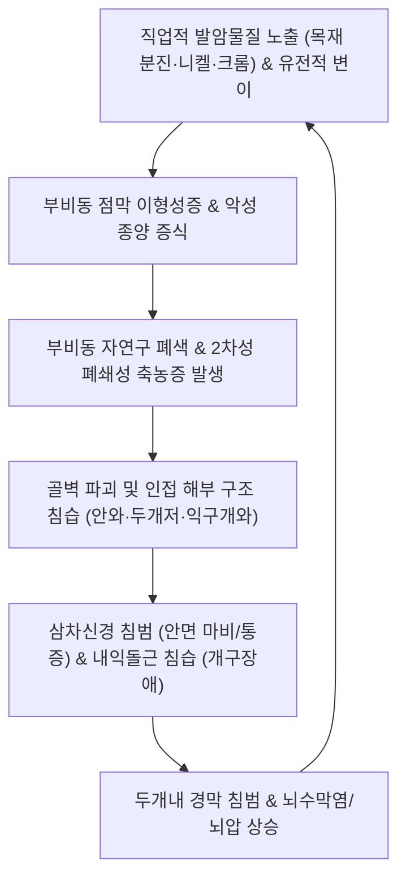

# 🩺 부비동암 (Sinonasal Malignancies / 鼻淵惡證·鼻衄)

> **핵심 3줄 요약 (Key Summary)**:
> - 📍 병소 부위 & 해부·병태생리: 비강(Nasal cavity) 및 상악동·사골동·접형동·전두동의 부비동 상피 및 간엽 조직에서 발생하는 희귀 악성 종양군으로, 편평상피세포암(SCC, 50~60%), 선암(Adenocarcinoma), 선양낭포암(ACC), 후각신경모세포종(Esthesioneuroblastoma), 비분화암(SNUC)이 대표적이며 안와 및 전두개저(Anterior skull base) 침습이 핵심 병소이다.
> - 🚩 전형적 임상 양상: 초기에는 단순 비염이나 부비동염과 유사한 편측성 코막힘, 장액성 비루로 오인되기 쉬우나, 진행 시 편측성 혈성 비루(반복성 코피), 안면부 감각이상(삼차신경 침범), 안구 돌출·복시, 치아 흔들림 및 개구장애가 나타난다.
> - 🛠️ 핵심 검사 & 치료 전략: 비내시경 하 조직 생검 및 조영 증강 안면부/경부 CT·MRI로 병기를 결정(TNM 분류)하며, 근치적 내시경 두개안면 절제술(Endoscopic craniofacial resection), 수술 후 강도변조방사선치료(IMRT) 및 유도/병용 항암화학요법(Cisplatin 기반)을 시행하고, 한의학적으로는 수술 및 항암방사선 치료 후 부작용 완화와 면역 조절(보기보혈, 청열해독, 생맥산·보중익기탕)을 통합 적용한다.
> - ⚠️ 응급 의뢰 레드플래그: 성인에서 새롭게 발생한 비대칭적 편측성 비폐색 및 난치성 혈성 비루, 급격한 시력 저하 및 외안근 마비(복시), 삼차신경 제2지(V2) 영역의 안면부 저림/감각 소실, 구개부 궤양 및 상악 치아의 급격한 유동성 관찰 시 즉시 상급병원 두경부종양 다학제 센터로 응급 의뢰한다.

---

## 📌 목차
1. [질환 개요 & 해부학적 병태생리](#1--질환-개요---해부학적-병태생리)
2. [병태생리 메커니즘 & 생체역학적 악순환 네트워크](#2--병태생리-메커니즘---생체역학적-악순환-네트워크)
3. [임상 증상 & 이학적 검사(Physical Exam) 알고리즘](#3--임상-증상---이학적-검사-physical-exam--알고리즘)
4. [감별 진단 매트릭스 (Differential Diagnosis)](#4--감별-진단-매트릭스--differential-diagnosis-)
5. [한의 통합 치료 프로토콜 (침·약침·추나·한약)](#5--한의-통합-치료-프로토콜--침-약침-추나-한약-)
6. [양방 치료 & 병용·의뢰 기준 (Conventional Treatment & Referral)](#6-양방-치료--병용의뢰-기준-conventional-treatment--referral)
7. [재활 운동 & 생활습관 티칭 가이드](#7--재활-운동---생활습관-티칭-가이드)
8. [💡 사용자 진료실 핵심 필기 & 임상 노하우 (Melt-In 잔여 심화 집약)](#8----사용자-진료실-핵심-필기---임상-노하우--melt-in-잔여-심화-집약-)
9. [출처 및 학술 참고 문헌 (References)](#9--출처-및-학술-참고-문헌--references-)

---

## 1. 질환 개요 & 해부학적 병태생리

### 1) 질환 정의 및 분류
* **정의**: 부비동암(Sinonasal Cancer)은 비강과 비부비동(상악동, 사골동, 접형동, 전두동)의 점막 상피 및 심부 결합조직에서 기원하는 악성 신생물이다. 전체 두경부암의 약 3~5%를 차지하는 비교적 드문 질환이나, 해부학적으로 뇌 및 안구와 인접하여 조기 진단이 어렵고 치명률이 높다.
* **조직학적 분류**:
  * **편평상피세포암 (Squamous Cell Carcinoma, SCC)**: 가장 흔하며(약 50~60%) 상악동에서 호발.
  * **장형 선암 (Intestinal-type Adenocarcinoma, ITAC)**: 목재 분진, 가죽 분진 노출과 밀접하며 사골동 호발.
  * **선양낭포암 (Adenoid Cystic Carcinoma, ACC)**: 타액선 기원으로 신경주위 침습(Perineural invasion) 성향이 매우 강함.
  * **비분화암 (Sinonasal Undifferentiated Carcinoma, SNUC)**: 극도로 침습적이며 급속 진행(Scholfield et al., 2026).
  * **후각신경모세포종 (Esthesioneuroblastoma)**: 사골판(Cribriform plate) 후각 상피 기원.

### 2) 비부비동 해부학 및 침습 경로
* **상악동 (Maxillary sinus)**:
  * 상벽(안와하벽), 내벽(비강 측벽), 후벽(익구개와, Pterygopalatine fossa), 하벽(치조골 및 경구개).
  * 후벽 파괴 시 익구개와 및 측두하와(Infratemporal fossa)로 파급되어 삼차신경과 내익돌근을 침범한다.
* **사골동 (Ethmoid sinus)**:
  * 상벽은 전두개저(두개내 전두엽)와 접하고 외벽은 안와의 지판(Lamina papyracea)과 접하여 안와 및 두개강 침범의 최단 경로이다.
* **신경 주행**:
  * 안와하신경(Infraorbital nerve, V2 분지) 침범 시 동측 뺨과 윗입술의 감각 마비 발생.

---

## 2. 병태생리 메커니즘 & 생체역학적 악순환 네트워크

### 1) 무증상 잠복과 골파괴 기전
* 부비동 내부는 공기로 채워진 넓은 공간이므로, 종양이 상당한 크기로 자라 주변 뼈 벽(골피질)을 침식하고 파괴할 때까지 통증 없이 단순 비염 증상만 유발한다. 이로 인해 초진 환자의 70% 이상이 이미 T3~T4 국소 진행성 병기로 내원한다.

### 2) 신경주위 침습 (Perineural Spread)
* 특히 선양낭포암(ACC)은 삼차신경 분지(V1, V2)를 따라 두개저의 정원공(Foramen rotundum)이나 난원공(Foramen ovale)을 통해 두개강 내로 침투하는 독특한 생물학적 악성도를 보인다.

---

## 3. 임상 증상 & 이학적 검사(Physical Exam) 알고리즘

### 1) 주요 임상 양상
* **비강 증상**: 편측성 코막힘, 편측성 악취를 동반한 혈성 비루, 빈번한 코피.
* **안면 및 구강 징후**: 동측 뺨의 팽륜 및 둔탁한 통증, 윗입술 감각 저하, 상악 대구치 흔들림, 의치(틀니)가 맞지 않음.
* **안과 증상**: 안구 돌출(Proptosis), 복시, 안구 운동 장애, 시력 감퇴, 유루증(눈물흘림증).
* **신경계 징후**: 개구장애(Trismus), 전두부/안와 심부 통증, 뇌신경 마비.

### 2) 이학적 진찰 및 진단 알고리즘
* **비내시경 검사 (Nasal Endoscopy)**: 중비도나 후비공 부위에 궤양을 동반하거나 쉽게 출혈하는 불규칙한 종괴 확인 후 즉각적인 조직 생검.
* **영상 진단**:
  * **조영 증강 CT**: 뼈 침식(Bone erosion), 지판 및 두개저 골 결손 평가.
  * **조영 증강 MRI**: 종양과 저류된 분비물의 감별, 신경주위 침습, 안와 및 경막 침범 범위 정밀 확인.
* **경부 초음파 및 PET-CT**: 경부 림프절 전이 및 원격 전이(폐, 골) 병기 설정.

---

## 4. 감별 진단 매트릭스 (Differential Diagnosis)

| 감별 질환 | 핵심 감별점 및 특징 | 구체적 차이점 |
| :--- | :--- | :--- |
| **만성 비부비동염 ([[부비동염]])** | 양측성 농성 비루, 코막힘, 안면 압박감 | 골파괴 없이 자연구 폐쇄 중심이며 항생제에 부분 반응 |
| **반전성 유두종 (Inverted Papilloma)** | 편측성 비종괴, 국소 골재형성 | 조직학적으로 양성이나 악성 전환율(5~10%)이 있어 수술적 제거 필수 |
| **진균성 부비동염 (Fungal Ball)** | 편측성 상악동 침범, CT 상 고음영 석회화 | 석회화 이물질 소견 중심이며 악성 세포 침윤 부재 |
| **비인두암 (Nasopharyngeal Cancer)** | 비인두 후벽/이관 개구부 침범, 이명, 경부 림프절 비대 | EBV 연관성이 높으며 부비동 골파괴보다 비인두 점막 병변 |
| **치성 상악동염** | 상악 치아 감염으로 인한 이차성 축농증 | 치아 방사선 상 치근단 병변 확인, 악성 골파괴 없음 |

---

## 5. 한의 통합 치료 프로토콜 (침·약침·추나·한약)

### 1) 통합 종양학적 접근 원칙
* 부비동암은 외과적 절제와 방사선 치료가 필수적인 중증 암 질환이다. 한의 치료는 근치적 치료의 보조요법으로서 **수술 후 상처 치유 촉진, 항암방사선 치료의 부작용(구강건조증, 방사선 점막염, 식욕부진) 완화, 면역 증강**을 목표로 한다.

### 2) 변증 분류
* **열독치성(熱毒熾盛)**: 코피가 자주 나고 구취가 심하며 안면 발적과 극심한 두통이 있음. (설홍태황조, 맥삭)
* **담어결취(痰瘀結聚)**: 안면 종괴가 단단하고 감각이 둔하며 목에 어혈과 담음이 정체됨. (설암어반, 맥현삽)
* **기혈양허(氣血兩虛)**: 수술 및 항암 치료 후 극심한 피로, 빈혈, 체중 감소, 면역 저하. (설담태백, 맥세약)
* **기음양허(氣陰兩虛)**: 방사선 치료 후 구강 건조, 인후 통증, 미열, 마른기침. (설홍소태, 맥세삭)

### 3) 침구 치료
* **주요 혈위**: [[합곡]](LI4), [[곡지]](LI11), [[족삼리]](ST36), [[삼음교]](SP6), [[태충]](LR3), [[풍지]](GB20), [[염천]](CV23), [[승읍]](ST1), [[지창]](ST4), [[협거]](ST6).
* **자침 기법**:
  * 구강건조증 완화: 염천, [[지창]], [[협거]] 자침으로 타액선 분비 자극.
  * 항암 후 면역 및 기력 회복: 족삼리, 삼음교, 합곡에 보법(補法) 자침.
  * 종양 국소 부위 직접 침습 자침은 절대 금기(출혈 및 파종 위험).

### 4) 약침 치료
* **자하거 약침**: 기혈양허형 환자의 전신 쇠약 및 방사선 치료 후 골수 억제 완화를 위해 족삼리(ST36), [[비수]](BL20)에 각 0.5cc 주입.
* **황련해독탕 약침**: 원위 혈위(곡지, 풍지)에 소량 시술하여 항암 후 염증 반응 완화.

### 5) 한약 처방 프로토콜
* **[[보중익기탕]](補中益氣湯) / [[십전대보탕]](十全大補湯)**: 항암화학요법 및 방사선 치료 후 기혈 쇠약, 식욕부진, 호중구 감소 완화.
* **[[생맥산]](生脈散) 합 증액탕**: 방사선 치료로 인한 점막 위축 및 극심한 구강 건조증 개선.
* **[[선방활명음]](仙方活命飮)**: 열독형 국소 염증 및 연조직 종창 완화.

---

## 6. 양방 치료 & 병용·의뢰 기준 (Conventional Treatment & Referral)

### 1) 수술적 치료 (Surgical Resection)
* **내시경 두개안면 절제술 (Endoscopic Craniofacial Resection, Goh et al., 2026)**: 전두개저와 안와를 보존하면서 종양을 경비강 내시경으로 일괄 절제.
* **상악 절제술 (Maxillectomy)**: 종양 범위에 따라 부분, 전, 또는 안와 내용 제거술(Orbital exenteration) 병행.

### 2) 방사선 및 항암화학요법
* **강도변조방사선치료 (IMRT) / 양성자 치료 (Proton Therapy)**: 시신경과 뇌간을 보호하면서 고선량 방사선 조사.
* **전신 항암 치료**: Cisplatin 기반 복합 화학요법 또는 전이성/재발성 환자에서 면역관문억제제 및 표적치료제 고려(Roberts et al., 2026).

### 3) 응급 전원 기준
* 성인에서 이유 없는 편측성 코막힘과 혈성 비루가 2주 이상 지속될 때.
* 급격한 시력 저하, 복시, 안구 돌출 동반 시.
* 상악 치아의 급격한 흔들림 및 뺨의 감각 마비 발생 시.

---

## 7. 재활 운동 & 생활습관 티칭 가이드

* **비강 내 생리식염수 세척**: 수술 및 방사선 치료 후 비점막 섬모 기능 회복 및 가피 형성을 억제하기 위해 하루 3~4회 세척.
* **연하 및 발음 재활**: 상악 절제술 후 폐쇄장치(Obturator) 착용 훈련 및 연하 훈련.
* **직업적 발암물질 차단**: 목재, 가죽, 중금속 취급 작업 시 방진 마스크 착용 철저.

---

## 8. 💡 사용자 진료실 핵심 필기 & 임상 노하우 (Melt-In 잔여 심화 집약)

* **진료실 암 조기 발견을 위한 '비대칭의 법칙'**:
  * 일반적인 알레르기 비염이나 축농증은 대개 양측성으로 오거나 좌우가 번갈아 막힌다.
  * 40대 이상 환자가 "한쪽 코만 몇 달째 꽉 막히고, 풀면 피가 섞여 나와요"라고 한다면 축농증 침 치료를 할 것이 아니라 그 자리에서 즉시 이비인후과 의뢰서를 발급해야 한다. 조기 발견이 환자의 안구와 생명을 살린다.

---

## 9. 출처 및 학술 참고 문헌 (References)

1. Roberts TJ. (2026). Advances in Systemic Therapies for Rare Head and Neck Malignancies: Spotlight on Adenoid Cystic Carcinoma, Differentiated Thyroid Cancer, and Sinonasal/Paranasal Tumors. *Am Soc Clin Oncol Educ Book*. PMID: 42462190

2. Scholfield DW. (2026). Long-Term Outcomes of IDH2-Mutant Sinonasal Carcinomas Compared With IDH2-Wild Type Sinonasal Undifferentiated Carcinoma. *Head Neck*. PMID: 42855994

3. Goh JCI. (2026). Endoscopic Craniofacial Resection for Anterior Skull Base Tumors: A Singapore Center Review. *J Craniofac Surg*. PMID: 42439840

---

## 관련 노트

- [[_의학/03_이론/질환/이비인후·안과 질환/코·부비동/부비동염|부비동염]]
- [[_의학/03_이론/질환/호흡기 질환/상기도/비염|비염]]
- [[_의학/00_기본의학/01. 레드플래그·응급 감별/척수증·마미증후군_선별_2026-10-12|레드플래그 선별]]
- [[_의학/03_이론/치료기법/추나|추나]]
