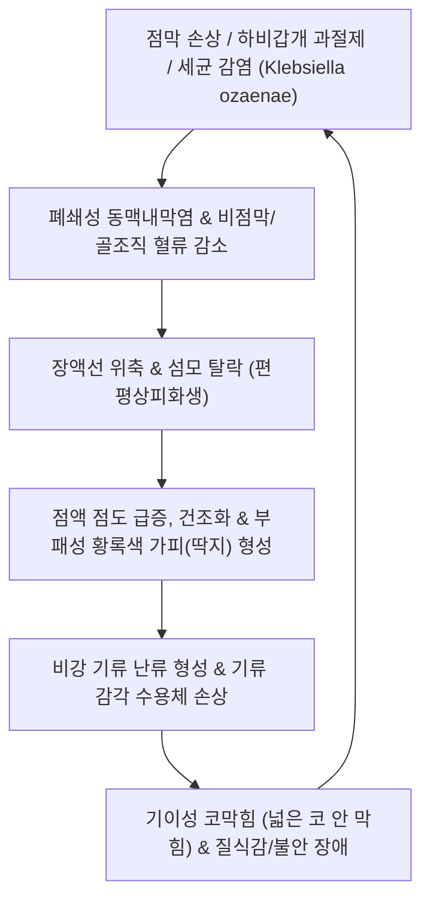

# 🩺 위축성 비염 (Atrophic Rhinitis / 鼻臭·鼻槁)

> **핵심 3줄 요약 (Key Summary)**:
> - 📍 병소 부위 & 해부·병태생리: 비강 점막 및 하비갑개·중비갑개 해면상 발기조직, 골조직의 점진적 위축과 건조화가 진행되는 만성 염증성 비질환으로, 섬모 상피의 편평상피 화생(Squamous metaplasia), 점막하 혈관의 폐쇄성 동맥내막염, 점액 분비선 퇴화 및 *Klebsiella ozaenae* 세균 감염에 의한 부패성 악취가 핵심 병소이다.
> - 🚩 전형적 임상 양상: 비강이 휑하게 넓어져 있음에도 불구하고 극심한 코막힘을 느끼는 '기이성 코막힘(Paradoxical nasal obstruction)', 두껍고 단단한 황록색 가피(딱지) 형성, 타인에게는 진동하나 본인은 후각 상실로 맡지 못하는 심한 악취(비취증, Ozaena), 비출혈, 인두 건조감이 주소증이다.
> - 🛠️ 핵심 검사 & 치료 전략: 전비경 및 비내시경 검사(넓은 비강, 위축된 비갑개, 건조 가피 관찰) 및 부비동 CT(골위축 확인)로 진단하며, 대량 생리식염수 비강 세척, 가피 연화제(글리세린/비타민 A/D 연고), 혈소판풍부혈장(PRP) 국소 주입 또는 점막하 비강 축소술(구조 재건)과 함께 한의학적 자음윤조(滋陰潤燥)·선폐통규(맥문동탕, 사물탕가감방, 신이산), 비강 습윤 한방 연고(자운고/황련고) 요법을 적용한다.
> - ⚠️ 응급 의뢰 레드플래그: 하비갑개 과도 절제술 후 발생한 빈코증후군(Empty Nose Syndrome, ENS) 환자의 극심한 호흡 공포·질식감에 따른 중증 우울증 및 자살 사고, 두개저 및 안와로 파급되는 침습성 진균 감염증, 뇌수막염 합병 징후 관찰 시 즉시 이비인후과 및 정신건강의학과로 전원한다.

---

## 📌 목차
1. [질환 개요 & 해부학적 병태생리](#1--질환-개요---해부학적-병태생리)
2. [병태생리 메커니즘 & 생체역학적 악순환 네트워크](#2--병태생리-메커니즘---생체역학적-악순환-네트워크)
3. [임상 증상 & 이학적 검사(Physical Exam) 알고리즘](#3--임상-증상---이학적-검사-physical-exam--알고리즘)
4. [감별 진단 매트릭스 (Differential Diagnosis)](#4--감별-진단-매트릭스--differential-diagnosis-)
5. [한의 통합 치료 프로토콜 (침·약침·추나·한약)](#5--한의-통합-치료-프로토콜--침-약침-추나-한약-)
6. [양방 치료 & 병용·의뢰 기준 (Conventional Treatment & Referral)](#6-양방-치료--병용의뢰-기준-conventional-treatment--referral)
7. [재활 운동 & 생활습관 티칭 가이드](#7--재활-운동---생활습관-티칭-가이드)
8. [💡 사용자 진료실 핵심 필기 & 임상 노하우 (Melt-In 잔여 심화 집약)](#8----사용자-진료실-핵심-필기---임상-노하우--melt-in-잔여-심화-집약-)
9. [출처 및 학술 참고 문헌 (References)](#9--출처-및-학술-참고-문헌--references-)

---

## 1. 질환 개요 & 해부학적 병태생리

### 1) 질환 정의 및 분류
* **정의**: 위축성 비염(Atrophic Rhinitis)은 비강 점막의 섬모 상피, 장액 점액선, 하비갑개의 해면정맥동 및 기저 골조직이 서서히 소실되고 위축되어 비강이 비정상적으로 확장되면서 건조, 가피(딱지), 악취, 코막힘을 초래하는 만성 질환이다.
* **분류**:
  * **원발성 위축성 비염 (Primary Atrophic Rhinitis, Ozaena)**: 유전적 요인, 영양 결핍(철분, 비타민 A/D), *Klebsiella pneumoniae subsp. ozaenae* 감염 등이 관여하며 저개발국 및 젊은 여성에서 호발.
  * **속발성 위축성 비염 (Secondary Atrophic Rhinitis)**: 비후성 비염 수술 시 하비갑개의 과도한 광범위 절제(과도한 비갑개 절제술, Turbinate surgery, Kim et al., 2026), 부비동 수술 후 합병증, 방사선 치료 후 점막 손상, 육아종성 질환(육아종성 다발혈관염, 매독 등)에 의해 발생.
  * **빈코증후군 (Empty Nose Syndrome, ENS, Rosch et al., 2026)**: 하비갑개 결손으로 비강 기류 감각 수용체가 파괴되어 해부학적으로는 개방되어 있으나 주관적으로 질식감을 느끼는 심각한 의인성 형태.

### 2) 비강 점막 해부학 및 생리학적 파탄
* **호흡기 섬모 상피의 탈락**: 정상 위중층 섬모 원주 상피가 건조와 염증으로 인해 방어 기능이 없는 편평상피로 화생(Squamous metaplasia)된다.
* **비강 기류 역학 붕괴**: 정상적으로는 비갑개가 좁은 틈을 형성하여 층류(Laminar flow)를 만들고 온도와 습도를 조절하지만, 비강이 지나치게 넓어지면 들이마신 공기가 소용돌이(Turbulent flow)를 일으켜 점막을 급격히 건조시킨다.
* **삼차신경 기류 감각 수용체 소실**: 비점막의 냉감 수용체(TRPM8)가 공기 흐름을 뇌로 전달하지 못해 뇌는 '숨을 전혀 쉬지 못하고 있다'고 착각하여 심각한 호흡 공포를 유발한다.

---

## 2. 병태생리 메커니즘 & 생체역학적 악순환 네트워크

### 1) 폐쇄성 동맥내막염과 허혈성 위축
* 점막하 소동맥의 내피세포 증식과 유리질화로 혈관 내강이 좁아져 비점막과 뼈로 가는 혈류가 차단된다. 이로 인해 하비갑개 골질이 흡수되어 비강 내부가 휑하게 뚫린 동굴처럼 변한다.

### 2) 세균성 부패와 악취 (Ozaena)
* 점액 정체와 섬모 청소 부전으로 인해 단백질 분해 혐기성 세균이 증식하여 특유의 역겹고 달콤하면서도 썩은 냄새(Fetid odor)를 풍기지만, 환자는 후각 상피 위축으로 냄새를 맡지 못한다.

---

## 3. 임상 증상 & 이학적 검사(Physical Exam) 알고리즘

### 1) 주요 임상 양상
* **기이성 코막힘 (Paradoxical Obstruction)**: 코로 공기가 드나드는 감각이 없어 질식할 것 같은 고통 호소.
* **비취증 (Ozaena)**: 타인이 견디기 힘든 악취(주변 사람이 먼저 알아챔).
* **악취성 건조 가피**: 비강 전체를 메우는 두꺼운 녹갈색 또는 황색 딱지.
* **후각 상실 (Anosmia) 및 미각 저하**: 후각 점막 파괴.
* **비출혈 및 인두 건조**: 가피를 억지로 떼어낼 때 발생하는 점막 찰과 출혈, 만성 위축성 인두염 병발.

### 2) 이학적 진찰 및 진단 도구
* **전비경 및 비내시경 검사**:
  * 비강 내강이 비정상적으로 넓어져 비인두 후벽이 훤히 들여다보임.
  * 하비갑개 및 중비갑개가 얇은 융기 수준으로 축소되어 있거나 완전히 소실됨.
  * 악취 나는 두꺼운 가피가 비강 측벽과 중격에 고착되어 있음.
* **부비동 단순 X선 및 CT**:
  * 비강 외측벽의 골소실, 비갑개 뼈의 소실, 상악동 점막 비후 관찰.
* **비강 통기도 검사 (Rhinomanometry)**: 비강 저항은 매우 낮으나 환자의 주관적 코막힘 점수는 극도로 높음.

---

## 4. 감별 진단 매트릭스 (Differential Diagnosis)

| 감별 질환 | 핵심 감별점 및 특징 | 구체적 차이점 |
| :--- | :--- | :--- |
| **만성 비후성 비염** | 하비갑개 점막의 비가역적 증식과 비대 | 비강이 좁아져 있으며 건조 가피나 악취 없음 |
| **비중격 천공증** | 비중격 연골/골 결손으로 양측 비강이 통함 | 천공 부위 주변 국소 가피와 호각음(휘파람 소리) 발생 |
| **육아종성 다발혈관염 (Wegener)** | 비점막 궤양, 안비(Saddle nose) 기형, 신장 침범 | c-ANCA 양성, 전신 혈관염 증상 동반 |
| **비부비동 매독 / 결핵** | 심한 골파괴와 궤양성 결절 형성 | 혈청 매독 검사(VDRL/FTA-ABS) 및 항산균 배양으로 감별 |
| **단순 만성 위축성 인두염** | 인후부 건조와 이물감 위주 | 비강 내 비갑개 위축 및 가피 형성 부재 |

---

## 5. 한의 통합 치료 프로토콜 (침·약침·추나·한약)

### 1) 변증 분류
* **폐열진휴(肺熱津虧)**: 코안이 몹시 마르고 화끈거리며 열감이 있고 딱지가 마르고 비출혈이 잦음. (설홍소태, 맥세삭)
* **음허폐조(陰虛肺燥)**: 비강 건조감이 극심하고 인후가 마르며 마른기침을 하고 혀가 붉음. (설홍소진, 맥세삭)
* **비폐기허(脾肺氣虛)**: 만성적인 피로와 소화기 무력증이 동반되며 콧살이 힘없이 위축됨. (설담태박, 맥세약)
* **혈허어조(血虛瘀阻)**: 비점막 혈색이 창백하고 딱지가 검붉으며 후각이 완전히 상실됨. (설암태백, 맥삽)

### 2) 침구 치료
* **주요 혈위**: [[영향]](LI20), [[비통]](EX-HN8), [[인당]](EX-HN3), [[합곡]](LI4), [[열결]](LU7), [[척택]](LU5), [[태계]](KI3), [[조해]](KI6), [[족삼리]](ST36).
* **자침 기법**:
  * 비점막 혈류 개선: 비통, 영향에 천자(淺刺)하여 미세순환을 촉진하고 삼차신경 냉감 감각 회복 유도.
  * 음액 보충 및 진액 상승: 태계, 조해, 삼음교 혈위에 보법(補法) 자침.
  * 폐경락 윤조 진통: 열결, 척택 혈위 자침으로 상초의 건조열 완화.

### 3) 약침 치료
* **자하거 약침**: 비점막 및 골조직 영양 공급과 재생 촉진을 위해 풍지(GB20), 폐수(BL13)에 각 0.5cc 주입.
* **증류 황련해독탕 약침**: 비강 내 화농성 세균 억제를 위해 합곡(LI4) 및 영향(LI20) 부위에 미량 자입.

### 4) 외용 한방 연고 도포 (자운고/황련고)
* 자초, 당귀, 마유, 참기름으로 조제된 자운고(紫雲膏)를 멸균 면봉으로 비강 내벽에 얇게 도포하여 가피 연화 및 상피화 촉진.

### 5) 한약 처방 프로토콜
* **[[맥문동탕]](麥門冬湯) / [[청조구폐탕]](淸燥救肺湯)**: 폐열진휴 및 음허폐조형의 비강 건조, 마른기침, 화끈거림을 윤택하게 적셔주는 1차 처방.
* **[[사물탕]](四物탕) 합 [[신이산]]**: 혈허로 인한 점막 위축 및 영양 결핍 개선.
* **[[보중익기탕]](補中益氣湯)**: 비폐기허형 환자의 전신 진액 생성 능력 회복.
* **[[생맥산]](生脈散)**: 하기(夏期) 건조 악화 및 기음양허형 비강 건조 완화.

---

## 6. 양방 치료 & 병용·의뢰 기준 (Conventional Treatment & Referral)

### 1) 보존적 국소 치료 (표준 요법)
* **대량 생리식염수 세척**: 미온수 생리식염수(등장액 또는 저장액) 200~300ml로 하루 2~3회 세척하여 가피를 부드럽게 용해 배출.
* **가피 연화제 도포**: 25% 글리세린/포도당 용액 또는 비타민 A/D 연고 비강 도포.
* **혈소판풍부혈장 (PRP) 국소 주입**: 비점막하 자가 PRP 주사로 점막 혈관신생 및 섬모 상피 재생 유도(Asiry, 2025).

### 2) 수술적 치료 (비강 축소 및 재건술)
* **점막하 충전물 이식술 (Submucosal Implantation)**: 하비갑개 부위 점막하에 자가 연골, 골편, 또는 인공 합성 물질(실리콘, 다공성 폴리에틸렌 Medpor)을 삽입하여 비강 단면적을 좁혀 정상 층류 기류 복원.
* **영구적/일시적 외비공 폐쇄술 (Young's Procedure)**: 비강으로 들어오는 공기를 차단하여 수개월~수년간 점막 휴식 및 재생 유도.

### 3) 응급 전원 기준
* 빈코증후군(ENS)으로 인한 심각한 공황 발작, 질식 공포, 불면 및 자살 사고 발생 시 정신건강의학과 즉시 협진.
* 비강 내 침습성 진균 감염이나 골수염 의심 시 상급 이비인후과 전원.

---

## 7. 재활 운동 & 생활습관 티칭 가이드

* **비강 가습 환경 철저 유지**: 실내 습도 60% 유지, 개인용 미니 가습기 사용.
* **절대 딱지 강제 손 제거 금지**: 손가락이나 핀셋으로 가피를 강제로 뜯어내면 점막 결손과 출혈이 악화되므로 반드시 식염수 세척 후 자연 배출되도록 지도.
* **충분한 수분 섭취**: 하루 1.5~2L 미온수 음용으로 전신 진액 공급.

---

## 8. 💡 사용자 진료실 핵심 필기 & 임상 노하우 (Melt-In 잔여 심화 집약)

* **비내시경을 넣었을 때 목젖이 보이는 환자**:
  * 비내시경을 넣자마자 코 안이 뻥 뚫려 비인두 후벽이 훤히 보이는데도 환자는 "선생님, 코가 막혀서 숨을 못 쉬겠어요, 미치겠습니다"라고 호소한다.
  * 이때 "코가 이렇게 넓은데 왜 막힌다고 하세요?"라고 하면 환자는 절망한다. "코 안의 신경이 들이마시는 공기 바람을 느끼지 못해서 뇌가 코막힘으로 착각하는 병입니다"라고 신경생리학적으로 설명해주고, 자운고 도포와 식염수 세척, 맥문동탕 투여를 시작하면 환자의 불안이 가라앉는다.

---

## 9. 출처 및 학술 참고 문헌 (References)

1. Asiry AJ. (2025). Effect of Platelet-Rich Plasma Injection in Patients With Atrophic Rhinitis: A Systematic Review. *Am J Rhinol Allergy*. PMID: 40820344

2. Kim DH. (2026). Comparative Efficacy and Safety of Turbinate Surgery for Chronic Rhinitis: A Systematic Review and Network Meta-Analysis. *Clin Otolaryngol*. PMID: 42601322

3. Rosch S. (2026). Anatomical Empty Nose in Dogs and Cats After Nasal Disease or Endoscopic Endonasal Surgery: Implications for Human Empty Nose Syndrome? *Vet Clin North Am Small Anim Pract*. PMID: 42135185

---

## 관련 노트

- [[_의학/03_이론/질환/호흡기 질환/상기도/비염|비염]]
- [[_의학/03_이론/질환/이비인후·안과 질환/코·부비동/부비동염|부비동염]]
- [[_의학/02_약리/의약품/00_양방약_MOC|양방약 MOC]]
- [[_의학/03_이론/치료기법/추나|추나]]
