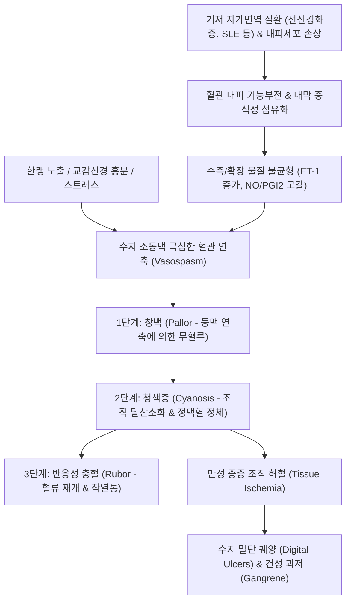

# 🩺 레이노 증후군 (Raynaud Syndrome / Secondary Raynaud Phenomenon)

> **핵심 3줄 요약 (Key Summary)**:
> - 📍 병소 부위 & 해부·병태생리: 전신 경화증, 전신 홍반성 루푸스(SLE) 등 기저 결합조직질환 또는 혈관염에 이차적으로 동반되는 수지 및 족지 미세혈관의 구조적 내피 손상, 혈관벽 비후, 과도한 혈관 연축 질환.
> - 🚩 전형적 임상 양상: 한랭 노출 또는 스트레스 시 발생하는 삼색조 변화(창백-청색-발적), 일차성 레이노병과 달리 **비대칭적 발작**, **극심한 허혈성 통증**, **손가락 끝의 함몰성 궤양(Pitting scars)** 및 조직 괴사(Gangrene).
> - 🛠️ 핵심 검사 & 치료 전략: 조갑주름 모세혈관현미경(Nailfold Videocapillaroscopy, NVC)상 거대 모세혈관 및 무혈관 구역(Avascular areas) 확인, 자가항체(ANA, anti-Scl-70, anti-centromere); 양방 칼슘채널차단제(CCB), PDE5 억제제(실데나필), 프로스타사이클린 유도체(일로프로스트), 보센탄; 한의학적으로 한응혈어(寒凝血瘀)·맥락어체(脈絡瘀滯) 변증 하에 [[당귀사역가오수유생강탕]], [[온경탕]], [[사묘용안탕]] 투여 및 합곡·태충·곡지·삼음교 자침.
> - ⚠️ 응급 의뢰 레드플래그: 급격한 손가락/발가락 말단의 흑색 괴저(Dry gangrene), 조절되지 않는 극심한 안정 시 허혈성 통증, 전신 결합조직질환의 급성 장기 부전(신위기, 폐동맥고혈압 동반).

---

## 📌 목차
1. [질환 개요 & 해부학적 병태생리](#1-질환-개요--해부학적-병태생리)
2. [병태생리 메커니즘 & 생체역학적 악순환 네트워크](#2-병태생리-메커니즘--생체역학적-악순환-네트워크)
3. [임상 증상 & 이학적 검사(Physical Exam) 알고리즘](#3-임상-증상--이학적-검사physical-exam-알고리즘)
4. [감별 진단 매트릭스 (Differential Diagnosis)](#4-감별-진단-매트릭스--differential-diagnosis)
5. [한의 통합 치료 프로토콜 (침·약침·추나·한약)](#5-한의-통합-치료-프로토콜-침약침추나한약)
6. [양방 치료 & 병용·의뢰 기준 (Conventional Treatment & Referral)](#6-양방-치료--병용의뢰-기준-conventional-treatment--referral)
7. [재활 운동 & 생활습관 티칭 가이드](#7-재활-운동--생활습관-티칭-가이드)
8. [💡 사용자 진료실 핵심 필기 & 임상 노하우 (Melt-In 잔여 심화 집약)](#8--사용자-진료실-핵심-필기--임상-노하우--melt-in-잔여-심화-집약)
9. [출처 및 학술 참고 문헌 (References)](#9-출처-및-학술-참고-문헌--references)

---

## 1. 질환 개요 & 해부학적 병태생리

* **질환의 정의 및 임상적 의의**:
  * 레이노 증후군(Raynaud Syndrome)은 기저 전신 질환(특히 자가면역 결합조직질환)이나 특정 외인성 원인에 의해 말초 소동맥 및 모세혈관의 혈류 장애가 발생하는 **이차성 레이노 현상(Secondary Raynaud Phenomenon)**을 의미한다.
  * 양성 경과를 보이는 일차성 레이노병(Raynaud Disease)과 달리, 기저 질환에 의한 **혈관 내피세포 증식, 혈관 내경 폐색, 섬유화 등 구조적 혈관병증(Structural vasculopathy)**이 동반되므로 손가락 말단의 난치성 피부 궤양과 허혈성 조직 괴사를 흔히 유발한다.

* **원인 기저 질환군**:
  * **자가면역 결합조직질환(가장 흔함, 80~90%)**:
    * **[[전신 경화증]](Systemic Sclerosis, SSc)**: 환자의 95% 이상에서 레이노 증후군이 질환의 첫 증상으로 선행함.
    * **전신 홍반성 루푸스(SLE)**: 환자의 약 30~50%에서 발생.
    * **혼합결합조직병(MCTD)** 및 쇼그렌 증후군, 피부근염/다발근염.
  * **혈관염 및 폐색성 혈관 질환**: 폐색성 혈전혈관염(버거병, Buerger's disease), 타카야수 동맥염, 죽상경화증.
  * **직업 및 약물성 요인**: 진동 공구 사용(Hand-arm vibration syndrome), 베타차단제, 에르고타민, 항암제(블레오마이신, 시스플라틴), 면역관문억제제(ICI).

* **호발 해부학적 구조와 미세혈관 병태**:
  * 수지동맥(Proper digital arteries) 및 손톱 주름(Nailfold)의 모세혈관망이 주 침범 부위이다.
  * 한랭 자극 시 정상적인 혈관 확장 물질(산화질소 NO, 프로스타사이클린 PGI2, CGRP)의 분비가 고갈되고, 강력한 혈관 수축 물질인 엔도텔린-1(Endothelin-1, ET-1)과 알파-2 아드레날린 수용체 활성이 비정상적으로 폭증하여 혈류가 완전히 차단된다.

---

## 2. 병태생리 메커니즘 & 생체역학적 악순환 네트워크

* **삼색조 혈색 변화(Triphasic Color Change)의 혈역학적 기전**:
  1. **백색 (White/Pallor, 허혈기)**: 수지 소동맥의 급격한 경련성 수축으로 모세혈관 내 혈류 공급이 전면 중단되어 피부가 시체처럼 하얗게 질림.
  2. **청색 (Blue/Cyanosis, 저산소기)**: 모세혈관과 소정맥 내에 갇힌 정체 혈액에서 산소가 조직으로 과도하게 흡수되면서 환원 헤모글로빈이 증가하여 피부가 암청색으로 변함.
  3. **적색 (Red/Rubor, 반응성 충혈기)**: 연축이 풀리면서 반동적으로 혈류가 급격히 유입되어 피부가 붉어지고 욱신거리는 작열통과 박동성 통증이 발생함.

* **미세혈관 폐색과 허혈-재관류 손상의 악순환**:
  * 연축이 반복되면서 혈관 내피세포가 박리되고 혈소판이 응집하여 미세혈전이 형성된다.
  * 재관류 시 대량의 활성산소(ROS)가 방출되어 혈관 주위 섬유화를 촉진하고, 모세혈관 벽이 파괴되어 결국 영구적인 혈류 차단과 수지 말단 피부 궤양(Digital pitting ulcer)으로 진행한다.

---

## 3. 임상 증상 & 이학적 검사(Physical Exam) 알고리즘

* **전형적 임상 증상**:
  1. **발작 양상**: 찬물, 찬바람, 냉동실 노출 또는 감정적 긴장 시 손가락이나 발가락(엄지손가락 포함 가능)의 피부색이 갑자기 창백해지며 저림, 무감각, 극심한 통증 발생.
  2. **이차성의 비대칭성 및 중증도**: 일차성과 달리 좌우 비대칭으로 나타나며, 침범 손가락이 1~2개에 국한되거나 진행 시 손가락 전체로 확산.
  3. **영양성 조직 변화**: 손톱의 변형, 세로 능선(Longitudinal ridging), 손끝의 피부 위축, 쌀알 모양의 함몰성 흉터(Digital pits), 만성 난치성 궤양, 감염, 심한 경우 흑색 건성 괴저.

* **이학적 검사 및 진단적 도구**:
  * **조갑주름 모세혈관현미경(Nailfold Videocapillaroscopy, NVC, 감별 핵심)**:
    * 4번째 손가락 손톱 주름 부위에 오일을 바르고 고배율 현미경으로 모세혈관 주름 관찰.
    * **이차성(전신경화증 패턴) 소견**: 모세혈관 루프의 거대 확장(Giant capillary, > 50μm), 미세출혈(Microhemorrhage), 모세혈관 소실 및 무혈관 구역(Avascular areas), 신생혈관 기형. (일차성은 정상 정렬).
  * **알렌 검사(Allen Test)**: 요골동맥 및 척골동맥을 동시 압박 후 손바닥의 혈류 재개통 시간을 측정하여 수지동맥 순환 장애 평가.
  * **혈액학적 및 자가면역 혈청 검사**:
    * **항핵항체 (ANA)**: 90% 이상 양성.
    * **질환 특이 항체**: Anti-Scl-70(전신경화증), Anti-Centromere(제한전신경화증/CREST), Anti-dsDNA/Sm(SLE), Anti-U1-RNP(MCTD).
    * 염증 수치(ESR, CRP) 상승 여부.

---

## 4. 감별 진단 매트릭스 (Differential Diagnosis)

| 감별 질환 | 발병 연령 및 성별 | 대칭성 및 침범 | 모세혈관현미경 (NVC) | 자가항체 (ANA) | 궤양 및 괴사 유무 |
| :--- | :--- | :--- | :--- | :--- | :--- |
| **레이노 증후군 (이차성)** | **30대 이후 호발, 남녀 모두** | **비대칭적, 엄지 침범 흔함** | **거대 모세혈관, 무혈관 구역** | **양성 (High titer)** | **흔함 (함몰 궤양, 괴저)** |
| **레이노병 (일차성)** | 15~30세 젊은 여성 | 대칭적, 양측성 (엄지 보존) | 정상 (Normal architecture) | 음성 (Negative) | 없음 (조직 괴사 절대 없음) |
| **말초동맥질환 (PAD)** | 50대 이상 흡연자, 당뇨 | 비대칭적 하지 우세 | 정상 또는 죽상경화성 | 음성 | 궤양 흔함, 파행증(Claudication) |
| **폐색성 혈전혈관염 (버거병)** | 20~40대 중증 흡연 남성 | 사지 원위부 비대칭적 | 정상 모세혈관 (동맥 혈전) | 음성 | 심한 족부 궤양, 유주성 정맥염 |
| **동창 (Chilblains/Pernio)** | 한랭 노출 후 청소년/여성 | 대칭적 홍반성 구진/결절 | 정상 | 음성 | 가려움, 작열통, 만성 궤양 드묾 |

---

## 5. 한의 통합 치료 프로토콜 (침·약침·추나·한약)

* **진료 원칙 및 한의 병기**:
  * 한의학에서 레이노 증후군은 **사역(四逆)**, **수족궐랭(手足厥冷)**, **혈비(血痺)**, **탈저(脫疽)**의 범주에 속한다.
  * 선천적 양기부족(陽氣不足) 상태에서 한습사기(寒濕邪氣)가 혈맥에 침범하여 기혈을 응체시키는 **한응혈어(寒凝血瘀)**와, 만성화되어 말초 락맥(絡脈)이 막히고 영혈(營血)이 사지 말단에 도달하지 못하는 **맥락어조(脈絡瘀阻)**를 주 병기로 파악한다.

* **침구 치료 프로토콜**:
  * **사지 말단 혈류 개통 및 개규혈**:
    * **[[합곡]](LI4)**, **[[태충]](LR3)**: 사관혈(四關穴) 배합으로 전신 기혈 순환을 촉진하고 자율신경 연축을 이완.
    * **십선혈(十宣穴) 또는 팔사혈(八邪穴)**: 손가락 끝과 손가락 사이 혈위 자침으로 국소 미세혈관 확장을 직접 유도.
    * **[[곡지]](LI11)**, **[[수삼리]](LI10)**: 상지 요골신경 및 상완동맥 혈류 순환 촉진.
    * **[[삼음교]](SP6)**, **[[혈해]](SP10)**, **[[태계]](KI3)**: 보혈활혈(補血活血), 신양(腎陽) 강화.
  * **온구(뜸) 치료**: 관원(CV4), 기해(CV6), 신수(BL23)에 간접구를 시행하여 심부 양기를 북돋움 (단, 허혈성 궤양이 있는 손가락 직접 뜸은 화상 및 괴사 위험으로 절대 금기).

* **약침 치료 프로토콜**:
  * 황련해독탕 약침 또는 중성어혈 약침을 대추(GV14), 견정(GB21), 곡지(LI11) 등 근위부 혈위에 소량 주입하여 교감신경절 과흥분을 안정시키고 혈관 염증을 조절.

* **변증별 한약 처방**:
  * **한응혈어·맥락폐색형 (寒凝血瘀 - 극심한 수족 냉증, 청색증, 자통, 설암태백, 맥침세삽)**:
    * 처방: **[[당귀사역가오수유생강탕]](當歸四逆加吳茱萸生薑湯)**.
    * 군약: 당귀, 계지, 작약, 세신, 통초, 오수유, 생강.
    * 작용: 온경산한(溫經散寒), 양혈통맥(養血通脈)하여 굳어버린 말초 미세혈관을 강력히 개통.
  * **기체혈어·담어호결형 (氣滯血瘀 - 스트레스 시 악화, 흉협고만, 수지 종창, 설어반, 맥현삽)**:
    * 처방: **[[온경탕]](溫經湯)** 합 **[[혈부축어탕]](血府逐瘀湯)**.
    * 작용: 혈액 점도를 낮추고 미세혈전 용해를 촉진.
  * **열독치성·궤양형 (熱毒熾盛 - 손끝에 궤양 발생, 극심한 작열통, 부종)**:
    * 처방: **[[사묘용안탕]](四妙勇安湯)** (금은화, 현삼, 당귀, 감초).
    * 작용: 허혈성 조직 손상 부위의 2차 세균 감염과 괴사 진행을 억제.

---

## 6. 양방 치료 & 병용·의뢰 기준 (Conventional Treatment & Referral)

* **단계별 양방 약물 치료**:
  1. **1차 약제 (경구 혈관확장제)**:
     * **디히드로피리딘계 칼슘채널차단제(CCB)**: 니페디핀 서방정(Nifedipine ER, 30~60mg/일) 또는 암로디핀(Amlodipine). 혈관 평활근을 직접 이완시켜 발작 빈도와 강도를 경감시킴.
  2. **2차 약제 (CCB 불응 또는 난치성 궤양)**:
     * **PDE5 억제제**: 실데나필(Sildenafil 20mg tid) 또는 타다라필. cGMP 분해를 억제하여 강력한 혈관 확장 유도.
     * **국소 니트로글리세린 연고**: 급성 발작 부위 도포.
  3. **3차 약제 (중증 허혈 및 수지 궤양)**:
     * **프로스타사이클린 유도체 정맥주사**: **일로프로스트(Iloprost)** 정맥 점적 주우 (궤양 치유 및 통증 완화 입증).
     * **엔도텔린 수용체 길항제(ERA)**: 보센탄(Bosentan) - 전신경화증 환자의 새로운 수지 궤양 발생 예방.
  4. **시술 및 외과적 치료**:
     * 보툴리눔 독소 국소 주사(Botulinum toxin A): 교감신경 말단 노르에피네프린 방출을 차단하여 혈관 연축 억제.
     * 흉부/수지 디지털 교감신경절제술(Digital sympathectomy): 약물에 반응하지 않는 절박 괴사 환자.

* **한의 병용 치료 가이드**:
  * CCB 복용 중인 환자는 안면 홍조, 두통, 하지 부종 등의 부작용으로 순응도가 낮아지는 경우가 많음. 이때 당귀사역탕을 병용하면 말초 혈관 탄력성을 높여 CCB 투여 용량을 줄이면서도 혈류 개선 효과를 극대화할 수 있음.

* **양방·전문과 응급 의뢰 기준 (Referral Criteria)**:
  * 🚨 **즉각적인 류마티스내과 및 혈관외과 전원 레드플래그**:
    1. 손가락이나 발가락 끝이 검게 변하는 흑색 괴저(Gangrene) 징후.
    2. 극심한 통증을 동반한 치유되지 않는 깊은 함몰성 궤양(Infected digital ulcer).
    3. 안정 시에도 손가락 혈류가 돌아오지 않고 창백 또는 청색증이 지속되는 급성 폐색(Acute limb ischemia).
    4. 전신경화증 의심 환자에서 급격한 혈압 상승, 단백뇨, 호흡곤란(신위기 및 폐고혈압 의심).

---

## 7. 재활 운동 & 생활습관 티칭 가이드

* **철저한 보온 및 한랭 노출 차단**:
  * 손만 따뜻하게 하는 것으로는 부족하며, **신체 중심부(코어) 체온을 유지**해야 교감신경 반사성 말초 수축을 막을 수 있음 (내복, 조끼, 목도리, 모자 필수).
  * 외출 시 보온 장갑(벙어리장갑 권장)과 양말을 착용하고, 핫팩을 소지함 (단, 감각 저하 부위 저온 화상 주의).
  * 냉장고 문을 열거나 찬 음료를 만질 때도 반드시 실리콘 장갑이나 오븐 장갑을 사용하도록 지도.

* **완전한 금연 (Absolute Smoking Cessation)**:
  * 니코틴은 강력한 말초혈관 수축제로, 단 한 개비의 담배로도 수지 혈류가 수 시간 동안 50% 이상 감소함. 간접흡연도 철저히 회피.

* **풍차 돌리기 운동 (Windmill Exercise)**:
  * 급성 발작 발생 시 팔을 어깨 중심으로 360도 크게 풍차처럼 빠르게 회전시키면, 원심력에 의해 혈액이 손가락 끝 모세혈관으로 강하게 밀려 내려가 연축을 신속히 해제할 수 있음.

* **정서적 이완 및 스트레스 관리**:
  * 교감신경 흥분이 발작을 촉발하므로 복식 호흡, 바이오피드백, 명상 훈련을 병행.

---

## 8. 💡 사용자 진료실 핵심 필기 & 임상 노하우 (Melt-In 잔여 심화 집약)

* **비오님 진료실 1초 감별 노하우**:
  1. **"일차성 레이노병 vs 이차성 레이노 증후군 3대 감별 공식"**:
     - ① **발병 연령**: 10~20대 젊은 여성에 대칭성이면 일차성(레이노병), 30대 이후 늦게 발병하고 손가락 1~2개만 유독 심하면 이차성(레이노 증후군).
     - ② **손톱 주름 확인**: 돋보기나 검안경으로 손톱 뿌리를 보았을 때 모세혈관이 군데군데 끊겨 붉은 핏자국(미세출혈)이 보이면 100% 전신경화증이나 루푸스 연관 이차성이다.
     - ③ **손끝의 흉터**: 손끝에 송곳으로 찌른 듯한 작은 함몰 흉터(Pitting scar)나 궤양이 단 하나라도 있다면 뒤도 돌아보지 말고 류마티스내과로 보내 자가항체(ANA)를 내야 한다.
  2. **"궤양 부위에는 침과 뜸을 대지 마라"**: "허혈로 피부가 짓무른 손가락 끝에 침을 놓거나 뜸을 뜨면 조직 괴사를 촉진하여 손가락을 절단해야 할 수도 있다. 국소 자극은 절대 금기이며, 합곡·곡지·족삼리 등 근위부 취혈과 내복약(당귀사역가오수유생강탕)으로 전신 혈류를 열어주어야 한다."
  3. **"풍차 돌리기 응급 팁을 환자에게 가르쳐라"**: "환자가 손가락이 하얗게 굳어 통증으로 울고 있을 때, 팔을 풍차처럼 빙빙 돌리게 시키면 원심력으로 혈액이 손끝으로 쏠려 수 분 내로 붉은 피가 돌며 통증이 멎는다. 진료실에서 꼭 교육해야 할 실전 티칭이다."

---

## 9. 출처 및 학술 참고 문헌 (References)

- Singh RR et al. (2026). Comment on 'effects of locally applied water-filtered infrared a irradiation adjunctive to iloprost and carbon dioxide hand baths in patients with systemic sclerosis and severe Raynaud's phenomenon - a randomized controlled trial'. *Int J Hyperthermia*. 43(1):2697188. PMID: 42411120.

- Schulz N et al. (2026). Effects of locally applied water-filtered infrared a irradiation adjunctive to iloprost and carbon dioxide hand baths in patients with systemic sclerosis and severe Raynaud's phenomenon - a randomized controlled trial. *Int J Hyperthermia*. 43(1):2653012. PMID: 41972282.

- Rehman U et al. (2026). Unusual Vascular Claudication in a Seronegative Patient: Raynaud's Phenomenon or Atypical Buerger Disease. *Cureus*. 18(9):e70192. PMID: 42860943.\n