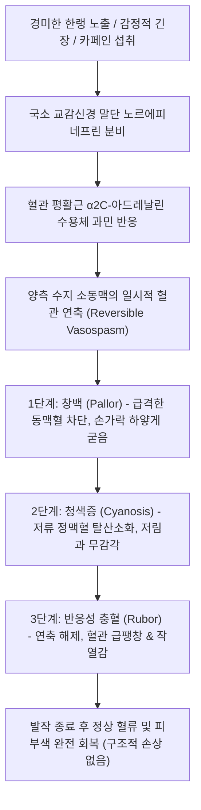

# 🩺 레이노병 (Raynaud's Disease / Primary Raynaud Phenomenon)

> **핵심 3줄 요약 (Key Summary)**:
> - 📍 병소 부위 & 해부·병태생리: 뚜렷한 기저 자가면역 질환 없이, 한랭 노출이나 정서적 스트레스에 의해 사지 말단(손가락·발가락)의 소동맥 평활근이 일시적으로 과도하게 경련성 수축(Vasospasm)을 일으키는 원발성 혈관운동 신경 기능장애.
> - 🚩 전형적 임상 양상: 15~30세 젊은 여성에서 호발하며, 추위에 노출되었을 때 양측 수지에서 **대칭적인 삼색조(창백-청색-발적)** 혈색 변화가 나타나고, **조직 괴사나 피부 궤양은 전혀 발생하지 않는 양성 경과**.
> - 🛠️ 핵심 검사 & 치료 전략: 조갑주름 모세혈관현미경(NVC) 정상, 항핵항체(ANA) 음성, ESR/CRP 정상 확인으로 이차성 레이노 증후군 배제; 비약물 요법(보온, 금연, 스트레스 조절)이 기본이며, 증상 지속 시 저용량 CCB(니페디핀); 한의학적으로 양기불달(陽氣不達)·간울기체(肝鬱氣滯) 변증 하에 [[사역산]], [[당귀사역탕]], [[계지복령환]] 투여 및 합곡·태충(사관혈) 자침.
> - ⚠️ 응급 의뢰 레드플래그: 손가락 끝의 함몰성 궤양(Pitting ulcer)이나 괴사 발생(이차성 레이노 증후군으로 진단 재분류 필요), 한쪽 손가락에만 치우친 비대칭적 발작, 30세 이후 첫 발병 및 관절통·안면 홍반 등 자가면역 증상 동반 시 류마티스내과 정밀 의뢰.

---

## 📌 목차
1. [질환 개요 & 해부학적 병태생리](#1-질환-개요--해부학적-병태생리)
2. [병태생리 메커니즘 & 생체역학적 악순환 네트워크](#2-병태생리-메커니즘--생체역학적-악순환-네트워크)
3. [임상 증상 & 이학적 검사(Physical Exam) 알고리즘](#3-임상-증상--이학적-검사physical-exam-알고리즘)
4. [감별 진단 매트릭스 (Differential Diagnosis)](#4-감별-진단-매트릭스--differential-diagnosis)
5. [한의 통합 치료 프로토콜 (침·약침·추나·한약)](#5-한의-통합-치료-프로토콜-침약침추나한약)
6. [양방 치료 & 병용·의뢰 기준 (Conventional Treatment & Referral)](#6-양방-치료--병용의뢰-기준-conventional-treatment--referral)
7. [재활 운동 & 생활습관 티칭 가이드](#7-재활-운동--생활습관-티칭-가이드)
8. [💡 사용자 진료실 핵심 필기 & 임상 노하우 (Melt-In 잔여 심화 집약)](#8--사용자-진료실-핵심-필기--임상-노하우--melt-in-잔여-심화-집약)
9. [출처 및 학술 참고 문헌 (References)](#9-출처-및-학술-참고-문헌--references)

---

## 1. 질환 개요 & 해부학적 병태생리

* **질환의 정의 및 임상적 특징**:
  * 레이노병(Raynaud's Disease)은 기저 전신 질환(결합조직병, 혈관염 등)이 없는 상태에서 발생하는 **일차성/원발성 레이노 현상(Primary Raynaud Phenomenon)**이다.
  * 전체 레이노 현상 환자의 약 80~90%를 차지하는 매우 흔한 기능성 혈관 질환으로, 인구의 약 3~5%(한랭 지역에서는 10% 이상)에서 관찰된다.
  * 혈관 내막의 구조적 폐색이나 기질적 병변이 없으며, 순수한 신경혈관성 기능부전에 기인하므로 영구적인 조직 괴사나 허혈성 흉터를 남기지 않는 **완전한 양성(Benign) 질환**이다.

* **호발 인구 및 해부학적 구조**:
  * 15~30세 사이의 젊은 여성에서 호발(남녀비 약 1:5~1:9)하며, 초경 전후에 시작되어 폐경 후 호전되는 양상을 보이기도 한다.
  * 양측 손의 2~5번째 손가락(수지동맥 및 모세혈관망)에 대칭적으로 호발하며, 엄지손가락(Thumb)은 혈류 공급이 풍부하여 침범되지 않거나 증상이 경미한 경우가 많다. 발가락, 코끝, 귓바퀴 등에도 동반될 수 있다.

* **혈관 운동성 자율신경계 병태**:
  * 정상인의 경우 한랭 노출 시 중심부 체온을 보존하기 위해 피부 혈관이 적절히 수축하지만, 레이노병 환자는 국소 소동맥의 **알파-2 아드레날린 수용체(α2-adrenergic receptor)**가 과민하게 활성화되어 사소한 온도 변화나 가벼운 스트레스에도 수지동맥이 완전히 수축하여 혈류가 일시적으로 차단된다.

---

## 2. 병태생리 메커니즘 & 생체역학적 악순환 네트워크

* **삼상성(또는 이상성) 혈관 운동 주기**:
  1. **창백기 (Pallor, 동맥 연축기)**: 한랭 자극 즉시 수지동맥이 경련을 일으켜 모세혈관으로의 혈액 유입이 정지됨. 손가락이 분필처럼 하얗게 변하며 감각이 무뎌짐.
  2. **청색증기 (Cyanosis, 정맥 정체기)**: 정체된 모세혈관 혈류에서 산소가 빠져나가 탈산소화 헤모글로빈이 집적됨. 손가락이 파랗게 질리고 저림증과 뻐근한 통증이 발생함.
  3. **발적기 (Rubor, 반응성 충혈기)**: 따뜻한 환경으로 들어가거나 자극이 사라지면 혈관이 반동적으로 확장되면서 일시적으로 다량의 혈액이 밀려들어와 붉어지며 화끈거리는 열감과 욱신거림을 호소함.

* **이차성과의 결정적 병태생리 차이**:
  * 이차성 레이노 증후군과 달리 혈관벽의 섬유성 증식, 내피 손상, 혈전 형성이 없으므로, 발작이 끝나면 혈류와 모세혈관 구조가 100% 정상으로 복구된다.

---

## 3. 임상 증상 & 이학적 검사(Physical Exam) 알고리즘

* **전형적 임상 증상**:
  1. **대칭적 발작**: 양측 손가락(주로 검지, 중지, 약지)에 대칭적으로 발생.
  2. **경미한 통증 및 감각 이상**: 손가락 끝이 시리고 저리며 뻣뻣한 느낌이 주를 이루며, 이차성과 같은 극심한 찢어지는 듯한 허혈성 통증은 드묾.
  3. **정상 피부 및 손발톱**: 발작 간헐기에는 피부가 완전히 정상이며, 손톱의 변형, 위축, 궤양, 흉터가 전혀 관찰되지 않음.

* **일차성 레이노병의 표준 진단 기준 (LeRoy & Medsger Criteria)**:
  * 다음 5가지 조건을 모두 만족해야 일차성으로 진단 확정:
    1. 한랭이나 스트레스에 의해 유발되는 양측 대칭성의 혈색 변화 발작.
    2. 수지의 괴사, 궤양, 영양성 변화(Pitting scars)가 전혀 없음.
    3. **조갑주름 모세혈관현미경(NVC) 검사 정상** (모세혈관 확장, 거대혈관, 소실 없음).
    4. **항핵항체(ANA) 음성** (자가면역 항체 불검출).
    5. 적혈구침강속도(ESR) 및 CRP 등 염증 수치 정상.

* **이학적 검사**:
  * 말초 동맥 맥박(요골동맥, 척골동맥, 족배동맥) 촉진: 정상 맥박 확인.
  * 손톱 주름 육안 시진: 출혈점이나 모세혈관 비후 없음 확인.

---

## 4. 감별 진단 매트릭스 (Differential Diagnosis)

| 감별 질환 | 호발 연령 | 침범 양상 | 궤양 / 괴사 | 모세혈관현미경 | 자가항체 (ANA) | 예후 |
| :--- | :--- | :--- | :--- | :--- | :--- | :--- |
| **레이노병 (일차성)** | **15~30세 여성** | **양측 대칭성, 엄지 보존** | **절대 없음** | **정상 (Normal)** | **음성 (Negative)** | **매우 양호 (기능성)** |
| **레이노 증후군 (이차성)** | 30세 이후 남녀 | 비대칭적, 엄지 침범 | 흔함 (함몰 궤양) | 거대 모세혈관, 무혈관 구역 | 양성 (High titer) | 진행성 (조직 괴사 위험) |
| **말초한랭증 (Acrocyanosis)** | 젊은 여성 | 지속적인 사지 청색증 | 없음 | 정상 | 음성 | 발작성 아님, 항상 차갑고 땀남 |
| **망상청반 (Livedo reticularis)** | 전 연령 | 그물 모양의 청자색 피부 | 드묾 | 정상 또는 혈관염 | 음성 또는 APS 양성 | 그물망 혈관 무늬, 온수 시 소실 |
| **홍통증 (Erythromelalgia)** | 성인 | 열 노출 시 극심한 발적/작열통 | 드묾 | 정상 | 음성 | 추위가 아닌 열에 악화됨 |

---

## 5. 한의 통합 치료 프로토콜 (침·약침·추나·한약)

* **진료 원칙 및 한의 병기**:
  * 한의학에서 레이노병은 **사역(四逆)**, **수족궐랭(手足厥冷)**, **양미(陽微)**의 범주에 속한다.
  * 기질적 어혈보다는, 정서적 스트레스로 인해 간기(肝氣)가 울결되어 기운이 사지 말단으로 뻗어나가지 못하는 **간울기체·양기불달(肝鬱氣滯·陽氣不達)**과, 비위(脾胃) 기능 허약으로 사지에 기혈을 공급하지 못하는 **비양허(脾陽虛)**를 주 병기로 파악한다.

* **침구 치료 프로토콜**:
  * **[[자율신경계]] 조절 및 사지 개규 배혈**:
    * **[[합곡]](LI4)**, **[[태충]](LR3)**: 사관혈(四關穴) 자침으로 간울(肝鬱)을 풀고 말초 혈관 수축을 신속히 이완.
    * **[[내관]](PC6)**, **[[외관]](TE5)**: 심포경과 삼초경을 소통시켜 교감신경 흥분을 안정화.
    * **[[족삼리]](ST36)**, **[[삼음교]](SP6)**: 비위 생화지원을 돕고 하지 혈류 순환 개선.
    * **[[팔사]](EX-UE9)**: 손가락 사이 혈위 천자로 국소 미세순환을 촉진.
  * **온구(뜸) 요법**: 기해(CV6), 관원(CV4), 족삼리(ST36)에 간접구를 시행하여 양기를 온후(溫煦)시킴.

* **변증별 한약 처방**:
  * **양기불달·사역형 (陽氣不達 - 손발이 얼음장처럼 차고, 스트레스 시 악화, 설담태백, 맥현세)**:
    * 처방: **[[사역산]](四逆散)** (시호, 작약, 지실, 감초) 또는 **[[당귀사역탕]](當歸四逆湯)**.
    * 작용: 간기를 소통시켜 막혀 있는 양기를 사지 말단으로 방출(투달양기, 透達陽氣)하여 혈관 경련을 해제.
  * **기체어혈형 (氣滯瘀血 - 손가락 청색증, 뻐근한 통증, 월경통 동반, 설암, 맥삽)**:
    * 처방: **[[계지복령환]](桂枝茯苓丸)** 합 사역산.
    * 작용: 온통혈맥(溫通血脈), 미세혈류 순환 촉진.
  * **비신양허형 (脾腎陽虛 - 만성 전신 추위, 소화불량, 피로, 맥침지무력)**:
    * 처방: 이중탕(理中湯) 합 당귀사역탕 (약재: [[인삼]], [[백출]], [[건강]], [[감초]], [[부자]] 가미).
    * 작용: 중초를 따뜻하게 하고 양기를 보강.

---

## 6. 양방 치료 & 병용·의뢰 기준 (Conventional Treatment & Referral)

* **양방 표준 치료 전략**:
  1. **1차 치료: 비약물적 보존 요법 (환자의 70~80%는 약물 없이 조절됨)**:
     * 보온 유지, 장갑 착용, 금연, 스트레스 회피.
  2. **2차 치료: 약물 요법 (일상생활 지장이 심한 경우)**:
     * **경구 디히드로피리딘계 [[칼슘채널차단제]](CCB)**: 니페디핀 서방정(Nifedipine 10~30mg/일) 또는 암로디핀(2.5~5mg/일)을 동절기에 한해 선택적 투여.
     * 혈관 평활근 연축을 차단하여 발작 빈도와 지속 시간을 40~50% 감소시킴.
     * 저혈압, 두통, 안면홍조 등 부작용 모니터링.
  3. **국소 요법**: 발작 부위에 0.2% 니트로글리세린 연고 도포.

* **한의 병용 치료 가이드**:
  * 혈압이 낮은 젊은 여성 환자는 양방 CCB 복용 시 심한 어지럼증과 기립성 저혈압을 겪기 쉬움. 이때 사역산이나 당귀사역탕 등 한약 치료를 위주로 하면서 체질을 개선하면 양약 복용 없이도 겨울철을 무난히 보낼 수 있음.

* **양방·전문과 의뢰 기준 (Referral Criteria)**:
  * 🚨 **이차성 전환 의심 시 류마티스내과 정밀 의뢰 기준**:
    1. 손가락 끝에 작은 궤양, 딱지, 피부 함몰 흉터가 발생한 경우.
    2. 30세 이후에 새롭게 발작이 시작되었거나 증상이 급격히 심해진 경우.
    3. 좌우 한쪽에만 국한되어 심하게 나타나는 비대칭 발작.
    4. 관절통, 근육통, 구강 궤양, 안면 홍반, 탈모 등 전신 증상이 동반될 때.

---

## 7. 재활 운동 & 생활습관 티칭 가이드

* **체온 보온의 골든 룰**:
  * 손만 감싸서는 안 되며, 몸통(배, 등, 목)을 따뜻하게 유지해야 교감신경의 말초혈관 수축 반사를 차단할 수 있음.
  * 추운 날씨에는 모자, 목도리, 내복, 덧신을 반드시 착용.
  * 찬물로 설거지나 손 씻기 엄금, 항상 미온수 사용.

* **카페인 및 혈관수축제 제한**:
  * 커피, 홍차, 에너지 음료 등 고카페인 음료는 혈관을 수축시키므로 하루 1잔 이하로 제한하거나 회피.
  * 비염약에 흔히 포함된 슈도에페드린(Pseudoephedrine) 등 비충혈제거제는 혈관 연축을 악화시킬 수 있으므로 복용 전 성분 확인.

* **자율신경 이완 훈련 (손 따뜻하게 하기 바이오피드백)**:
  * 조용한 환경에서 눈을 감고 "내 손이 따뜻해진다"고 뇌에 암시를 주면서 복식 호흡을 하면 손가락 피부 온도가 실제로 $1\sim2^\circ	ext{C}$ 상승함.

---

## 8. 💡 사용자 진료실 핵심 필기 & 임상 노하우 (Melt-In 잔여 심화 집약)

* **비오님 진료실 1초 진단 & 안심 티칭**:
  1. **"환자를 먼저 안심시켜라"**: "20대 여성이 인터넷에서 '레이노 증후군'을 검색하고 손가락이 괴사되어 잘려나가는 줄 알고 사색이 되어 내원하는 경우가 많다. 손끝에 상처가 없고 양손에 똑같이 나타나며 손톱 주름이 깨끗하다면, '이것은 손가락이 썩는 병이 아니라 추위에 혈관이 깜짝 놀라 쥐가 나는 양성 레이노병이니 걱정하지 마시라'고 환자를 안심시키는 것이 치료의 50%이다."
  2. **"사역산(四逆散)의 신묘한 효과"**: "레이노병으로 손발이 얼음장 같은 여성 환자들은 대부분 신경이 예민하고 스트레스를 받으면 체하는 간기울결(肝氣鬱結) 환자들이다. 몸에 열이 부족해서가 아니라 기운이 뻗어나가지 못해 사지가 차가워진 것이므로, 무작정 인삼·부자를 쓰지 말고 사역산으로 뭉친 간기를 열어주면 손끝으로 훈훈한 피가 돌기 시작한다."
  3. **"외출 전 실내에서 장갑을 껴라"**: "추운 밖으로 나간 다음에 장갑을 끼면 이미 혈관이 수축해버려 소용이 없다. 현관문을 열기 5분 전, 따뜻한 실내에서 미리 장갑과 목도리를 착용하고 나가도록 티칭해야 발작을 원천 차단할 수 있다."

---

## 9. 출처 및 학술 참고 문헌 (References)

- Li YJ et al. (2026). A Case Series of Raynaud's Phenomenon in the Setting of Immune Checkpoint Inhibitors. *J Immunother Precis Oncol*. 9(4):141-146. PMID: 42799102.

- Singh RR et al. (2026). Comment on 'effects of locally applied water-filtered infrared a irradiation adjunctive to iloprost and carbon dioxide hand baths in patients with systemic sclerosis and severe Raynaud's phenomenon - a randomized controlled trial'. *Int J Hyperthermia*. 43(1):2697188. PMID: 42411120.

- Schulz N et al. (2026). Effects of locally applied water-filtered infrared a irradiation adjunctive to iloprost and carbon dioxide hand baths in patients with systemic sclerosis and severe Raynaud's phenomenon - a randomized controlled trial. *Int J Hyperthermia*. 43(1):2653012. PMID: 41972282.\n