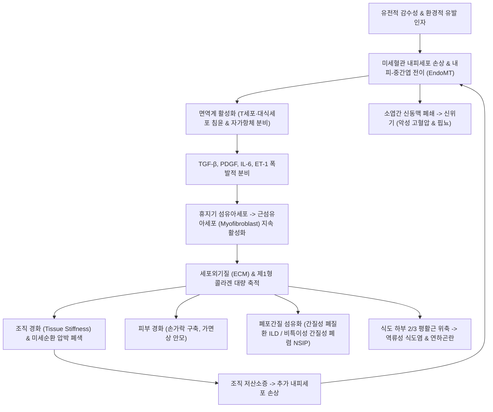

# 🩺 전신 경화증 (Systemic Sclerosis, SSc / Scleroderma)

> **핵심 3줄 요약 (Key Summary)**:
> - 📍 병소 부위 & 해부·병태생리: 광범위한 미세혈관 내피세포 손상(Microvasculopathy), 면역 활성화, 그리고 섬유아세포의 비정상적 과활성화로 인해 피부와 폐, 위장관, 신장 등 전신 내부 장기에 과도한 콜라겐이 침착되는 만성 자가면역 질환.
> - 🚩 전형적 임상 양상: 초기 레이노 현상 및 손가락 부종(Puffy fingers)으로 시작하여 손가락부터 피부가 두꺼워지고 단단해지는 경화(Sclerodactyly), 가면상 얼굴(Mask-like face), 식도 연하곤란, 간질성 폐질환(ILD), 신위기(Scleroderma Renal Crisis).
> - 🛠️ 핵심 검사 & 치료 전략: 조갑주름 모세혈관현미경(NVC), 자가항체(Anti-Scl-70, Anti-Centromere, Anti-RNA polymerase III), 고해상도 흉부 CT(HRCT); 양방 면역억제제(마이코페놀레이트 모페틸, MMF), 항섬유화제(닌테다닙), 신위기 시 즉각 ACE 억제제(캡토프릴); 한의학적으로 피비(皮痺)·맥비(脈痺)·간신음허(肝腎陰虛) 변증 하에 [[도홍사물탕]], [[보양환오탕]], [[당귀사역가오수유생강탕]] 투여 및 합곡·곡지·족삼리·삼음교 자침.
> - ⚠️ 응급 의뢰 레드플래그: 급격한 혈압 상승과 급성 신부전(신경화증 신위기, 스테로이드 고용량 복용 시 호발), 급속 진행성 호흡곤란(중증 ILD 또는 폐동맥고혈압 급성 악화), 급성 장 가성 폐색.

---

## 📌 목차
1. [질환 개요 & 해부학적 병태생리](#1-질환-개요--해부학적-병태생리)
2. [병태생리 메커니즘 & 생체역학적 악순환 네트워크](#2-병태생리-메커니즘--생체역학적-악순환-네트워크)
3. [임상 증상 & 이학적 검사(Physical Exam) 알고리즘](#3-임상-증상--이학적-검사physical-exam-알고리즘)
4. [감별 진단 매트릭스 (Differential Diagnosis)](#4-감별-진단-매트릭스--differential-diagnosis)
5. [한의 통합 치료 프로토콜 (침·약침·추나·한약)](#5-한의-통합-치료-프로토콜-침약침추나한약)
6. [양방 치료 & 병용·의뢰 기준 (Conventional Treatment & Referral)](#6-양방-치료--병용의뢰-기준-conventional-treatment--referral)
7. [재활 운동 & 생활습관 티칭 가이드](#7-재활-운동--생활습관-티칭-가이드)
8. [💡 사용자 진료실 핵심 필기 & 임상 노하우 (Melt-In 잔여 심화 집약)](#8--사용자-진료실-핵심-필기--임상-노하우--melt-in-잔여-심화-집약)
9. [출처 및 학술 참고 문헌 (References)](#9-출처-및-학술-참고-문헌--references)

---

## 1. 질환 개요 & 해부학적 병태생리

* **질환의 정의 및 임상적 아형 분류**:
  * 전신 경화증(Systemic Sclerosis, SSc)은 결합조직의 과도한 섬유화, 미세혈관병증, 자가면역 이상을 3대 축으로 하는 전신 질환이다. 피부뿐만 아니라 식도, 위장관, 폐, 심장, 신장 등 생명 유지 장기를 광범위하게 침범한다.
  * **2대 주요 임상 아형**:
    1. **제한형 전신 경화증 (Limited Cutaneous SSc, lcSSc)**:
       * 피부 경화가 팔꿈치 및 무릎 원위부(손, 전완, 발)와 얼굴·목에만 국한됨.
       * 전형적으로 **CREST 증후군** 동반: 석회증(Calcinosis), 레이노 현상(Raynaud), 식도 운동장애(Esophageal dysmotility), 지경화증(Sclerodactyly), 모세혈관확장증(Telangiectasia).
       * 만성적이고 서서히 진행하나, 후기에 **폐동맥고혈압(PAH)** 발생 위험이 높음.
    2. **미만형 전신 경화증 (Diffuse Cutaneous SSc, dcSSc)**:
       * 피부 경화가 몸통(가슴, 복부)과 팔꿈치/무릎 근위부(상완, 대퇴)까지 침범.
       * 발병 초기부터 급격히 진행하며, **간질성 폐질환(ILD)**과 **신경화증 신위기(SRC)** 등 치명적 장기 합병증이 조기에 빈발함.

* **3대 핵심 병태생리 해부학적 기전**:
  * **미세혈관 손상(Microvasculopathy)**: 내피세포 사멸, 혈관 확장 반응 소실, 내막 비후로 인한 내강 폐쇄.
  * **자가면역 활성화**: T세포(Th2, Th17)와 B세포 활성화로 자가항체 생성 및 전염증성 사이토카인 방출.
  * **조직 섬유화(Tissue Fibrosis)**: 근섬유아세포(Myofibroblast) 분화 촉진 및 제1형/제3형 콜라겐, 피브로넥틴 등 세포외 기질(ECM)의 비가역적 축적.

---

## 2. 병태생리 메커니즘 & 생체역학적 악순환 네트워크

* **TGF-β 신호전달과 근섬유아세포의 영구 활성화**:
  * 정상적인 상처 치유 과정에서는 콜라겐이 생성된 후 근섬유아세포가 사멸하지만, SSc에서는 변형성장인자-베타(TGF-β)와 혈소판유래성장인자(PDGF)의 지속적 자극으로 세포 사멸이 억제된다.
  * 세포외 기질의 탄성이 감소하고 조직이 뻣뻣해지면(Stiffness), 메카노트랜스덕션(Mechanotransduction) 경로를 통해 근섬유아세포가 스스로 더 많은 콜라겐을 분비하는 자가 증폭 악순환이 고착된다.

---

## 3. 임상 증상 & 이학적 검사(Physical Exam) 알고리즘

* **장기별 전형적 임상 증상**:
  1. **피부 증상**:
     * 부종기(Edematous phase): 손가락과 손등이 소시지처럼 붓는 부종성 손가락(Puffy fingers).
     * 경화기(Indurative phase): 피부가 가죽처럼 뻣뻣해지고 광택이 나며 손가락이 굽어지는 지경화증(Sclerodactyly).
     * 위축기(Atrophic phase): 주름이 소실된 무표정한 가면상 안모(Mask-like face), 입을 벌리기 어려운 구순개구 장애(Microstomia), 입술 주변 방사상 주름.
  2. **소화기 증상 (90% 이상 침범)**:
     * 하부 식도 괄약근 압력 저하로 인한 심한 위식도 역류, 가슴쓰림, 연하곤란(고형물 삼킴 장애), 소장 운동 정체로 인한 복부 팽만 및 장 가성 폐색.
  3. **폐 침범 (주요 사망 원인)**:
     * 간질성 폐질환(ILD): 마른기침, 운동성 호흡곤란, 양측 폐 기저부의 벨크로성 수포음(Velcro crackles).
     * 폐동맥고혈압(PAH): 청색증, 실신, 하지 부종.
  4. **신장 침범 (신경화증 신위기, Scleroderma Renal Crisis, SRC)**:
     * 급격히 발생하는 악성 고혈압(수축기 > 180, 이완기 > 110 mmHg), 두통, 핍뇨, 급속 신부전.

* **자가항체 및 특수 검사 알고리즘**:
  * **조갑주름 모세혈관현미경(NVC)**: 거대 모세혈관(Early), 출혈 및 루프 붕괴(Active), 무혈관 구역 및 신생혈관(Late).
  * **자가항체 프로파일**:
    * **Anti-Scl-70 (Topoisomerase I)**: 미만형(dcSSc)과 연관, 심한 ILD 고위험.
    * **Anti-Centromere (ACA)**: 제한형(lcSSc/CREST)과 연관, 후기 PAH 위험.
    * **Anti-RNA polymerase III**: 미만형과 연관, **신위기(SRC) 발생의 최고 위험 인자**.
  * **폐기능 검사(PFT) 및 흉부 고해상도 CT(HRCT)**: FVC 및 DLCO(일산화탄소 확산능) 추적, 간질성 폐렴(NSIP 패턴의 간유리 음영 및 망상형 음영) 조기 진단.

---

## 4. 감별 진단 매트릭스 (Differential Diagnosis)

| 감별 질환 | 피부 침범 부위 | 레이노 현상 동반 | 자가항체 (ANA) | 내부 장기 침범 | 핵심 감별점 |
| :--- | :--- | :--- | :--- | :--- | :--- |
| **전신 경화증 (SSc)** | **손가락(Sclerodactyly) 포함 전신** | **95% 이상 (필수적)** | **Anti-Scl-70, ACA 양성** | **식도, 폐(ILD), 신장 침범** | **수지 침범 필수, NVC 이상, 레이노 선행** |
| **호산구성 근막염** | 전완, 하퇴 (손가락/얼굴 침범 안 함) | 없음 (드묾) | 대개 음성 | 내부 장기 침범 없음 | **손가락 보존**, 오렌지 껍질 징후, 말초 호산구증다증 |
| **경화점액수종 (Scleromyxedema)** | 전신 구진 및 경화 | 없음 | 음성 | 단클론감마글로불린혈증(IgG) | 피부에 밀집된 밀짚색 구진, 파라프로테인 검출 |
| **국소 경피증 (Morphea)** | 피부 국소 반판(Plaque) 또는 선상 | 없음 | 음성 또는 저역가 | 내부 장기 침범 없음 | 전신 증상 없는 국소 피부 질환 |
| **신원성 전신 섬유증 (NSF)** | 사지, 몸통 | 없음 | 음성 | 심근, 폐 섬유화 가능 | 신부전 환자의 **가돌리늄 조영제 노출력** |

---

## 5. 한의 통합 치료 프로토콜 (침·약침·추나·한약)

* **진료 원칙 및 한의 병기**:
  * 한의학에서 전신 경화증은 **피비(皮痺)**, **맥비(脈痺)**, **기비(肌痺)**, **피부갑착(肌膚甲錯)**의 범주이다.
  * 한습사기(寒濕邪氣)와 풍사(風邪)가 기부(肌膚)에 침입하여 영위(營衛)가 불화하고 혈맥이 응체되는 **풍한습비(風寒濕痺)**로 시작하여, 만성화되면서 어혈과 담음이 락맥을 막는 **기체어혈(氣滯瘀血)** 및 간신음허(肝腎陰虛), 비신양허(脾腎陽虛)로 귀결된다.

* **침구 치료 프로토콜**:
  * **사지 말단 혈류 개통 및 관절 구축 예방**:
    * **[[합곡]](LI4)**, **[[곡지]](LI11)**, **[[수삼리]](LI10)**: 상지 경맥을 소통시키고 손가락 굴곡 구축 완화.
    * **[[팔사]](EX-UE9)**, **[[십선]](EX-UE11)**: 손가락 끝 미세순환을 촉진하고 저림증 해소.
    * **[[족삼리]](ST36)**, **[[삼음교]](SP6)**, **[[태충]](LR3)**, **[[혈해]](SP10)**: 비위 건운, 활혈화어(活血化瘀).
    * 안면 구축 시: [[지창]](ST4), [[협차]](ST6), [[하관]](ST7) 자침으로 개구 장애 완화.
  * **구법(뜸)**: 관원(CV4), 비수(BL20), 신수(BL23)에 간접구를 시행하여 양기를 북돋움 (궤양 환부 직접 뜸은 엄금).

* **약침 치료 프로토콜**:
  * 중성어혈 약침 또는 황련해독탕 약침을 견정(GB21), 곡지(LI11), 격수(BL17)에 시술하여 미세혈관 주위 염증을 완화하고 혈류 장애 개선.

* **변증별 한약 처방**:
  * **한응혈어·맥락폐색형 (寒凝血瘀 - 극심한 레이노, 수지 부종·경화, 설암어반, 맥침세삽)**:
    * 처방: **[[당귀사역가오수유생강탕]](當歸四逆加吳茱萸生薑탕)** 합 **[[도홍사물탕]](桃紅四物湯)**.
    * 작용: 한사를 몰아내고 혈관을 확장시키며 미세혈전을 융해.
  * **기허어혈·피부구축형 (氣虛瘀血 - 피부 비후, 피로, 운동 시 호흡곤란, 설담어반, 맥세무력)**:
    * 처방: **[[보양환오탕]](補陽還五湯)** 가 단삼, 계혈등, 강황.
    * 작용: 대용량 황기(30~60g)로 기운을 보하고 전신 락맥의 섬유화 어혈을 강력히 통락.
  * **간신음허·장기섬유화형 (肝腎陰虛 - 피부 위축, 구강 건조, 마른기침, 식도 연하곤란, 설홍소태, 맥세삭)**:
    * 처방: **[[독활기생탕]](獨活寄生湯)** 합 **[[육미지황탕]](六味地黃湯)** 가 맥문동, 사삼.
    * 작용: 간신을 보하고 폐음(肺陰)과 위음(胃陰)을 자양하여 조직 건조와 섬유화 진행을 지연.

---

## 6. 양방 치료 & 병용·의뢰 기준 (Conventional Treatment & Referral)

* **장기 침범별 양방 표준 치료 전략**:
  1. **피부 및 관절 증상**: 메토트렉세이트(MTX) 또는 마이코페놀레이트 모페틸(MMF).
  2. **간질성 폐질환 (SSc-ILD)**:
     * 면역억제제: **마이코페놀레이트 모페틸(MMF, 2~3g/일)** 또는 정맥 시클로포스파미드(CYC).
     * 항섬유화제: **닌테다닙 (Nintedanib, 티로신 키나아제 억제제)** - 강제폐활량(FVC) 감소율을 40~50% 둔화시킴.
     * 난치성 진행 환자: 조혈모세포이식(Autologous HSCT) 고려.
  3. **폐동맥고혈압 (SSc-PAH)**:
     * 엔도텔린 수용체 길항제(보센탄, 마시텐탄) + PDE5 억제제(실데나필) 병용 요법.
  4. **신경화증 신위기 (Scleroderma Renal Crisis, SRC) 응급 치료**:
     * **치료제**: **ACE 억제제(Captopril 6.25~25mg tid 즉시 투여)**가 생명을 구하는 표준 요법.
     * ⚠️ **절대 경고: 고용량 글루코코르티코이드(프레드니솔론 > 15mg/일)는 신위기 발생을 유발하므로 전신경화증에서 고용량 스테로이드 사용은 엄격히 제한됨**.

* **한의 병용 치료 가이드**:
  * 식도 침범으로 인한 만성 연하곤란과 위식도 역류 환자는 양방 PPI 단독으로 호전되지 않는 경우가 많음. 이때 반하후박탕이나 평위산을 병용하면 위장관 평활근 운동을 개선하여 가슴쓰림과 흡인 위험을 줄일 수 있음.
  * 레이노 증후군 및 피부 경화 환자에게 당귀사역탕 계열 한약과 온열 침구 치료를 병용하면 말초 관류압을 유지하여 수지 궤양 발생을 효과적으로 예방할 수 있음.

* **양방·전문과 응급 의뢰 기준 (Referral Criteria)**:
  * 🚨 **즉각적인 류마티스내과/응급실 전원 레드플래그**:
    1. **신위기 의심**: 평소 정상 혈압이던 환자가 갑자기 수축기 혈압 160 mmHg 이상으로 상승하며 두통, 시야 장애, 핍뇨, 혈청 크레아티닌 상승이 나타날 때 (즉각 캡토프릴 투여 및 전원).
    2. **급성 호흡부전**: 계단을 오르지 못할 정도의 급속한 호흡곤란 악화, 청색증, 흉통.
    3. **장폐색 증상**: 극심한 복통, 담즙성 구토, 가스 배출 불능(장 가성 폐색).

---

## 7. 재활 운동 & 생활습관 티칭 가이드

* **안면 및 구강 스트레칭 (개구 장애 방지)**:
  * 피부가 굳어 입이 작아지는 구순개구 장애를 막기 위해 매일 아침저녁 '아-에-이-오-우' 과장되게 발음하기, 뺨 부풀리기, 입 크게 벌리기 운동 지도.

* **손가락 관절 신전 및 스트레칭**:
  * 손가락이 구부러진 채 굳는 굴곡 구축(Flexion contracture)을 방지하기 위해 따뜻한 물에 손을 담그고 손가락을 하나씩 뒤로 젖히는 신전 운동을 매일 20분 이상 시행.

* **식도 역류 방지 생활요법**:
  * 식사는 소량씩 자주 꼭꼭 씹어 먹고, 식사 중 물을 적절히 마셔 음식물 통과를 도움.
  * 식후 최소 2시간 동안 눕지 않으며, 침대 머리를 15~20cm 높여 수면 중 역류 방지.

* **보온 및 피부 보습 관리**:
  * 피부 건조와 가려움이 심하므로 보습제를 전신에 수시로 도포.
  * 전신 보온(내복, 장갑, 양말)을 철저히 유지하여 레이노 발작 차단.

---

## 8. 💡 사용자 진료실 핵심 필기 & 임상 노하우 (Melt-In 잔여 심화 집약)

* **비오님 진료실 핵심 필기 & 원문 집약**:
  1. **"손가락이 붓는다고 다 류마티스 관절염이 아니다"**: "손가락 관절이 붓고 뻣뻣하다고 온 중년 여성이 손가락 마디뿐만 아니라 손가락 전체가 소시지처럼 통통하게 부어있고(Puffy finger), 손가락 끝 피부를 집어 올렸을 때 집히지 않는다면(Pinch sign 음성), 단순 관절염이 아니라 전신경화증의 초기 신호이다. 이때 레이노 현상이 동반되어 있는지 반드시 물어야 한다."
  2. **"스테로이드를 함부로 쓰지 마라 (신위기의 방아쇠)"**: "자가면역 질환이라고 해서 전신경화증 환자에게 고용량 스테로이드(프레드니솔론 15mg 이상)를 처방하면 신동맥 혈관 연축을 촉발하여 사경을 헤매는 신경화증 신위기(Scleroderma Renal Crisis)가 터질 수 있다. 전신경화증 환자의 혈압이 갑자기 160을 넘으면 뇌출혈이나 신부전으로 이어지므로 지체 없이 응급실로 보내 캡토프릴을 써야 한다."
  3. **"보양환오탕(補陽還五湯)과 당귀사역탕의 융합"**: "피부가 가죽처럼 굳고 손발이 차가운 환자에게 황기를 40~60g까지 대용량으로 증량한 보양환오탕에 당귀사역탕을 합방하여 투여하면, 뻣뻣하던 손가락 피부가 눈에 띄게 부드러워지고 관절 가동 범위가 회복된다. 기운을 밀어주어 미세혈관을 열어주는 것이 섬유화를 늦추는 핵심이다."

---

## 9. 출처 및 학술 참고 문헌 (References)

- Iacovantuono M et al. (2026). Hallmarks of aging in systemic sclerosis: implications for pathogenesis, multimorbidity, and therapeutic development. *EULAR Rheumatol Open*. 2(4):100256. PMID: 42926811.

- Wilson CE et al. (2026). Survival and disease reactivation after autologous stem cell transplantation for systemic sclerosis: a single-centre cohort. *EULAR Rheumatol Open*. 2(4):100241. PMID: 42861335.

- Singh RR et al. (2026). Comment on 'effects of locally applied water-filtered infrared a irradiation adjunctive to iloprost and carbon dioxide hand baths in patients with systemic sclerosis and severe Raynaud's phenomenon - a randomized controlled trial'. *Int J Hyperthermia*. 43(1):2697188. PMID: 42411120.\n